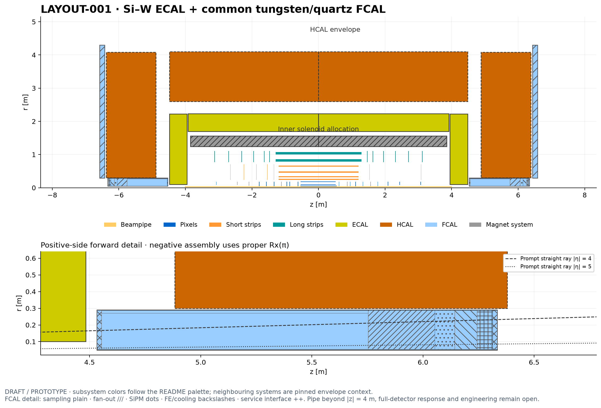

# nODD

nODD develops a more realistic, publicly reproducible evolution of the
OpenDataDetector for DD4hep simulation and ACTS-compatible reconstruction.
See the [project scope](PROJECT.md), [development plan](docs/DEVELOPMENT_PLAN.md)
and [documentation index](docs/README.md).

The [PR interaction ledger](interactions/README.md) records available human
inputs, agent responses, parties, roles, tools and canonical token-account
references in separate files for each PR.
The [GitHub Pages resource ledger](https://asalzburger.github.io/nodd/) provides
token usage and an Interactions tab for browsing PR conversations. See the
[site guide](tools/token_usage/README.md) for builds and coverage boundaries.

## Detector component colors

Use this fixed palette for all new or regenerated detector illustrations and
component-resolved plots in the write-up, documentation and validation reports.
The colors are a project style choice specified by the user on 2026-11-03,
including the HCAL update and permission to use lighter shades for substructure.

| Component | Hex color |
| --- | --- |
| Beampipe | `#ffcc66` |
| Pixels | `#0066cc` |
| Short strips | `#ff9933` |
| Long strips | `#009999` |
| ECAL | `#cccc00` |
| HCAL | `#cc6600` |
| FCAL | `#99ccff` |
| Muons | `#0066ff` |
| Magnet system | `#999999` |

- When a listed component is shown, use its assigned color for its filled area,
  histogram stack, bar, curve or marker, and its legend entry. For example, a
  stacked material-budget histogram must color each subsystem contribution
  according to this table.
- Keep the same assignment across figures, including plots showing only a
  subset of components; do not select colors by plotting order.
- Substructure within a subsystem may use lighter versions of its assigned
  color. Keep the base color for the subsystem as a whole and its main legend
  entry; label any lighter shades used for subcomponents. Hatching, line styles
  or marker shapes may also distinguish details or compared configurations.
- Label components in the figure or legend so the meaning remains clear
  independently of color.

## Current detector layouts

The [DES039 common tungsten/quartz forward calorimeter](docs/design/DES-039-common-forward-calorimeter.md) is shown in both candidates, with an additional EM collar in the LAr alternative. It remains a DRAFT / PROTOTYPE with explicit aperture and service amendments.

**[Open the layout main page](docs/layouts/README.md)** for both current candidates,
its R–Z view and concise links to component decisions and pull requests.

The selected candidate combines the maintained tracker with proposed solenoid
and ECAL components. Open prototypes and remaining systems are identified on the
main page; the combined layout has no engineering sign-off.

The [DES043 short-strip working baseline](docs/design/DES-043-short-strip-service-redesign.md)
extends active endcap coverage through 703 mm (704.9 mm finite corner), narrows the shared service tray and
quantifies conditional cable/material savings. The redesigned modules, cooling and shared services are integrated in the maintained DD4hep working prototype, with [full native and ACTS checks](docs/validation/DES-043/integration/README.md). ASIC/cable and thermal/hydraulic qualification remain open.

## Current pixel baseline

The standard combined build uses the expert-selected
[balanced configuration](detector/config/pixel-detector-balanced.json) from
[PR104](https://github.com/asalzburger/nodd/pull/104). Its barrel radii are
31.5, 57, 96 and 182 mm, with ten mirrored endcap stations including the
new donor-2 disk at |z|=950 mm. Module types and local structures are preserved.
The pixel system contains 5,666 modules and 12,410 sensitive chip areas;
with the integrated DES043 short strips, the full tracker contains 46,682 sensitive planes in 54 signed logical groups.

Use the [build and validation workflow](tools/pixel_detector_dd4hep/README.md).
The previous trimmed and quad-only configurations remain explicit controls.
The [selection record](docs/design/inputs/DES-040-balanced-selection.json)
records expert approval and implementation authorization. The design remains
DRAFT, with service capacity, thermal qualification and coverage limits open.
The [dated October 29 full-tracker TDR review source](docs/publication/tracker-baseline-2026-10-29/README.md)
updates the pixel chapter and remains a frozen repository-owned review edition. The [current TDR publication receipt](docs/publication/short-strip-services-2026-11-03/README.md) records the integrated short-strip update published on Overleaf.

The [TDR outline](docs/publication/TDR-outline.md) and
[publication plan](docs/publication/publication-plan.md) organize chapters,
evidence and review inputs as the detector design develops.

The [ODD IdRes comparison](docs/validation/ODD-idres/README.md) provides
reproducible SVGs and complete JSON/CSV data for original ODD and the extended
tracker prototype before/after pixel aperture adaptation: hits, local layer
material and pitch/√12 momentum-resolution estimates versus eta.

The [full tracker reconstruction prototype](docs/validation/tracker-reconstruction/results.md)
uses Fatras, frozen Gaussian digitization, native ACTS GBTS and CKF on this
baseline, with paired tuning and independent single-muon validation at
pT 1, 5, 10 and 100 GeV in constant 3 T. These dated performance campaigns use the preceding physical geometry; they do not validate the DES043 redesign.
The [species and transport comparison](docs/validation/tracker-reconstruction-species/results.md)
adds Fatras electrons and Geant4 muons, electrons and charged pions with the same
frozen GBTS and Gaussian response. It retains full pull distributions and the
observed electron momentum and pion charge limitations.
The [current reconstruction setup is approved as the tracker baseline](docs/validation/tracker-reconstruction-approval.md)
in PR107, with its recorded performance limitations retained.

The [strixel-pitch sensitivity study](docs/validation/DES-042/results.md)
compares 0.5/1/1.5/2 mm segmentation with paired native truth-associated
tracking and separate conditional power/cable-space estimates. Its
[repeatable workflow](software/analysis/strixel_pitch_study/README.md) keeps
the four historical comparison configurations reproducible.
The [human-selected 75 µm × 2 mm strixel baseline](docs/validation/DES-042/baseline-selection.md)
is integrated into the combined tracker in [PR109](https://github.com/asalzburger/nodd/pull/109).
That selection had 380,436,480 strixel channels on the preceding physical layout. The expanded DES043 layout has 393,707,520 channels (12,816 modules × 30,720). Its [combined native/module/service evidence](docs/validation/DES-043/integration/README.md) and [current layouts](docs/layouts/README.md) are distinct from the earlier reconstruction campaigns. Calibrated response and hardware/service qualification remain open; PR107 retains its dated 0.5 mm response.

## Agent roles

Use these short address names when referring to the project's eight agent roles.
The [development plan](docs/DEVELOPMENT_PLAN.md#6-stage-b-agent-organization-and-responsibility-boundaries)
defines their full mandates and responsibility boundaries.

| Address name | Role | Responsibilities |
| --- | --- | --- |
| `ProRes` | Project responsible | Objectives, scientific use cases, requirements, priorities, decision/risk register and escalation to humans. |
| `SysArch` | System Architect | Global layout, envelopes, interfaces, magnets and fields, shared supports and services, and aggregate budgets. |
| `TrackTech` | Tracker technician | Pixel/strip technology, local electronics, supports, cooling and service routes; provisionally dedicated timing hardware. |
| `CaloTech` | Calorimeter technician | Electromagnetic and hadronic calorimetry, local electronics, supports, cooling, gaps and response assumptions. |
| `MuonTech` | Muon technician | Chamber technology, stations, local services and readout, backgrounds, and field/absorber requirements. |
| `SoftEng` | Project software engineer | Specification and code generation, DD4hep/Geant4, digitization and reconstruction, identifiers, environments, CI and reproducibility. |
| `PhysVal` | Physics and Performance Validation | Independent physics benchmarks, observables, response review, uncertainties, ODD/nODD comparisons and scientific interpretation. |
| `PubDoc` | Publication/documentation office | TDR structure, source catalogue, terminology, claim/version traceability, figures and tables, and TDR revision consistency. |

These are responsibility roles, not a requirement for eight simultaneous agent
processes. Only identified humans may grant design sign-off or acceptance.

The [agent workflow](docs/AGENT_WORKFLOW.md) connects these mandates to reusable
Codex profiles and skills, bounded assignments and revision-specific handoffs.
Start Codex in the nODD checkout (or its worktree) to discover project guidance.
The workflow supports explicit role instructions when native profile selection
is unavailable; its [pilot record](logs/codex/SESSION-2026-10-12-agent-workflow.md)
states which behavior was actually exercised.

## Human review 

Guidelines for human review can be found in [REVIEW.md](REVIEW.md) 

## Final sign-off

The final human sign-off authority is **`asalzburger-review`**, assigned by the
user on 2026-09-18, wherever the project workflow requires it, including formal
M0 closure. See [ADR-002](docs/decisions/ADR-002-review-and-signoff-policy.md)
for the assignment and remaining review-policy questions. Each approval requires
an explicit human decision for an exact reviewed revision.

## Node-specific software

The [ACTS Spack skill](skills/acts-spack/SKILL.md) checks the
[verified node registry](skills/acts-spack/references/nodes.json) before using
preinstalled DD4hep/Geant4. It warns about unavailable nodes or capabilities;
runtime availability and full source availability are recorded separately.

For local ACTS development, use the authorized `acts-nodd` sister checkout and
the [recorded build, test and Python runtime workflow](AGENTS.md#local-acts-sister-checkout).

The [finite-module study workflow](tools/module_layout/README.md) regenerates
isolated cobe/pint prototypes from versioned sensor and layer inputs, compares
straight/curved-track coverage and silicon area, and audits intersections with
ACTS. See [DES-009](docs/design/DES-009-module-populated-layouts.md) and the
[coverage/support report](docs/validation/DES-009-module-populated-layouts.md).
