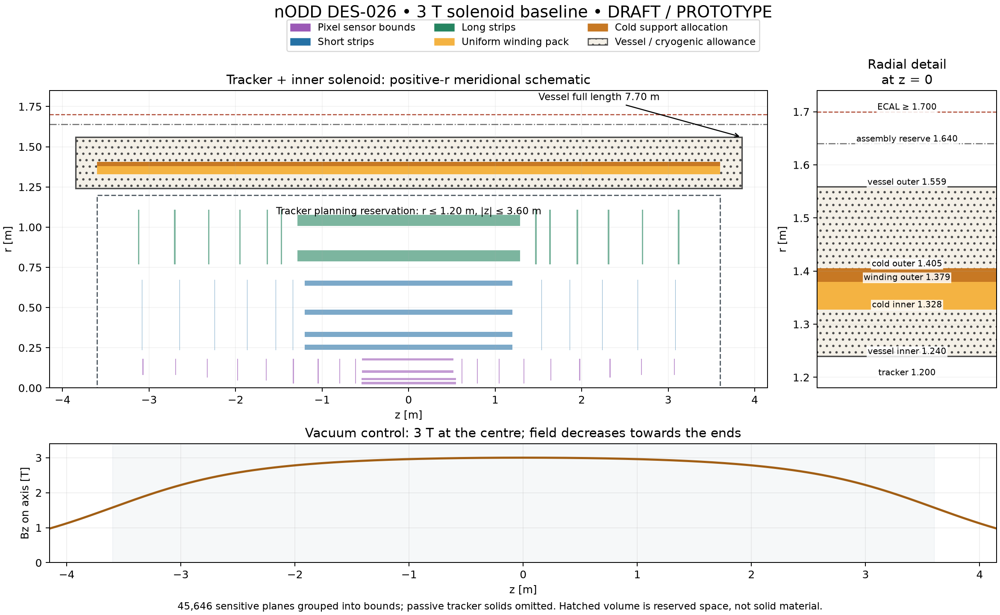
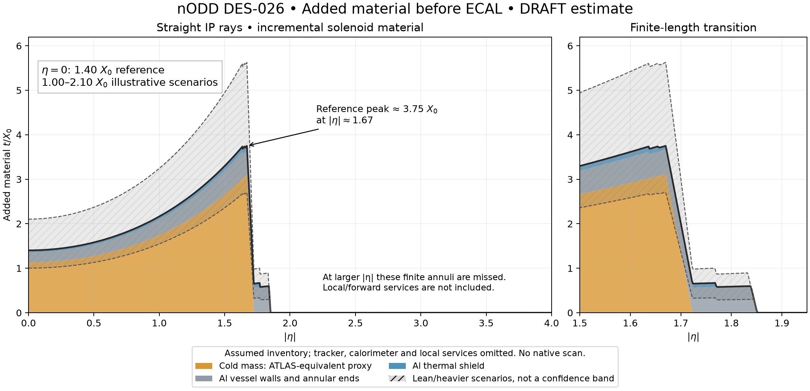

# DES-026 — Baseline 3 T solenoid around the tracker

- Status: DRAFT
- Date: 2026-10-12
- Scope: baseline proposal and isolated PROTOTYPE sizing; no production integration.
- Human request: an ATLAS-style inner solenoid, central 3 T, sufficient space,
  and a tracker + solenoid R–Z view. The user confirmed PR #6 as the reference.
- Human design approval: pending; no engineering sign-off recorded.

The proposed baseline places one superconducting solenoid outside the current
tracker and inside the electromagnetic calorimeter. Its vacuum control has
**Bz(0,0) = 3 T**, a **7.20 m winding/cold length**, and a **7.70 m vessel
length**. The computed vessel outer radius is **1.559 m**; retain the larger
**1.640 m assembly reservation** for unresolved engineering. This is a space
and field-source proposal. It does not yet specify buildable conductor, vessel
walls, a complete material inventory or an installed field map.

The [vector figure](figures/DES-026-tracker-solenoid-rz.svg) shows the same data.
Sensor bounds come from the DES-025 export, not the historical ODD tracker.
Purple/blue/green groups represent 45,646 sensitive planes; passive tracker
solids are omitted. The dashed tracker outline carries a planning reservation.
The hatched vessel area represents allocated space, not a solid material slab.
The axis-field panel makes the finite-length falloff explicit.

## Relation to earlier work and ATLAS

**NODD DESIGN CHOICE:** use the ATLAS topology (tracker → solenoid → ECAL).
An outer CMS-like coil and an additional active-return solenoid are outside this
baseline. The second active-return solenoid was withdrawn in PR #6.

**FACT — SRC-ATLAS-SOLENOID-2007**, abstract/Table I, PDF1: ATLAS demonstrated
an aluminium-stabilized NbTi solenoid with 2 T central field and a cryostat
shared with its liquid-argon calorimeter. The abstract and §§I–II identify the
indirect cooling, cold supports and service chimney. These provide credible
hardware categories, not dimensions or current margins for a 3 T nODD coil.

**NODD DESIGN CHOICE:** retain a standalone vessel allocation provisionally.
ODD's Si–W ECAL does not inherit ATLAS liquid-argon cryogenics. A shared
calorimeter/magnet vessel would require a separate technology and interface
choice; copying the ATLAS cryostat would be unjustified.

PR #6 is an open, broader magnetic-layout study. This PR reuses only its
uniform finite-winding energy kernel at
`d2437a7d84dbd02eed098c2a6341c5447cc42701`; it does not merge the alternative
muon, iron or toroid layouts. The catalogue records kernel provenance and
links the [September 22 comment](https://github.com/asalzburger/nodd/pull/6#issuecomment-5774198540)
and [September 24 sizing comment](https://github.com/asalzburger/nodd/pull/6#issuecomment-5809476152).
The latter's currently edited outer-gap formula explicitly uses `RCMi`; the
older PR response's ambiguity is therefore not carried into this proposal.

## Inputs and their status

All lengths below are full lengths unless explicitly marked radius or per-end.
Rules stated by the reviewer are facts about requested sizing policy, not proof
of mechanical or superconducting adequacy. Approval of new choices is pending.

| Input | Value | Classification and rationale |
| --- | ---: | --- |
| Central vacuum field | 3.000 T | NODD DESIGN CHOICE — explicit user target |
| Central-field ceiling | 5 T; preferred range 1–4 T | FACT — PR6 September 24 comment |
| Current tracker truth region | r ≤ 1.200 m, \|z\| ≤ 3.600 m | FACT — `detector/config/tracker.json`; DES025. A software enclosure, not surveyed mechanical clearance |
| Temporary tracker planning reservation | same r and z limits | NODD DESIGN CHOICE — carry a conservative interface before a complete passive-service bound audit; extra services can invalidate it |
| Vessel inner radius RVi | 1.240 m | NODD DESIGN CHOICE — retain DES003/PR6's 1.240 m entrance; 40 mm remains outside the present 1.200 m planning reservation |
| Cold inner radius RCMi | `1.065 RVi + 0.0072 m` | FACT — PR6 September 24 rule |
| Vacuum energy / cold volume | 30 MJ/m³ | FACT — same comment; empirical sizing rule, not a physical identity |
| Vessel outer radius RVo | `RCMo + 1.75 (RCMi − RVi)` | FACT — same edited comment |
| Winding / cold radial width | 2/3 | NODD DESIGN CHOICE — retain PR6 provisional closure; conductor and support still unqualified |
| Winding and cold full length | 7.200 m each | NODD DESIGN CHOICE — extend historical 6.600 m winding to bracket the present ±3.600 m planning reservation |
| Axial cold-to-vessel allowance | 0.250 m at each end | NODD DESIGN CHOICE — retain PR6 planning allowance, not an engineered end package |
| Assembly outer reservation | 1.640 m | NODD DESIGN CHOICE — retain DES003 conservative magnet-space allocation |
| External radial / axial interface | 0.060 / 0.100 m | NODD DESIGN CHOICE — retain DES003 planning separations; capacity remains to be demonstrated |

Sources: [catalogue](../../reference/manifest.yaml),
[DES003 solenoid space budget](inputs/DES-003-solenoid-space-budget.md),
[DES025](DES-025-tracker-dd4hep-gen3.md).
Inputs are centralized in [baseline.json](../../tools/solenoid_baseline/baseline.json).
The historic 6.6 m control is recalculated separately, without promoting it to
a current tracker-compatible baseline.

## Calculation and resulting radial/axial allocation

**INFERENCE — vacuum finite-pack model:** an azimuthal current density J is
constant throughout an annular winding `a ≤ r ≤ b`, `|z| ≤ L/2`. Normalize J
analytically to the central field. Evaluate vacuum stored energy through the
all-space Neumann current/vector-potential integral, analytically integrating
axial separation; do not truncate an external field map or substitute a uniform
bore. The equivalent field-energy definition is `U = ∫ B²/(2 μ0) dV`.

Iterate RCMo, with `b = RCMi + (2/3)(RCMo − RCMi)`, until
`U = 30 MJ/m³ × π(RCMo² − RCMi²)L`. This conditional closure assumes cold mass
and winding have the same length. It excludes nonlinear steel and every other
magnet; the complete installed system needs new energy and field calculations.

| Derived quantity | Baseline result | Interpretation |
| --- | ---: | --- |
| Cold inner radius | 1.327800 m | Inner cryogenic allocation is 87.800 mm |
| Winding outer radius | 1.379271 m | Homogeneous pack width 51.471 mm |
| Cold outer radius | 1.405006 m | Total cold width 77.206 mm; remaining radial allocation 25.735 mm |
| Vessel outer radius | 1.558656 m | Outer cryogenic/vessel allocation 153.650 mm |
| Vessel full length | 7.700 m | Cold/winding 7.200 m plus two 0.250 m allowances |
| Unassigned radial assembly margin | 81.344 mm | From vessel outer radius to 1.640 m reservation |
| Vacuum stored energy | 143.174 MJ | Includes exterior/fringe energy |
| Annular cold volume | 4.772459 m³ | Geometrical allocation, not a solid-metal volume or measured mass |
| Pack-average current density | 49.552 A/mm² | Insulated winding-pack average; not strand current density |
| Total ampere-turns | 18.364 MA-turn | Current/turn count individually unselected |

All table results are **INFERENCE**, conditional on the preceding choices.
Do not assign a uniform aluminium density to the cold annulus or solid steel
to the vessel envelope. A mixed inventory must distinguish conductor,
stabilizer, insulation, reinforcement, coolant, vacuum and warm structure.
At 3 T, the diagnostic pressure scale `B²/(2 μ0)` is 3.58 MPa; this is not a
stress, an allowable load or proof of support thickness.

The lower panel shows **3.000 T at z=0**, **2.219 T at z=3.0 m** and
**1.575 T at z=3.6 m** on axis in vacuum. Central field alone does not promise
uniform tracking bending power. Peak conductor field, end forces, winding
stress, conductor critical surface, operating temperature and quench margin
require dedicated review. No field is installed in DD4hep or ACTS by this PR.

## Space for hardware, installation and services

**NODD DESIGN CHOICE — required inventory for the next design:** retain the
following ownership and fit requirements. Their numerical subdivision and
material definitions remain unassigned; the radius formulas do not supply them.

| Hardware | Allocated region or interface | Required follow-up |
| --- | --- | --- |
| NbTi winding, stabilizer and turn insulation | 1.327800–1.379271 m; full length 7.200 m | Select conductor, fill fraction, joint/current/turn inventory and winding ends; verify J and peak-field margin |
| Cold mandrel/reinforcement and indirect cooling | Remaining cold envelope to 1.405006 m | Load path, alloy/layup, cooling attachment, helium circuits and thermal contraction; radial split may need amendment |
| Vacuum vessel, radiation shield, multilayer insulation and gaps | Between RVi and RCMi, and between RCMo and RVo | Place separate solids and voids; prove vessel stability and shield/support fit; no wall thickness assumed |
| Cold-mass supports and end closures | Two 0.250 m axial allowances plus local radial interfaces | Warm-to-cold supports, alignment, contraction travel, assembly access and end loads |
| Leads, busbars, cryogenic pipes and instrumentation | Local chimney/penetration routes, not a full cylindrical layer | Choose azimuth and axial exit; reserve shared ECAL/tracker corridors and remote dewars explicitly |
| Power converter, detection, dump/protection and interlocks | External system, named penetrations into detector | Current rating, extraction time, voltage/insulation, hot spot, protection and commissioning assumptions |
| Warm installation/mounting and unresolved fit | 81.344 mm radial assembly margin | Separate mounts, survey/access and adjacent supports; retain margin until inventoried |

The 40 mm tracker interface and 81 mm external margin are not demonstrated
cable capacities. The dashed tracker reservation derives from the truth region;
69 repository source/input hashes match the retained DES025 export used for
sensor bounds. Full passive solids, supports, pipe supports and remote services
still require an explicit native boundary/interface audit. The beam pipe
continues beyond the tracker; route solenoid ends and services around it.

## Calorimeter and global-envelope consequences

**INFERENCE:** the inherited ODD ECAL barrel starts at r=1.250 m and intersects
the proposed magnet. DES003 already requires a new ECAL inner face at
**r ≥ 1.700 m** (1.640 m assembly plus 0.060 m interface). Keep that larger
reservation even though the conditional vessel is narrower.

**NODD DESIGN CHOICE — proposed axial amendment:** a full endcap overlapping
the magnet's annular radii starts at **|z| ≥ 3.950 m** (3.850 m vessel end plus
0.100 m interface). The previous DES003 3.650 m front is insufficient by
0.300 m for this longer coil. A shaped recess is an alternative requiring an
explicit r–z boundary and service route; it is not assumed here.

Preserve ECAL/HCAL sampling depths when moving entrances. Rebalance ECAL outer
radius, HCAL barrel/endcap positions, timing, forward transitions and muon
interfaces together. Neither an old envelope drawing nor the ODD compact can
be combined unchanged with this baseline. These are proposed interface
amendments; this PR does not edit DES003's retained study or production geometry.

## Added material estimate requested on PR64

The [incremental material estimate](../validation/DES-026/material-estimate.md)
gives an illustrative **1.40X₀ at eta=0**, rising to **3.75X₀ near |eta|=1.67**.
Its explicit lean/heavier scenarios give **1.00–2.10X₀ centrally**. The cold
assembly uses an ATLAS-calibrated material-per-length proxy; warm vessel walls,
thermal shells and annular ends use assumed Al thicknesses. The range is a
scenario spread, not an engineered uncertainty bound. The existing tracker,
calorimeter and local supports/services are outside this incremental estimate.

No complete conductor or cryostat bill of materials is implied. The finite-end
ray calculation and its six additional controls are isolated prototypes; the
assumptions are explicit in [material-assumptions.json](../../tools/solenoid_baseline/material-assumptions.json).

## Evidence, reproduction and decision gate

[Results](../validation/DES-026/results.md) and
[sizing.json](../validation/DES-026/sizing.json) record runtime versions,
input/code hashes, the baseline and historical control. Quadrature refinement
from 48×192 to 96×384 changes energy by **3.03×10⁻⁶ relative**, below the
prototype's 5×10⁻⁴ control tolerance. The 30 MJ/m³ root residual is below 10⁻⁸.
These tolerances are numerical controls, not engineering accuracy requirements.

Six controls cover axis normalization/reversal, B² and geometrical scaling,
independent axial quadrature, the infinite-solenoid field-energy limit,
energy-volume closure/refinement, invalid input and reservation rejection.
The plotted [tracker snapshot](../validation/DES-026/tracker-rz.json) retains
its source digest, extraction hash and matched inputs. See the
[tool instructions](../../tools/solenoid_baseline/README.md).

Before production implementation, human review must resolve the winding/support
closure, operating conductor, cooling, protection, warm/cold structure and
service ownership; confirm passive tracker clearances; approve the calorimeter
interface amendment; and specify complete installed field/energy checks with
calorimeter and return steel. Only then generate magnet solids/materials and
field maps, run native overlap/material/transport checks, and connect the same
field to tracking. The 3 T baseline remains DRAFT throughout this PR.
