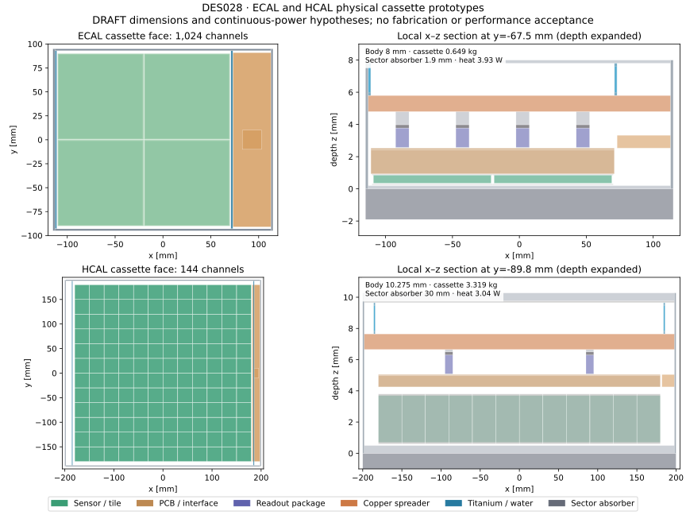

# DES-028 — Physical Si–W ECAL and steel/scintillator HCAL cassettes

- Status: **DRAFT**
- Type: **PROTOTYPE**
- Date: 2026-10-12
- Programme: [DES-027](DES-027-calorimeter-description-assessment.md), PR #66
- Human instruction: retain Si–W ECAL and steel/scintillator HCAL; design representative hardware before sectors and full assemblies.
- Approval: technology preference confirmed by Andreas Salzburger; dimensions, operating conditions and engineering qualification remain unsigned.

## Purpose and boundaries

Develop two reusable warm cassettes with physical sensors, readout packages, containment, heat paths and coolant. Retain ODD's absorber technologies and sampling thicknesses. The isolated factory is absent from production CMake and compact entry points. This document specifies a simulation prototype, not a fabrication drawing or a performance claim. Sector absorber plates have a separate owner; the unit test includes one representative plate patch.

## Public hardware precedents

| ID | Classification | Evidence and limits |
| --- | --- | --- |
| F01 | FACT | SRC-CALICE-SIW-2022, arXiv:2211.07457 PDF4–6, §§3/3.1: 180 mm ASU, four 90 mm sensors; 5.5 mm pads; 500 µm sensor option; 64-channel SKIROC2a, 7.5 × 8.7 mm die and 1.5 mW/channel continuous consumption. PCB and packaged/COB variants differ. |
| F02 | FACT | SRC-CALICE-AHCAL-2022, arXiv:2209.15327v1 PDF5–8: 360 mm HBU, 144 tiles, 30 mm tile pitch, 3 mm polystyrene, direct SiPM coupling, four 36-channel SPIROC2E ASICs. PDF7: 125 µm polyimide isolation. PDF12: 6.4 mm cassette with two 0.5 mm steel covers, separate absorber. |
| F03 | FACT | Same AHCAL source PDF8–9/13: pulsed operation and interface-board cooling; those low average powers do not establish continuous operation without cooling. |
| F04 | FACT | SRC-ODD-UPSTREAM pinned c167363: ECAL48 × 1.9 mm W alloy, HCAL36 × 30 mm Steel235, 3 mm scintillator. Recipes from compact material XML retained as explicit comparison proxies. |
| F05 | FACT | SRC-PDG-PET-2026, density/composition table: PET density 1.400 g/cm³, C10H8O4. Reflectivity and optical properties are not supplied by this bulk-material record. |

## nODD choices to review

All new cassette dimensions in `tools/calorimeter_hardware/cassettes.json`, including layer positions, clearances, frame/skin/PCB/thermal-pad/pipe/package dimensions and service-board allocations, are **NODD DESIGN CHOICE**. They enlarge the published active-layer precedents to accommodate continuous-operation cooling and an explicitly reserved interface board. Approval is pending. Alternatives are thinner power-pulsed cassettes or different cooling/readout packaging; neither is justified by the current detector operating contract.

The warm fixture uses 20 °C, water, a 5 K coolant rise, 12 V LV and 90% conversion efficiency (**NODD DESIGN CHOICE**). ECAL bias150 V/leakage5 nA/channel; HCAL bias55 V/dark2 µA/channel; 2 W interface allowance/cassette and HCAL continuous5 mW/channel are budgeting hypotheses, not supplier specifications. No power pulsing is assumed. Water heat capacity4180 J/(kg K) is a rounded engineering assumption. Thermal resistance, pressure drop, leak containment, condensation control, irradiation, exact electronics, grounding and optical response remain unqualified.

Material densities/recipes inherited from the tracker prototype and ODD are reusable simulation proxies (**NODD DESIGN CHOICE** to reuse). StainlessProxy is explicitly Fe70/Cr18/Ni10/Mn2 mass%, density7.9 g/cm³; not certified steel. G10 and Epoxy are effective recipes. ODD Polystyrene's C19H21 and 1.032 g/cm³ are retained for traceable comparison, not asserted as pure-polystyrene stoichiometry. Package mixes preserve constituent volumes, hence masses, of silicon/copper/epoxy; internal transistor and bond-wire layouts are omitted. New package constituent fractions and die thickness0.3 mm are **NODD DESIGN CHOICE**. No cryostat is required by these warm active technologies; the solenoid cryostat belongs to DES026.

## Geometry, services and ownership

Local x/y span the cassette, +z runs from absorber toward electronics and back cover. Four ECAL sensors have separate active silicon and passive guard silicon. Each HCAL tile has a reflector shell and a cylindrical effective SiPM recess. ASIC packages connect through graphite pads and aluminium posts to a copper spreader. Titanium supply/return tubes with water touch the spreader. This is an explicit conductive-contact hypothesis; geometry contact is not a thermal calculation. Boards include copper as separate equivalent sheets; their chosen thicknesses replace the unexplained ODD HCAL PCB bulk rather than reproduce it.

The absorber is **sector owned**. Only the unit fixture includes its rectangular patch. Repeated assemblies must omit that patch and add continuous sector plates exactly once. Stable identifiers use zero-based system/side/sector/layer/cassette/sensor plus signed x/y cells; ECAL has 16 × 16 cells/sensor, HCAL one readout cell/tile. Positions are physical; material checks do not substitute for readout/performance validation.

## Reproducible checks and follow-up

The unit exporter, analytic constituent ledger, independent DD4hep/ROOT audit and bounded directional rays must agree on counts, capacities, masses and IDs. ROOT overlaps use 10 nm tolerance. Check every ECAL cell and HCAL tile, guard/recess containment and negative controls for invalid dimensions, mixtures and duplicated ownership. Record actual runtime/source hashes; CI runs dependency-free controls, not native runtime checks.

Next PRs: parameterized sector plates/frames and cassette packing; then complete barrel and both endcaps with deterministic transforms, aggregate services, mass conservation and material rays. Envelope calculations must use the revised cassette pitches rather than squeeze them into the old ODD envelope. DES026/PR64 solenoid interfaces are a conditional planning input until merged/reviewed. Detector-wide fit, complete service trunks, stress/thermal/electrical qualification, transport response and particle-flow performance remain later acceptance work.

## Prototype dimensions and measured budgets

| Quantity | ECAL | HCAL |
| --- | --- | --- |
| Cassette outer x × y | 230 × 190 mm | 400 × 380 mm |
| Body depth (without sector absorber) | 8.0 mm | 10.275 mm |
| Unit fixture absorber | 1.9 mm W alloy | 30 mm Steel235 |
| Active elements / channels | 4 / 1024 | 144 / 144 |
| Cassette mass, including water | 0.649163 kg | 3.318896 kg |
| Fixture mass including absorber patch | 2.127097 kg | 39.114896 kg |
| Continuous heat hypothesis | 3.929657 W | 3.038062 W |
| Required ideal coolant flow, ΔT=5 K | 0.1880 g/s | 0.1454 g/s |

Mass and heat values are **INFERENCE** from the explicit inventory/operating
hypotheses. They are not weighed hardware or measured temperatures. A future
installation gap of1 mm would give 10.9/41.275 mm layer pitches, respectively
(**INFERENCE**, pending assembly design). Compared with ODD, this changes the
48-layer ECAL sampling stack from242.4 to523.2 mm and36-layer HCAL from1836 to
1485.9 mm. The latter removes the unjustified16 mm PCB proxy; absorber and
scintillator thicknesses are retained. Supports/service trunks add further space.

The figure is generated from the inventory. HCAL section displays the active
body and the top1 mm of its30 mm absorber. [Executed checks](../validation/DES-028/results.md)
and [budgets](../validation/DES-028/budgets.json) distinguish proven geometry
from engineering assumptions.
