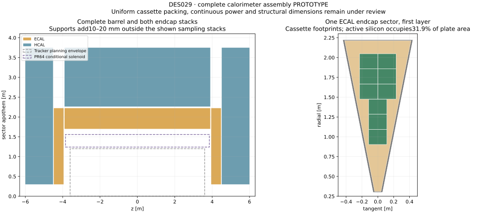
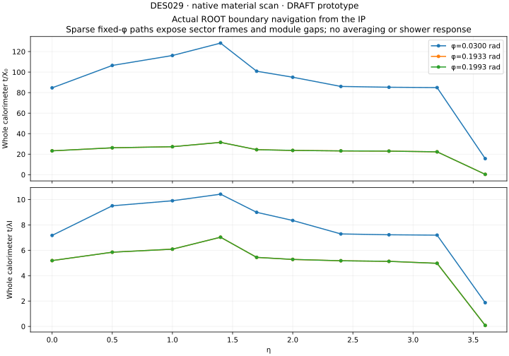

# DES-029 — Calorimeter sectors and complete prototype assemblies

- Status: **DRAFT**
- Type: **PROTOTYPE**
- Date: 2026-10-12
- Depends on: [DES028](DES-028-calorimeter-cassettes.md), PR67
- Human instruction: build sectors and complete barrel/endcap assemblies with reproducible geometry, mass and material checks.
- Engineering approval: pending; no production integration.

## Scope

Repeat the checked warm cassettes in sixteen sectors, retain48ECAL/36HCAL
sampling layers, give continuous absorber plates and structural frames separate
ownership, and build each barrel plus both endcaps. Geometry generation uses
one apothem convention and right-handed rotations. This is a complete *assembly
prototype*, not a qualified detector layout. Uniform rectangular cassettes leave
large sector-edge and aperture gaps; their areas are reported, not hidden.

## Parameter provenance

ODD sampling counts, absorber technology/thickness and retained material recipes
are **FACT**, SRC-ODD-UPSTREAM at c167363, as audited in DES027. Cassette choices
are those of DES028. All new dimensions in `assemblies.json` are **NODD DESIGN
CHOICE**:16sectors, 1 mm cassette/installation gaps, 20 mm edge rails/flanges,
10 mm back covers and endcap aperture/rim frames, 40 mm edge allocation,
20 mm barrel end allocation, 300 mm endcap aperture apothem. They reserve
support/service routes and make first packing reproducible; alternatives are
shaped/short cassettes, different sector count and structural engineering sizing.
Approving humans for these values: none recorded.

ECAL front apothem1700 mm and endcap front|z|3950 mm are conditional planning
inputs from DES026 / open PR64 at4e44d7c650ac0a2931f7fc1637b5b3f2dfbe4c95,
using the user-requested3 T solenoid concept and PR6 discussion. They are
**NODD DESIGN CHOICE**, not a merged detector envelope. Barrel half-length3900 mm
leaves50 mm to the endcap; outside supports use part of that allowance. ECAL/
HCAL interface gap30 mm is a further **NODD DESIGN CHOICE**. Outer radii and
HCAL front planes are **INFERENCE** from cassette stack depth plus supports.
This explicitly supersedes old ODD envelopes for the isolated fixture only.

## Physical construction and identifiers

An absorber layer is a sector trapezoidal prism. Its plate stops before the
continuous edge rails, with endcap inner/outer frame strips also excluded.
Rectangular cassettes fit inside the narrower face of the sector and respect
reserved edge/end zones. Each cassette omits the unit fixture's absorber patch.
Separate aluminium edge frames, barrel end flanges, endcap aperture/rim frames
and a back cover form a first structural inventory. Joint fasteners, allowable
stress, buckling, deflection, handling/lifting and seismic supports are not
qualified. Tungsten mounting requires expert review; rails alone are not proof
that the large assembly is buildable.

Barrel cassette local x is tangent, y axial, z radially outward. Endcap local x
is tangent, y radial, z outward from the IP. The negative endcap uses a proper
180° rotation about x, not a reflection. Side0 denotes barrel,1 positive and2
negative endcap; sectors/layers/cassettes/sensors are zero-based. Each side-sector
replica owns parent identifiers, layer/cassette placements own the next fields,
and shared sensor volumes carry only sensor indices. Identifier bounds and
native inherited paths must be checked, not derived from volume names alone.

## Services and limitations

Cassette tube ends require rail ports to meet a face interface. DES028's fixture
is amended with rectangular2×2 mm ports and tubes flush with cassette end faces
(**NODD DESIGN CHOICE**); real connectors/seals/bend radii remain unqualified.
Cooling demand and LV/bias heat scale from the continuous cassette budgets.
Reserved edge/end strips are space allocations for collection routes, not
fabricated manifolds, cables, optical links or a voltage-drop calculation. Full
external services/cryostat interfaces remain a later PR and are excluded from
mass totals explicitly. This preserves the staged hardware programme in DES027.

## Required checks

Deterministic packing, independent corner/wedge/depth containment, no absorber
duplication, zero-based ID bounds, proper transforms and endcap symmetry,
component/constituent mass conservation, sector/full replication agreement,
active and occupied area fractions, aggregate heat/coolant and ROOT material
rays versus eta/phi. Native checks must distinguish unit-template audits from
full placement audits. CI uses standard-library controls; native DD4hep/ROOT
execution is separately recorded. Engineering and calorimeter performance are
not acceptance criteria of this prototype.

## Executed prototype budgets and layout limits

All values below are **INFERENCE** from the current explicit geometry and
continuous service hypotheses; full native geometry/mass checks passed.

| Region | Cassettes | Mass | Continuous heat | Active plate-area fraction |
| --- | ---: | ---: | ---: | ---: |
| ECAL barrel | 77,440 | 210.248 t | 304.31 kW | 43.5–64.9% by layer |
| Both ECAL endcaps | 13,824 | 59.166 t | 54.32 kW | 31.9% |
| HCAL barrel | 27,200 | 1,336.956 t | 82.64 kW | 52.9–78.3% by layer |
| Both HCAL endcaps | 9,216 | 762.860 t | 28.00 kW | 38.8% |

Total127,680 cassettes,98,698,240 channels and approximately2369.23 t;
469.27 kW ideal heat and22.45 kg/s water at5 K rise. Totals include plates,
frames/covers, local cassette cooling and readout; exclude external services,
connectors/fasteners and additional handling/installation structures. They are
not a fabrication bill of materials. Package/PCB and power hypotheses can
materially change these values; no uncertainty distribution is established.

ECAL barrel sampling apothems1.700–2.2232 m; HCAL2.2632–3.7491 m; the outer
HCAL back-cover corner reaches3.83275 m. ECAL endcap starts|z|3.950 m;
HCAL starts4.5132 m and its back cover reaches6.0091 m. These envelope changes
require detector-wide review, including muon and forward-system interfaces.

**This rectangular packing is not suitable for detector acceptance.** It
exposes sizeable passive edges, aperture gaps and an axial cassette-row gap.
Sparse native paths at|eta|≥2.4 cross no active elements for the sampled phi
values while passing absorber. This is geometric loss, not a shower-resolution
result. Smaller/short/shaped cassettes and aperture layouts are the next design
work; the preserved uniform prototype provides the reproducible comparison.
The large continuous heat budget also demands an operating/readout decision and
explicit service architecture before claiming a realistic complete detector.

The material graph covers only the calorimeter prototype and its local support;
tracker/solenoid envelopes in the RZ figure are planning context. No transport
through those components or combined detector clearance check is implied.
[Executed evidence](../validation/DES-029/results.md) retains full overlap,
component/constituent inventories, native identifiers and bounded material rays.
