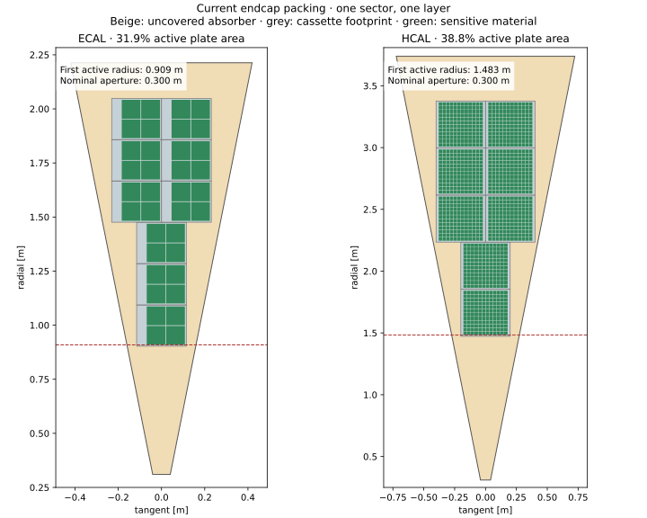
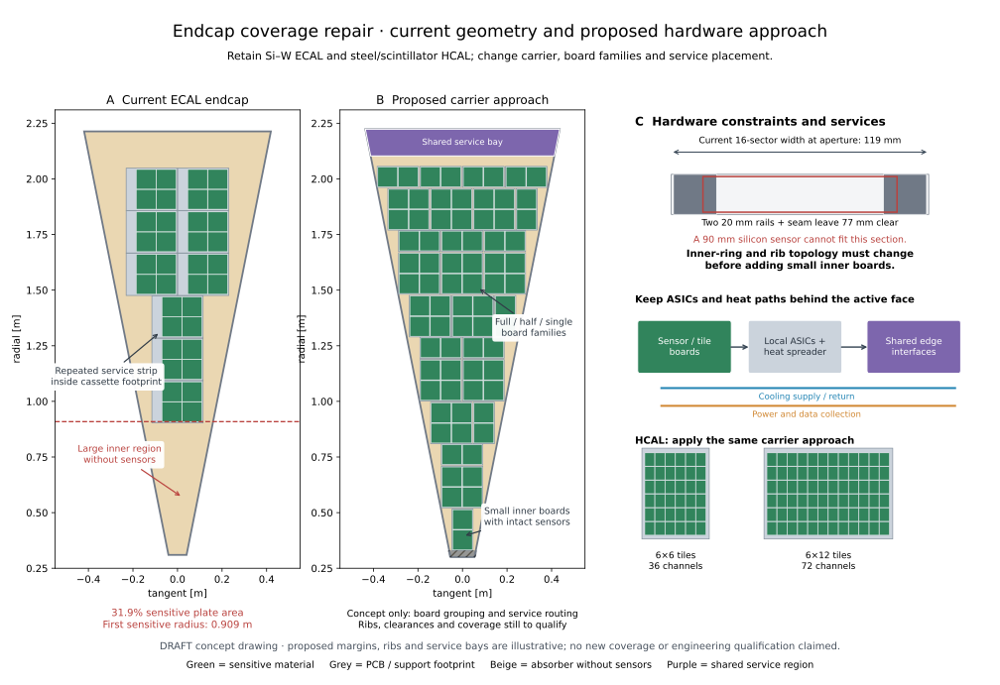

# DES029 companion — Endcap coverage diagnosis and proposed repair

- Status: **DRAFT**
- Type: Analytical review and proposal; no geometry implementation
- Date: 2026-10-12
- Parent: [DES029](DES-029-calorimeter-assemblies.md), PR69

The prototype uses fixed rectangular cassette envelopes and an elementary row
packer in sixteen22.5° sectors. That gives valid nonoverlapping assemblies but
large empty wedges, unused outer radial strips and a much larger effective
active aperture than the declared300 mm hole. Those results identify a layout
problem that must be fixed before detector acceptance.

[Current ODD comparison](DES-029-odd-endcap-comparison.md) shows how its
continuous sensitive sheets avoid these packing holes, with source-derived
98.59%/99.33% ECAL/HCAL face fractions and an aperture near |eta|=3. Those values
are idealized geometric coverage, not an engineered module layout or efficiency.

## Where the reported area goes

All values below are **INFERENCE** from the unchanged model at61ab5a4.
Coverage denominator is one layer's absorber plate face, excluding its aperture
and separately modeled structural frame. It is not simulated particle efficiency.

| Quantity | ECAL endcap | HCAL endcap |
| --- | ---: | ---: |
| Cassette envelope | 230 × 190 mm | 400 × 380 mm |
| Plate covered by cassette footprints | 44.93% | 46.45% |
| Sensitive area / cassette footprint | 70.88% | 83.57% |
| Sensitive area / plate | 31.85% | 38.82% |
| Cassettes per sector per layer | 9 | 8 |
| First sensitive radius | 908.9 mm | 1483.15 mm |

Thus the two losses multiply:0.4493×0.7088=0.3185 forECAL and
0.4645×0.8357=0.3882 forHCAL. Most loss is outside cassette footprints;
service strips, guards/frame and tile gaps contribute the remaining loss.

For a row whose inner radial edge is r, the present fit width is
`2 × (r × tan(pi/16) − 1 mm − 40 mm)`. A full cassette needs at least230 or
400 mm. This forbids its placement until the row inner edge exceeds about784
or1212 mm; fixed radial row spacing delays actual first placement further.
ECAL's first three candidate rows and HCAL's first three candidate rows are
empty. At the outer edge, floor-rounded radial row counts leave approximately
165 mm of ECAL and362 mm of HCAL plate beyond the last cassette envelope.

The same transverse pattern repeats in all48/36 layers. Staggering can reduce
narrow aligned seams but cannot fill the large unsensed inner region. The native
prototype's sampled|eta|≥2.4 zero-crossing paths therefore require hardware/layout
repair. For illustration,|eta|=3 at the respective front planes requires
`r = z/sinh(3)` ≈394 mm ECAL and451 mm HCAL. This is an illustrative requirement,
not an approved eta target. The nominal aperture alone is not the current limit.

## Simple changes are insufficient

The following **INFERENCE** comparisons rerun only the unchanged rectangular
packing, with logical corner containment checked. They are not native-validated
alternative detectors. Changing sector count also changes polygon corner radii,
plate geometry, support loads and services; apothems are held fixed here.

| Sectors / edge allocation per side | ECAL sensitive plate fraction | HCAL fraction |
| --- | ---: | ---: |
| 16 / 40 mm, baseline | 31.85% | 38.82% |
| 16 / 20 mm | 42.47% | 38.82% |
| 8 / 40 mm | 43.81% | 49.84% |
| 8 / 20 mm | 48.67% | 52.10% |

Even shrinking the service reservation and using broader sectors leaves large
losses. Shrinking the absorber to redefine the denominator would conceal the
problem. Enlarging sensitive boxes through guards/services is not a physical fix.

## Recommended design sequence

All recommendations below are **NODD DESIGN CHOICE proposals**, unsigned.
Retain Si–W/steel–scintillator technologies and sampling counts/thicknesses.

1. **Specify the fiducial eta range and beam/service aperture.** Derive the active
   inner edge at each layer's z and identify the handover to a forward detector.
   Require useful sampling throughout that range, including sector boundaries;
   do not set coverage by whichever large cassette happens to fit first.
2. **Separate mechanical carriers from readout units.** Use endcap-specific
   trapezoidal/petal or quadrant carriers that hold several sensor/tile boards.
   Local ASICs and heat paths remain embedded. Consolidate interface electronics
   at carrier ends/outer service zones where routing, voltage drop and cooling
   can be described explicitly; preserve all displaced material and power.
3. **Introduce a small, manufacturable module family.** ForECAL compare full
   2×2, single and1×2 arrays of standard90 mm sensors, with custom boards and
   shaped carrier edges. These proposed board families require validation; do
   not clip standard silicon sensors into fictitious active polygons. ForHCAL
   compare full HBU arrays with6×6 or6×12 tile subarrays and edge/inner strips;
   retain30 mm tile pitch/3 mm thickness as the initial choice. Custom shaped
   edge tiles are a later manufacturing/optical decision, not an automatic cut.
4. **Design the inner ring and structural seams jointly.** At300 mm a16-sector
   wedge is only about119 mm wide before rails. Two20 mm rails and seam already
   leave roughly77 mm, less than one90 mm silicon sensor. Review tapering/ending
   radial ribs at a supported inner ring, and compare broader mechanical petals
   or quadrant carriers. Sector IDs need not define mechanical boundaries.
5. **Optimize complete layers, then control cracks through depth.** Fill inner,
   edge and outer remainders with the small module families; compare orientations
   and staggering only after large holes are removed. Route services without
   introducing new columns of inactive space. Keep structural seams explicit.
6. **Use directional geometry gates.** Publish layer-by-layer active masks and
   active-layer counts versus eta/phi, with seam/guard/service/aperture labels.
   Report both per-layer area and full fiducial-face coverage, including frames.
   Set numerical coverage/crack requirements through review rather than promise
   an unverified90–95% result. Rerun native containment/overlaps/IDs/mass/material
   and sparse transport; recalculate channel counts, continuous power and cooling.

**FACT / source precedent:** SRC-CALICE-SIW-2022 PDF4 (§3) describes quarter
endcaps and multiple180 mm ASUs per layer; PDF6 describes the compact40×180 mm
SL-Board and multiple ASUs connected to shared readout. This supports studying
carrier-level service grouping, not adoption of its power-pulsed operating mode
or qualification of a nODD endcap. [Public paper](https://arxiv.org/pdf/2211.07457).
The CALICE AHCAL architecture remains a precedent for modular SiPM/tile boards;
new subarray/carrier shapes proposed here are project choices, not built-hardware
claims from that paper.

The next implementation should design one **inner ECAL carrier** and one
**inner HCAL carrier**, because the missing inner coverage is the dominant
geometric failure. Demonstrate realistic sensors, boards, heat paths and service
exits there; then fill a complete layer and replicate the reviewed design.

[Reproducible arithmetic](../validation/DES-029/endcap-coverage-review.json):
`python3 -B tools/calorimeter_hardware/endcap_review.py` from the repository root.
The companion figure uses the existing Matplotlib environment with
`endcap_review_plot.py`. No existing geometry inputs or native evidence changed.

## Annotated concept drawing

PanelA uses actual ECAL placement/sensor coordinates. PanelB illustrates intact
90 mm sensors in full/half/single board families, an inner supported rim and a
shared peripheral service bay. PanelC separates the existing119 mm/77 mm fit
constraint from functional service routing and proposed HCAL tile subarrays.

The proposed PCB margins, sensor/board gaps, edge allowance, inner clearance and
service-bay depth are **NODD DESIGN CHOICE drawing fixtures**, recorded in
[the drawing inputs](figures/DES-029/endcap-repair-concept.json). They have no
engineering approval and are not detector input changes. The proposed support/
absorber boundary differs from today's20 mm continuous rib; its mechanics,
material and cooling still require design. Board corners stay inside the
illustrative outline; that check does not qualify a physical assembly. No
coverage percentage is predicted for the proposed panel.

Reproduce with the existing Matplotlib environment:
`python3 -B tools/calorimeter_hardware/endcap_repair_drawing.py`.
