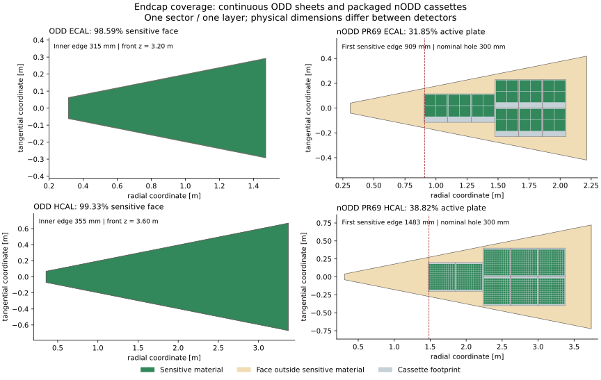

# DES029 companion — Current ODD endcap coverage

- Status: **DRAFT** source review; no detector input change
- Date: 2026-10-12
- Parent: [DES029](DES-029-calorimeter-assemblies.md), PR69
- Source: **SRC-ODD-UPSTREAM**, current main at
  `c167363f3d4ad1540a577af99071283caf54f3a6`

ODD avoids the large missing active regions of the first nODD cassette packer
by representing each endcap layer as sixteen almost contiguous trapezoidal
sensitive sheets. Its fine cells are logical readout segmentation within those
sheets. The nODD prototype instead places finite, physically packaged rectangular
sensor/tile boards. Its low coverage is introduced by that packing and service
layout; it is not inherited from ODD's endcap sensitive-face layout.

## Verified source and construction

**FACT:** On 2026-10-12 the public CERN GitLab main API returned the revision
above, committed on 2026-04-29. Four raw source files at that exact revision
matched the clean study checkout byte for byte. Hashes and derived results are
retained in [the comparison record](../validation/DES-029/odd-endcap-comparison.json).
The GitHub repository redirects development to CERN GitLab.

Primary locators at this revision:

- [Envelopes, lines51–66](https://gitlab.cern.ch/acts/OpenDataDetector/-/blob/c167363f3d4ad1540a577af99071283caf54f3a6/xml/OpenDataDetectorEnvelopes.xml#L51):
  ECAL/HCAL endcap radii, front positions and sixteen-fold symmetry.
- [ECAL XML, lines71–99](https://gitlab.cern.ch/acts/OpenDataDetector/-/blob/c167363f3d4ad1540a577af99071283caf54f3a6/xml/detectors/CalorimeterECal.xml#L71):
  48 sampling layers, 0.5 mm sensitive silicon and `gap="0.25*cm"`.
  Lines9–20 define 5.1 mm Cartesian cells.
- [HCAL XML, lines63–86](https://gitlab.cern.ch/acts/OpenDataDetector/-/blob/c167363f3d4ad1540a577af99071283caf54f3a6/xml/detectors/CalorimeterHCal.xml#L63):
  36 sampling layers, 3 mm sensitive polystyrene and the same gap setting.
  Lines9–20 define 30 mm Cartesian cells.
- [Endcap factory, lines43–67 and111–149](https://gitlab.cern.ch/acts/OpenDataDetector/-/blob/c167363f3d4ad1540a577af99071283caf54f3a6/factory/calorimeter/ODDPolyhedraEndcapCalorimeter_geo.cpp#L43):
  outer-radius conversion, identical trapezoidal transverse outlines for layers
  and slices, and sensitive-detector assignment. Lines198–219 place the sectors
  and positive/negative endcaps.

**FACT / representation limit:** The factory gives each sensitive slice the
whole trapezoidal footprint, with the small side reduction. There are no
individual silicon-wafer guards, tile wrappers, board borders, cassette frames,
connectors, local cooling tubes or service reservations within that sensitive
face. ODD includes other effective passive slices, notably PCB mixtures and
air, but these do not resolve the physical packaging that competes for active
area in an engineered endcap. The HCAL 30 mm cells are not separately placed
physical tiles in this construction.

## Quantitative comparison

Source dimensions are **FACT**; apothems, face fractions and eta estimates are
**INFERENCE** from the inspected factory equations. nODD values are from the
unchanged DES029 prototype, not a repaired or accepted layout.

| Quantity | ODD ECAL | ODD HCAL |
| --- | ---: | ---: |
| Endcap front \|z\| | 3200 mm | 3600 mm |
| Inner polygon apothem | 315 mm | 355 mm |
| Outer polygon corner radius | 1500 mm | 3436 mm |
| Outer polygon apothem | 1471.18 mm | 3369.98 mm |
| Sampling layers / stack depth | 48 / 242.4 mm | 36 / 1836 mm |
| Sensitive face fraction, excluding central hole | 98.59% | 99.33% |
| Front-plane aperture limit, depending on phi | \|eta\| ≈ 2.995–3.014 | \|eta\| ≈ 2.993–3.012 |
| nODD PR69 active absorber-plate fraction | 31.85% | 38.82% |
| nODD PR69 first sensitive radial edge | 908.9 mm | 1483.15 mm |

ODD's XML gap is **2.5 mm per side in the local transverse coordinate**: the
factory subtracts it from both trapezoid half-widths. The resulting seam is
about 5 mm wide (4.904 mm measured perpendicular to the sector boundary).
It is not a 2.5 mm total seam. For N sectors, inner apothem r, outer corner
radius Rc and side reduction g:

```text
R = Rc × cos(pi/N)
face area = N × (R² − r²) × tan(pi/N)
sensitive area = face area − N × 2g × (R − r)
```

These are single-layer geometric area fractions, not measured efficiencies.
The ODD denominator is the polygon face before stave seams, excluding the
central hole. The nODD denominator is the sector absorber face, excluding its
hole and separately modeled structural frame. The detectors also have different
sizes and longitudinal positions; the numbers do not compare calorimetric
performance. They demonstrate the size of the packing loss in PR69.

The eta estimates use `asinh(z_front/r_boundary)` at the nominal front plane.
They describe the central-hole boundary, not a validated full-depth acceptance
edge. Corners of the polygonal hole have larger radius than its apothem. A ray
outside the front-plane aperture can still enter later layers as its radius
grows with z. Conversely, narrow sector seams repeat through depth. A rigorous
acceptance claim needs layer counts versus eta/phi and transport validation.



The drawing shows one sector and one layer at each detector's own dimensions.
Green is sensitive material; beige is the remaining face; grey is cassette
footprint. ODD's narrow seams are visible only as thin edge strips at this scale.
It is a source-derived footprint drawing, not a new native detector rendering.

## Implication for the repair

**NODD DESIGN CHOICE proposal, unsigned:** Retain near-contiguous sampling as
the architectural objective, but achieve it with manufacturable sensors/tiles,
smaller board families and shaped mechanical carriers with explicit seams and
services. ODD is a useful idealized reference mask; copying its continuous
silicon/scintillator sheets would conceal the hardware constraints exposed by
our prototype. Coverage requirements and the forward handover still need review.
The [repair proposal](DES-029-endcap-coverage-repair.md) describes that sequence.

Reproduce the arithmetic with standard-library Python and the exact source
checkout; add `--plot` with the existing Matplotlib environment for the figure:

```sh
python3 -B tools/calorimeter_hardware/odd_endcap_comparison.py \
  --source-dir /path/to/OpenDataDetector
```

The script rejects a different revision or file hashes. It checks the face-area
subtraction against an independent trapezoid-area expression. No new native ODD
construction, overlaps, directional scan or simulation was run for this review.
