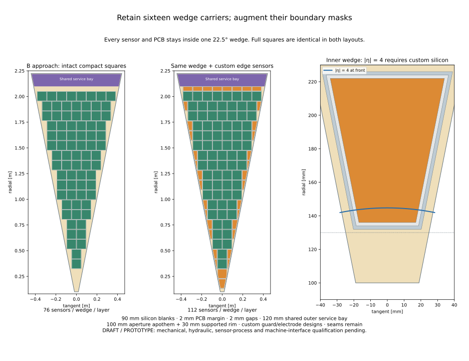

# DES-030 — Custom ECAL edge sensors and optimized endcap

- Status: **DRAFT**
- Type: **PROTOTYPE**
- Date: 2026-10-13
- Parent: DES028/DES029; no production integration
- Human instruction: design custom edge sensors, update the prototype layout,
  compare ODD, first nODD, optimized squares and squares with edge sensors.
- Human clarification: extend optimized layouts toward |eta|=4 as a prototype target.
- Engineering approval: pending. Implementation permission is not design sign-off.
- Aperture/carrier decision: [ADR008](../decisions/ADR-008-prototype-ecal-forward-aperture.md)

## Wedge carrier architecture

The human clarified that DES029 drawing **B — Proposed carrier approach** is
that baseline: keep wedge carriers and augment them with edge sensors. The
initial four-quadrant alternative at commit69b044e is superseded and retained in
[its validation archive](../validation/DES-030/quadrant-study/results.md) and
[its drawing](figures/DES-030/quadrant-study/four-stage-coverage.svg).

**FACT:** B shows sixteen22.5-degree wedge carriers, smaller full/half/single
board families, an inner supported rim and shared electronics at the outer end.
Its PCB/gap/support/service dimensions were illustrative unsigned choices,
not an engineered detector. **NODD DESIGN CHOICE:** carry its topology and named
2mm PCB margins,2mm board gaps,5mm tangential side allowance,30mm inner rim and
120mm outer service bay into this isolated ECAL prototype. The inherited1mm
half-seam is additional; the sloping board boundary is
`abs(y) <= x*tan(pi/16) - 6mm` in radial-x/tangential-y coordinates.

Use individual sensor boards as the first independently validated member of
B's full/half/single family. Rows are centred like B; an even number of squares
uses a half-pitch tangential offset. Boards never cross a wedge boundary.
Grouped full/half-board routing and mechanics remain open. A radial-phase
search over0/2/4/6mm offsets prioritizes custom-mask eta4 azimuth coverage and
then intact-square area; it selects2mm. This is a bounded optimization, not a
global packing optimum. Edge addition retains every square placement and ID.

Retain90mm silicon blanks,0.5mm Si,5.5mm nominal pad pitch,1.9mm tungsten,
48layers,10.9mm layer pitch,front3950mm,outer16-gon apothem2223.2mm and10mm
rear cover from DES028/029. No HCAL, barrel, production entry point or tracker
geometry changes. The existing HCAL forward hole is not repaired by this work.

## Forward aperture and custom inner sensors

**INFERENCE:** at3950mm,|eta|4 reaches144.7421mm. The original300mm aperture
blocks that direction. The human authorized extending the prototype toward
eta4. **NODD DESIGN CHOICE:** use a100mm-apothem16-sided aperture; retain B's
30mm inner supported rim. Its supported corner radius is
`130/cos(pi/16)=132.55mm`, leaving12.19mm radially to the target at the front.
Machine/forward/shielding clearance and support strength remain unsigned.

At that radius, a22.5-degree wedge is approximately57mm wide before side
reservations, so a90mm sensor cannot fit. Custom inner trapezoids cover the
narrow region. Additional partial boards/sensors fill sloping sides and the
remainder below the outer service bay. The same aperture, supports, row centres
and service reservation apply to both square-only and square-plus-edge cases.
They isolate the contribution of custom silicon, including forward reach.

## Sensor masks, electrodes and readout

**FACT / architectural precedent:** SRC-CMS-HGCAL-PARTIAL-2025 arXiv2510.17280v4
§2/Figs1–3 describes manufactured partial sensors with dedicated dicing/HV/guard
structures. SRC-CALICE-SIW-2022 PDF4/6 supports compact boards and shared
interfaces. These sources do not qualify these nODD masks or operating modes.

All new parameters in `tools/calorimeter_hardware/edge_sensors.json` are unsigned
**NODD DESIGN CHOICE** proposals. Distinct outer silicon, matching PCB and active
inset polygons specify new manufactured masks, not fictitious clipped standard
sensors. Keep the inherited1mm square guard; reserve2mm along every custom edge
for dicing/HV termination. Reject silicon area<1200mm2, minimum Feret width<20mm,
and boards unable to hold the required10×12mm packages with1mm clearance.
Sensor outlines fit within90×90mm blanks. Dicing tolerances, edge termination,
wafer yield, irradiation and guard electrical behaviour need process review.

Clip the nominal pad lattice to each active mask. Merge fragments smaller than
20% of a nominal pad with connected neighbours, preserving active area. Record
electrode outlines, merged keys, bounds and reference positions within their
physical union. The dedicated `nODDEdgeGrid` segmentation maps hits to those
IDs and interior positions, including closed-boundary ties. It does not model
charge sharing or electrical fields. There are29 oriented profiles and36 custom
placements per wedge/layer;14 small/narrow candidates are rejected. Catalogue
minimum pad area is6.068449mm2;158 electrode groups per wedge merge fragments.

The ID descriptor is
`system:8,side:2,sector:4,layer:6,module:10,x:-6,y:-6`.
Four sector bits represent all16 wedges. Linearized row/column addresses retain
square IDs when custom masks are enabled. IDs from the superseded four-quadrant
architecture are not a compatible detector baseline. Negative-end transforms
are proper rotations, including Rx(pi), with no handedness reflection.

## Material, cooling and budgets

Each wedge owns absorber plates and the supported frame once. Explicit PCBs,
ASIC constituents, thermal contacts and skins remain behind the active face.
**NODD DESIGN CHOICE:** retain the3mm copper cooling plate with2mm-OD Ti/water
runs. Radial runs at tangential0/±250mm fit inside each wedge; account for the
removed copper. Tube endpoints stop5mm inside the plate. External fittings,
headers, hydraulics, heat removal and stiffness remain unqualified.

Use the inherited continuous channel-power, leakage, voltage,2W shared-interface
and0.9 converter hypotheses, with8192 logical channels/interface. Count all
64channels per installed ASIC, including914 unbonded channels per wedge/layer
in the edge case. No power-pulsing or unverified unused-channel savings.

| One wedge/layer unless stated | Compact squares | Squares + custom masks |
| --- | ---: | ---: |
| Sensors | 76 | 112 (36 custom) |
| Logical channels | 19456 | 22830 |
| ASIC packages | 304 | 371 |
| Shared interfaces | 3 | 3 |
| Full-face active fraction | 59.98% | 69.47% |
| Both48-layer endcap channels | 29884416 | 35066880 |
| Both endcap native mass | 97.928245t | 98.948639t |
| Both endcap continuous heat hypothesis | 60.070kW | 71.051kW |

## Drawings and coverage interpretation

The single-wedge drawing follows B and adds orange custom masks while keeping
all green squares unchanged. Its close-up shows the supported rim, inner sensor
and eta4 circle. The four-stage drawing keeps historical ODD/first-nODD geometry
and their original denominators. Their source-derived fractions are98.59% and
31.85%; no new native ODD run is claimed. C/D both divide by the complete outer
16-gon face minus the100mm-apothem16-gon aperture, including support/service
losses. The custom-mask gain is9.48percentage points. The eta4-fiducial face
outside the144.742mm disc gives60.11%/69.59%. These are geometric areas, not
particle efficiencies.

At eta4,360 one-degree-centred azimuth samples give square-only zero active
layers; custom masks average32.36/48 layers,68.89% with at least one and64.44%
with at least40. Identical masks repeat through depth; seams/guards/gaps still
produce zero-hit directions. The endcap-only scan excludes the unchanged barrel.
Uniform eta4 acceptance and realistic calorimetric performance are not claimed.

[Mask catalogue](inputs/DES-030-edge-profiles.json),
[directional samples](../validation/DES-030/directional-coverage.json) and
[native/transport evidence](../validation/DES-030/results.md) record exact inputs,
actual checks and the remaining engineering questions.
