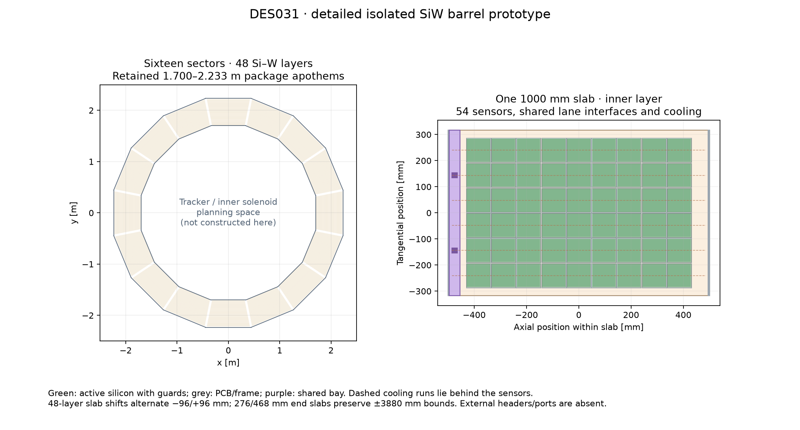
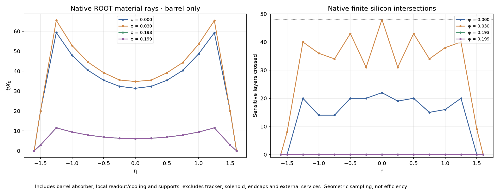

# DES-031 — Detailed SiW ECAL barrel prototype

- Status: **DRAFT**
- Type: **PROTOTYPE**
- Date: 2026-10-13
- Parent: [DES-029](DES-029-calorimeter-assemblies.md), [DES-030](DES-030-ecal-edge-sensors.md), PR70
- Human instruction: make a SiW barrel prototype with similar physical detail to PR70.
- Engineering approval: pending; no production integration or performance acceptance.

## Scope and provenance

Retain the existing barrel envelope, sixteen sectors and 48 layers. Replace
individual large four-sensor cassette fixtures with compact square sensor boards
in independently serviced axial slabs. Supports, absorber ownership, guards,
PCB/ASIC/thermal stacks, shared interfaces, cooling and readout are explicit.
Endcaps and HCAL are unchanged.

**FACT:** DES-029/030 prototype inputs at5664d16 retain front apothem1700 mm,
barrel half-length3900 mm,20 mm end reservation/flanges,10 mm back cover,
1.9 mm tungsten,8 mm cassette body and1 mm installation gap. These facts describe
previous unsigned project choices, not externally approved detector dimensions.
**INFERENCE:** layer pitch10.9 mm; sampling back2223.2 mm, cover2233.2 mm,
HCAL front2263.2 mm; flange ends3920 mm versus3950 mm endcap front.

**FACT / architectural precedent:** SRC-CALICE-SIW-2022, §§3–3.1/PDF4–6,
describes90 mm sensors, compact PCB/ASIC slabs and slab-end interfaces. It does
not qualify the new boards, cooling or operating hypotheses. The retained
square90 mm silicon/88 mm active window,0.5 mm Si,5.5 mm pad pitch and material/
package recipes are the DES-030 prototype choices.

All values in `tools/calorimeter_hardware/barrel.json` are unsigned **NODD DESIGN
CHOICE** proposals.94 mm PCBs allow2 mm margin around full silicon;96 mm pitch
leaves2 mm board gaps.40 mm side allocations include the inherited rails and
additional service setback. At PCB front these fit6/7/8 columns across layers
0–17/18–39/40–47, without custom sensor masks.

## Axial slabs and deliberate staggering

**NODD DESIGN CHOICE:** seven1000 mm slabs, two short end slabs and2 mm slab
gaps fit between±3880 mm, respecting the inherited20 mm end allocation.
Each full slab has nine board rows and a40 mm shared interface bay; two short
slabs together have six rows.5 mm slab-end frames have separate ownership.
Short-slab boards move5 mm inward to leave3 mm between their PCB and bay.

A centered control uses372 mm end slabs. It exposes120–146 mm aligned active
gaps between slab groups, including an entirely blind band near eta0.25.
**NODD DESIGN CHOICE:** alternate full-slab shifts−96/+96 mm across layers
(one board pitch), keeping slab manufacture common and moving service joints
through the depth. End slabs consequently have standard276/468 mm lengths,
exchanged between ends. Each full slab still contains a sensor row at z=0;
no central mechanical seam crosses every layer. This prevents identical service
joints forming one uninterrupted dead band; it does not establish acceptance
or tune material to a performance plot. Both the aligned control and staggered
candidate are retained for geometric comparison.

Full-slab centres are `1002*i + phase`, i=−3..3. Short centres are
`−3694 + phase/2` and `3694 + phase/2`; their lengths are372+phase and372−phase.
Tungsten plates remain continuous and owned once per layer/sector. Large plate
manufacture, loads, mounting and physical segmentation remain unqualified.

## Physical stack, services and identifiers

After tungsten, retain PR70's radial stack:0.2 mm Al front skin; bias film,
0.5 mm silicon and glue/pad;1.6 mm PCB with explicit copper fraction; four
10×12 mm ASIC packages with glue/graphite/Al thermal contacts;3 mm common Cu
plate at body4.8–7.8 mm;0.2 mm Al rear skin. Sensitive silicon and passive guards are physically separated. Pad metallization
retains the equivalent copper-film representation; readout pads are logical
electrode partitions, not new lithographic copper-gap volumes. Slab-end frames exclude overlapping plate/
skin material. Axial2 mm-OD Ti/water runs fit inside the cold plate, with holes
subtracted from copper and5 mm setbacks from actual plate boundaries.

Shared interfaces group complete axial lanes, each≤8192 logical channels.
All installed64-channel ASIC channels remain powered under inherited continuous
1.5 mW/channel,2 W/interface and0.9 converter hypotheses. Bias leakage and
ideal water flow at5 K rise remain hypotheses, not engineering qualification.

External headers, connectors and cable routes are excluded. Side/end reservations
still contain tungsten or aluminium: a radial collector needs explicit ports or
an external route. No empty-air corridor, hydraulic network, voltage-drop or
thermal-mechanical solution is implied.

The isolated readout retains `system:8,side:2,sector:4,layer:6,module:10,x:-6,y:-6`;
side0 is barrel. A board has its own module ID, independent of mechanical slab
ownership. Full-square closed-boundary electrodes reuse the tested EdgeGrid.
All placements use a proper rotation from local(tangent,axial,radial) to world.
Logical board volumes are reused; their physical parent IDs remain distinct.

## Validation and interpretation

Require native construction/full overlaps, primitive/restricted-CSG capacity
and constituent mass, every physical sensor-volume ID round trip, all logical
pad references/boundary ties, proper slab/sector transforms and directional
material/sensitive crossings. Compare plane-mask coverage with native rays,
including service bands and sector seams. Save seeded positive-energy hits
in sparse barrel transport fixtures; distinguish those from complete transport.

Centered6/8-column grids retain a sector-centre phi crack: at eta0,phi0 only
22 of48 layers have active silicon. Standard sensor guards, residual side strips,
service bays and slab gaps are real losses, not calorimeter efficiencies.
Full geometric acceptance, engineering qualification and realistic shower/jet/
particle-flow response remain future work.

## Executed prototype budgets

The complete isolated barrel contains 359,904 square sensor boards in 16 sectors.
The following are **INFERENCES** from the unsigned component choices, verified
against the native geometry where applicable.

| Quantity | Result | Interpretation |
| --- | --- | --- |
| Logical channels / ASIC packages | 92,135,424 / 1,439,616 | 256 pads and four 64-channel packages per board |
| Shared interfaces | 15,648 | Complete lanes, each at most 8,192 channels |
| Barrel mass | 299.003 t | Native and analytic constituent sums agree |
| Tungsten alloy / copper | 149.228 t / 119.693 t | Copper is dominated by the proposed 3 mm cooling plates |
| Continuous heat / ideal water flow | 188.401 kW / 9.014 kg/s | Inherited power hypotheses; water rises by 5 K |
| Active face fraction | 54.88–64.57% | Layer-dependent planar area, including side/end allocations; not efficiency |
| Minimum PCB side / bay clearance | 1.440 mm / 3 mm | Geometric clearances, without manufacturing tolerances |

The copper mass and continuous power make the cooling choice a substantial
engineering decision. Plate manufacture, load paths, headers, connectors,
hydraulic pressure drop, thermal gradients and power/data routing need further
design. The 46,944 individual coolant runs imply up to 93,888 endpoints before
any sharing or collector redesign. The 30 mm barrel–endcap handoff is an
allocation rather than a qualified service connection.

[Vector slab drawing](figures/DES-031/barrel-layout.svg) ·
[Vector material plot](figures/DES-031/barrel-material.svg) ·
[Source-bound plot inputs](figures/DES-031/plot-inputs.json).

Native construction, mass/material checks, every physical sensor ID and complete
overlaps passed at 10 nm tolerance with seed 31. Supplemental checks cover all
552 logical module addresses and three sparse Geant4 events. Independent
finite-thickness intersections reproduce all 60 native rays; five centre-plane
approximations differ by one or two layers at sensor boundaries. These checks
establish the bounded prototype implementation, while acceptance and engineering
qualification remain open. See [the executed report](../validation/DES-031/results.md)
for exact source revisions, commands, evidence and limitations. No human sign-off
is recorded.
