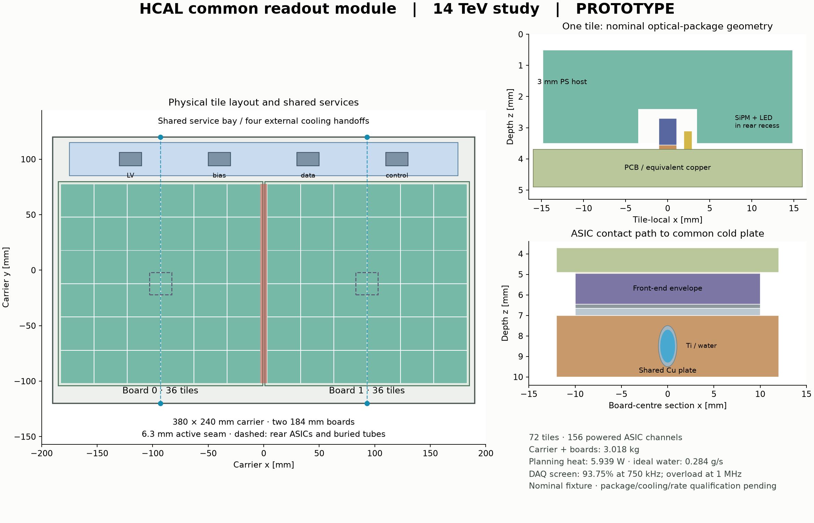

# DES-036 — Common HCAL readout module prototype

- Status: **DRAFT**
- Type: **PROTOTYPE**
- Created / updated: 2026-10-15
- Human direction: start the common readout module proposed in DES035; operating contract is a 14 TeV hadron collider
- Author: Codex-assisted implementation with CaloTech and SysArch inputs; independent PhysVal assessment follows a fixed revision
- Human engineering owner / sign-off: unassigned / pending
- Parent: [DES035](DES-035-hcal-realism-and-prototype-plan.md), [DES028](DES-028-calorimeter-cassettes.md)
- Implementation / issue: local isolated prototype; no production integration

## Operating contract and scope

**FACT about human direction:** the collision energy is 14 TeV. This starts H0/H1 of DES035 and authorizes an isolated module prototype. It does not determine bunch spacing, pileup, luminosity, regional dose/fluence, operating temperature or a final front-end component.

**NODD DESIGN CHOICE — planning scenarios:** continuous operation; 25 ns sampling, 12.5 µs trigger latency and a 750 kHz accepted-trigger scenario, with a 1 MHz bandwidth stress case. These are explicit test inputs for a pp-compatible architecture, not extra requirements inferred from beam energy. Timing, occupancy and radiation qualification remain conditional. The present module supplies material, identifiers, electronics-function and service budgets; it does not emulate an ASIC or qualify a complete HCAL.

## Sourced component and architectural evidence

| Classification / source | Fact and locator | Use and limit |
| --- | --- | --- |
| FACT — SRC-CMS-HGCROC3-2026 | §1/PDF2: tile-compatible H2GCROC3, continuous bunch-crossing trigger path, 512-entry latency memory, 32-entry output FIFO and below 15 mW/channel design requirement | Functional precedent; quoted requirements are not measured module power or tile timing |
| FACT — SRC-H2GCROC-CHANNELS-2023 | HGCROC characterization slides, 2023-09-22, PDF14: 78 total channels = 72 ordinary + 2 calibration + 4 common-mode | Ordinary sensor capacity is 72; auxiliary channels are not tile inputs |
| FACT — SRC-HAMAMATSU-S14160-1315PS | Manufacturer KAPD1070E05, June 2025, PDF1–2/5: 1.3 × 1.3 mm active area, 15 µm cells, 7,284 pixels; nominal package 2.1 × 2.63 × 0.85 mm, height tolerance ±0.15 mm; nominal active-centre offset 0.26 mm; nominal breakdown 38 V and +4 V operating overvoltage | Sourced beginning-of-life component reference. No irradiated lifetime or complete optical-response selection |
| FACT — SRC-PDG-PS-2024 | Density/composition table: polystyrene host C8H8, 1.060 g/cm³ | Explicit undoped transport proxy; dopants, light yield and optical parameters are not supplied by this table |
| FACT — SRC-CMS-HGCAL-TILE-CHAIN-2025 | Contribution Summary: tile modules aggregate through a motherboard, with concentrators, optical export and cooled system validation | Module/carrier hierarchy; no borrowed nODD throughput, package or cooling certification |

The source manifest retains links and exact inspected locators. The actual H2GCROC package outline is unresolved. All package/connector volumes below are project envelopes; they are not represented as manufacturer dimensions.

## Common board and channel ownership

**NODD DESIGN CHOICE:** use one 184 × 184 mm board with a 6 × 6 tile lattice at 30 mm pitch. Retain 29.7 × 29.7 × 3 mm scintillator cores and 0.1 mm reflector allowance. The wrapped tile field spans 179.9 mm, leaving 2.05 mm of PCB border per side. A named cylindrical effective recess of radius 3.5 mm and depth 1.1 mm accommodates the candidate SiPM and an adjacent LED envelope. The recess is a prototype optical-coupling hypothesis, not a manufactured dimple drawing. Preserve a nominal 0.26 mm SiPM-package offset so the active centre follows the tile centre; verify direction against the chosen package orientation. The recess accommodates the nominal 0.85 mm height and the sourced 1.00 mm upper-height case anchored to the same board/solder plane; this is one bounded tolerance check, not a complete tolerance stack.

Each module owns 36 tiles, SiPM packages, adjacent calibration LEDs, a PCB, one front-end envelope, thermal contact and local support-electronics allowance. It has one H2GCROC-class chip: 36 ordinary inputs connected, 36 ordinary inputs unconnected, six auxiliary channels. Budget all 78 channels as powered; disabling savings are not assumed. Physical tiles map to module-local addresses independently of carrier placement. A 6 × 12 alternative would use all 72 ordinary inputs, but doubles one board dimension and constrains packing. The compact first module deliberately retains that utilization cost.

## Shared carrier and explicit geometry

All dimensions in this section are **NODD DESIGN CHOICE — unsigned fixture parameters**, except the nominal SiPM envelope noted above. Local x/y span the carrier; +z runs from the absorber toward electronics. Two identical boards are centred at (−93, −12) and (+93, −12) mm. A 380 × 240 × 12 mm carrier owns one set of skins/rails, one copper plate, two through-flow cooling branches, one shared interface and connector envelopes. The boards have a 2 mm PCB gap and a 6.3 mm scintillator-core seam. Do not replace that physical seam with an uninterrupted Cartesian grid.

| z interval, mm | Part / owner |
| --- | --- |
| 0–0.2 | Aluminium front skin, carrier |
| 0.4–3.6 | Wrapped tile; active core 0.5–3.5, module |
| 2.4–3.5 | Effective rear recess cut in scintillator; opening continues through rear reflector |
| 2.70–3.55 | Nominal SiPM package; 0.15 mm solder-equivalent contact reaches PCB at 3.70 |
| 3.10–3.70 | Adjacent 1 × 1 × 0.6 mm LED envelope in the common recess, module |
| 3.70–4.90 | 1.2 mm PCB with 0.105 mm explicit equivalent copper, module/shared-interface board |
| 4.90–4.95 | Front-end adhesive |
| 4.95–6.45 | 20 × 20 × 1.5 mm front-end envelope, module |
| 6.45–6.65 | Graphite contact, module |
| 6.65–7.00 | Aluminium thermal post, module |
| 7.00–10.00 | 376 × 236 × 3 mm copper plate, carrier |
| 11.675–11.800 | Rear polyimide insulation, carrier |
| 11.800–12.000 | Aluminium rear skin, carrier |

Two Ti/water tube axes run along y at x = ±93 mm and z = 8.5 mm; outer/inner diameters are 2/1.6 mm. Exact rotated cylindrical cuts displace copper over its 236 mm length. Tubes extend 240 mm through rail clearance ports to four named external collector handoffs. These are two parallel inlet/outlet branches, not a closed supply/return circuit. The upstream/downstream collector, seals, fittings and pressure drop are unqualified external interfaces.

A carrier-owned 350 × 30 × 1.2 mm service PCB occupies y = 85–115 mm. One shared interface envelope at (0,100) mm has the front-end-like contact path to the common plate. Four 20 × 12 × 2 mm connector envelopes centred at x = −120, −40, +40, +120 mm and y = 100 mm reserve LV, bias, data and control handoffs. Their pins, ratings, protocols and cable geometry remain open. Rails and service parts must fit without overlapping boards, skins or displaced coolant volumes.

The absorber remains sector-owned. A separate removable 30 mm Steel235 reference patch can be present in the transport fixture, once only. It is excluded from module/carrier masses and from claims about chosen sampling depth. No old DES028 skin, interface, pipe or absorber is duplicated per board.

## Material and service ledger

**NODD DESIGN CHOICE:** reuse explicit bulk material helpers and proxy package constituents, with mass normalization. Give the new polystyrene host a distinct name; preserve historical C19H21 evidence unchanged. PET wrapping, G10, epoxy and silicon/copper/epoxy package mixtures are effective transport materials with no implied optical, electrical or radiation response. Solder uses a named copper-equivalent proxy; the omitted alloy and normalization target must remain visible.

**NODD DESIGN CHOICE — nominal budgets:** 15 mW per all 78 channels/chip, 0.5 W support electronics per board, 2 W shared interface, 12 V LV, 90% conversion efficiency, 42 V nominal SiPM bias and 2 µA/device current. The 42 V is a nominal starting point, not a substitute for device-specific breakdown trimming. Bias regulation loss is omitted pending component selection. Test 100 µA and 1 mA/device current as stress inputs, without labelling them predicted end-of-life currents. Use a 20 °C warm water fixture, 5 K ideal rise and cp = 4,180 J/(kg K). These choices do not establish acceptable sensor temperature, flow velocity or thermal resistance.

**INFERENCE — nominal formulas:** two chips give 156 powered channels for 72 tiles. Local LV heat is (2 × 78 × 0.015 + 2 × 0.5 + 2)/0.9 W; bias heat is 72 × 42 × 2e−6 W. Ideal flow is heat/(cp × rise). Compare one shared interface with two separate interface allowances; do not remove relocated heat or count it twice.

**NODD DESIGN CHOICE — bandwidth screen:** allocate two 1.28 Gbit/s DAQ lanes per chip, a payload fraction of 0.8, and a deliberately conservative 32-bit word per all 78 channels plus 64 event-header bits per chip. These are link/payload budgeting hypotheses, not a verified H2GCROC protocol. Keep trigger-output lanes separate. Report nominal and stress utilization even when stress exceeds capacity; buffering depth alone does not demonstrate queue/dead-time performance. A 512-sample memory at 25 ns spans 12.8 µs; the 12.5 µs test latency leaves only 12 samples of ideal arithmetic margin, not a qualified timing budget.

## Implementation and validation contract

The isolated code must provide deterministic material/compact and inventory exports, physical module/tile identifiers, a sourced facts/project-choice ledger and interface/channel/power/bandwidth tables. Production compact/CMake entry points are not modified. Preserve original DES028/029 code and evidence as controls.

Require analytic/native agreement on dimensions, constituent masses, tile counts and all identifier/cell round trips, plus native overlaps at the existing 1e−5 mm tolerance. Trace both tile centres and the board/service seams; include a seeded saved-hit muon check for the standalone fixture. Test negative controls for invalid channel roles, hidden power-pulsing, inadequate memory, invalid mixtures, module/connector overlap, wrapper clearance, duplicated shared parts and blocked cooling handoffs. Inspect the generated face/section drawing. ACTS conversion is not applicable to this local calorimeter module.

Independent review must distinguish these checks from radiation, thermal/hydraulic, fabrication, sustained readout and shower-response qualification. All remain future gates. Human review and sign-off of exact dimensions and operating choices are pending; this prototype begins the common-module work without accepting the full HCAL.

## First prototype budgets and evidence

These values are **INFERENCE from the explicit unsigned inventory and planning scenarios**. The reference steel patch is excluded from board/carrier totals.

| Quantity | Result | Interpretation |
| --- | ---: | --- |
| One common board | 36 tiles / 207.355 g | 184 mm square PCB and one front-end envelope |
| Paired carrier | 72 tiles / 156 powered channels | Two identical 78-channel allocations; 72 unused ordinary inputs and 12 auxiliary inputs |
| Shared carrier / complete paired unit | 2.603 kg / 3.018 kg | Dominated by the proposed 3 mm copper plate; no lightweight optimum or stiffness qualification claimed |
| Nominal heat / ideal water flow | 5.939 W / 0.2842 g/s | 2 µA/SiPM and 5 K water rise; excludes bias-regulator loss |
| 100 µA / 1 mA current stress | 6.236 W / 8.957 W | Conditional current inputs, not end-of-life predictions |
| Shared-interface saving | 2.222 W input | Comparison with two separate 2 W interface allowances under the same efficiency |
| DAQ screen at 750 kHz / 1 MHz | 93.75% / 125% utilization | The overload remains visible; chip-lane sum is not qualified carrier egress or queue performance |
| Ideal latency margin | 12 samples / 300 ns | Arithmetic only |

The [tool guide](../../tools/hcal_readout/README.md) reproduces the exporter, controls and isolated native factory. [Executed evidence](../validation/DES-036/results.md) records the source/config/library identities, actual native checks and saved-hit smoke scope. Optical coupling, component selection, EOL behavior and sustained electronics/engineering validation remain open.

[Vector drawing](figures/DES-036/common-module.svg). The two cooling branches terminate at four declared external handoffs. Board removal in +z requires disconnecting those handoffs and removing the rear cover/common plate and thermal contacts first; independent board extraction with the plate installed is not claimed.
