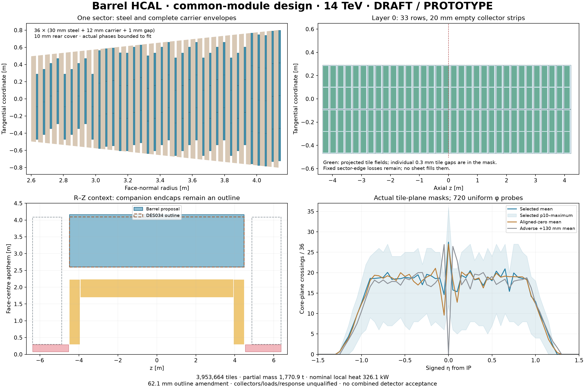

# DES-037 — Barrel HCAL using the common readout module

- Status: **DRAFT**; type: **PROTOTYPE / design proposal**
- Date: 2026-10-15
- Human direction: take DES036 as the common module and design barrel/endcap HCAL in separate PRs.
- Parents: [DES036](DES-036-hcal-common-readout-module.md), [DES035](DES-035-hcal-realism-and-prototype-plan.md), [DES034](DES-034-siw-service-envelopes.md).
- Human engineering owner / sign-off: unassigned / pending. No production integration.

## Design basis and provenance

**FACT about human direction:** the common module is the working design basis for a 14 TeV hadron collider. This authorizes the assembly study, without granting engineering sign-off. Preserve the 184 mm, 36-tile board and the 380 × 240 × 12 mm paired carrier, including its physical parts, material, channel and service ledger. The 25 ns, 750 kHz, latency, current and thermal inputs remain DES036 planning scenarios.

**FACT about pinned designs:** DES036 specifies all unit dimensions and sourced component locators; DES034 allocates a 2,600 mm barrel front apothem, 4,483.2 mm half-length, 1,495.9 mm total HCAL depth, an external ECAL service annulus at R = 2,300–2,600 mm and a 400 mm rear egress break. These are facts about unsigned prototypes. The upstream 36-layer / 30 mm steel recipe is audited in DES035, SRC-ODD-HCAL-CURRENT, XML layer/material locators.

**NODD DESIGN CHOICE:** retain that sampling comparison and all common hardware. Do not choose extra absorber by changing an electronics mixture. The present steel depth is a comparison point, not an established 14 TeV containment requirement. No cropped boards/tiles or continuous sensitive-sheet replacement is introduced.

## Required envelope amendment

The following are **INFERENCE** from the explicitly chosen stack. Values are normal to a barrel face.

| Contribution | Depth |
| --- | ---: |
| 36 repeats of 30 mm steel + 12 mm carrier + 1 mm installation gap | 1,548 mm |
| Rear aluminium cover | 10 mm |
| Total / increase over DES034 | **1,558 mm / 62.1 mm** |

Even 36 × (30 + 12) = 1,512 mm exceeds the old complete outline before gaps and covers. Keeping 35 layers with 1 mm gaps needs 1,515 mm; 36 layers with 0.5 mm gaps need 1,540 mm. Reducing steel, layers or installation clearance is a separate mechanical/sampling decision, rather than a hidden fit correction.

**NODD DESIGN CHOICE — proposed amendment:** retain the front and half-length; move the outer apothem to **4,158 mm**. The maximum polygon corner is **4,239.460 mm**. At DES034's R = 4,300 mm handoff, subtracting the 25 mm jacket radius and 20 mm clearance leaves only **15.540 mm extra**. This passes that particular analytic bound and provides no certified extra HCAL service capacity. Muon/magnet/load interfaces require reconciliation. The companion endcap proposal has its own depth/radial amendment; neither PR silently adopts the other.

## Assembly, supports and identifiers

All new geometric and routing values below are **NODD DESIGN CHOICE — unsigned**.

| Item | Proposed organization |
| --- | --- |
| Mechanical sectors / sampling layers | 16 / 36 |
| Absorber | Sector-owned 30 mm Steel235 plates, once per layer |
| Carrier order | Steel → unchanged paired carrier → 1 mm installation allowance |
| Local axes at sector phi | x = (−sin phi, cos phi, 0); y = (0, 0, 1); z = (cos phi, sin phi, 0), determinant +1 |
| Axial packing | 33 rows of 240 mm, with 20 mm empty collector strips; 260 mm pitch |
| Tangential packing | Maximum centred whole-carrier count at the narrow carrier-front face; 1 mm gaps |
| Structural reservations | 1 mm sector half-seam, 20 mm aluminium edge rails and end flanges, 10 mm rear cover |
| Requested phase cycle | Tangent −90, −35, +35, +90 mm; axial −60, −20, +20, +60 mm |

A carrier origin is its local (0,0,0) front face, not its geometric centre. Its radial front is `2600 + 43*layer + 30` mm. All eight corners through its 12 mm depth are checked. Plates exclude the edge rails; rails span only the sampling region, the rear cover follows it, and flanges occupy the axial end strips. Their material domains are disjoint. Plate → rail → flange / external bearing is the proposed load path; joints, bearing attachments, deflection, buckling, handling and magnetic loads are unqualified and omitted hardware is listed.

The 33 rows occupy 8,560 mm. Inside ±4,463.2 mm flange faces, a centred layout permits axial shifts up to 183.2 mm. The selected ±60 mm limit leaves at least 123.2 mm. Requested tangent shifts are **explicitly bounded** to `sign(request)*min(abs(request), max(0, centred_edge_margin − 1 mm))`. Emit both requested and actual shifts per layer. This retains identical maximal column counts in all phase controls; it avoids dropping the fourth carrier when a wide outer layer cannot take a full 90 mm shift.

The matched controls are phase-zero alignment and an adverse alignment with +130 mm axial shift. Odd row count at phase zero already includes the midplane; the +130 mm control deliberately puts a common service gap there. Changing phase can change sampling along a ray while preserving per-layer area and all material/power totals. Fixed sector boundaries are not removed by these shifts.

Retain the DES036 descriptor: system9, side0, sector0–15, layer0–35, carrier0–4095, module0–1, sensor0–35. Carrier indices are row/column addresses unique per sector/layer. The source-checked physical unit omits its removable steel reference patch. Shared interface/cooling material is counted once per carrier, not once per board.

## Services and material ownership

The common tubes run along local y, with four transformed inlet/outlet endpoints per carrier and the connector bay toward +y. The tool records each placement/frame and the port transformation, with world-coordinate examples. Reserve 20 mm inter-row strips and 32 named sector/end collection handoffs. These are **empty allocations**, not installed manifolds or a connected hydraulic network. Edge rails/end flanges contain material; crossing them needs an explicit port design rather than treating them as an empty trunk.

Scale all 156 powered internal channels for 72 tile inputs per carrier, including 72 unused ordinary and 12 auxiliary inputs. Keep trigger and DAQ budgets separate. The aggregate 12 V current is a sum of local module inputs, not a proposed single regional feed; voltage distribution, conversion, concentration, cabling and fault segmentation require design. Local converter losses are already included. External collector/trunk material and losses, bias regulation, fasteners, bearings, mounts and lifting hardware remain excluded. Mechanical extraction requires disconnecting services and removing covers/contact hardware; radial extraction from a closed stack is not established.

## Quantified first design and its limitations

**INFERENCE — partial local inventory:** 54,912 paired carriers, 109,824 boards, **3,953,664 tiles** and 8,566,272 powered internal channels. Modeled mass is **1,770.862 tonnes**, including plates, named supports/covers and unchanged common hardware. Nominal local heat is **326.143 kW**, requiring **15.605 kg/s** ideal water at 5 K rise. The 100 µA / 1 mA per-device stress cases give 342.417 / 491.865 kW; those currents are not predicted end-of-life values.

The whole common carrier's intrinsic projected core fraction is only **69.6387%**, from 72 × 29.7² / (380 × 240). The barrel's complete-face fractions are **39.51–59.30%** by layer, including support/end/packing losses. Report a separate packable-face denominator; do not shrink the fiducial face to hide unused areas. These are geometric plane areas, not particle efficiency. Intact small edge carriers using the same board are a future alternative if the residual gaps cannot meet reviewed sampling requirements.

The [executed design screen](../validation/DES-037/results.md) samples actual 29.7 mm core rectangles at carrier-local z = 2 mm, ahead of the recess beginning at 2.4 mm. It reports signed eta, uniform-phi statistics, first/last sampled plane and separate exact seam probes for selected/aligned controls. It also clips steel-only IP path lengths against plate/sector/end boundaries. These checks do **not** replace finite-solid/recess navigation, native geometry, optical response or shower containment. No whole-barrel DD4hep/Geant4 result is claimed from the inherited module smoke.

Residual all-empty phi bands and shortened sampling near the barrel/endcap transition are explicit design failures to resolve before detector acceptance. Staggering is not a general repair of wide fixed sector-edge gaps. The 400 mm rear break preserves the ECAL route; although barrel/endcap outline intersections overlap angularly, approximately |eta| = 0.94–1.22 lacks a complete traversal of either separate outline. Combined material and shower studies must assess that transition rather than adding separate maxima.

## Review and next gates

[Reproduction and controls](../../tools/hcal_barrel/README.md), [source-bound evidence](../validation/DES-037/results.md), and [independent review](../validation/DES-037/review.md). The regional drawing and proposal entry accompany this document. The selected LAYOUT001 outline stays unchanged while this amendment is reviewed.

Review the depth amendment, usable edge-carrier alternatives, sector cracks, collection/access interfaces and power distribution first. Full native assembly overlap/material/ID checks, finite-solid tile/recess navigation, thermal/hydraulic and structural work, regional radiation/occupancy/EOL assumptions, digitization/pileup and high-energy leakage studies follow. Only identified humans may approve production integration or accept the detector.

[Vector drawing](figures/DES-037/barrel-design.svg).
