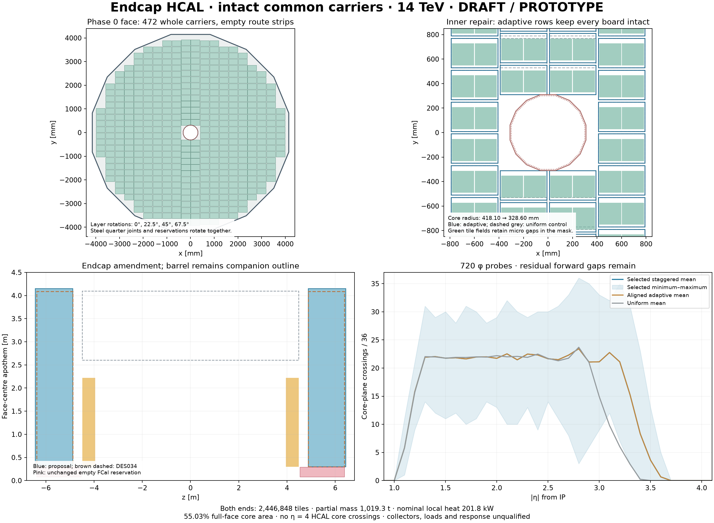

# DES-038 — Endcap HCAL using the common readout module

- Status: **DRAFT**; type: **PROTOTYPE / design proposal**
- Date: 2026-10-15
- Human direction: use DES036 as the common module; design barrel/endcap HCAL in separate PRs.
- Parents: [DES036](DES-036-hcal-common-readout-module.md), [DES035](DES-035-hcal-realism-and-prototype-plan.md), [DES034](DES-034-siw-service-envelopes.md), [endcap diagnosis](DES-029-endcap-coverage-repair.md).
- Human engineering owner / sign-off: unassigned / pending. No production integration.

## Design basis and envelope amendment

**FACT about human direction:** use the common module as the working basis for a 14 TeV hadron collider. Preserve its 184 mm, 36-tile board and 380 × 240 × 12 mm paired carrier, including material, channel, heat and service ownership. Selection as a working basis is not engineering sign-off. Other operating inputs remain DES036 planning scenarios.

**FACT about pinned prototypes:** DES034 has endcap front/back |z| = 4,883.2/6,379.1 mm and inner/outer apothems 300/4,085.9 mm. Its FCal reservation is empty, R = 80–290 mm, |z| = 4,533.2–6,379.1 mm. DES036 and DES035 retain the component source locators and historical sampling recipe; no new device specification is asserted here.

**NODD DESIGN CHOICE — explicit amendment:** retain 36 layers of 30 mm steel, the 12 mm common carrier, 1 mm installation allowance and 10 mm rear cover. **INFERENCE:** total depth is 36 × (30 + 12 + 1) + 10 = **1,558 mm**, 62.1 mm beyond DES034. Even zero installation gaps would exceed its complete depth. Propose back |z| = **6,441.2 mm** and outer apothem **4,148 mm**. The radial amendment preserves the previous 10 mm difference from the companion proposed barrel outer cover at 4,158 mm. Front and 300 mm aperture stay fixed. These are proposed outlines, not already approved detector bounds or a containment choice.

The ECAL rear egress break remains 400 mm, starting after the barrel half-length 4,483.2 mm. Do not fill that service allocation. The FCal reservation remains unchanged: extending the HCAL rear does not extend the forward detector or establish hadronic depth there. Muon/magnet/load and external-service interfaces need joint review.

## Full-face packing using intact common carriers

All new packing, frame and routing dimensions are **NODD DESIGN CHOICE — unsigned**. Do not clip boards, carriers or tiles at the bore or wedge boundaries.

| Item | Proposal |
| --- | --- |
| Face | Regular 16-gon, inner/outer apothems 300/4,148 mm |
| Inner / outer aluminium frames | 300–310 / 4,128–4,148 mm apothems, across the 1,548 mm sampling stack |
| Mechanical grouping | Four quarters per layer, independent of 16 angular readout-sector IDs |
| Carrier lattice before rotation | Column pitch 400 mm; row pitch 260 mm |
| Empty routes / quarter joints | 20 mm between columns and rows; 20 mm full joints on both axes |
| Positive-quadrant column centres | x = 200 + 400*i mm |
| First carrier front in y | Greater of 10 mm and the aperture-safe position for that column; then step 260 mm |
| Whole-layer phase cycle | 0°, 22.5°, 45°, 67.5°, repeated through 36 layers |

Use exact rectangle/convex-polygon separation at the expanded 310 mm bore, and all-corner containment inside the 4,128 mm frame boundary. The aperture-adaptive row origin moves intact inner carriers closer to the bore; it does not manufacture a new tile family. A 20 mm column trunk is reserved so differing row origins do not route a header through a neighbouring carrier. Outer-edge route fragments terminate at declared collection boundaries rather than implying a complete installed network.

Rotate the **whole layer pattern**, including steel quarter joints and collector reservations. The regular 16-gon is invariant under these 22.5° increments. Frames/rings are continuous; a layer quarter is not an independently extractable quadrant stack through all depths. Plate loading, attachments, assembly order and access for rotated layers require engineering design.

The controls separate effects: a uniform Cartesian row origin; an aligned aperture-adaptive pattern; and the same adaptive pattern with layer rotations. A further diagnostic filters that adaptive grid to reject carriers crossing any of the 16 angular bookkeeping boundaries. It exposes the cost of treating IDs as mechanical wedge borders; it is **not** an optimized wedge-packing comparison.

## Steel, supports, frames and identifiers

Each layer has four Steel235 polygon-annulus quarter plates, excluding the inner/outer frame domains and 20 mm quarter joints. The quarter joints rotate with their layer. Row/column collector strips exist in the carrier plane and **do not remove the steel beneath them**. Aluminium annular frames and one 10 mm back cover are owned once per endcap. The common unit is imported without its removable reference absorber. The partial mass ledger subtracts actual holes/joints and separates steel, common hardware, annular frames and cover.

For layer l, steel occupies `4883.2 + 43*l` through +30 mm; the carrier follows through +42 mm; the installation allowance completes the 43 mm pitch. The first/last sampled core planes are |z| = **4,915.2 / 6,420.2 mm**. Positive carrier axes are global x/y/z before the layer rotation. Generate the negative assembly through proper global **Rx(pi)**, including every port, connector and identifier. At zero phase its basis is (+x, −y, −z), determinant +1. A simple z reflection is invalid. A placement origin denotes carrier-local (0,0,0) at its front face; component solids retain their own local centres.

Use the DES036 descriptor: system9, side1/2, sector0–15, layer0–35, carrier0–4095, module0–1, sensor0–35. Assign the angular sector by the carrier centre and a unique index within each side/layer/sector. Carriers may cross an electronic sector boundary; no material is cut for that bookkeeping. Plate → annular frames / rear frame → external mounts is the proposed load path. Bolts, bearings, lifting fixtures and stiffness qualification remain absent; transport composition is not mechanical or magnetic constitutive data.

## Quantified first design

All results are **INFERENCE from the explicit unsigned layout**, not measured efficiency or engineering qualification.

| Quantity | Result |
| --- | ---: |
| Uniform / adaptive carriers per layer per end | 468 / **472** |
| Angular-boundary-filtered control | 304 carriers per layer per end |
| First tile-core radius, uniform / adaptive | 418.099 / **328.598 mm** |
| Full-face / packable-face core fraction, adaptive | **55.03% / 55.59%** |
| Both ends: paired carriers / common boards | **33,984 / 67,968** |
| Tiles / powered internal channels | **2,446,848 / 5,301,504** |
| Partial modeled mass | **1,019.273 tonnes** |
| Nominal local heat / ideal water at 5 K rise | **201.844 kW / 9.658 kg/s** |
| 100 µA / 1 mA per-device current stress heat | 211.915 / 304.406 kW |

The full fiducial denominator is the entire polygon annulus, including frame/joint/packing losses; the packable denominator excludes only the annular frames. The common carrier itself has a 69.6387% projected core-area ceiling, 72 × 29.7² / (380 × 240). Rotating an unchanged pattern preserves area and count, while changing its directional sampling. The uniform first radius is a lattice result, not an unavoidable hardware limit; adaptive rows improve it without custom boards.

Sampled active-plane counts at eta = 2 improve from an aligned minimum of zero to **13–29**, and eta = 3 to **9–33**, for the selected rotation pattern. This does not establish full coverage: at eta = **3.5**, **33.33%** of sampled azimuths still have no active plane; eta = **3.8, 4 and 5** have zero crossings throughout the sampled azimuths. At eta = 4 the ray reaches only 236.029 mm radius at the proposed back, inside the 300 mm aperture. A distinct forward design is mandatory for the ADR006 coverage direction. There is no FCal hardware or shower-depth claim here.

## Service boundaries and validation scope

Transform four water endpoints and LV/bias/data/control connector envelopes for every carrier. Name column/quadrant and perimeter-sector handoffs, with their local heat/current/cooling and separate chip DAQ/trigger allocations. Collector reservations are **empty**; connection objects explicitly say unconnected. Frames contain material, and crossing ports/seals/header/cable geometry are unimplemented. Do not borrow DES034's ECAL route capacity as spare HCAL plant capacity. The summed local 12 V current is not an external feed design. Extra conversion/concentration, external services, bias regulation and mounting hardware remain excluded.

The [analytical screen](../../tools/hcal_endcap/README.md) tests whole-carrier corners, aperture separation, neighbour spacing, proper frames, transformed ports, ID uniqueness, ownership and scaled continuous budgets. [Executed evidence](../validation/DES-038/results.md) records source/config/output identities and core-plane masks. Samples use actual 29.7 mm core rectangles at local z = 2 mm, ahead of the rear recess. They are not finite-solid intersections, optical response, particle efficiency or containment. Finite steel-path screening is explicitly **NOT RUN**. The old module native/Geant4 smoke remains unit evidence only; no new full-endcap native claim is made.

[Independent review](../validation/DES-038/review.md) assesses the exact implementation and claim limits. Next gates are residual inner/edge sampling, the barrel/endcap transition, collector/port/power distribution and mechanical access; then full native construction/material paths, regional radiation/occupancy/EOL inputs, thermal/hydraulic work and shower/digitization/leakage studies. Human approval is required for production integration and detector acceptance. The selected LAYOUT001 outline remains unchanged while this proposal is reviewed.

[Vector drawing](figures/DES-038/endcap-design.svg).
