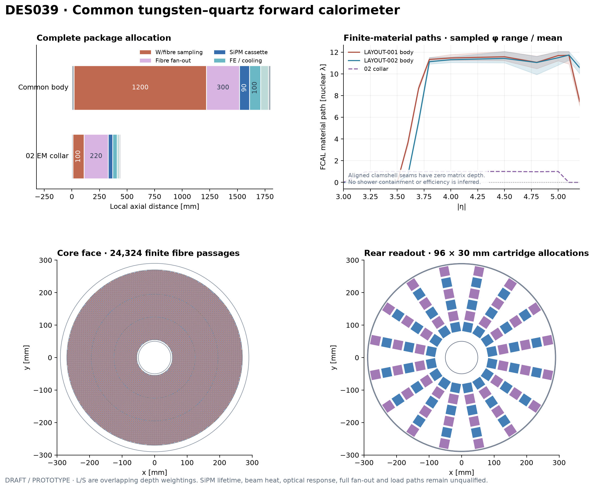

# DES-039 — Common tungsten–quartz forward calorimeter

- Status: **DRAFT**
- Type: **PROTOTYPE / design proposal**, 2026-10-17
- Human direction: design the proposed forward calorimeter and fit it into layouts 01 and 02.
- Related: [ADR010](../decisions/ADR-010-common-forward-calorimeter.md), [DES034](DES-034-siw-service-envelopes.md), [technology input](inputs/DES-039-fcal-technology.md), [interface input](inputs/DES-039-fcal-layout-interfaces.md).
- Human technology, machine-interface and engineering owners: unassigned; sign-off pending.

[LAYOUT-001 integration](../layouts/LAYOUT-001-tracker-3t-siw.md) · [LAYOUT-002 integration](../layouts/LAYOUT-002-tracker-3t-lar.md)

[LAYOUT-001 3D cutaway SVG](figures/DES-039/LAYOUT-001-FCAL-3d.svg) · [Technology and features in eight sentences](figures/DES-039/LAYOUT-001-FCAL-summary.txt).
The orthographic illustration retains the named design dimensions; an upper quadrant is removed, selected fibres are enlarged and the rear enclosure is shown in wireframe for visibility. Small clamshell joints, support ribs and full service hardware are omitted from the illustration; this changes no design parameter or validation evidence.

## Design and scope

**NODD DESIGN CHOICE:** use a common warm tungsten matrix with beam-parallel fused-silica Cherenkov fibres and rear cooled SiPM readout. Two interleaved fibre populations, full-depth L and S starting 100 mm into the core, give overlapping shower-depth weightings. They are not independent EM and hadronic compartments. Calibrated combinations require optical/shower evidence; no compensation, energy resolution, timing or high-pileup performance is specified.

The common body fits both candidate envelopes at different longitudinal positions. A short, wider module of the same technology forms the additional LAYOUT-002 EM collar. Its additional cooling/readout and service route are included. Existing tracker, magnet and ECAL source geometry stays pinned. This is an isolated parametric design and native-geometry study; it is not wired into production detector construction.

| Parameter | Common FCAL body | LAYOUT-002 EM collar |
| --- | ---: | ---: |
| Physical inner / outer radius | 50 / 290 mm | 50 / 450 mm |
| Sampling inner / outer radius | 55 / 270 mm | 55 / 430 mm |
| Complete axial length | 1800 mm | 440 mm |
| Tungsten/fibre sampling length | 1200 mm | 100 mm |
| Lattice pitch / hole diameter | 3.0 / 0.9 mm | 5.0 / 0.9 mm |
| Quartz core / buffered diameter | 0.6 / 0.8 mm | 0.6 / 0.8 mm |
| Short-fibre start after sampling front | 100 mm | 50 mm |
| Radial readout boundaries | 55, 125, 195, 270 mm | 55, 185, 315, 430 mm |
| Azimuth sectors / fibre populations | 16 / 2 | 16 / 2 |
| Optical tower signals / SiPM pixels per end | 96 / 1536 | 96 / 1536 |

All package, placement, lattice, segmentation, cooling and interface dimensions in this proposal are **NODD DESIGN CHOICES — unsigned**, except explicitly cited source dimensions. Counts/material paths are **INFERENCES** from the exact finite geometry. The [JSON inputs](../../tools/forward_calorimeter/inputs.json) are the numerical authority; retained output is in [the validation report](../validation/DES-039/results.md).

## Public evidence and deliberate adaptations

**FACT:** CMS HF uses rear-read long/short quartz fibres in steel; CASTOR uses tungsten/quartz tilted plates with side light guides. The proposed detector combines a dense absorber with rear fibre extraction; it is neither installed detector copied or scaled unchanged. The source dimensions, actual device data and precise locators are in the [technology dossier](inputs/DES-039-fcal-technology.md) and `reference/manifest.yaml`.

**FACT:** the Hamamatsu S14161-6050HS-04 reference array has sixteen 6 × 6 mm pixels and a 25 mm square package. **NODD DESIGN CHOICE:** allow a 30 mm square cartridge and a shared rear front-end/cold plate. Six cartridge rows per sector fit the body; each optical tower is divided across sixteen pixels by a finite ferrule map, without a lens or optical compression. This is a credible footprint reference, subject to irradiation, background-current, dynamic-range, circuit and cooling qualification.

**NODD DESIGN CHOICE:** model pure tungsten rather than an unspecified heavy alloy. Two matrix half-cylinders have 0.4° open joints at each split boundary. A half-pitch-offset Cartesian lattice excludes finite holes crossing the inner/outer surfaces or these joints. Short-fibre sites retain tungsten ahead of their 100/50 mm start; they are not empty full-length holes. A polyethylene transport proxy represents hard cladding plus protective buffer outside the 600 µm silica core. Its material is not a manufacturer optical-polymer specification.

## Physical assemblies, readout and services

The body zones are 20 mm front, 1200 mm sampling, 300 mm optical fan-out, 90 mm sensor cassette, 100 mm electronics/cooling, 70 mm service interface and 20 mm rear. Collar zones are 10, 100, 220, 40, 40, 20 and 10 mm respectively. Full buffered-fibre routing uses cosine S curves with zero endpoint slope; endpoint containment, per-pixel occupancy and individual bend radii are screened. Complete loom collision, connector, attenuation and optical capture validation remain open.

The inner aluminium sleeve occupies R50–55 mm. Sampling load cases have a thick outer shell, four longitudinal cradle ribs and end rings. The rear thin housing leaves space for the actual sensor cartridges. Mounts pass loads to a separate calorimeter frame; neither the beam pipe, tracker nor LAr cryostat carries the FCAL. Structural stiffness, attachment bolts, lifting and withdrawal procedures remain unqualified. The retained mass ledger is partial and excludes detailed external mounts, fan-out connectors and complete electronics.

Each sensor pixel has front-end calibration/diagnostic access; 16 pixels are combined to each tower output. A 40 MHz × 12 bit stream would require 46.08 Gbit/s per body/end before framing or redundant gains. This is a bandwidth sizing example. Circuit summing, thresholds, final sample rate and trigger/DAQ protocol are not selected. Power and data must be aggregated before the local service exit.

Nominal/adverse planning scenarios use 0.1/1.0 mA per pixel at a 40.7 V manufacturer-reference bias, 0.05/0.20 W front-end allocation per pixel, 10/20 W shared electronics, and 85% conversion efficiency. The +5°C sensor, 0°C supply and 3 K rise are planning conditions. Water-equivalent flow is an arithmetic bound, not a selected freeze-safe fluid or hydraulic network. Beam-deposition and environmental heat remain unknown. Supply/return routes use 6 mm OD / 4 mm ID allocations and a dry-gas/electrical exit. Pixel current is a stress parameter, not a radiation-dose prediction.

## Two-layout fit and explicit amendments

| Interface | LAYOUT-001 | LAYOUT-002 |
| --- | --- | --- |
| Body absolute z | 4533.2–6333.2 mm | 4850–6650 mm |
| Sampling absolute z | 4553.2–5753.2 mm | 4870–6070 mm |
| Body clearance to HCAL minimum bore | 10 mm | 10 mm |
| Body clearance to LAr warm bore | Not applicable | 11 mm |
| EM collar | No additional collar | 4400–4840 mm, R50–450 mm |
| New rear radial handoff plane | 6429.1–6579.1 mm | 7905.9–8055.9 mm |
| Outboard service handoff radius | 4300 mm | 4850 mm |

**NODD DESIGN CHOICE — explicit aperture amendment:** reduce the previous empty R80 mm bore to R50 mm. **FACT about pinned input:** the pipe has R27.8 mm outer radius and stops at absolute z4000 mm. A hypothetical same-radius extension would have 22.2 mm radial clearance; no downstream machine pipe, shielding, protection or acceptance has been approved. At eta5 the sampling front clearance to the sensitive inner edge is only 6.36 / 10.63 mm; collar margin is about 4.43 mm. These small margins require shower/beamline studies.

**NODD DESIGN CHOICE — additional 02 service amendment:** reserve a collar collector at absolute z4840–4890 mm, before the LAr warm front4900 mm. Two 18 mm centreline elbows and a radial segment turn 6 mm OD coolant lines from R435 to R294 mm. Their bounding surfaces span z4844–4886 mm and R291–438 mm. The new axial service neck is R290–298 mm; actual tubes span R291–297 mm, leaving 1 mm to the body, 3 mm to the cryostat and 2 mm to HCAL minimum bore. This is an explicit extension of the former R290 allocation. The radial collector is separate from the 10 mm collar/body axial gap.

Body and collar electrical, dry-gas and coolant services continue axially beside the HCAL bore until 50 mm behind its rear surface, then use a new 150 mm radial handoff allocation. Existing ECAL rear service breaks are not silently used as spare capacity. These new rear allocations extend total detector service space to 6.5791 / 8.0559 m and require muon/magnet/access coordination. The complete outboard manifold, plant connections and load frame remain open.

## Coverage and validation requirements

Finite-cylinder material scans use the actual core, buffer and air passage geometry, short-fibre starts and proper Rx(pi) negative-side placement. Source radiation/nuclear lengths are material references; pion interaction length and shower containment are distinct. The transverse average is not a guaranteed directional depth. Aligned clamshell seams provide an adverse zero-matrix control.

The collar geometrically bridges the LAYOUT-002 EM gap around eta3.28–3.59. The common body overlaps the forward calorimeter handover around eta3.8–5. It does not remove the partial-depth HCAL transition or lateral shower leakage into adjacent calorimeters. Eta/phi fibre crossings, solid material depth, optical signal and calibrated particle efficiency are different observables. [Executed evidence and limitations](../validation/DES-039/results.md) identify exactly which checks ran.

Next gates are downstream machine-interface approval, full native combined construction, optical and shower transport with surrounding calorimeters, radiation/EOL noise and beam-heat inputs, circuit/DAQ and thermal/hydraulic tests, and structural/access engineering. No human sign-off, production acceptance or performance claim is supplied by this prototype.
