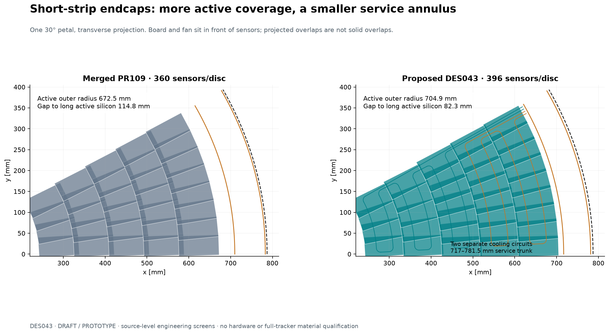
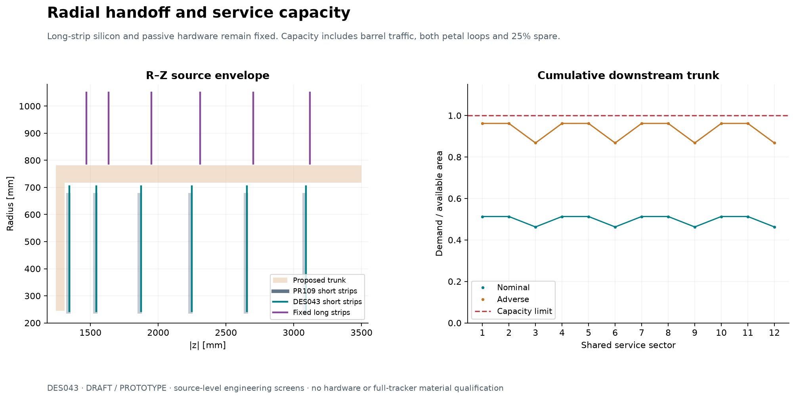
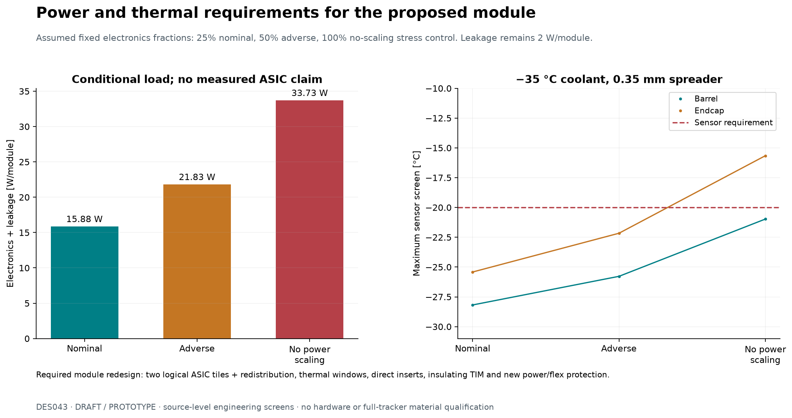
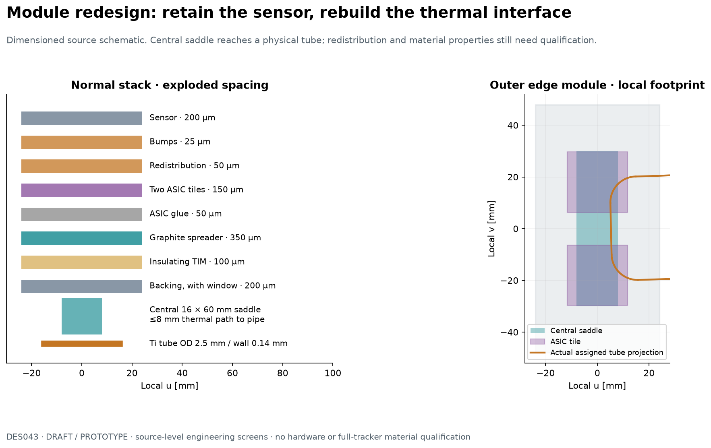
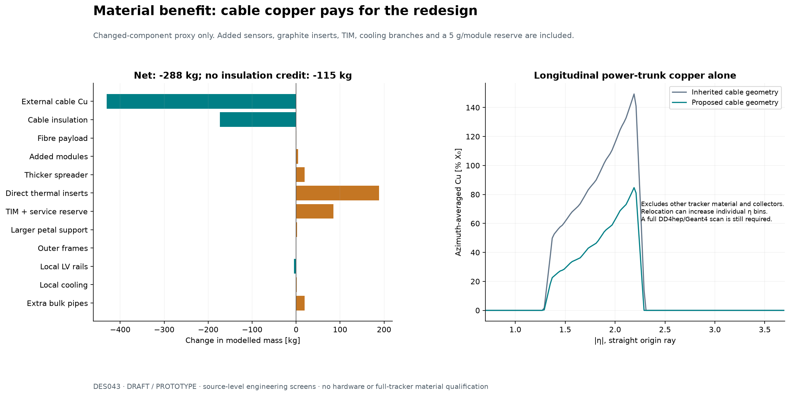

# DES-043 — 2 mm strixel services and radial coverage redesign

- Status: DRAFT
- Date: 2026-11-02
- Candidate: **SS-2MM-SVC-01**, isolated PROTOTYPE, proposed new working baseline.
- Human authorization: proceed with module redesign for703mm coverage; formal engineering approval remains separate. No production integration.
- Source baseline: merged PR109, `b564308fe2e76da42d0d62c6ba33f9c76876119c`.
- Governing inputs: DES-042 selected readout; DES-007 module; DES-010 services; DES-020/021 short strips; DES-022/023 long strips; DES-025 assembly.

## Proposed baseline

Use five more widely spaced short-strip endcap rings, extending the sampled full-azimuth target to **703 mm** and the finite active
silicon envelope to **704.9 mm**. Keep the long strips fixed. Reduce the physical active
radial gap from **114.8 to 82.3 mm**, a **32.4 mm / 28.3%** improvement. Rebuild
the power distribution and module thermal interface; reserve a narrower shared
service trunk, with an enlarged barrel collector connection.

**The module needs redesign.** Its 48 × 96 mm² active silicon outline and
200 µm thickness can remain. Electronics/interconnect, thermal contacts,
spreader/backing, power flex, connectors and protection must change. Extended
endcap petals also need new supports, board mounts and cooling circuits. The
proposal does not require larger sensor dies or changes to long-strip modules.

| Quantity | Merged PR109 | Proposed SS-2MM-SVC-01 |
| --- | ---: | ---: |
| Cell pitch, local u × v | 75 µm × 2 mm | 75 µm × 2 mm |
| Short-strip barrel sensors | 8,064 | 8,064 |
| Endcap sensors, both ends | 4,320 | **4,752** |
| Sensors per disc / petal | 360 / 30 | **396 / 33** |
| Finite active outer radius | 672.486 mm | **704.909 mm** |
| Finite body outer radius | 676.001 mm | **708.424 mm** |
| Long-strip finite active inner radius | 787.243 mm | 787.243 mm |
| Physical active radial gap | 114.758 mm | **82.335 mm** |
| Short-strip channels, both systems | 380,436,480 | **393,707,520** |
| Reduction versus original 0.5 mm population | 75% | **74.13%**, including added coverage |
| External power/HV/control bundles, both ends | 1,584 | **1,008** |
| Optical groups, both ends | 1,584 | **1,584**, retained |
| Local cooling circuits, both ends | 720 | **864**, including two per petal |
| Shared trunk r bounds | 710..783 mm | **717..781.5 mm** |

The added 432 sensors provide 1.991 m² more silicon area. They increase the
selected 2 mm channel count by 3.49%. Thus 75% remains the same-area readout
reduction; it is not the net channel reduction after the coverage extension.
These dimensions describe a proposed baseline, not manufactured tolerances.

## Parameter provenance and design decisions

All new hardware dimensions and operating requirements below are **NODD DESIGN
CHOICE**, proposed by this study with approving humans pending. Calculated
counts, gaps, loads, clearances and masses are **INFERENCE**, conditional on the
stated assumptions. Existing source-model dimensions are repository facts at
the pinned revision, rather than claims about built hardware.

Public **FACTS**, precise locators and independently inspected source bytes are
in the [TrackTech dossier](inputs/DES-043-tracktech-dossier.md), TT43-F01–09,
and [source catalogue](../../reference/manifest.yaml). The independently
computed geometry/interfaces are in the [SysArch dossier](inputs/DES-043-interface-assessment.md).
In particular: the CMS 7.8 W / 30,208-channel comparator and 13.4/3.6 mm cable
reservations come from DES-010 SS-F04/F10–12; ATLAS local return-drop guidance
is a comparator, not qualification. CERN bPOL12V V1.9 pp1–2 limits its input
to 12 V, so a 12 V supply requires transient protection. Henkel CAT11 May2019
p2 gives typical 1.28 W/(m K) insulating epoxy conductivity; it does not qualify
our cold thin interface. PDG `SRC-PDG-COPPER-2025` supplies Cu density
8.96 g/cm³ and X₀ = 14.36 mm. All remaining conductivities, contact resistances,
flow/quality bounds and cable insulation fractions are design requirements or
explicit material proxies, not supplier measurements.

## Rings and physical handoffs

| Ring | Centre radius [mm] | Modules/disc | Modules/petal |
| --- | ---: | ---: | ---: |
| 0 | 289.5 | 48 | 4 |
| 1 | 381.25 | 60 | 5 |
| 2 | 473.0 | 84 | 7 |
| 3 | 564.75 | 96 | 8 |
| 4 | 656.5 | 108 | 9 |

Retain the six mirrored disc datums, original 3 mm ring and 1.5 mm phi
staggering, 49 × 103 mm² module body allowance and inner active boundary.
The finite rectangle edge, rather than its nearest corner, defines the true
long-strip minimum radius. A finite-plane sampled union finds no radial holes
in the target 243.5..703.0 mm annulus at the tested phi and z vertices, with0.610mm minimum sampled outer margin. This
is not a reconstruction efficiency or continuous hermeticity claim.

| Interface | Proposed bounds / requirement | Rationale and consequence |
| --- | --- | --- |
| Petal cold plate | r236..710 mm; original skin/core thicknesses | Clears body corner708.424 mm; larger plate debited in material |
| Outer frame | r689..715 mm, 3 mm axial thickness at w=−12 mm | Preserve26 mm radial width; move load introduction and recheck stiffness |
| Board | r695 mm, 52 × 20 × 8 mm³, centre w=14 mm | Bottom10 mm above fanout9.5; top18 mm below fan start20 |
| Board supports | New peripheral entry beyond r708.424 mm, e.g.710..714 mm | Translating old posts would intersect outer-ring silicon; new cantilever/mount required |
| Front fan/pocket | r690..781.5 mm, w20..100 mm | Routes in front of modules; preserves an80 mm axial bend/connector reservation |
| Cooling ports | r712 mm; inner loop29.7°/29.2°, outer28.7°/28.2° | Four distinct ports; ordering avoids interloop fillet crossings |
| Longitudinal shared tray | r717..781.5 mm, abs(z)1310..3500 mm; walls0.5 mm | 2 mm to fixed long-strip inner bearing ring783.5 mm |
| Barrel collector | r244..781.5 mm, abs(z)1245..1310 mm | Extending the old750 mm endpoint avoids a failed joining throat |

Following the human instruction to advance coverage to703mm, ring spacing is
91.75mm. This supersedes the91.5mm engineering sketches in both input dossiers.
The longest direct pipe-saddle path is bounded by8mm rather than the earlier
6.6mm flat-contact estimate; the extra3.1mm insert reserve is debited.

The proposed26 mm frame is deliberately wider than the17 mm sketch in the
SysArch input; its larger material debit is retained. The front fan depth,
board supports and pipe passages require solid modelling before integration.
Finite current collector clearances are18.5 mm radially to the long barrel
collector and15 mm axially between their nearest z boundaries.

The worst sector carries **43 LV/HV/control bundles, 68 optical groups and
six bulk pipe pairs**. With half the azimuth available,40% packing,0.5 mm
walls and25% payload spare, its area utilization is **0.96184**. The nominal
75% azimuth/50% packing case is0.51298. These are area inequalities;
connector placement, bend/strain relief, installation and full solid clearances
remain unverified. A725..783 mm tray fails1.06478, a10 mm cable package fails
even in the old corridor, and retaining the750 mm collector endpoint fails its
joining throat. The8 mm package is therefore a real engineering requirement.

A sixth ring is not the selected baseline: the natural pitch continuation
crowds services, while a nearer690 mm ring intersects inherited thermal pickups
in the independent finite-footprint screen. It needs a further cold-module and
service architecture amendment. The five-ring design provides a conservative
coverage gain without that extra module-footprint change.

## Electrical and data design

Use protected12 V distribution, maximum14 physical modules per feed and a
minimum11 V delivered-voltage design bound. Select **2 × 10 mm² LV copper**,
maximum3.5 m one-way feeder. Include independent per-module HV pairs
2 × 0.14 mm²,0.8 mm² control and0.5 mm² shield allocation per bundle. Reserve
an **8 mm finished cable diameter**:25.22 mm² conductor in50.27 mm² envelope,
roughly50.2% copper. Insulation, creepage, radiation, bend, connector current,
protection selectivity and supplier manufacturability must establish this package.
No qualified commercial8 mm harness is claimed.

Use0.17 mm thick local Cu,12 mm width per polarity on barrel staves. Split
endcap power into three independently protected11-module islands with4 mm
width per polarity each, retaining the same24 mm total copper width. Interleave
taps radially to balance the discrete resistance paths. Copper resistivity is
0.0175 Ω mm²/m multiplied by1.4 for the warm bound. The local return-drop
limit is0.2 V; the total feeder+local+protection budget is1 V.

At the adverse load the local worst return is0.18571 V and the total round-trip
including **0.15 V connectors/protection is0.96206 V**. The resulting11.03794 V
minimum exceeds the11 V current-evaluation bound, so the constant-power current
bound is self-consistent. Only38 mV unallocated voltage margin remains.
The8 mm² conductor alternative fails this same connector budget;0.15 mm local
rails also fail the warm return-drop requirement. Protect against supply
overshoot; the CERN converter precedent is not a selected nODD converter.

Keep maximum12 physical modules per optical group and3.6 mm fibre packages.
No75% traffic saving is assumed: hit flux, occupancy, framing and module
endpoints do not follow the channel-count ratio. Optical occupancy/throughput
qualification and electronics grounding remain required.

## Heat, cooling and required module changes

Set `P0 = 7.8 × 122880/30208 =31.7288 W` electronics/module as the inherited
channel-density upper reference, and
`Pelec = P0 × [f_fixed +(1−f_fixed)/4]`. Nominal `f_fixed=0.25`, adverse0.5;
retain2 W leakage/module and5 W per physical end board. These are **power-budget
hypotheses**, not measured ASIC power and not an extra measured power saving
caused by this service redesign. The unscaled CMS7.8 W normalization is already
below our new nominal requirement; savings relative to that normalization are
not asserted. The proposed hardware must meet the adverse budget or be revised.

| Screen | Nominal | Adverse | No-scaling stress control |
| --- | ---: | ---: | ---: |
| Electronics/module [W] | 13.881 | 19.831 | 31.729 |
| Electronics+leakage/module [W] | 15.881 | 21.831 | 33.729 |
| Total strixel module+board heat [kW] | 207.14 | 283.38 | 435.87 |
| New heat incl. upper service-loss allowances [kW] | 216.95 | 301.69 | 478.97 |
| Total voltage drop [V] | 0.721 | 0.962 | **1.445 FAIL** |
| Endcap maximum sensor temperature [°C] | −25.42 | −22.16 | **−15.66 FAIL** |

The historical0.5 mm channel-density reference is421.30 kW before feeder/bus
losses. It is a comparison of assumptions; no measured current cooling-plant
load is available. Added sensors/leakage, fixed electronics, boards and service
losses are included explicitly. Full HV cable loss is not qualified.

The inherited6..24° serpentine missed some edge-module lands and cannot support
the earlier thermal claim. The redesigned arcs span3..27°; each hairpin uses
two10 mm-radius quarter-bends and a radial straight rather than a wide
semicircle. The central saddle intersects the assigned loop for every module
in the finite contact screen. Both same-loop and interloop clearances are
checked separately; thermal qualification still needs the actual contact.

Retain2.5 mm OD /0.14 mm wall local tubes and8/12 mm OD,6/10 mm ID bulk pairs.
Use two independent endcap circuits, inner3rings16 modules and outer2rings17.
Barrel nominal flow is4 g/s per leaf; endcap nominal5 g/s; adverse7 g/s per
leaf. With200 J/g latent allowance and0.35 usable quality rise, both selected
load screens satisfy enthalpy bounds; assign the full petal bus loss to each
loop for a conservative local screen. No-scaling controls fail. Total nominal
flow is3.744 kg/s, adverse6.048 kg/s; the old720-loop7 g/s comparator is
5.040 kg/s. **Adverse flow and branch count increase**; reduced total heat does
not justify smaller pipes. Two-phase pressure drop, local saturation temperature,
dryout, capillaries, flow balancing and pressure proof remain unresolved.

The concrete module thermal proposal is:

- Two logical23.4 × 23.4 ×0.15 mm³ ASIC tiles,15,360 channels each, at
  (u,v)=(0,±18) mm. This requires new interconnect redistribution and ASIC
  feasibility; it is a dimensional/hotspot allocation, not an available ASIC.
- A0.35 mm full-area graphite spreader, design conductivity400 W/(m K)
  in-plane and10 W/(m K) through-plane; maximum hotspot spreading distance3.7 mm.
- Use one central16 ×60 mm² endcap saddle, keeping two20 ×64 mm² barrel lands.
  Its ±8 mm tangential extent clears the neighboring inner-ring active edge;
  finite solid checks must confirm all module/petal seams.
- Direct conductive inserts through backing/core windows to the pipe, maximum
 8.0 mm path (including3.1 mm new core insertion); effective pickup conductivity
 ≥100 W/(m K), explicitly requiring a suitable orientation/material/interface.
- Electrically insulating TIM, total0.10 mm, cold/irradiated conductivity
 ≥1.2 W/(m K). Contact resistance≤0.04 K/W and pipe/boiling allowance≤0.08 K/W
 are requirements to demonstrate, not measured results.
- Coolant no warmer than−35 °C. Include a separate uniform2 W sensor-leakage
 corner allowance over the uncontacted16/18 mm endcap overhangs. The adverse
 endcap result is−22.163 °C: only2.16 K to the−20 °C requirement.

This bypasses the original foam/insulating backing path inside explicit windows;
it cannot be achieved by keeping the old mechanical module unchanged. Preserve
sensor footprint where feasible, but redesign support penetrations, thermal
contacts, electrical isolation and stress relief. Cold cycling, CTE, sensor bow,
radiation, noise, die bonding and failure isolation need module tests/FEA.

## Material consequence and limits

The changed-component ledger predicts **−287.8 kg** under its cable insulation
proxy. More conservatively, take **no cable insulation saving**: the result is
**−114.6 kg**. External power/HV/control/shield copper alone falls924.95→494.46 kg
(−430.49 kg); local LV rails save4.75 kg. All positive additions total320.60 kg,
including the extra sensors,19.58 kg spreader,188.40 kg direct inserts/pickups,
84.75 kg TIM plus5 g/module service reserve, larger supports and additional
cooling pipe bank. **No ASIC mass reduction, removed foam/backing, optical
saving or empty cable-envelope mass is credited.**

The raw power cable envelope falls516.15→109.99 litres, including internal
void. This is not a solid-material saving, nor a claim that the entire shared
service corridor shrinks by that percentage. The radial tray allocation falls
73→64.5 mm; the additional active reach also consumes existing local space.
The inherited effective20% copper cable recipe anchors the old copper estimate;
actual vendor cable data can change these results. Unmodelled fittings,
manifolds, mounts and qualifications must fit the reserve or trigger a new
ledger. The no-insulation-credit estimate has114.6 kg headroom to such additional
mass beyond the allowances; it is not a measured full-tracker weight.

The plotted η diagnostic averages **longitudinal trunk copper only** over full
azimuth. It excludes sensors, collectors, radial fanouts and other tracker
material. It shows the cable benefit and the effect of shifting its radius;
individual η bins may increase. It is not a Geant4 material scan or a prediction
of momentum resolution, tracking efficiency or fake rate. A complete native
geometry and directional X₀/interaction-length comparison is required before
claiming the full tracker material improvement.

## Deliverables and qualification gates

The [validation report](../validation/DES-043/README.md) supplies exact recipes,
source hashes, compact summaries, plots, checks and limitations. The proposed
parameters live in [inputs.json](../../tools/short_strip_redesign/inputs.json).
Original configurations, layouts and evidence remain frozen under their own
identities; SS-2MM-SVC-01 is not wired into the combined detector.

The human has authorized the isolated module redesign. Before production
integration: ASIC/cable feasibility; detailed module and endcap CAD/native DD4hep solids with
stable new identifiers and overlap checks; thermal/structural and hydraulic
qualification; complete conductor/data/pressure interfaces; full material scans;
ACTS conversion/navigation and curved-track/vertex coverage; repeated frozen
single-particle and ttbar+200PU comparisons. The existing2 mm response evidence
belongs to the old physical geometry and cannot certify this expanded one.
