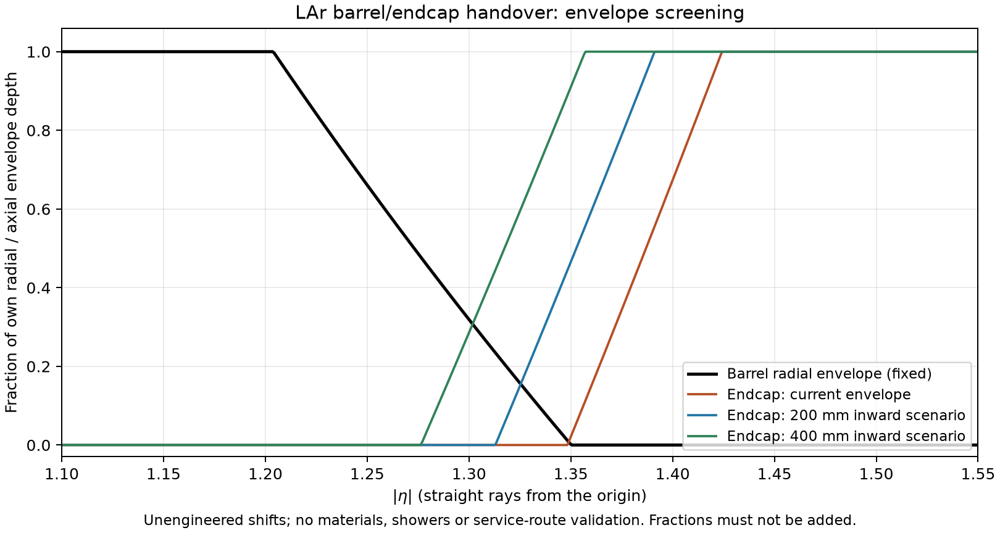

# DES032/DES033 — hadron-collider granularity and barrel/endcap gap options

2026-11-13. **PROTOTYPE / design input**, following merged
[PR140](https://github.com/asalzburger/nodd/pull/140). Source geometry and service
hypotheses examined at `ce9c261a94aa2b025180f2f5c96d5e166fa01a53`.
This note proposes discriminating studies; it changes no detector parameters
and grants no engineering or performance acceptance.

## Recommendation and present evidence

**INFERENCE:** investigate selective readout coarsening and alternate service
egress together. Coarser readout can lower channel-dependent services, but the
present front gap is driven by a chosen cryogenic-pipe route. Its size does not
follow directly from the number of cells. Start by defining side/rear service
ports and a projective-depth target, then determine a viable clearance.

**FACT about the current prototype:** the warm barrel ends at |z|=4100mm and
the warm endcap starts at4900mm: an800mm routing reservation. Sampling ends
at3910mm in the barrel and starts at5010mm in the endcap. The1100mm axial
separation therefore contains800mm external routing,190mm barrel closure/bath
and110mm endcap closure/bath. These are axial dimensions; they are not a dead
thickness traversed by every particle. See DES032/033 and the prior
[PR75 transition review](DES-032-transition-review.md).

**FACT:** the matched10k study has a much smaller inclusive raw-response width
for LAr, but its1.2<=|eta|<1.5 bin still has44.18% width. That quantity is the
coefficient of variation of active deposited energy / primary energy over a
broad energy/angle sample, without digitization or calibrated reconstruction.
It is not intrinsic energy resolution. The study alone does not select a
hadron-collider calorimeter or attribute the transition loss entirely to the
800mm gap. Sources: [protocol](../../validation/lar10k/protocol.md),
[summary](../../validation/lar10k/summary.json).

## What changing cell size can achieve

**FACT about the model:** barrel readout already groups two neighbouring
electrode periods and both active gaps into a canonical cell, with different
theta binning by layer. The physical absorber/electrode pitch and LAr drift-gap
width are separate from this grouping. The total3,488,768 logical cells differ
from the4.3million planning channels used by services.json.

**INFERENCE:** doubling both transverse readout dimensions would give roughly
four times fewer channels in a uniformly mergeable grid. Actual barrel/wheel
boundaries and layer choices require an exact address-count audit. Keep the
absorber/electrode sampling geometry and drift gaps fixed in the first study;
changing them also changes sampling, capacitance and charge collection.

- Preserve the fine strip layer, useful shower-depth/pointing information and
  fine coverage where occupancy or shower separation requires it. Test coarser
  cells in deeper compartments first. Region-dependent grouping is an option,
  not an assumption that the forward region can be coarser.
- A smaller number of physical frontend inputs can reduce frontend power and
  analog interconnects. Analog ganging or larger electrode pads changes
  capacitance, noise, calibration, dynamic range and routing; it needs an
  electronics model. Digital merging after digitization retains frontend/ADC
  channels. It can reduce later data traffic if implemented upstream of the
  relevant link, but it does not by itself remove those frontend services.
- At hadron-collider rates, larger cells also collect more overlapping energy
  and can obscure nearby showers. Channel bandwidth need not decrease in direct
  proportion to channel count, since occupancy and waveform policy change.

**FACT from SRC-FCC-HH-CALO-2019:** section1.3.2 (PDF12) motivates high
granularity for photon identification, track-cluster association and pileup
rejection, and a fine strip layer for photon/pi0 separation. Table2 (PDF18)
already combines fine strips with coarser phi cells in some layers. This is
evidence for a differentiated study, not a transferable optimum for nODD.
The report also requires deeper electromagnetic sampling for its high-energy
scenario. Its FCC-hh conditions are not silently adopted as this project's
requirements. [Primary report](https://arxiv.org/abs/1912.09962).

## Service arithmetic: substantial power savings need not shrink this gap

**INFERENCE**, evaluating the existing services.py hypotheses without changing
pipe diameters, station counts, fixed HV/power/control cable counts or bend rules:

| Planning-channel divisor | Planning channels | Channel power at40mW | Barrel ordinary station area | Barrel utility station area |100mm-jacket S-bend |
| --- | ---: | ---: | ---: | ---: | ---: |
|1 |4,300,000 |172kW |31,104mm² |109,644mm² |739.4mm |
|2 |2,150,000 |86kW |30,218mm² |108,758mm² |739.4mm |
|4 |1,075,000 |43kW |29,735mm² |108,275mm² |739.4mm |

The power column is only the assumed channel-proportional electronics term;
it excludes bath/static loads and fixed overhead. It is not an ASIC prediction
or a total cryogenic-load budget. Even fourfold channel reduction lowers the
ordinary packed station footprint by only4.4% and the utility footprint by1.25%
under these fixed hypotheses. Pipes dominate much of the reservation. Those
fractions would change if a thermal/hydraulic study justified smaller pipes or
a different supply architecture. A50kHz hit/channel throughput hypothesis from
the existing FCC-ee-oriented budget cannot certify hadron-collider bandwidth.

The100mm utility line is assumed to shift from R2735.3 to R3029mm with
minimum bend radius4xOD. The selected S-bend construction needs739.403mm,
including jacket and20mm clearance. Ports, headers, connectors and utility-specific
origins remain undefined. Reducing the front gap to600 or400mm while retaining
this route fails its own assumed clearance; it is not a viable exported variant.

## Options to mitigate the handover

All entries below are **INFERENCE / proposed studies**, with approval open.

| Option | Benefit to investigate | Physical interface and limitation |
| --- | --- | --- |
| Barrel-side ports to the outer annulus, with rear radial egress | Remove the front S-bend as the gap-setting feature | Define fill/drain/vent/relief, N2 supply/return, electrical/HV/data, penetrations, insulation, connectors and installation sequence. Check barrel support, outer annulus, HCAL rear break and access at both ends. |
| Bring the endcap inward after rerouting | Recover sampling depth along transition rays | Move the complete cryostat/services coherently; check collar/FCal, tracker/solenoid service paths, HCAL and installation. No clearance is inferred from an empty RZ rectangle. |
| Extend the barrel or shape a projective overlapping corner | Prevent rays from leaving a short barrel before reaching useful endcap depth | Extend cold/warm closures and supports consistently; avoid physical overlap of separate cryostats. Recheck ECAL/HCAL and forward interfaces. |
| Reduce passive closure material; move boards/support out of critical rays | Reduce upstream loss and conversions | Requires pressure-vessel, thermal and mechanical evidence, plus realistic penetrations. The50mm Al-equivalent endcap front closure is a model hypothesis, not a certified irreducible wall. |
| Instrument the residual transition with a presampler or crack detector; combine ECAL/HCAL information | Measure upstream losses and constrain corrections/tails | Adds its own material, services, radiation/timing requirements. A thin detector cannot replace missing electromagnetic shower depth or recover energy already lost invisibly. |
| Common or interlocking cryostat concept | Potentially remove duplicated end closures and improve projectivity | Larger redesign of vacuum/pressure boundaries, supports, installation and maintainability; lower priority than closing the current routing hypothesis. |

Calibration, timing and track information can mitigate residual response
nonuniformity and pileup. They do not physically eliminate a gap or guarantee
recovery of its event-by-event fluctuations. Local passive shielding/support
must not be treated as active calorimeter depth.

## Envelope screen and the next comparison

**INFERENCE**, straight rays from the origin with `r=z/sinh(|eta|)`: the barrel
has its full radial sampling envelope through|eta|=1.204 and some envelope
through1.350. The outer endcap wheel first intercepts rays at1.348 and offers
its full450mm axial envelope only above1.424. Near-tangent overlap therefore
does not imply adequate shower depth.

| Unengineered endcap shift inward | Warm gap | Active axial separation | First endcap-envelope eta | Full axial-envelope eta |
| --- | ---: | ---: | ---: | ---: |
|0mm |800mm |1100mm |1.348 |1.424 |
|200mm |600mm |900mm |1.313 |1.391 |
|400mm |400mm |700mm |1.276 |1.357 |



These curves omit inclined sampling, wheel support strips, material, showers
and magnetic fields. Each fraction measures its own radial or axial envelope;
the fractions must not be added as an energy or radiation-length estimate.
The shifts are probes of geometric leverage, not demonstrated feasible designs.
The prospective forward collar occupies R80–450mm and |z|4400–4850mm,
while the warm endcap bore is301mm. An inward shift beyond the current50mm
axial clearance also conflicts with that reservation and requires a new forward
interface handoff; the collar is not claimed to be installed in the10k ECAL-only
model. The endcap rear support annulus also lacks signal/HV penetrations, so
rear egress remains an interface proposal rather than a connected route.

**NODD DESIGN CHOICE — proposed evaluation, not adoption:** first compare the
present routing with an explicit side/rear port option. Screen inward endcap
shifts of200/400mm and a barrel-corner extension only in isolated variants once
routes exist. Keep readout fixed for that comparison. Separately test layer/region
groupings at fixed geometry. This keeps service-topology, passive-material,
active-coverage and readout effects distinguishable.

Before selecting either geometry or granularity:

1. Specify collider energy, luminosity/occupancy, bunch spacing, vertex spread,
   radiation, trigger/readout policy and timing targets. Close pipe/cable/board
   counts, actual routes, cooling and power budgets at the same completeness
   for LAr and SiW.
2. Check containment, overlaps, ports and material/X0 maps versus signed eta/phi
   with the vertex distribution; preserve IDs or explicitly version them.
3. Use matched electrons/photons through the transition, calibrated per energy
   and direction, with withheld validation events. Report means, central widths,
   tails, zeros and leakage separately. The10k broad-bin mixture is insufficient
   for a detailed transition redesign.
4. For cell sizes, add clustering, two-shower/pi0 separation, track matching,
   noise/shaping/dynamic range and in/out-of-time pileup. Include higher-energy
   showers, jets, taus and missing-momentum tails for the chosen hadron scenario.

Lossless regrouping preserves the study's all-cell deposited-energy sum, so a
repeated inclusive raw-response comparison cannot choose the cell size. The
existing result supports further LAr study; it does not yet establish hadron
performance superiority over SiW.

## Reproduction and evidence

The standard-library screen calls the existing service arithmetic and reads
the unchanged barrel/endcap configurations. Matplotlib is needed only for PNG:

```sh
python3 -B tools/lar_calorimeter/gap_screen.py \
  --output build/lar-gap-options/screen.json
# With an existing Matplotlib Python:
python3 -B tools/lar_calorimeter/gap_screen.py \
  --output build/lar-gap-options/screen.json \
  --figure build/lar-gap-options/envelope-screen.png
```

Retained [screen.json](lar-gap-options/screen.json) contains exact results,
source hashes and limitations. No DD4hep/Geant4 build or transport was run for
this note. Separate SysArch/PhysVal contributions and actual checks are curated
in [the session](../../../logs/design/SESSION-2026-11-13-lar-gap-hadron-options.md).
