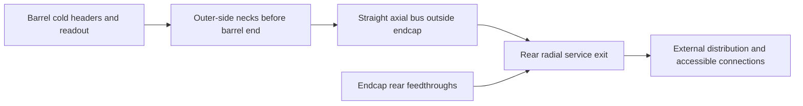

# DES032/DES033 — proposed barrel side necks and rear service exit

2026-11-13. **PROTOTYPE / proposed NODD DESIGN CHOICE; approval open.**
Requested clarification of option1 in the
[gap/options assessment](DES-032-hadron-gap-options.md), retained in
[draft PR142](https://github.com/asalzburger/nodd/pull/142).
Input revision: `e5e1ecd68bbdcd8c3f9e6402e2089db1c8eab751`.
No detector parameters or exported geometry change in this proposal.

## Preferred topology

**NODD DESIGN CHOICE — proposed:** put the outward pipe offsets in service
necks on the cylindrical outer side of the barrel, completing them before the
barrel end face. Continue straight axial lines outside the endcap, then turn
radially outward in the rear service break. Keep endcap service exits at its
rear. Preserve the present channel count, pipe diameters and4xOD bend rule in
the first comparison; no smaller pipe or unqualified header consolidation is
used to obtain the proposed front-gap saving.



The diagram shows connectivity, not installed routes or a scaled RZ layout.
Separate process circuits remain separate; a common service location is not
a shared fluid manifold.

**FACT about the present model:** the barrel warm radius is2830mm and half-length
4100mm. Its cold cooling-pipe reference radius is2735.3mm. The endcap warm
radius is2949mm; the exterior bus reference is3029mm and HCAL barrel inner
apothem3130mm. HCAL barrel ends at|z|5860mm and HCAL endcap starts at6360mm,
giving a500mm rear service break. These are prototype allocations, not qualified
pipe ports. Sources: DES032/033, services.json and barrel_services.py at the
input revision.

## First dimensional reservation

All new reservations below are **NODD DESIGN CHOICES — proposed**. Their sizing
arithmetic is **INFERENCE** from the unchanged pipe/bend hypotheses.

| Part | First reservation | What must be established |
| --- | --- | --- |
| Barrel side-neck band | Initially investigate abs(z)=3000–4000mm, one metre long and entirely before the4100mm end face. A single100mm jacket gives a conservative radial sizing envelope R2665.3–3099mm including20mm clearance | Local cold/warm vessel extensions and insulated penetrations, actual header origins, swept pipe paths, board and support clearance. The band is a study location, not a proven fit for one pipe or the complete bundle. |
| Outward offset inside each neck | Reuse the existing2735.3→3029mm offset as an envelope-sizing example | The100mm jacket with400mm bend radius needs619.4mm axial centreline advance,739.4mm by the old jacket/clearance convention. Its actual utility origin is undefined and may change this number. |
| Straight exterior bus | Start from pipe centre R3029mm; retain the existing32 barrel stations,16 per end, including one utility station at each end | A single100mm jacket occupies R2979–3079mm:30mm to the endcap wall and51mm to the conservative HCAL apothem. Full multi-line/cable packing, supports, insulation, installation and tangential clearances remain unproved. |
| Rear outward turn | Use the existing500mm break as the baseline test | A100mm jacket,400mm bend radius and20mm clearance to each axial face need490mm in the ideal swept-elbow screen. Only10mm remains for extra axial footprint; connectors/flanges/valves cannot be assumed to fit there. |
| Connections/distribution | Use R4800mm as an initial exterior handoff marker; locate bulky hardware beyond the narrow annulus and turn where practicable | HCAL outer apothem4625.9mm gives4716.5mm corner radius; a100mm jacket at4800mm leaves33.5mm radial clearance. This is not an allocated free envelope: magnet/return-yoke passages, supports, disconnection and plant routes remain to be defined. |

Do not try to put a conventional radial-to-axial90degree turn wholly inside
the300mm barrel corridor or181mm endcap corridor: the existing470mm one-sided
turn allowance already exceeds both. The purpose of the neck is to make an
oblique two-arc offset along the barrel periphery, through deliberately designed
vessel penetrations, rather than a tight elbow after a simple radial hole.

The single-pipe radial screen is not proof that all station bundles fit.
The700x150mm ordinary and1100x150mm utility lane reservations must be checked
with actual pipe/cable positions and 3D supports. No reduction of the existing
external cooling-line count is assumed. Header consolidation could be studied
later with a separately sized hydraulic circuit.

## Interfaces that the prototype must resolve

**FACT about current obstructions:** the proposed axial band contains100mm-wide
H-rings centred at|z|3250 and3750mm and populated board rows. The closed cold
and warm shells are not penetrations. The5888 board slots provide only28 spares
above the5860 slots needed for the3million-channel planning allowance at512
channels/board; fewer geometric readout cells do not authorize consuming that
planning margin. The endcap rear30mm support annulus is currently unported and
blocks direct signal/HV paths. Sources: barrel_services.py, DES032 and DES033.

| Handoff | Required resolution before shrinking the front gap |
| --- | --- |
| Calorimeter cold header → cryostat neck | Locate distinct N2 supply/return and LAr fill/drain/vent/relief connections; size flow and heat loads, thermal contraction and process-specific high/low points. Preserve support load paths and repack affected boards while retaining planning capacity. |
| Cryostat neck → SysArch outer bus | Draw both pressure/vacuum interfaces, insulation, warm/cold supports and each swept pipe/cable volume. A shell cutout without sealed interfaces is not a feedthrough design. |
| Outer bus → rear break / HCAL | Check both HCAL corners with independent face clearances, including jacket, supports and connector footprints. Retain the500mm baseline if it fits; otherwise explicitly allocate a larger break or an engineered local HCAL service pocket. |
| Endcap cold components → rear exits | Replace the continuous support proxy with a load-bearing design containing qualified signal/HV passages; define cold-header and rear-vessel feedthroughs. |
| Rear exit → external services | Allocate a real receiving envelope and magnet/return-steel crossing. Specify access and how endcaps can move or be disconnected without loading fixed pipes. |
| Barrel/endcap front → tracker, magnet and forward region | Retain their installation and service needs; moving LAr services alone does not prove the front gap can vanish. |

**FACT / precedent only:** SRC-ATLAS-CANADA-FEEDTHROUGHS describes separate cold
and ambient sealed flanges, vacuum isolation and internal connection cables.
It illustrates the interface completeness required here; its1998 electrical
design is not a cryogenic-pipe design or a channel-capacity prescription for nODD.
[Primary collaboration description](https://www.atlas-canada.ca/cry1.html).

## Proposed first comparison

**NODD DESIGN CHOICE — proposed sequence:** first replace empty service
reservations with isolated port/neck/bus/exit mock-ups at the unchanged ECAL
positions. Check closed connections, swept clearances, material, structural
load paths and electronics/cooling budgets before moving the endcap. Keep
readout and sampling fixed to isolate routing effects.

Then use a400mm front warm-gap **study target**, half the present800mm, rather
than declaring it an attainable minimum. Moving the complete endcap400mm inward
while keeping HCAL fixed would increase endcap-back-to-HCAL-endcap space from
500 to900mm, and reduce the active axial separation from1100 to700mm.
However, HCAL barrel still ends at5860mm: the unobstructed radial exit remains
the500mm window5860–6360mm. The extra400mm provides room for ports/headers
behind the endcap inside the outer annulus; it does not widen the radial elbow
window without an HCAL barrel/end-interface amendment. This is a useful
allocation to test while the current front handover is weak. It still conflicts
with the prospective forward collar reservation and requires a coordinated
forward-interface amendment.
Do not implement the shift until those interfaces and installation clearances
are resolved. No response improvement is quantified by this routing proposal.

If the neck cannot be made compatible with the support/vessel/board layout,
compare a localized radial service chimney through an explicitly reserved HCAL
sector as a fallback. That trades a distributed EM transition problem for a
localized hadronic inactive region and requires jet/missing-momentum validation;
it is not a free escape route.

## Arithmetic check

For the legacy sizing example, `d=3029-2735.3=293.7mm`, `R=4*100=400mm`:

```text
theta = acos(1-d/(2*R)) = 50.737445 degrees
S-bend axial centreline = 2*R*sin(theta) = 619.403189 mm
legacy envelope = 619.403189 + 100 + 20 = 739.403189 mm
rear ideal elbow with both face clearances = R + 100/2 + 2*20 = 490 mm
```

These are analytical screens, not CAD/native overlap or thermal/hydraulic
validation. No Geant4/DD4hep runtime was used. Separate SysArch assessment and
checks are retained in the
[follow-up session](../../../logs/design/SESSION-2026-11-13-lar-side-rear-routing.md).
