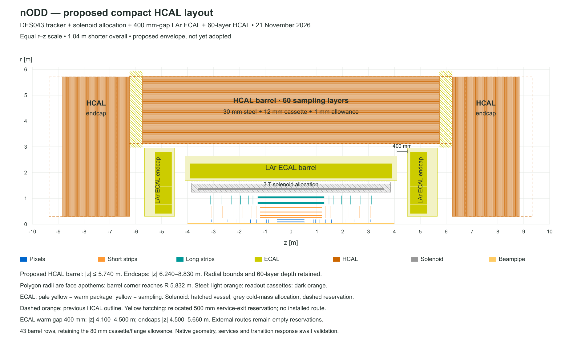

# HCAL axial compaction around the 400 mm-gap ECAL

2026-11-20. **DRAFT / feasibility proposal only.** Governing inputs:
[DES045](../DES-045-hcal-restored-ecal-pion50.md),
[DES046](../DES-046-hcal-sector-edge-coverage.md) and the
[merged 400 mm-gap ECAL recipe](DES-032-gap400-prototype.md).
Source examined: `8153129e07d92a17dccca6fa0226ae5142398941`.
No detector configuration, exported/native geometry or response sample is changed.



The21November drawing shows the80 mm-allowance candidate below. Solid orange is
the proposed HCAL; dashed orange is the previous outline. Yellow hatching marks
the relocated500 mm service-exit reservation. It is an envelope illustration,
not a newly constructed/native-validated detector.
[Named inputs](../../layouts/LAYOUT-002-HCAL-compact-proposal.json) ·
[SVG](../../layouts/figures/LAYOUT-002-HCAL-compact-proposal-rz.svg) ·
[PDF](../../layouts/figures/LAYOUT-002-HCAL-compact-proposal-rz.pdf)

```sh
python3 -B tools/hcal_response/draw_rz.py --capture --compact-hcal \
  --input docs/layouts/LAYOUT-002-HCAL-compact-proposal.json \
  --output docs/layouts/figures/LAYOUT-002-HCAL-compact-proposal-rz.svg
rsvg-convert docs/layouts/figures/LAYOUT-002-HCAL-compact-proposal-rz.svg \
  -o docs/layouts/figures/LAYOUT-002-HCAL-compact-proposal-rz.png
rsvg-convert -f pdf docs/layouts/figures/LAYOUT-002-HCAL-compact-proposal-rz.svg \
  -o docs/layouts/figures/LAYOUT-002-HCAL-compact-proposal-rz.pdf
```

Omit both capture flags to replay the named input. Source hashes bind the parent
layout and screen; current geometry figures are preserved byte-identically.

## Space and a compact candidate

**FACT about the current project model:** the complete ECAL warm endcap ends at
|z|=5660 mm. HCAL still ends its barrel at6260 mm and begins its endcaps at6760 mm,
coordinates retained when the ECAL moved600 mm inward. The1100 mm ECAL-rear to
HCAL-front interval therefore contains600 mm extra allocation before the500 mm
HCAL barrel/endcap radial service-exit window. External pipes, side necks and
cables in these routes are unconstructed reservations. Local ECAL hardware is
inside its warm package; an empty route reservation is not an engineered route.

**INFERENCE:** the exit window can be shifted inward with the HCAL without
changing its width or the radial lanes in the existing service-budget screen.
The largest rear-elbow bound is490 mm, including the existing two-face clearance
screen, leaving10 mm in a500 mm window. A400 mm exit fails the retained bend
screen. These are current model assumptions, not engineering minimum clearances.

The whole-carrier packing screen gives:

| Layout | Barrel half-length [mm] | Endcap front/back [mm] | Cassette to inner flange [mm] | Total length saved [mm] |
| --- | ---: | ---: | ---: | ---: |
| Current | 6260 | 6760 / 9350 | 80 | 0 |
| Exact ECAL-rear alignment | 5660 | 6160 / 8750 | **0** | 1200 |
| Illustrative new20 mm allowance | 5680 | 6180 / 8770 | 20 | 1160 |
| Preserve current80 mm allowance | **5740** | **6240 / 8830** | **80** | **1040** |

**NODD DESIGN CHOICE, proposed and not adopted:** retain the present80 mm
cassette/flange allowance for a first compact geometry trial. This shortens each
end by520 mm. The20 mm alternative is a new unsigned allowance; it is not an
established installation requirement. Exact alignment is an envelope limit,
with zero module/flange clearance, rather than a ready assembly layout.

All compact cases preserve60 layers,30 mm steel per layer,2590 mm endcap depth,
barrel radii and endcap radii/bore. The barrel repacks from47 to43 whole axial
rows. It predicts245616 barrel carriers and13882464 barrel tiles, versus268464
and15173856 currently. Steel, guides, covers, flanges, placements/IDs, aggregate
materials and service inventories would need regeneration; no module is clipped.
The counts are packing predictions, not a new native inventory.

“Align with ECAL” here means the **complete warm ECAL rear**, not the barrel
alone at4100 mm. A full HCAL endcap starting4600 mm,500 mm after that shorter
barrel, would overlap the ECAL endcap package4500–5660 mm at shared radii.
Retaining the HCAL endcap safely behind the ECAL instead creates a2060 mm
barrel/endcap interval and is a different topology with substantial coverage loss.
The solenoid allocation ends at3850 mm and is not the direct obstruction here.

## Coverage consequence

**INFERENCE from finite absorber intervals:** shortening and translating the
components changes the barrel/endcap overlap seen by showers. Keeping60 layers
does not establish equal directional depth or energy resolution.

An independent PhysVal screen, reproduced by the coordinator, intersects all
60 actual30 mm absorber intervals at phi=10 degrees, away from sector/quarter
seams. It includes the20 mm barrel flange exclusion and endcap steel apothems
310–5690 mm. Example total steel paths are:

| Eta | Current [mm] | 20 mm-allowance candidate [mm] | 80 mm-allowance candidate [mm] |
| ---: | ---: | ---: | ---: |
| 0.90 | 2619.35 | 2344.35 | 2401.07 |
| 0.94 | 2651.57 | 2195.27 | 2193.96 |
| 1.00 | 2342.71 | 2335.80 | 2344.25 |
| 1.30 | 2779.83 | 2314.89 | 2358.50 |

On eta0.8–1.25 in steps of1e-5, the sampled minimum steel is2321.35 mm currently,
2166.71 mm with20 mm allowance and2184.83 mm preserving80 mm. These are one-phi
absorber-path screens, not sensitive sampling, all-phi acceptance or shower
predictions. Coarse face-apothem full-depth transition bounds change from
|eta|0.9466–1.2687 to0.8764–1.2145 or0.8838–1.2202 respectively. The transition
shifts; it is not unchanged. Moving the bore inward also affects forward coverage.

Before adopting any candidate, regenerate and check finite/native geometry,
counts/materials/IDs/overlaps, actual service routes and sensitive/material paths
across both signs of the transition and relevant phi seams. Then compare matched
pion samples retaining zeros/tails and independently recalibrate where needed.
Existing HCAL response results remain attached to their original configuration.
FCAL/collar, outer magnet/muon and structural support interfaces remain separate
integration work; no historical clearance proof is transferred.

## Reproduction and assessment

[Compact screen receipt](../../validation/hcal-compact-screen/screen.json) records
source hashes, all four candidate coordinates, packing, service-budget outputs,
finite steel points and the declared sampled extrema. Regenerate without native
dependencies or writing any detector configuration:

```sh
python3 -B tools/hcal_response/compact_screen.py \
  --output build/hcal-compact-screen/screen.json
```

The script imports current packing and ECAL service-budget functions, modifies
deep copies in memory, checks validated-source hashes and writes only its output.
Its source-revision field records the generation checkout; derived numerical
results can be compared between identical source hashes. No random input is used.
The steel calculation uses `r_normal=rho cos(phi)`, `z=rho sinh(eta)` and sums
clipped radial/axial layer intervals with `cosh(eta)`/`coth(eta)` path factors.
Its phi10 assumption avoids the actual20 mm endcap quarter seams and barrel guides.

Separate read-only SysArch and PhysVal assignments examined the pinned source.
They are bounded technical assessments, not human approval or a review of new
native implementation. [Curated checks and handoffs](../../../logs/codex/SESSION-2026-11-20-hcal-compact-screen.md)
retain their exact revision, roles, methods and limits. The current geometry is
unchanged; this is a concrete candidate for a subsequent layout decision.
