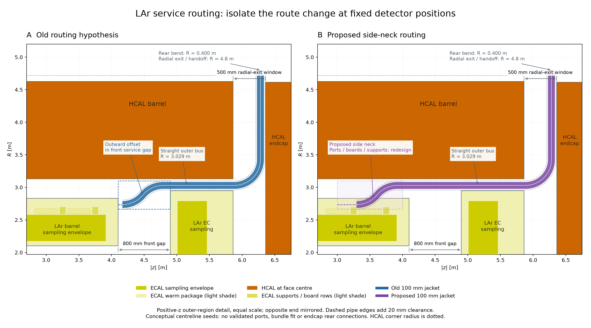
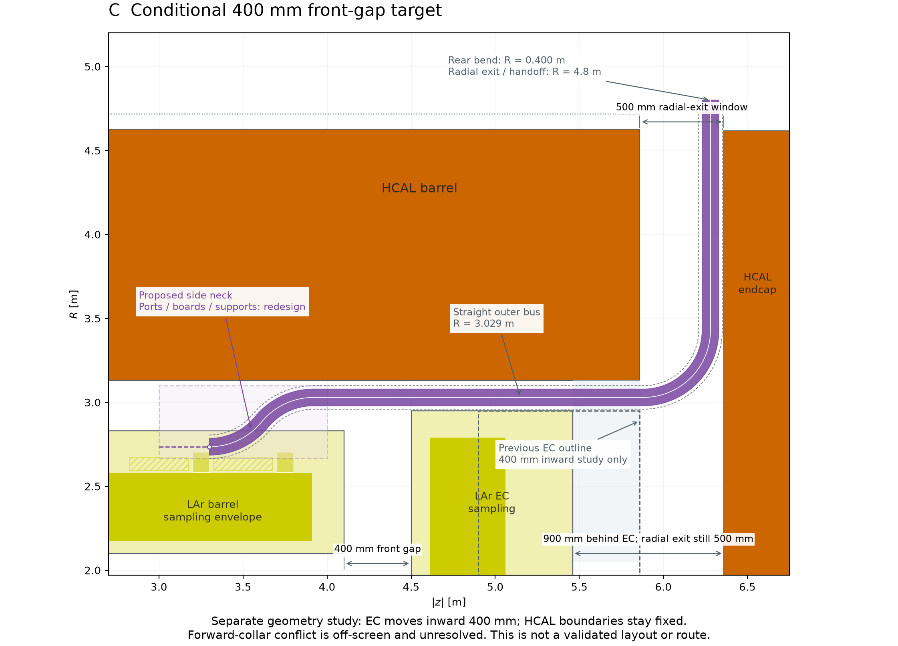

# LAr service-routing RZ comparison

2026-11-14. **PROTOTYPE / conceptual drawings**, requested for draft PR142.
These show the [side-neck proposal](../../DES-032-side-rear-routing.md), not
installed pipes or native detector geometry. No fit/engineering acceptance.

## Old and new routing at identical detector positions



A: the former front-gap S-bend hypothesis. B: the proposed S-bend in a barrel-side
neck, completed before the barrel end, then a straight bus and rear radial exit.
Both panels retain the800mm front gap and all ECAL/HCAL positions; this isolates
the routing change. The coloured band is one100mm jacket, drawn to physical
width with analytical normal offsets; dashed edges add20mm clearance. It is not
the complete service bundle. Light-yellow shapes project the support rings and board
rows; the neck is occupied space requiring vessel/board/support redesign.

## Separate conditional endcap shift



C: the same proposed route with the ECAL endcap moved400mm inward, while HCAL
stays fixed. The dashed box is the previous ECAL endcap outline. Rear axial
space increases to900mm, but the HCAL barrel still blocks outward egress before
5860mm: the full radial-exit window stays500mm. The forward-collar conflict is
outside this crop and unresolved. This is a target study, not an amended layout.

All panels are equal-scale RZ outer-region views, with |z| horizontal and R
vertical, cropped at R=1.97m and |z|=2.70m. The other end is mirrored. HCAL is
shown through a face centre; the larger barrel outer-corner radius is dotted.
Sampling envelopes omit inclined plate details and endcap wheel support strips.
Headers, connections, flanges, valves, endcap rear routes, azimuthal station
packing, magnet/yoke crossings and installation access are not represented.

The former arrangement also lacked defined ports. Neither coloured curve should
be interpreted as an existing or validated connected route.

## Source and reproduction

Geometry and proposal inputs are committed Git blobs at
`21d2f01f99156034f7a80257fa642f1c2a4d9548`; the script fails closed for a different
source revision. The script itself and figure hashes are recorded separately in
[routing-rz.json](routing-rz.json). Centreline starts at4170/3300mm, rear turn
start5880mm and exterior handoff R4800mm are drawing seeds, not installed port
coordinates. The two-arc offset retains the2735.3→3029mm example and400mm bend
radius from the proposal. Full source/configuration hashes and tool versions
are in the receipt. No external source or dependency was added.

With an existing Python containing Matplotlib and NumPy:

```sh
MPLCONFIGDIR=build/lar-routing-rz/mpl XDG_CACHE_HOME=build/lar-routing-rz/cache \
  python3 -B tools/lar_calorimeter/draw_routing_rz.py \
  --source-revision 21d2f01f99156034f7a80257fa642f1c2a4d9548 \
  --output build/lar-routing-rz/reproduced
```

The retained PNG/SVG files can be regenerated without DD4hep/Geant4, native
factories or the raw10k sample. No native overlap/material/transport validation
was performed. The paired drawing session records actual checks and review.

The fixed project palette is retained: ECAL yellow `#cccc00`, HCAL orange
`#cc6600`; warm-package and support/board projections use labelled lighter ECAL
shades. Blue and purple distinguish the two routing hypotheses.

Vector exports: [comparison SVG](routing-rz-comparison.svg),
[conditional target SVG](routing-rz-gap-target.svg).
