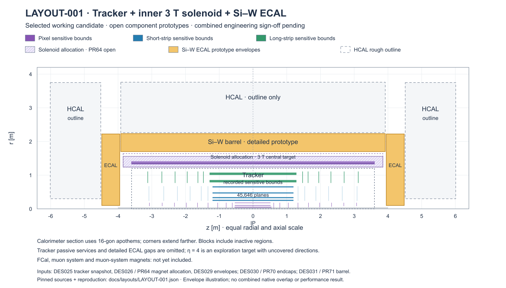

# LAYOUT-001 — Tracker + inner 3 T solenoid + Si–W ECAL

**Current human-selected candidate · DRAFT / PROTOTYPE · updated 2026-10-14.**
The tracker is maintained on main. Open component proposals are included in this
candidate for review; combined detector construction and engineering sign-off
remain pending.

| System | Main features | Decisions and PRs |
| --- | --- | --- |
| Tracker | RD53i mixed single/quad pixels; short and long strips; Be pipe. 45,646 sensitive planes. | [DES025](../design/DES-025-tracker-dd4hep-gen3.md), [pixel choice ADR007](../decisions/ADR-007-itkpix-pixel-baseline.md), [PR58 — merged](https://github.com/asalzburger/nodd/pull/58) |
| Solenoid | Inside ECAL; central 3 T target. 7.2 m cold length; 7.7 m vessel allocation; 1.64 m outer reservation. | [DES026](https://github.com/asalzburger/nodd/blob/4e44d7c650ac0a2931f7fc1637b5b3f2dfbe4c95/docs/design/DES-026-tracker-solenoid-baseline.md), [sizing direction PR6](https://github.com/asalzburger/nodd/pull/6#issuecomment-5809476152), [PR64 — open](https://github.com/asalzburger/nodd/pull/64) |
| EM calorimeter | Si–W, 48 layers; barrel square-board slabs, inner apothem 1.70 m. Endcaps at ±3.95 m: sixteen wedge carriers with custom edge sensors; η = 4 exploration target. | [Barrel DES031](https://github.com/asalzburger/nodd/blob/2776266570dda13386a16863e5b0e97432f27217/docs/design/DES-031-siw-barrel-prototype.md), [Endcap DES030](https://github.com/asalzburger/nodd/blob/654b85a48abeb38735ad7fe0866c5d1082882df7/docs/design/DES-030-ecal-edge-sensors.md), [aperture/carriers ADR008](https://github.com/asalzburger/nodd/blob/654b85a48abeb38735ad7fe0866c5d1082882df7/docs/decisions/ADR-008-prototype-ecal-forward-aperture.md), [PR70 — open](https://github.com/asalzburger/nodd/pull/70), [PR71 — open barrel prototype](https://github.com/asalzburger/nodd/pull/71) |
| Services | R=2.300-2.600 m external backbone; 400 mm rear radial egress breaks. 259.452 kW local heat and 12.414 kg/s ideal water; collectors/ports remain unresolved. | [DES034](../design/DES-034-siw-service-envelopes.md), [allocations](../validation/DES-034/allocations.json), [PR76 - open](https://github.com/asalzburger/nodd/pull/76) |
| HCAL | Service-constrained steel–scintillator outline: 2.600-4.0959 m barrel apothems, half-length 4.4832 m; endcap abs(z)=4.8832-6.3791 m. Detailed hardware follows. | [DES029 envelopes](../design/DES-029-calorimeter-assemblies.md#executed-prototype-budgets-and-layout-limits), [PR69 — merged](https://github.com/asalzburger/nodd/pull/69) |
| FCal | Empty insertion reservation R=0.080-0.290 m, abs(z)=4.5332-6.3791 m; hardware/technology and coverage remain undefined. | [DES034 forward interface](../design/DES-034-siw-service-envelopes.md#forward-reservation) |
| Muon system + its magnets | Not yet included. | Future design |

Tracker colour blocks show recorded sensitive-group bounds, omitting passive
services. Hatched magnet regions are allocations. ECAL blocks show package
bounds, including inactive regions: the η = 4 target has gaps. Cyan service regions are empty planning allocations; local collector/port
connections and support loads are unqualified. Red FCal envelopes contain no
hardware. Dashed HCAL bounds are the amended outline. Polygonal calorimeter radii are apothems at sector centres;
corners extend farther. No field map or combined overlap/performance result is
implied.

[Vector drawing](figures/LAYOUT-001-rz.svg) · [Named inputs and exact source revisions](LAYOUT-001.json) · [All candidates](README.md)

Reproduce with `python3 -B tools/layout_overview/draw.py`; use `--check` to verify
that the SVG matches its inputs. The JSON also records the optional PNG command.

## Open HCAL endcap design proposal

[DES038](../design/DES-038-hcal-endcap-common-module.md) uses the common
readout module from [PR81](https://github.com/asalzburger/nodd/pull/81) as its
working basis. It proposes a 1.558 m HCAL stack,62.1 mm beyond the outline above,
with regional packing, partial material/services budgets and core-plane masks.
Its [regional R–Z drawing](../design/figures/DES-038/endcap-design.png) shows
the amendment separately. The selected candidate inputs and existing R–Z image
remain unchanged pending review. This is an open DRAFT assembly proposal; residual
cracks, forward handover and engineering qualification remain unresolved.

[Draft regional PR85](https://github.com/asalzburger/nodd/pull/85) · [Companion PR84](https://github.com/asalzburger/nodd/pull/84). Both depend on the common-module PR81.
