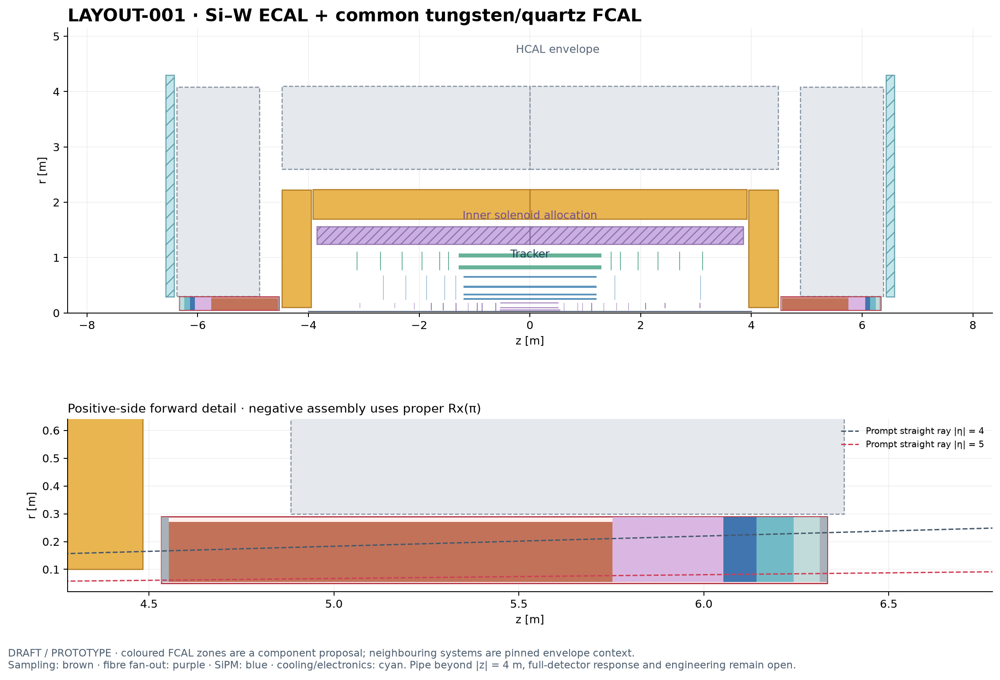

# LAYOUT-001 — Tracker + inner 3 T solenoid + Si–W ECAL

**Current human-selected candidate · DRAFT / PROTOTYPE · updated 2026-10-29.**
The tracker uses the balanced baseline selected for PR104. Open component proposals are included in this
candidate for review; combined detector construction and engineering sign-off
remain pending.

| System | Main features | Decisions and PRs |
| --- | --- | --- |
| Tracker | RD53i mixed single/quad pixels; short and long strips; Be pipe. 46,250 sensitive planes (balanced). | [DES025](../design/DES-025-tracker-dd4hep-gen3.md), [pixel choice ADR007](../decisions/ADR-007-itkpix-pixel-baseline.md), [PR58 — merged](https://github.com/asalzburger/nodd/pull/58) |
| Solenoid | Inside ECAL; central 3 T target. 7.2 m cold length; 7.7 m vessel allocation; 1.64 m outer reservation. | [DES026](https://github.com/asalzburger/nodd/blob/4e44d7c650ac0a2931f7fc1637b5b3f2dfbe4c95/docs/design/DES-026-tracker-solenoid-baseline.md), [sizing direction PR6](https://github.com/asalzburger/nodd/pull/6#issuecomment-5809476152), [PR64 — open](https://github.com/asalzburger/nodd/pull/64) |
| EM calorimeter | Si–W, 48 layers; barrel square-board slabs, inner apothem 1.70 m. Endcaps at ±3.95 m: sixteen wedge carriers with custom edge sensors; η = 4 exploration target. | [Barrel DES031](https://github.com/asalzburger/nodd/blob/2776266570dda13386a16863e5b0e97432f27217/docs/design/DES-031-siw-barrel-prototype.md), [Endcap DES030](https://github.com/asalzburger/nodd/blob/654b85a48abeb38735ad7fe0866c5d1082882df7/docs/design/DES-030-ecal-edge-sensors.md), [aperture/carriers ADR008](https://github.com/asalzburger/nodd/blob/654b85a48abeb38735ad7fe0866c5d1082882df7/docs/decisions/ADR-008-prototype-ecal-forward-aperture.md), [PR70 — open](https://github.com/asalzburger/nodd/pull/70), [PR71 — open barrel prototype](https://github.com/asalzburger/nodd/pull/71) |
| Services | R=2.300-2.600 m external backbone; 400 mm rear radial egress breaks. 259.452 kW local heat and 12.414 kg/s ideal water; collectors/ports remain unresolved. | [DES034](../design/DES-034-siw-service-envelopes.md), [allocations](../validation/DES-034/allocations.json), [PR76 - open](https://github.com/asalzburger/nodd/pull/76) |
| HCAL | Service-constrained steel–scintillator outline: 2.600-4.0959 m barrel apothems, half-length 4.4832 m; endcap abs(z)=4.8832-6.3791 m. Detailed hardware follows. | [DES029 envelopes](../design/DES-029-calorimeter-assemblies.md#executed-prototype-budgets-and-layout-limits), [PR69 — merged](https://github.com/asalzburger/nodd/pull/69) |
| FCal | DES039 tungsten/quartz-fibre proposal: R=0.050–0.290 m, abs(z)=4.5332–6.3332 m; 1.2 m sampling, rear SiPM readout. Draft aperture amendment from R80 to R50 mm. | [DES039](../design/DES-039-common-forward-calorimeter.md), [ADR010](../decisions/ADR-010-common-forward-calorimeter.md), [executed checks](../validation/DES-039/results.md) |
| Muon system + its magnets | Not yet included. | Future design |

Tracker colour blocks show recorded sensitive-group bounds, omitting passive
services. Hatched magnet regions are allocations. ECAL blocks show package
bounds, including inactive regions: the η = 4 target has gaps. Cyan service regions are empty planning allocations; local collector/port
connections and support loads are unqualified. The FCAL colour zones show the DES039 physical prototype proposal;
its optical and engineering qualification remain open. Dashed HCAL bounds are the amended outline. Polygonal calorimeter radii are apothems at sector centres;
corners extend farther. No field map or combined overlap/performance result is
implied.

[FCAL vector drawing](figures/LAYOUT-001-FCAL-rz.svg) · [FCAL named inputs](LAYOUT-001-FCAL.json) · [Pre-FCAL baseline inputs](LAYOUT-001.json) · [All candidates](README.md)

The retained pre-FCAL baseline is reproduced with `python3 -B tools/layout_overview/draw.py --check`. The current DES039 view uses the forward-calorimeter generator below.

## DES039 forward integration proposal

[FCAL 3D cutaway (SVG)](../design/figures/DES-039/LAYOUT-001-FCAL-3d.svg) · [Eight-sentence technology summary](../design/figures/DES-039/LAYOUT-001-FCAL-summary.txt).

The common 1.8 m package fits the current rear/radial bounds, with 10 mm to the HCAL minimum bore. Its R50 mm physical aperture replaces the former empty R80 mm allocation as a draft choice. The current pipe ends at four metres; downstream machine clearance remains open. New rear services turn outward at abs(z)=6.4291–6.5791 m. The existing ECAL service break remains separately owned.

The shown Si–W/HCAL context is pinned independently of open HCAL hardware proposals. ROOT checks cover the FCAL prototype plus conservative neighbouring envelope guards. Full combined geometry, optics, shower containment, radiation lifetime and load/thermal engineering remain open. [Design and finite results](../design/DES-039-common-forward-calorimeter.md).

Reproduce the updated drawing with `python3 -B tools/forward_calorimeter/draw.py` in an environment with matplotlib. The older `tools/layout_overview/draw.py` continues to reproduce the retained pre-FCAL baseline image.

The tracker overlay is extracted from the maintained balanced DD4hep export in [tracker-baseline-balanced.json](tracker-baseline-balanced.json). It updates only the tracker sensitive bounds; the independently pinned calorimeter and magnet contexts are unchanged. The earlier pre-FCAL layout remains a historical control.
