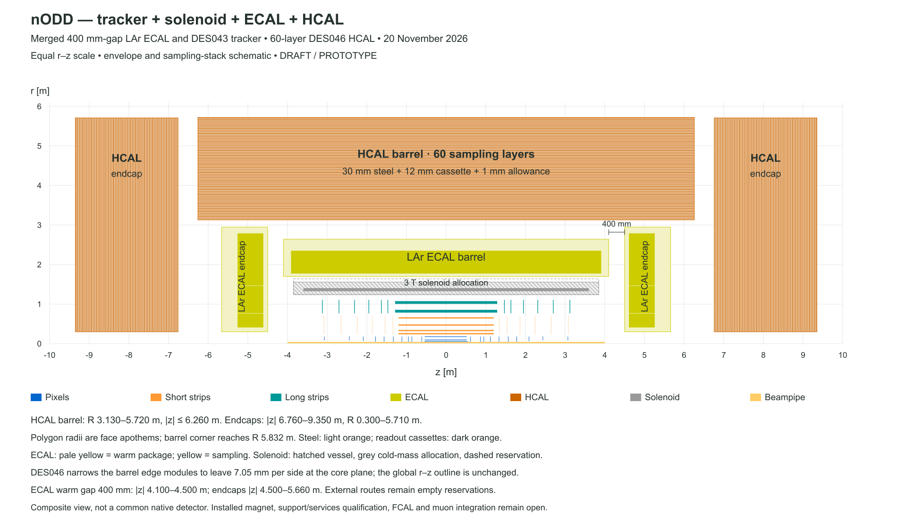
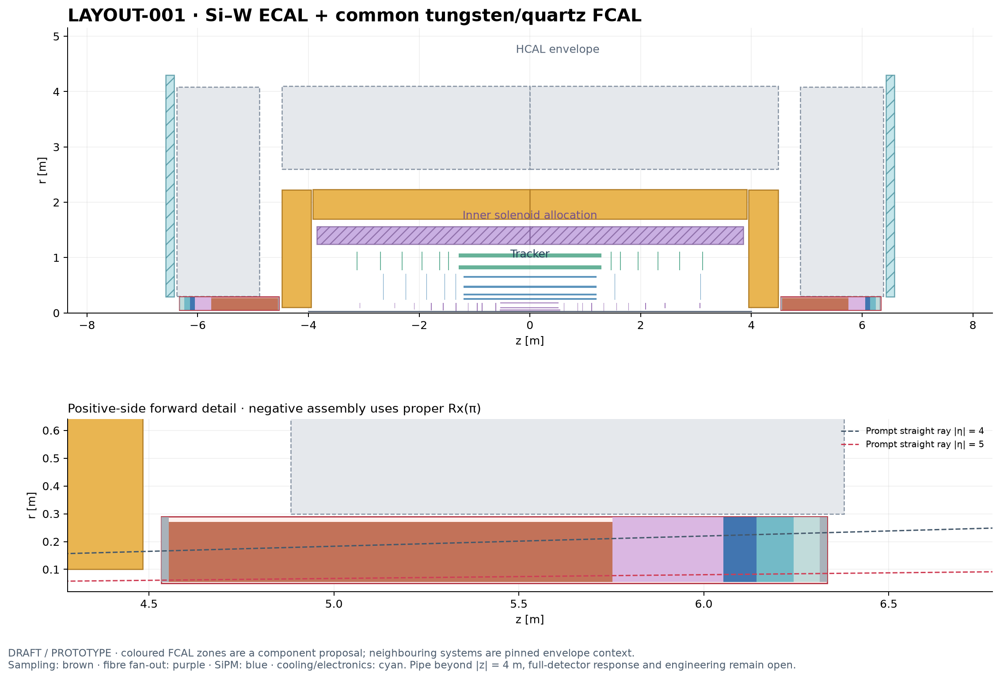
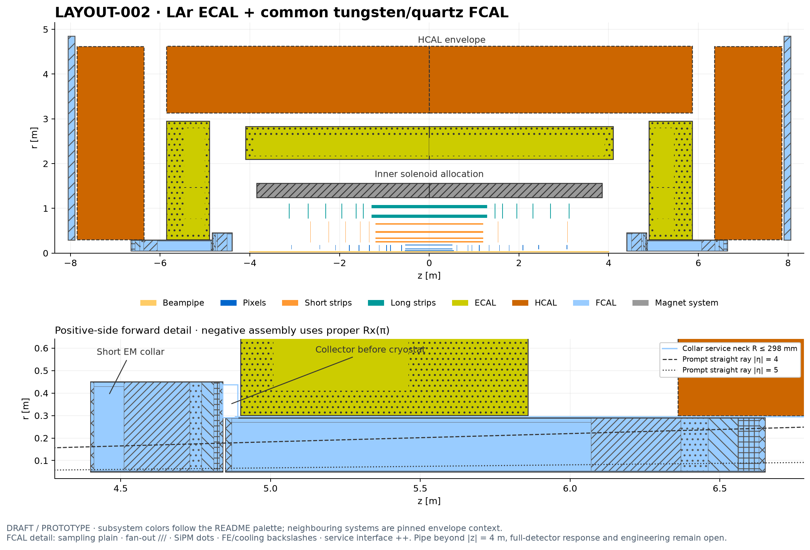

# Detector layouts and selected EM baseline

The user selected the **restored LAr design as the EM working baseline on
2026-11-18**. [Selection, dimensions and limits](../design/inputs/ECAL-baseline-selection-2026-11-18.md).
Si–W remains available as a comparison; engineering sign-off is unchanged.

The [November20 deep-HCAL proposal](../design/DES-045-hcal-restored-ecal-pion50.md)
fits60 common-hardware sampling layers around the restored ECAL. Its
[dimensioned view](../validation/hcal50/figures/hcal-fit-segmentation.png) and
[first pion protocol](../validation/hcal50/protocol.md) are separate from the
maintained tracker+ECAL union; the composite schematic below shows their bounds together.

The [DES046 sector-edge amendment](../design/DES-046-hcal-sector-edge-coverage.md)
adds narrow physical barrel cassettes and2mmguides within those same envelopes.
Its [new pion protocol](../validation/hcal50-edge/protocol.md) and validation
are separate from the retained first study and maintained detector union.

| Option | EM selection | Current integration scope |
| --- | --- | --- |
| [LAYOUT-002 — selected baseline](LAYOUT-002-tracker-3t-lar.md) | Restored1.8mmPb/1248period barrel and650mm turbine endcaps | Maintained tracker+ECAL; standalone deep HCAL prototype; conditional solenoid |
| [LAYOUT-001 — comparison](LAYOUT-001-tracker-3t-siw.md) | Retained Si–W | Explicit comparison export; historical FCAL context |

[](LAYOUT-002-tracker-3t-lar.md)

The **20 November composite view** uses the **400 mm (40 cm) warm-envelope gap**
from merged [PR151](https://github.com/asalzburger/nodd/pull/151), together with
the 60-layer DES045/046 HCAL:
barrel apothems 3.130–5.720 m and endcaps |z|=6.760–9.350 m. It combines
current tracker sensitive bounds, regenerated 400 mm-gap ECAL envelopes and the
separately validated HCAL prototype. The solenoid remains an allocation; no
common native detector or engineering acceptance is implied. Sector-edge
modules change transverse coverage, leaving these r–z bounds unchanged.

The [axial compaction screen](../design/inputs/DES-046-axial-compaction-screen.md)
finds a candidate saving1.04 m overall while retaining the current module-end
allowance and500 mm service-exit window. It is not adopted in this drawing or
the validated geometry; a smaller allowance could save1.16 m overall.
[Proposed compact r–z drawing](figures/LAYOUT-002-HCAL-compact-proposal-rz.png) ·
[SVG](figures/LAYOUT-002-HCAL-compact-proposal-rz.svg) ·
[Named proposal inputs](LAYOUT-002-HCAL-compact-proposal.json).

[Current composite named inputs](LAYOUT-002-DES046-gap400.json) ·
[SVG](figures/LAYOUT-002-DES046-gap400-rz.svg) · [PDF](figures/LAYOUT-002-DES046-gap400-rz.pdf)

```sh
python3 -B tools/hcal_response/draw_rz.py --capture --ecal-gap-mm 400 \
  --input docs/layouts/LAYOUT-002-DES046-gap400.json \
  --output docs/layouts/figures/LAYOUT-002-DES046-gap400-rz.svg
rsvg-convert docs/layouts/figures/LAYOUT-002-DES046-gap400-rz.svg \
  -o docs/layouts/figures/LAYOUT-002-DES046-gap400-rz.png
rsvg-convert -f pdf docs/layouts/figures/LAYOUT-002-DES046-gap400-rz.svg \
  -o docs/layouts/figures/LAYOUT-002-DES046-gap400-rz.pdf
```

Omit `--capture` to replay the retained named inputs. The earlier 1 m-gap/deep-HCAL
[drawing](figures/LAYOUT-002-DES046-rz.png) and [inputs](LAYOUT-002-DES046.json)
are preserved as the superseded drawing selection. PR151 was merged into the
stacked restored-baseline branch on 18 November; its recipe left the default
export manifest at 1 m, which caused that initial drawing mismatch. The current
view explicitly chooses the merged 400 mm recipe; it does not rewrite the
export manifest, historical response samples or HCAL placements. The prior selected-ECAL
view with its older HCAL context remains [preserved](figures/LAYOUT-002-restored-rz.png).

[Retained restored named inputs](LAYOUT-002-restored.json) ·
[SVG](figures/LAYOUT-002-restored-rz.svg) ·
[Native sector comparison](../validation/sector-gap-restored/README.md) ·
[Restored response controls](../validation/lar-restored/README.md)

The updated endcap/HCAL envelopes invalidate transfer of the older FCAL routing
checks. FCAL/collar integration is pending and omitted from the current view.
Current named inputs use the same project palette and retained DES043 tracker
source hashes. Generate and redraw with:

```sh
python3 -B tools/calorimeter_baselines/export.py --output build/baselines/selected
python3 -B tools/calorimeter_baselines/layout.py --baseline build/baselines/selected \
  --input docs/layouts/LAYOUT-002-restored.json --output docs/layouts/figures/LAYOUT-002-restored-rz.svg
rsvg-convert docs/layouts/figures/LAYOUT-002-restored-rz.svg \
  -o docs/layouts/figures/LAYOUT-002-restored-rz.png
```

## Merged 400 mm-gap implementation and retained controls

The [merged reduced-gap study](../validation/lar-gap400/README.md) moves the
complete endcaps600mm toward the IP with unchanged sampling depth. It retains
HCAL context and explicitly unconstructed side-egress reservations. The selected
1m-gap baseline above is preserved. Physical ports/support clearances and the
prospective forward collar conflict remain open.

[Prototype R–Z](figures/LAYOUT-002-gap400-rz.png) · [SVG](figures/LAYOUT-002-gap400-rz.svg) ·
[Named input](LAYOUT-002-gap400.json)

## Historical original candidates and FCAL controls

The following snapshots keep the original candidate dimensions and their frozen
FCAL validation context. They do not establish integration for the restored
baseline. Old file names and source pins remain unchanged for reproduction.


The two historical candidate views include the [DES039 forward-calorimeter proposal](../design/DES-039-common-forward-calorimeter.md). They remain DRAFT / PROTOTYPE. Native FCAL geometry and envelope guards are checked; combined detector response and engineering qualification remain pending.

| Candidate | EM technology | Forward calorimeter proposal |
| --- | --- | --- |
| [LAYOUT-001](LAYOUT-001-tracker-3t-siw.md) | Si–W | Common 1.8 m tungsten/quartz-fibre body at abs(z)=4.5332–6.3332 m |
| [LAYOUT-002](LAYOUT-002-tracker-3t-lar.md) | ALLEGRO-style LAr | Same body at4.850–6.650 m, plus short wider EM collar |

[](LAYOUT-001-tracker-3t-siw.md)

[](LAYOUT-002-tracker-3t-lar.md)

Click either drawing for dimensions, interfaces, source revisions and limitations. The shared R50 mm aperture and added service routes are explicit unsigned amendments. The downstream machine pipe, shower/optical performance, irradiation, full cooling/load design and muon interfaces remain open.

Both historical views use the [README component palette](../../README.md#detector-component-colors).
The legend identifies each shown subsystem; FCAL subcomponents share its light
blue and use hatching for detail. Muon stations are not part of these views.

[Common FCAL assembly](../design/figures/DES-039/common-fcal.png) · [Validation](../validation/DES-039/results.md) · [Design decision](../decisions/ADR-010-common-forward-calorimeter.md)

The current tracker overlay uses the human-requested [DES043 working baseline](../design/DES-043-short-strip-service-redesign.md): 75 µm × 2 mm strixels, 703 mm sampled short-strip coverage, 46,682 sensitive planes and 54 signed logical groups. Its finite outer sensor corner reaches 704.909 mm. The shared short-strip service trunk occupies 717–781.5 mm; passive services are omitted from these sensitive-bound illustrations. Module, cable, cooling and thermal qualification remain open.

[Extracted tracker bounds](tracker-baseline-des043.json) retain the executed producer/source hashes. Historical named inputs are [LAYOUT-001-DES043.json](LAYOUT-001-DES043.json) and [LAYOUT-002-DES043.json](LAYOUT-002-DES043.json). The independently pinned calorimeter/magnet context and frozen FCAL validation geometry are retained.

Reproduce after the combined DD4hep export:

```sh
python3 -B tools/tracker_dd4hep/des043_snapshot.py \
  --expected build/short-strip-redesign/combined-native/detector/tracker/expected.json \
  --output docs/layouts/tracker-baseline-des043.json
python3 -B tools/forward_calorimeter/draw.py --layouts-only \
  --tracker-overlay docs/layouts/tracker-baseline-des043.json --layout-suffix DES043
```

The earlier balanced [tracker overlay](tracker-baseline-balanced.json), [FCAL inputs](LAYOUT-001-FCAL.json) and [pre-FCAL inputs](LAYOUT-001.json) remain dated controls. The default `draw.py` still reproduces the retained FCAL views. The [DES043 validation report](../validation/DES-043/README.md) distinguishes integrated geometry evidence from engineering and reconstruction qualification.


[PR110 — short-strip integration, open for merge preparation](https://github.com/asalzburger/nodd/pull/110) retains fixed implementation source `d6c4d0d`, full native/payload/ACTS checks and the published TDR receipt. Human review/merge and engineering qualification are distinct.

[Historical ECAL reviewer overview](review/ecal-layout-review.md) and its frozen source catalogue retain the original PR75 comparison. Current baseline status is maintained at the top of this page.

The two [selectable working baseline packages](../../tools/calorimeter_baselines/README.md) restore the Si–W and LAr ECAL source histories on current main. Their [integration contract](../design/inputs/ECAL-baseline-integration-2026-11-04.md) retains issue114 and the unresolved PR75 review. Common HCAL and FCAL design options remain separate construction/qualification stages.

Both maintained ECAL exports use reusable solid mothers: Si–W wedges in
LAYOUT-001 and inclined LAr periods in LAYOUT-002. The
[LAr default-export report](../validation/lar-placement-default/README.md)
links the placement evidence and current DD4hep description. That historical hierarchy choice did not change physical bounds; the new restored
baseline has its own current named input and drawing above.
