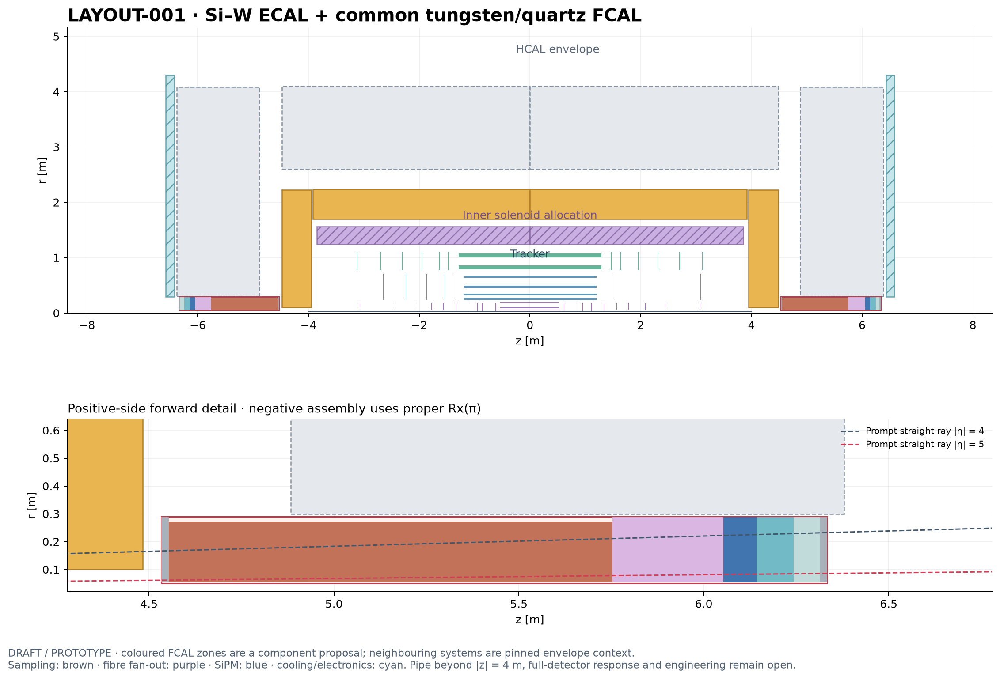
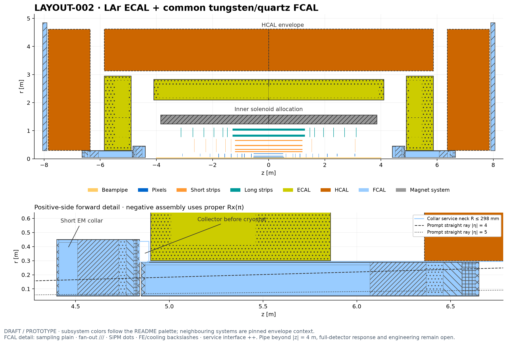

# Detector layout candidates

The two candidate views now include the [DES039 forward-calorimeter proposal](../design/DES-039-common-forward-calorimeter.md). They remain DRAFT / PROTOTYPE. Native FCAL geometry and envelope guards are checked; combined detector response and engineering qualification remain pending.

| Candidate | EM technology | Forward calorimeter proposal |
| --- | --- | --- |
| [LAYOUT-001](LAYOUT-001-tracker-3t-siw.md) | Si–W | Common 1.8 m tungsten/quartz-fibre body at abs(z)=4.5332–6.3332 m |
| [LAYOUT-002](LAYOUT-002-tracker-3t-lar.md) | ALLEGRO-style LAr | Same body at4.850–6.650 m, plus short wider EM collar |

[](LAYOUT-001-tracker-3t-siw.md)

[](LAYOUT-002-tracker-3t-lar.md)

Click either drawing for dimensions, interfaces, source revisions and limitations. The shared R50 mm aperture and added service routes are explicit unsigned amendments. The downstream machine pipe, shower/optical performance, irradiation, full cooling/load design and muon interfaces remain open.

Both current views use the [README component palette](../../README.md#detector-component-colors).
The legend identifies each shown subsystem; FCAL subcomponents share its light
blue and use hatching for detail. Muon stations are not part of these views.

[Common FCAL assembly](../design/figures/DES-039/common-fcal.png) · [Validation](../validation/DES-039/results.md) · [Design decision](../decisions/ADR-010-common-forward-calorimeter.md)

The current tracker overlay uses the human-requested [DES043 working baseline](../design/DES-043-short-strip-service-redesign.md): 75 µm × 2 mm strixels, 703 mm sampled short-strip coverage, 46,682 sensitive planes and 54 signed logical groups. Its finite outer sensor corner reaches 704.909 mm. The shared short-strip service trunk occupies 717–781.5 mm; passive services are omitted from these sensitive-bound illustrations. Module, cable, cooling and thermal qualification remain open.

[Extracted tracker bounds](tracker-baseline-des043.json) retain the executed producer/source hashes. Current named inputs are [LAYOUT-001-DES043.json](LAYOUT-001-DES043.json) and [LAYOUT-002-DES043.json](LAYOUT-002-DES043.json). The independently pinned calorimeter/magnet context and frozen FCAL validation geometry are retained.

Reproduce after the combined DD4hep export:

```sh
python3 -B tools/tracker_dd4hep/des043_snapshot.py \
  --expected build/short-strip-redesign/combined-native/detector/tracker/expected.json \
  --output docs/layouts/tracker-baseline-des043.json
python3 -B tools/forward_calorimeter/draw.py --layouts-only \
  --tracker-overlay docs/layouts/tracker-baseline-des043.json --layout-suffix DES043
```

The earlier balanced [tracker overlay](tracker-baseline-balanced.json), [FCAL inputs](LAYOUT-001-FCAL.json) and [pre-FCAL inputs](LAYOUT-001.json) remain dated controls. The default `draw.py` still reproduces the retained FCAL views. The [DES043 validation report](../validation/DES-043/README.md) distinguishes integrated geometry evidence from engineering and reconstruction qualification.


[PR110 — short-strip integration, open for merge preparation](https://github.com/asalzburger/nodd/pull/110) retains fixed implementation source `d6c4d0d`, full native/payload/ACTS checks and the published TDR receipt. Human review/merge and engineering qualification are distinct.

[Historical ECAL reviewer overview](review/ecal-layout-review.md) and its frozen source catalogue retain the original PR75 comparison. Current baseline status is maintained above.

The two [selectable working baseline packages](../../tools/calorimeter_baselines/README.md) restore the Si–W and LAr ECAL source histories on current main. Their [integration contract](../design/inputs/ECAL-baseline-integration-2026-11-04.md) retains issue114 and the unresolved PR75 review. Common HCAL and FCAL design options remain separate construction/qualification stages.
