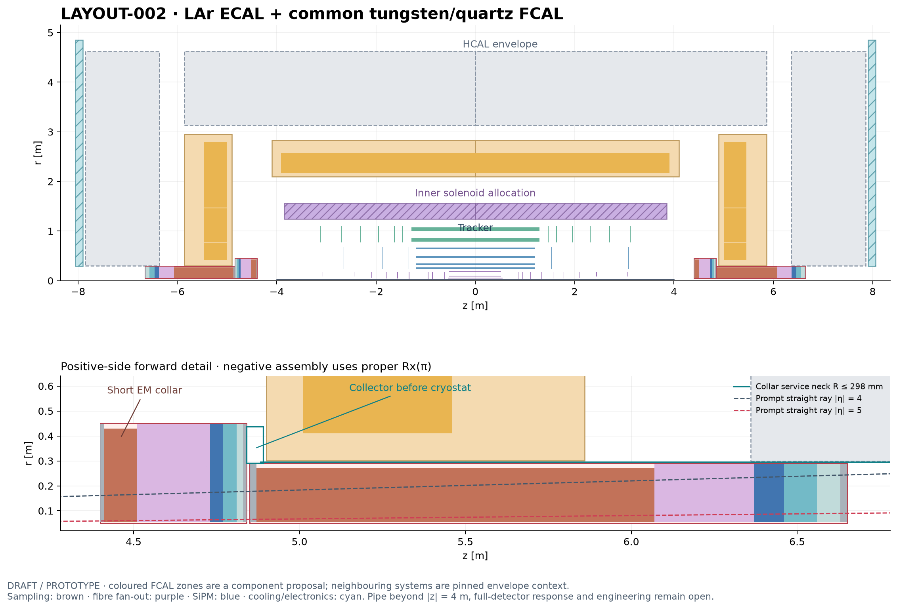

# Detector layout candidates

The two candidate views now include the [DES039 forward-calorimeter proposal](../design/DES-039-common-forward-calorimeter.md). They remain DRAFT / PROTOTYPE. Native FCAL geometry and envelope guards are checked; combined detector response and engineering qualification remain pending.

| Candidate | EM technology | Forward calorimeter proposal |
| --- | --- | --- |
| [LAYOUT-001](LAYOUT-001-tracker-3t-siw.md) | Si–W | Common 1.8 m tungsten/quartz-fibre body at abs(z)=4.5332–6.3332 m |
| [LAYOUT-002](LAYOUT-002-tracker-3t-lar.md) | ALLEGRO-style LAr | Same body at4.850–6.650 m, plus short wider EM collar |

Click either drawing for dimensions, interfaces, source revisions and limitations. The shared R50 mm aperture and added service routes are explicit unsigned amendments. The downstream machine pipe, shower/optical performance, irradiation, full cooling/load design and muon interfaces remain open.

[Common FCAL assembly](../design/figures/DES-039/common-fcal.png) · [Validation](../validation/DES-039/results.md) · [Design decision](../decisions/ADR-010-common-forward-calorimeter.md)

Reproduce with `python3 -B tools/forward_calorimeter/draw.py`. Named inputs are [LAYOUT-001-FCAL.json](LAYOUT-001-FCAL.json) and [LAYOUT-002-FCAL.json](LAYOUT-002-FCAL.json). The earlier [LAYOUT-001.json](LAYOUT-001.json) and its drawing remain a reproducible pre-FCAL envelope baseline.

The current tracker overlay uses the [expert-selected balanced baseline](../design/inputs/DES-040-balanced-selection.json): 46,250 sensitive planes in 54 signed logical groups. [Extracted source bounds](tracker-baseline-balanced.json) and their hash are retained in both named FCAL inputs. This changes the tracker drawing only; it does not revise the frozen FCAL validation geometry. Use `draw.py --layouts-only` to refresh these views.
