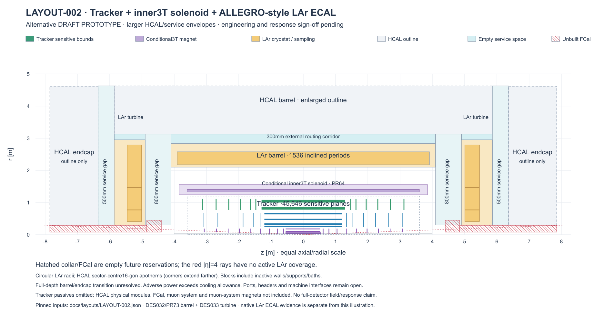

# Current layout candidates

Two separately versioned prototype candidates are available. Click a drawing
for concise features, component status, decisions and PRs. Engineering sign-off
for the combined detector remains pending.

| Candidate | EM calorimeter | Main distinctions |
| --- | --- | --- |
| [LAYOUT-001](LAYOUT-001-tracker-3t-siw.md) | Si–W | Original working candidate, edge-sensor wedge endcaps and detailed barrel proposals |
| [LAYOUT-002](LAYOUT-002-tracker-3t-lar.md) | ALLEGRO-style LAr | Larger cryostats/HCAL, cold-service reservations and uncovered forward region for later FCal |

Both retain the recorded tracker and conditional inner3T solenoid. HCAL is an
outline; FCal hardware, muon system and muon-system magnets are absent.

[LAYOUT-001 vector](figures/LAYOUT-001-rz.svg) · [pinned inputs](LAYOUT-001.json).

[LAYOUT-002 vector](figures/LAYOUT-002-rz.svg) · [pinned inputs](LAYOUT-002.json).

The views combine recorded sensitive bounds and proposed component envelopes.
Dashed HCAL contours and service/FCal reservations are planning context; drawings
do not establish full-detector overlaps, field, continuous acceptance or
calorimeter performance. Approved merged changes are reflected on this index,
the relevant candidate feature page and reproducible drawing inputs.
