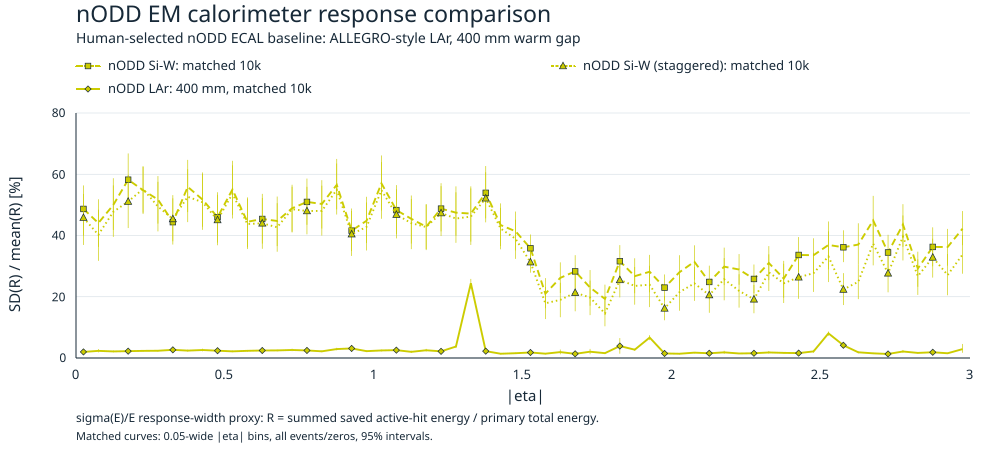
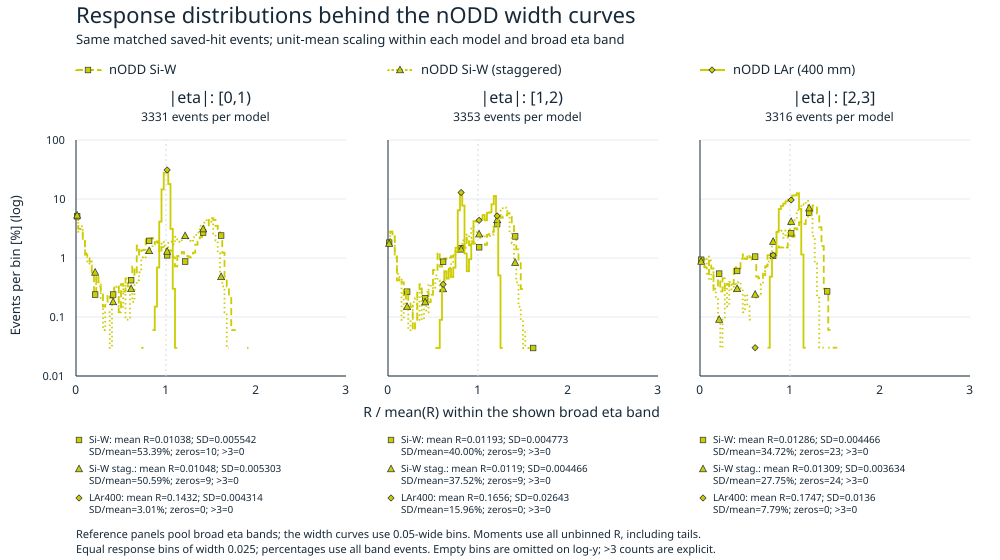

# Standalone nODD response plots

The accepted report and all ten existing report-directory files remain byte-identical to `d04614575e8fc3aed41ed79798def3fc461e3dc6`. These are two additional SVGs, each 1000 units wide. Display the first above the second:





- **Width plot:** the accepted three nODD curves, 0.05-wide absolute-eta bins and pointwise 95% intervals are unchanged. Only ODD reference elements are removed; the legend is repacked. Si-W, physically staggered Si-W and LAr400 use the fixed ECAL colour and distinct line/marker styles.
- **Reference plot:** three bands [0,1), [1,2), [2,3] contain 3331, 3353 and 3316 matched primaries per model. R is saved active-hit H divided by primary total energy. For display, each response is divided by its own model/band mean. Raw mean R, sample SD, SD/mean, zeros and overflow counts are shown under each panel. Rescaling to unit mean preserves relative width; it is not a fitted calibration.

The reference histograms pool broad eta bands; their pooled widths are not the fine-bin point estimates above. Moments are calculated directly from every unbinned R value, including zeros and tails, rather than reconstructed from histogram centres. Histogram bins are 0.025 wide over normalized response 0-3, with explicit overflow above 3. Percentages use all events in the band, including overflow. Log-y omits empty histogram bins; zero-valued responses remain in the first bin. No event is removed from the statistics.

`reference-data.json` retains compact counts/moments, exact input hashes and preservation checks. `render.json` binds the data, script, both SVGs and frozen report hashes. No raw per-event payload, bootstrap rerun, new transport, fit or report change is included.

## Reproduce

Run derivation with the existing NumPy environment and actual retained ledger paths. The default paths below are relative to a checkout in the original workspace; another host must supply its own paths, with the same required hashes:

```sh
python3 -B docs/publication/emcal-findings/standalone/make_svgs.py derive \
  --siw-original ../nodd-ecal10k/build/ecal10k/production12/event-summary.jsonl \
  --siw-staggered ../nodd-ecal10k/build/ecal-staggering/production12/event-summary.jsonl \
  --lar400 ../nodd-lar-gap-10k-response/build/lar-gap10k/reaudit/candidate/derived-events.jsonl
# Python with the existing ReportLab package; no raw inputs/NumPy needed to render:
python3 -B docs/publication/emcal-findings/standalone/make_svgs.py render
```

The source report commit must be available in Git. `--preview build/nodd-reference-svgs` optionally writes temporary QA PDFs; those are not report changes or deliverables. The executed versions are NumPy2.5.1 and ReportLab4.4.9, preinstalled, without dependency installation.
