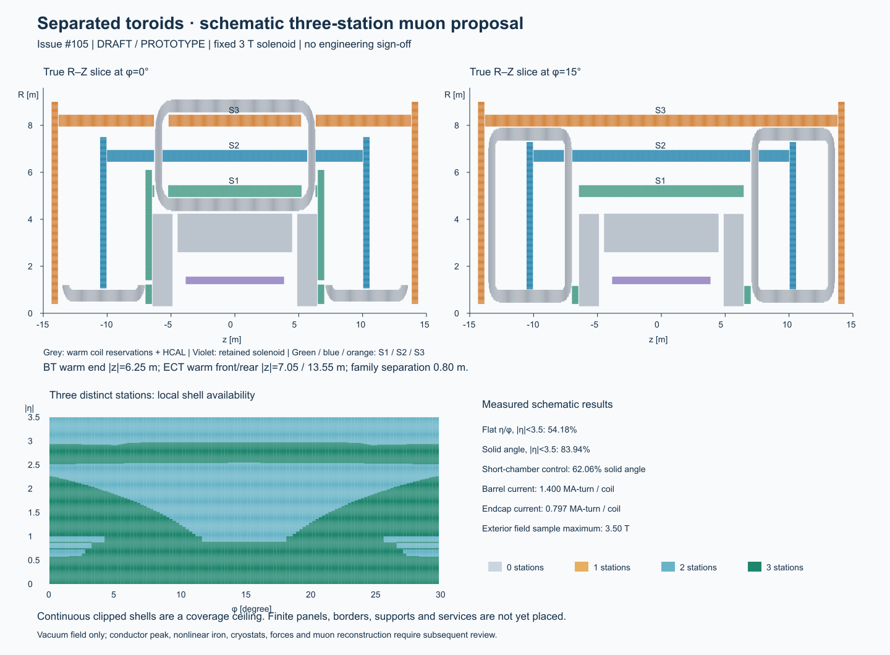

# Issue105 separated toroids — schematic study evidence

Date: 2026-10-29. **DRAFT / isolated PROTOTYPE.**
[Governing amendment](../../../design/inputs/DES-039-issue105-separated-toroids.md).
The PR90/LAYOUT-001 source is `cae3a72f3b1c98edaf9bc28a84d019142606ba25`.
The source commit/dirty state, exact input/code hashes, Python/NumPy versions,
executed dimensions, currents, all energy matrices and coverage bins are retained
in [results.json](results.json) and [configuration.json](configuration.json).
This run records dirty source plus hashes; it does not claim uncommitted files
were already part of its source commit.

## Result and its limits

The barrel coil centreline is12.0m long; each endcap coil is6.0m long. Complete
warm sweep bounds have **0.80m axial separation**, removing BT/ECT interleaving
independently of azimuth. S1/S2/S3 barrel radii are5.2/6.7/8.2m; corresponding
wheel centres are at absolute z6.7456/10.3/14.1m. Larger wheel outer radii and
barrel extensions close the ideal full-depth transition below eta3 before
azimuthal exclusions. All stations are continuous clipped shell suggestions,
with0.50m depth and50mm local warm-coil clearance, rather than actual finite panels.

| Executed quantity | Result | Scope |
| --- | --- | --- |
| Current per BT / ECT coil | 1.39987 /0.79689 MA-turn | Homogeneous0.12×0.18m packs; current is reduced by field screening |
| Ordinary barrel / endcap gap Bphi | 0.477691 /0.477691T | R6.7,z0,phi15° /R4,z10.3,phi0°; not a uniform detector field |
| Other barrel Bphi probes at R5.2 /8.2m | 0.52453 /0.28640T | z0,phi15° |
| Other endcap Bphi probes at R2 /6m | 0.95627 /0.29958T | z10.3,phi0°; R1.5m reaches1.27492T |
| Sampled joint exterior-pack max | 3.5000T | 1632 points2mm outside representative packs; includes fixed solenoid |
| Maximum exterior refinement change | 0.20387T | pack4/corner16 vs pack6/corner32 at identical probes; no rigorous peak bound |
| Complete central field | 3.0T | Joint vacuum vector sum; toroid origin cancels by symmetry |
| Complete toroid vacuum energy | 669.208MJ | Fresh finite-pack self/mutual integral; no old matrix rescaling |
| Joint vacuum energy including solenoid | 812.382MJ | Symmetric meridional/axisymmetric solenoid mutual term is zero |
| Energy refinement | +0.17047% | (source3,target4,corner16,line4) to(4,5,24,8); empirical sensitivity only |
| Toroid cold union volume | 22.30694m³ | Sized around fixed pack; global vacuum30MJ/m³ closure |
| Cold normal/tangent width | 0.126053 /0.183827m | Provisional support/cooling allowance remains unqualified |

**The4T winding requirement is not certified.** Exterior probes do not bound
the continuous winding interior. NbTi operating temperature, critical surface,
strain, current margin, conductor fill and quench are unresolved. The small
cold-to-pack dimensional allowance also needs mechanical/thermal review.
Global vacuum energy/volume closure is not installed-detector or per-family
sizing compliance: nonlinear HCAL magnetization and an applicable per-magnet
allocation are still required. [Rejected large-pack sizing control](sizing-control.json)
retains why the old0.20×0.30m pack could not be used at low current.

## Three-station geometric availability

The refined bank has33600 cell-centred directions in eta0–3.5 and one30° sector
(eta step0.0125,phi step0.25°). Reflection/sector controls support the two
hemisphere/full-phi extrapolation. A hit requires both depth faces inside the
shell, a clear local normal extrusion and a clear actual within-chamber track
chord. Barrel/wheel alternatives count once per station. There are no simulated
hits, efficiency or reconstructed tracks in this study.

| Denominator / metric | Extended nested proposal | Short-barrel-chamber control |
| --- | ---: | ---: |
| Solid angle conditional on absolute eta<3.5 | 83.94% | 62.06% |
| Flat eta/phi over absolute eta<3.5 | 54.18% | 41.17% |
| Solid angle conditional on absolute eta<3 | 84.20% | See recorded coarse control |
| Flat eta/phi over absolute eta<3 | 63.21% | See recorded coarse control |
| At least two stations, absolute eta<3 | 100% in this shell model | Separate control in JSON |

The control keeps the same coils/wheels and shortens every barrel chamber
half-length to5.7m. Its quoted values use the coarse bank (eta0.025/phi0.5°).
The same coarse bank gives83.43% solid angle and53.88% flat eta/phi for the
nested proposal. Refining changes the nested result by0.505 percentage points
of conditional solid angle and0.298 percentage points of flat eta/phi. These
sampling effects remain visible; values are not certified efficiencies.
The proposal's full-sphere solid-angle fraction is83.785%, including absent
directions outside absolute eta3.5 in the denominator.

The strongest loss remains the ECT middle station: only24.52% of eta/phi cells
in1.5<absolute eta<2.5 have all three retained stations. No three-station cells
survive in3<absolute eta<3.5 in the refined bank. The eta3.5 objective remains
unmet. A separate conservative magnet-free interstation-path metric gives82.61%
conditional solid angle within eta3; material traversal is not an automatic
muon veto, and must be evaluated with actual conductor/vessel material and transport.

The larger acceptance here cannot be compared directly with the old936-panel
coverage: no finite-panel seams,30mm borders, frames or service cutouts are
included. S2 also assumes a coil-following ECT vessel, not a filled annulus.
The old panel IDs, supports, DD4hep overlap certificates and maps have not been
reused as validation of this proposal.

## Signed bending at the proposed station crossings

The JSON retains selected44 direction trials, including absent stations and
pack-guard exclusions. It integrates signed Bphi with the unequal-spacing
middle-point interpolation kernel; no resolution or material assumptions are
introduced. Examples at eta0 give B_sag0.469–0.552T across the tested azimuths
with a3m span. At eta0.9,phi7.5°, B_sag falls to0.127T, despite three geometric
crossings. At eta2,phi0°, the longer7.63m span gives B_sag0.651T. Geometry and
bending therefore need separate interpretation, especially through the transition.
These are bounded vacuum diagnostics, not a momentum-performance claim.

## Reproduction and review gate

[Commands and dependencies](../../../../tools/toroid_redesign/README.md).
The numerical guards are0.025m half-step for within-chamber chord checks,
0.05m coarse/0.025m fine half-step for interstation paths, and0.10m winding
guard for signed-response field queries. Straight-ray, finite-depth and coil
exclusion controls are in `tools/toroid_redesign/test_study.py`.

No ACTS, DD4hep/Geant4 transport, material scan, native panel overlap, load,
thermal or installed nonlinear magnetic solve was run for the new geometry.
Separate SysArch and MuonTech assessments informed this proposal; the session
journal records their exact source revisions. A revision-specific PhysVal
assessment is retained separately before handoff. All recommendations require
human review; no design lifecycle is advanced by numerical execution.
