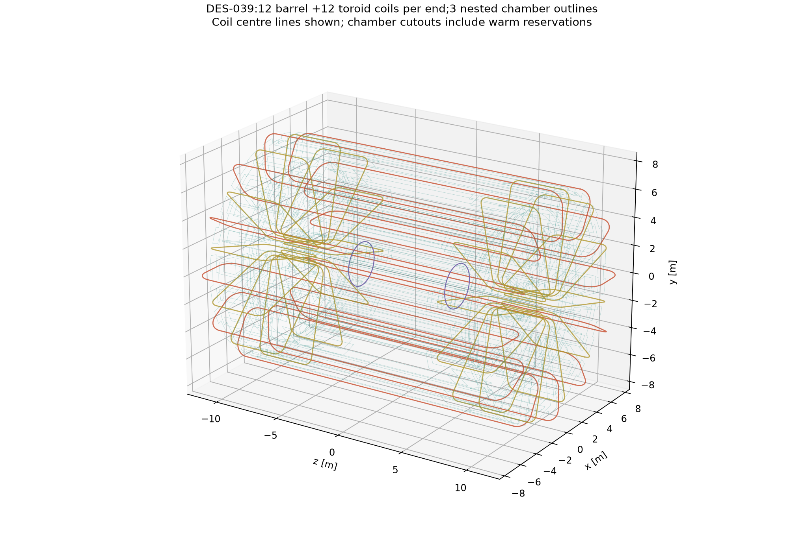
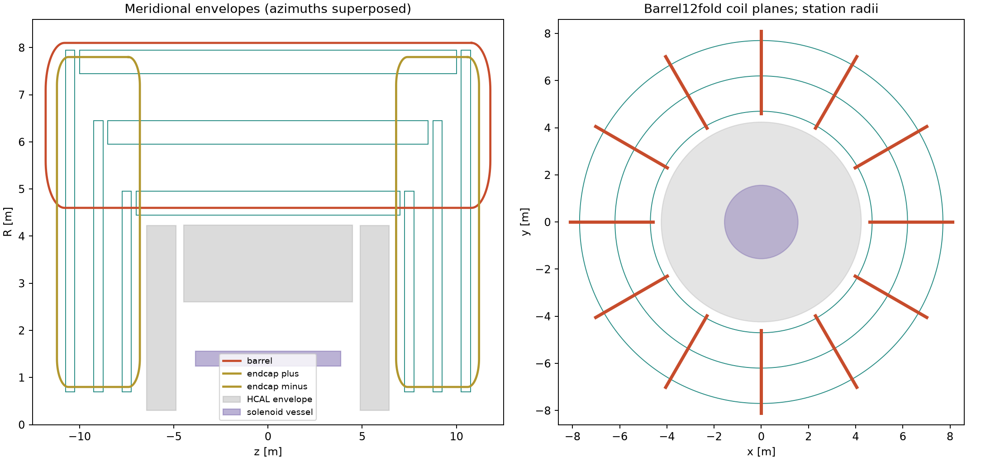

# DES-039 — Twelvefold toroids and joint solenoid field

2026-10-16. **DRAFT / PROTOTYPE.** Calculated vacuum magnetostatics and chamber
outline reservations; no engineering approval or detector reconstruction claim.

The proposal uses **12 barrel coils and 12 coils in each endcap**, rotated 15°
relative to the barrel. Three nested measurement shells provide three barrel
layers and **three disks per side**. The first-to-last radial and axial spans
are 3 m, with two 1.5 m intervals. The complete joint vector field includes the
pinned 3 T solenoid and all 36 finite-pack toroid coils.

Orange: barrel coils; gold: endcap coils; purple: solenoid; teal: both full-depth
external faces of the chamber outlines.

## Geometry and operating point

| Parameter | Barrel | Each endcap |
|---|---:|---:|
| Coil count | 12 | 12 |
| Coil-plane azimuth | 30° k | 15° + 30° k |
| Straight-leg centre radii | 4.60 / 8.10 m | 0.80 / 7.80 m |
| Axial centreline bounds | −11.8 to +11.8 m | ±(6.8 to 11.2) m |
| Rounded-corner radius | 1.0 m | 0.6 m |
| Uniform winding pack, normal × tangential | 0.20 × 0.30 m | 0.20 × 0.30 m |
| Ampere-turns per coil | 2.885089 MA-turn | 1.651317 MA-turn |
| Averaged pack current density | 48.0848 A/mm² | 27.5219 A/mm² |
| Sagitta-equivalent reference | 1.0 T at η=0, φ=15° | 1.6 T at η=2, φ=0° |

These are **NODD DESIGN CHOICES**, inspired by the primary ATLAS topology;
see the [source dossier](sources.md). ATLAS has eight coils per toroid and a
22.5° relative rotation; the twelvefold half-sector rotation of 15° is an
inference. We specify ampere-turns; electrical turn counts and circuit currents
are not selected. In particular, the barrel pack does **not** accommodate the
cited ATLAS conductor at its operating current. Conductor, insulation and
critical-current margin need a separate engineering design.

The chamber barrel radii are **4.7, 6.2, 7.7 m**; corresponding disk planes are
**|z|=7.5, 9.0, 10.5 m**. Disks extend from R=0.70 m to their corresponding barrel
radius+250 mm. Each barrel ends 500 mm before its disk centre. The 500 mm chamber
depth is a provisional nODD outline reservation, with no tubes, materials, readout or
internal structure. ATLAS uses two multilayers of 3/4 planes of 30 mm tubes; the
500 mm depth is our provisional envelope choice, not a sourced ATLAS whole
chamber dimension. Multilayer spacing/support depth remain open, and the 35 μm
response benchmark is not guaranteed by these empty envelopes. Barrel ends
leave 250 mm axially before disk front faces. Mixed BBB/BBD/BDD/DDD surface
crossings are supported.

Warm coil-following reservations are 0.50 × 0.60 m. Overall warm magnet bounds
are approximately R≤8.35 m and |z|≤12.05 m, before external services/supports.
Minimum pinned-HCAL envelope clearances are 110.5 mm radially at the barrel
corner and 108.8 mm axially at the endcap back face. The finite-depth chamber cutouts exclude both coil families; there is no
claim of a continuous unobstructed barrel annulus.

Both coil families cut the chamber outlines. Exported boundaries include a
50 mm warm clearance, the full radial/axial chamber extrusion and conservative
cell-size erosion. Depth is sampled at ≤25 mm with half-step padding; disk depth
does not falsely enlarge radial coil exclusions.
The shared endcap warm/cold reservation is a **union of coil-following sleeves**,
not independent overlapping vessels or a filled annular cryostat. A common
vessel, thermal shields, support webs and pressure boundary remain unresolved;
a filled ATLAS-style annular vessel would occupy some proposed chamber space.

## Joint field calculation

Exact finite straight-segment Biot–Savart and Coulomb-gauge vector-potential
kernels integrate closed rounded racetracks. Product Gauss quadrature samples
the finite uniform-current winding pack. The nominal toroid map uses 4×4 pack
nodes and 16 segments per rounded corner. The pinned solenoid uses three radial
and 96 axial Gauss nodes with 192 segments per circular loop, normalized to
Bz(0)=3 T. Its physical continuous winding is axisymmetric; the map rotates a
single meridional solenoid slice. This small polygon approximation is checked
against the independently integrated finite-solenoid axis formula.

The stored vector is the signed sum
`B_total = B_solenoid + B_barrel + B_endcap+ + B_endcap−`, in tesla.
No absolute values are taken before summation. The complete central vector is
approximately (0,0,3) T. A 7,644-point tracker-envelope scan gives a maximum
|B| of approximately **3.0244 T**, below the 5 T central cap. This is a sampled
tracker-region result, not a global peak-on-conductor calculation.

[joint-field.npz](joint-field.npz) is the numerical field grid; its exact axes,
shape, units, mask and SHA-256 are in [map-metadata.json](map-metadata.json).
The primary grid uses ΔR=Δz=0.0625 m and Δφ=0.625°, over R=0–9.5 m and
z=−12.5–12.5 m. Separate source components are retained in
[field-components.npz](field-components.npz) at 0.125 m /2.5° spacing.
The fundamental sector spans 0–30°; cylindrical components repeat every 30° and
must rotate when converted to global Cartesian vectors. `map.FieldMap` provides
bounded trilinear interpolation and rejects any stencil containing a masked
corner. Points inside finite winding packs plus a 0.10 m numerical guard are
NaN, never silently set to zero. No field extrapolation is supported.

An independent 2,472-point clear-path study selected this grid: its sampled
maximum interpolation error was 9.75 mT /1.16% of local field norm, with
0.894 mT RMS. This is broader than the filtered control in results.json;
see [independent-grid-study.json](independent-grid-study.json). An additional
solenoid 96→192 axial-quadrature check at 20 tracker points changed the field by
at most 1.24 mT (0.041%). These are separate source and interpolation effects.

The map remains an initial study grid. Retained interpolation checks compare
against direct evaluation; they are empirical sampled errors, not global
bounds. Precision observables below use direct source evaluation, with **no
interpolation uncertainty folded into the momentum proxy**. Refine the grid or
use the source evaluator for accuracy near coils or field cancellations.

**Material limitation:** the HCAL has ferromagnetic steel. Its magnetic grade,
B–H curve and complete installed supports are unspecified. This result is the
**joint coil field in vacuum**. The installed field requires a simultaneous
nonlinear solve of the combined currents and magnetic materials. Adding
separately iron-corrected solenoid/toroid maps is not generally valid.

## Energy and cold-volume accounting

All-space vacuum energy is calculated as `U=½∫J·A dV`. Distinct source/target
pack quadratures retain every self and mutual contribution while avoiding
coincident singular filaments. No near-wire energy, same-coil term or external
field tail is omitted. The C12 symmetry reduces target integration to one
representative coil per family. The energy is not a finite map-box B² integral.

The [raw reference study](energy.json) retains all convergence matrices at the
1 T/1 T reference. [operating-point-energy.json](operating-point-energy.json)
rescales **every ordered coupling term by I_g I_h** to the final currents; this
is exact linear vacuum scaling at fixed winding geometry. Solenoid/toroid mutual
energy vanishes by meridional/axisymmetric symmetry; independent numerical
integrations in both directions give residuals below 10⁻⁹ J.

| Vacuum energy | Value |
|---|---:|
| Complete toroid system, all self/mutual terms | **3.827697 GJ** |
| Pinned DES026 solenoid | **0.143174 GJ** |
| Complete coupled system | **3.970870 GJ** |

At the final operating point, pack refinement 4/5→6/7 changes toroid energy by
about 0.174%; corner segmentation 16→32 changes it by 0.0053%; longitudinal
quadrature 8→16 changes it by 0.00423%. Selected energy uses 6/7 pack orders,
32 segments per corner and 16 longitudinal nodes. These are observed refinement
changes, not a rigorous 0.2% uncertainty bound or engineering margin.

Applying the DES004 30 MJ/m³ rule to the **complete vacuum system** gives about
**132.363 m³ total cold allocation**, including 4.77246 m³ in the pinned solenoid.
A common toroid cold-section reservation of approximately **0.27574 × 0.40213 m**
gives 127.590 m³ unique toroid volume. Adjacent endcap overlap is subtracted,
approximately 0.08965 m³ per endcap. The retained analytical tube/overlap
integration and independent Monte Carlo control prevent double counting.

This is a global geometric energy/volume budget. It is not a local per-coil
energy-density, material-mass, stress or quench qualification. The very small
numerical bisection residual in U/V does not increase physical confidence.
Nonlinear installed-material energy and cold/support construction remain open.
The annular-solenoid radial-gap formula has not been applied to racetracks.

## Bending and chamber performance diagnostic

For actual finite surface crossings `s1<s2<s3`, use interpolation weights
`w=(s−s1)(s3−s2)/(s3−s1)` before s2 and
`w=(s3−s)(s2−s1)/(s3−s1)` after s2. The precision-coordinate sagitta is
`0.299792458 q/p × ∫w Bphi ds`. The equivalent uniform field is
`B_sag=2∫w Bphi ds/[(s2−s1)(s3−s2)]`. This retains signed cancellation and unequal
station spacing. Solenoid R/Z fields bend the other coordinate and are not
counted as equally precise MDT measurements.

The 1.6 T endcap reference compensates the opposing barrel return field in the
transition while keeping the barrel reference at 1 T. The final fine transition
scan (Δη=0.005, Δφ=0.5°) has a minimum B_sag of **0.8965 T** and maximum
standalone proxy of **8.80%**, near η=1.63, φ=0°. Of 2,511 sampled rays, 2,051 clear
all three finite-depth stations and the path between them. This 81.7% is a
fraction of this uniform scan grid, not a detector efficiency or solid-angle
coverage measurement. Narrow barrel–disk seam gaps, including around η≈1.2,
and forward coil/aperture shadows remain. This is a sampled diagnostic, not a
continuum performance guarantee. All fine samples are retained in
[transition-scan.csv](transition-scan.csv).

| Clear reference ray | Crossings | B_sag | 500 GeV standalone proxy |
|---|---|---:|---:|
| η=0, φ=15° | BBB | 1.000 T | 8.61% |
| η=2, φ=0° | DDD | 1.600 T | 5.54% |
| Fine-scan transition minimum | DDD | 0.8965 T | 8.80% |

ATLAS-source assumptions are 81.7 μm per tube and 35 μm fitted chamber precision.
Barrel alignment is 30 μm; disks use the separately quoted 40 μm endcap alignment.
Independent station uncertainties combine in quadrature. Barrel z precision is
projected by sech(η), and disk r precision by |tanh(η)|, into the track-normal
R–Z coordinate. Uniform **1.3 X₀ internal material is a borrowed proxy**, not a
mass derived from these empty outlines. For unequal station spacings a,b and
L=a+b, its sagitta noise is `theta0*a*b/(sqrt(3)*L)`.

Coil/case-crossing paths are rejected even if all three hits are clear. Path
sampling is at most 10 mm; arbitrary shallow grazes may be missed. Finite
outlines/cutouts, seams and the forward aperture create acceptance gaps. The
scan is not an efficiency measurement. Upstream calorimeter/solenoid scattering,
energy loss and tracker-to-muon matching remain the separate PR86 material study;
no new full transport, correlated combined fit, or high-energy loss extrapolation
is performed. Forces, supports, quench, conductor margin and installed steel
magnetization require further work before engineering adoption.

## Reproduction and evidence

See [tool instructions](../../../tools/toroid_prototype/README.md),
[full numerical results](results.json), [source manifest](sources.json),
[chamber outlines](chamber-outlines.json) and [3D VTP outlines](geometry.vtp).
The source tests cover analytic wires/loops, curl/divergence, C12 covariance,
Ampère circulation, finite-solenoid axis, uniform-field sagitta recovery,
finite-pack energy, reciprocity, scaling, geometry unions and masked map lookup.
Independent PhysVal review is retained in [review.json](review.json).
