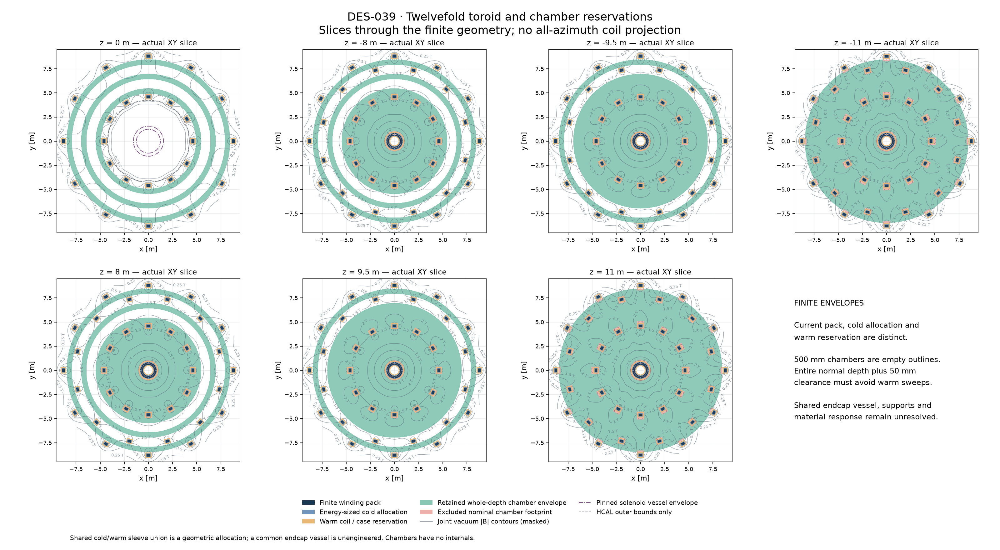
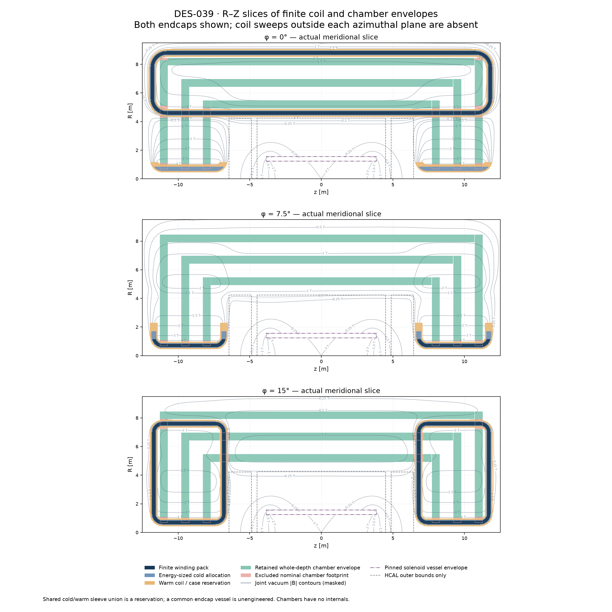
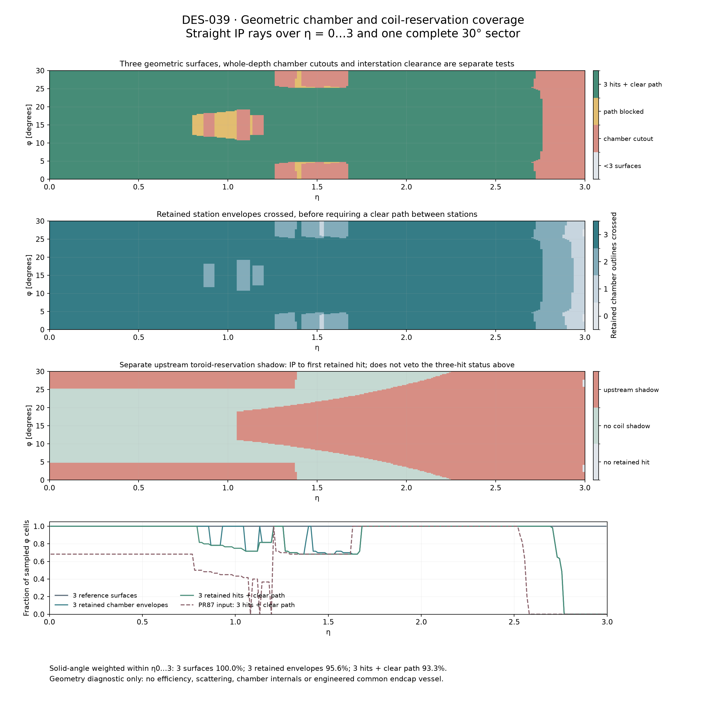
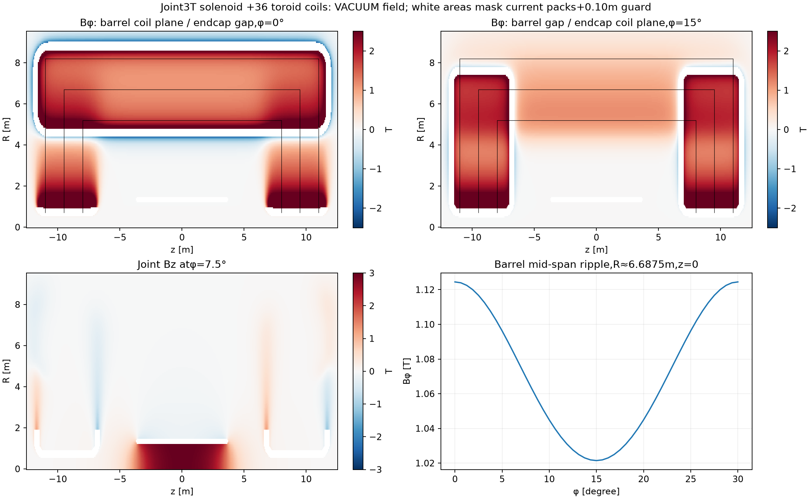
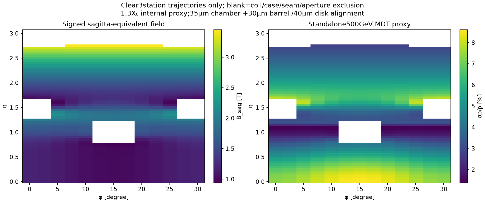

# DES-039 — Twelvefold toroids and joint solenoid field

Updated 2026-10-19 for PR87 review. **DRAFT / PROTOTYPE.** Calculated vacuum magnetostatics and chamber
outline reservations; no engineering approval or detector reconstruction claim.

The proposal uses **12 barrel coils and 12 coils in each endcap**, rotated 15°
relative to the barrel. Three nested measurement shells provide three barrel
layers and **three disks per side**. The first-to-last radial and axial spans
are 3 m, with two 1.5 m intervals. The complete joint vector field includes the
pinned 3 T solenoid and all 36 finite-pack toroid coils.

The [PR87 review](https://github.com/asalzburger/nodd/pull/87#issuecomment-6264270956)
asked for occupied coil space and its interleaving with all three chamber layers.
The original proposal is preserved at
[`71406b09`](https://github.com/asalzburger/nodd/tree/71406b09fa2d3fbfa119dba61e436f8fad1d11ac).
The revised geometry widens the barrel coil window and relocates the disks to
improve chamber coverage. No eta acceptance requirement has been adopted.

Dark blue is winding pack, blue the energy-sized cold allocation, orange the
warm coil/case reservation, green the retained full-depth chamber envelope,
and pink excluded nominal chamber space. The shared coil-following endcap
sleeves are reservations; their pressure vessel is not engineered. Unfilled
solenoid-vessel and dashed HCAL outer bounds provide context. These bounds do
not introduce a steel-response model. Contours show joint vacuum **|B|** in T;
no vector direction is implied, and invalid map stencils remain blank.

The XY panels are true z=0 and ±8/9.5/11 m sections; the RZ panels are true
phi=0/7.5/15-degree sections. Off-plane coils are absent. The earlier
[overview](geometry-rz-xy.png) is now explicitly labelled an axial projection;
its superposed return lines are not a z=0 coil section. The
[3D outline view](geometry-3d.png) retains coil centrelines and both chamber
boundary faces for orientation.

## Geometry and operating point

| Parameter | Barrel | Each endcap |
|---|---:|---:|
| Coil count | 12 | 12 |
| Coil-plane azimuth | 30° k | 15° + 30° k |
| Straight-leg centre radii | 4.60 / 8.80 m | 0.70 / 7.60 m |
| Axial centreline bounds | −11.8 to +11.8 m | ±(6.8 to 11.7) m |
| Rounded-corner radius | 1.0 m | 0.6 m |
| Uniform winding pack, normal × tangential | 0.20 × 0.30 m | 0.20 × 0.30 m |
| Ampere-turns per coil | 2.985344 MA-turn | 1.745396 MA-turn |
| Averaged pack current density | 49.7557 A/mm² | 29.0899 A/mm² |
| Sagitta-equivalent reference | 1.0 T at η=0, φ=15° | 1.6 T at η=2, φ=0° |

These are **NODD DESIGN CHOICES**, inspired by the primary ATLAS topology;
see the [source dossier](sources.md). ATLAS has eight coils per toroid and a
22.5° relative rotation; the twelvefold half-sector rotation of 15° is an
inference. We specify ampere-turns; electrical turn counts and circuit currents
are not selected. In particular, the barrel pack does **not** accommodate the
cited ATLAS conductor at its operating current. Conductor, insulation and
critical-current margin need a separate engineering design.

The chamber barrel radii are **5.2, 6.7, 8.2 m**; corresponding disk planes are
**|z|=8.0, 9.5, 11.0 m**. Disks extend from R=0.70 m to their corresponding barrel
radius+250 mm. Each barrel ends 300 mm before its disk centre. The 500 mm chamber
depth is a provisional nODD outline reservation, with no tubes, materials, readout or
internal structure. ATLAS uses two multilayers of 3/4 planes of 30 mm tubes; the
500 mm depth is our provisional envelope choice, not a sourced ATLAS whole
chamber dimension. Multilayer spacing/support depth remain open, and the 35 μm
response benchmark is not guaranteed by these empty envelopes. Barrel ends
leave 50 mm axially before disk front faces, closing the nominal angular seams. Mixed BBB/BBD/BDD/DDD surface
crossings are supported.

Warm coil-following reservations are 0.50 × 0.60 m. Overall warm magnet bounds
are approximately R≤9.06 m and |z|≤12.05 m, before external services/supports.
Minimum pinned-HCAL envelope clearances are 110.5 mm radially at the barrel
corner and 108.8 mm axially at the endcap back face. The finite-depth chamber cutouts exclude both coil families; there is no
claim of a continuous unobstructed barrel annulus.

Both coil families cut the chamber outlines. Exported boundaries include a
50 mm warm clearance, the full radial/axial chamber extrusion and conservative
cell-size erosion. Depth is sampled at ≤25 mm with half-step padding; disk depth
does not falsely enlarge radial coil exclusions.
The shared endcap warm/cold reservation is a **union of coil-following sleeves**,
not independent overlapping vessels or a filled annular cryostat. A common
vessel, thermal shields, support webs and pressure boundary remain unresolved;
a filled ATLAS-style annular vessel would occupy some proposed chamber space.

The old warm radial window 4.85–7.85 m admits at most 2.40 m of station-centre
span after 500 mm chamber depth and two 50 mm gaps. The new straight-leg window
4.85–8.55 m accommodates the requested 3 m span with 100 mm chamber/case gaps in
the coil plane. Including tangential case extent, the inner BT radial gap is
about 91 mm. The ECT outer warm leg reaches R=7.85 m in its coil plane, about
94 mm inside the outer barrel chamber inner face 7.95 m after tangential extent.
ECT inner current packs remain separated by
only about 20.8 mm; this does not qualify insulation, cold supports or a vessel.
The first disk moves past the front rounded return to reduce forward exclusions.

## Whole coverage and before/after comparison

[coverage.json](review-coverage/coverage.json) and
[coverage.csv](review-coverage/coverage.csv) retain every ray. Both configurations
use the same 28,800 cell-centred rays over 0≤|eta|≤3 and one 30-degree sector,
with deta=0.0125 and dphi=0.25 degrees. Periodic endpoints are not duplicated.
The weights integrate dOmega=dphi*[tanh(eta_high)−tanh(eta_low)]. Reflection and
C12 symmetry extend these fractions to both ends and the full azimuth.

| Solid-angle-weighted geometric fraction, conditional on abs(eta)≤3 | Original 71406b | Revised |
|---|---:|---:|
| Three retained full-depth chamber envelopes | ~66% | ~96% |
| Three envelopes plus clear interstation path | ~65% | ~93% |
| Above, also avoiding upstream toroid reservation | ~57% | ~57% |

These are geometric diagnostics, not detection/reconstruction efficiencies or
material budgets. The last row shows why better chamber placement cannot be
interpreted as removing the coils before the first station. Upstream toroid
shadows are reported separately; ECAL/HCAL/solenoid material is not included in
that flag. A muon traversing a case can still reconstruct, while the borrowed
clean-material curvature proxy cannot qualify such a path.

The separate [PhysVal spot checks](review-coverage/independent-spotchecks.json)
use 120 midpoint azimuth bins at selected eta values, with independently derived
surface crossings. They find 100% three-envelope/clear-interstation coverage at
eta=0 and 2.6–2.7 after revision, versus 68.3% at eta=0 and zero at 2.6–2.7 before.
At eta=1.2 the revised fractions are 81.7% versus zero in the original seam.
There are local losses: at eta=1.5 retained-envelope coverage falls 100%→68.3%,
while clear-interstation coverage stays 68.3%. The proposal is not a strict
superset. Transition holes remain and sampled coverage is zero again by eta=2.8.

The nominal three-surface gaps are closed analytically: each barrel eta endpoint
asinh((z_i−0.30)/R_i) exceeds the corresponding disk start
asinh(z_i/(R_i+0.25)). The disk-bore limit is eta≈3.131; coil shadows become
limiting earlier. No claim of full acceptance to that bore limit is made.
The paired coarse/fine scan in `coverage.json` exposes angular-sampling effects:
coarse-to-fine weighted clear-interstation fractions change approximately
66.6%→65.1% before and 93.31%→93.31% after. Fine bins still are not a continuum
bound; the overall comparison is deliberately rounded.

Coverage samples full chamber depth with ≤25 mm intervals and half-step guard.
Interstation/upstream paths use ≤10 mm intervals plus 5 mm padding to avoid
opening narrow gaps between samples. This is slightly more conservative than
the legacy response scan's unpadded 10 mm path test. Report the two diagnostics
with their actual conventions instead of calling either reconstruction efficiency.

## Joint field calculation

Exact finite straight-segment Biot–Savart and Coulomb-gauge vector-potential
kernels integrate closed rounded racetracks. Product Gauss quadrature samples
the finite uniform-current winding pack. The nominal toroid map uses 4×4 pack
nodes and 16 segments per rounded corner. The pinned solenoid uses three radial
and 96 axial Gauss nodes with 192 segments per circular loop, normalized to
Bz(0)=3 T. Its physical continuous winding is axisymmetric; the map rotates a
single meridional solenoid slice. This small polygon approximation is checked
against the independently integrated finite-solenoid axis formula.

The stored vector is the signed sum
`B_total = B_solenoid + B_barrel + B_endcap+ + B_endcap−`, in tesla.
No absolute values are taken before summation. The complete central vector is
approximately (0,0,3) T. A 7,644-point tracker-envelope scan gives a maximum
|B| of approximately **3.0244 T**, below the 5 T central cap. This is a sampled
tracker-region result, not a global peak-on-conductor calculation.

Black lines in this field overview are nominal station-centre guides. The
clipped full-depth chamber envelopes are shown in the finite-space slices above.

[joint-field.npz](joint-field.npz) is the numerical field grid; its exact axes,
shape, units, mask and SHA-256 are in [map-metadata.json](map-metadata.json).
The primary grid uses ΔR=Δz=0.0625 m and Δφ=0.625°, over R=0–9.5 m and
z=−12.5–12.5 m. Separate source components are retained in
[field-components.npz](field-components.npz) at 0.125 m /2.5° spacing.
The fundamental sector spans 0–30°; cylindrical components repeat every 30° and
must rotate when converted to global Cartesian vectors. `map.FieldMap` provides
bounded trilinear interpolation and rejects any stencil containing a masked
corner. Points inside finite winding packs plus a 0.10 m numerical guard are
NaN, never silently set to zero. No field extrapolation is supported.

A separately derived 3,066-point clear-path check of the revised source gives
sampled maximum interpolation error 9.61 mT /1.60% of local field norm, with
0.800 mT RMS. This is broader than the filtered control in results.json;
see [independent-grid-study.json](independent-grid-study.json). For the unchanged pinned
solenoid, the original 96→192 axial-quadrature check at 20 tracker points changed
the field by at most 1.24 mT (0.041%); the historical review retains that result.
These are separate source and interpolation effects.

The map remains an initial study grid. Retained interpolation checks compare
against direct evaluation; they are empirical sampled errors, not global
bounds. Precision observables below use direct source evaluation, with **no
interpolation uncertainty folded into the momentum proxy**. Refine the grid or
use the source evaluator for accuracy near coils or field cancellations.

**Material limitation:** the HCAL has ferromagnetic steel. Its magnetic grade,
B–H curve and complete installed supports are unspecified. This result is the
**joint coil field in vacuum**. The installed field requires a simultaneous
nonlinear solve of the combined currents and magnetic materials. Adding
separately iron-corrected solenoid/toroid maps is not generally valid.

## Energy and cold-volume accounting

All-space vacuum energy is calculated as `U=½∫J·A dV`. Distinct source/target
pack quadratures retain every self and mutual contribution while avoiding
coincident singular filaments. No near-wire energy, same-coil term or external
field tail is omitted. The C12 symmetry reduces target integration to one
representative coil per family. The energy is not a finite map-box B² integral.

The [raw reference study](energy.json) retains all convergence matrices at the
1 T/1 T reference. [operating-point-energy.json](operating-point-energy.json)
rescales **every ordered coupling term by I_g I_h** to the final currents; this
is exact linear vacuum scaling at fixed winding geometry. Solenoid/toroid mutual
energy vanishes by meridional/axisymmetric symmetry; independent numerical
integrations in both directions give residuals below 10⁻⁹ J.

| Vacuum energy | Value |
|---|---:|
| Complete toroid system, all self/mutual terms | **4.637645 GJ** |
| Pinned DES026 solenoid | **0.143174 GJ** |
| Complete coupled system | **4.780818 GJ** |

At the final operating point, pack refinement 4/5→6/7 changes toroid energy by
about 0.160%; corner segmentation 16→32 changes it by 0.0052%; longitudinal
quadrature 8→16 changes it by 0.00054%. Selected energy uses 6/7 pack orders,
32 segments per corner and 16 longitudinal nodes. These are observed refinement
changes, not a rigorous 0.2% uncertainty bound or engineering margin.

Applying the DES004 30 MJ/m³ rule to the **complete vacuum system** gives about
**159.361 m³ total cold allocation**, including 4.77246 m³ in the pinned solenoid.
A common toroid cold-section reservation of approximately **0.30062 × 0.43840 m**
gives 154.588 m³ unique toroid volume. Adjacent endcap overlap is subtracted,
approximately 1.00746 m³ per endcap. The retained analytical tube/overlap
integration and independent Monte Carlo control prevent double counting. The
verified area bracket lies inside that special union formula’s validity range;
it is not extrapolated to broader overlapping sleeves. The wider geometry costs
about 20.4% more complete vacuum energy than 71406b, with a 0.70 m larger radial
magnet bound and the same maximum longitudinal bound.

This is a global geometric energy/volume budget. It is not a local per-coil
energy-density, material-mass, stress or quench qualification. The very small
numerical bisection residual in U/V does not increase physical confidence.
Nonlinear installed-material energy and cold/support construction remain open.
The annular-solenoid radial-gap formula has not been applied to racetracks.

## Bending and chamber performance diagnostic

For actual finite surface crossings `s1<s2<s3`, use interpolation weights
`w=(s−s1)(s3−s2)/(s3−s1)` before s2 and
`w=(s3−s)(s2−s1)/(s3−s1)` after s2. The precision-coordinate sagitta is
`0.299792458 q/p × ∫w Bphi ds`. The equivalent uniform field is
`B_sag=2∫w Bphi ds/[(s2−s1)(s3−s2)]`. This retains signed cancellation and unequal
station spacing. Solenoid R/Z fields bend the other coordinate and are not
counted as equally precise MDT measurements.

The 1.6 T endcap reference compensates the opposing barrel return field in the
transition while keeping the barrel reference at 1 T. After recalculation, the
fine transition scan (deta=0.005, dphi=0.5 degrees) has minimum B_sag **0.9462 T**
and maximum standalone proxy **8.50%**, near eta=1.675, phi=0. Of 2511 sampled rays,
1964 clear all three finite-depth stations and the interstation path. This 78.2%
is a fraction of that uniform endpoint-inclusive scan, not the whole coverage
metric above. All samples remain in [transition-scan.csv](transition-scan.csv).

The separately authored [paired response comparison](review-coverage/response-comparison.json)
keeps a fixed 552-ray diagnostic grid, including the old seam directions:
296 rays clear both designs, 144 are newly clear, 4 are lost and 108 clear neither.
For common rays the median 500 GeV proxy changes 5.080%→5.062%; individual ratios
range 0.787–1.132, so improvement is not uniform. Newly gained rays have median
3.074% and maximum 7.564% on this grid. Grid choices differ from the fine scan;
these are local direct-field proxies, not detector momentum resolution or a
continuum bound. The [portable script](review-coverage/response-comparison.py)
snapshots baseline and current source modules and derives station/response
arithmetic independently; the field kernel is shared and separately controlled.

| Clear reference ray | Crossings | B_sag | 500 GeV standalone proxy |
|---|---|---:|---:|
| η=0, φ=15° | BBB | 1.000 T | 8.61% |
| η=2, φ=0° | DDD | 1.600 T | 5.54% |
| Fine-scan transition minimum | DDD | 0.9462 T | 8.50% |

ATLAS-source assumptions are 81.7 μm per tube and 35 μm fitted chamber precision.
Barrel alignment is 30 μm; disks use the separately quoted 40 μm endcap alignment.
Independent station uncertainties combine in quadrature. Barrel z precision is
projected by sech(η), and disk r precision by |tanh(η)|, into the track-normal
R–Z coordinate. Uniform **1.3 X₀ internal material is a borrowed proxy**, not a
mass derived from these empty outlines. For unequal station spacings a,b and
L=a+b, its sagitta noise is `theta0*a*b/(sqrt(3)*L)`.

Coil/case-crossing paths are rejected even if all three hits are clear. Path
sampling is at most 10 mm; arbitrary shallow grazes may be missed. Finite
outlines/cutouts and forward coil/aperture shadows create acceptance gaps; the
revised nominal barrel–disk seams themselves overlap in angular coverage. The
scan is not an efficiency measurement. Upstream calorimeter/solenoid scattering,
energy loss and tracker-to-muon matching remain the separate PR86 material study;
no new full transport, correlated combined fit, or high-energy loss extrapolation
is performed. Forces, supports, quench, conductor margin and installed steel
magnetization require further work before engineering adoption.

## Reproduction and evidence

See [tool instructions](../../../tools/toroid_prototype/README.md),
[full numerical results](results.json), [source manifest](sources.json),
[chamber outlines](chamber-outlines.json) and [3D VTP outlines](geometry.vtp).
The source tests cover analytic wires/loops, curl/divergence, C12 covariance,
Ampère circulation, finite-solenoid axis, uniform-field sagitta recovery,
finite-pack energy, reciprocity, scaling, geometry unions and masked map lookup.
The original PhysVal review remains historical evidence in
[review.json](review.json); the follow-up review of this revision is in
[review-coverage/review.json](review-coverage/review.json). The root agent adapted
the legacy seam and grid-control scripts for the revised geometry; the portable
paired response comparison was authored in a separate PhysVal context.
