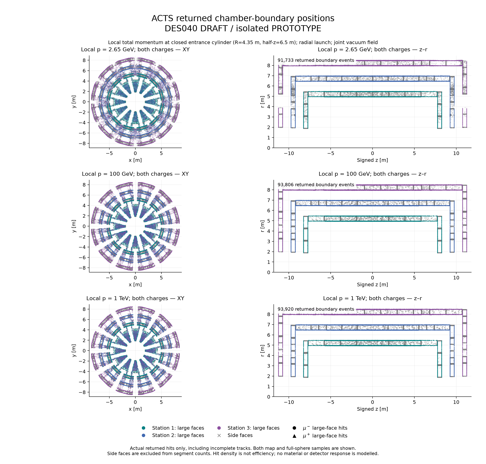
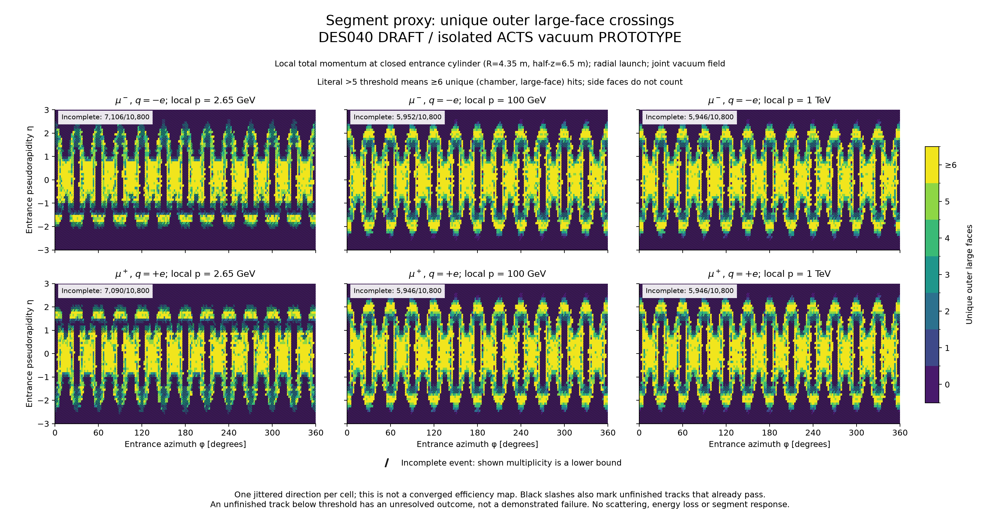
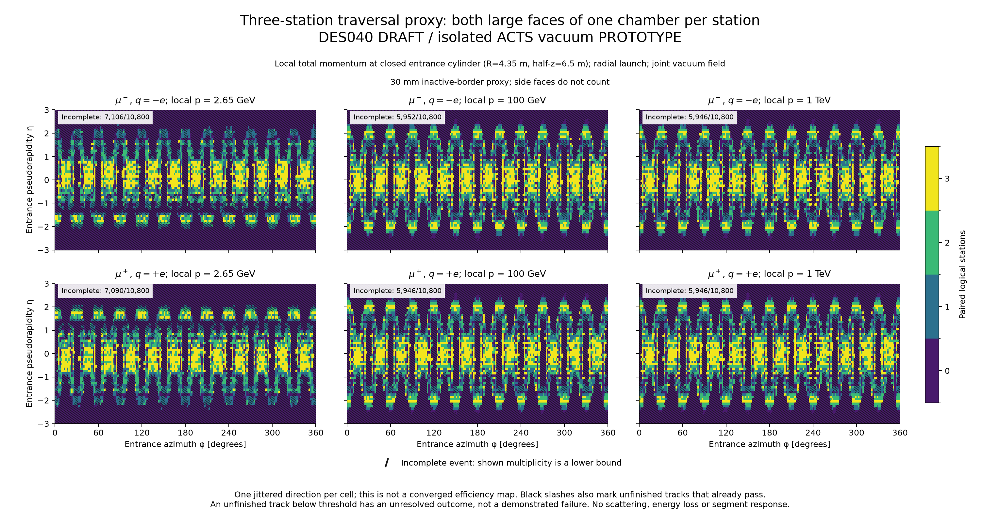
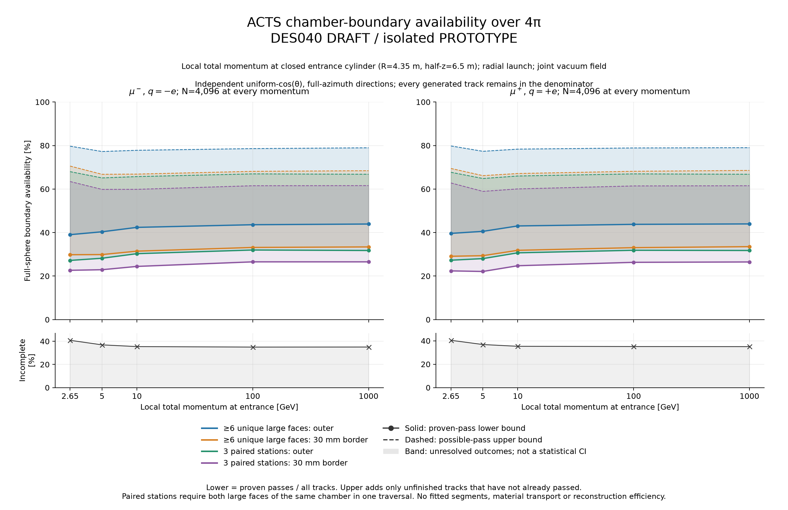

# Native ACTS muon-envelope propagation — PROTOTYPE

The fixed PR90 chamber layout does **not** provide at least six large-face proxies consistently over the full sphere. Proven fractions are 39–44%; even giving every unfinished event a pass only raises the bound to 77–80%. Three distinct stations with border-inset opposite-face pairs have proven fractions 22–27%. These are vacuum geometric proxies, not reconstructed MDT segments or muon efficiency.

This responds to PR90 comments [6268359299](https://github.com/asalzburger/nodd/pull/90#issuecomment-6268359299) and [6268670798](https://github.com/asalzburger/nodd/pull/90#issuecomment-6268670798). The [governing DES040 amendment](../../../design/DES-040-muon-chambers-frame.md#pr90-acts-propagation-amendment-2026-10-19-before-implementation) precedes implementation. Geometry and the joint solenoid/toroid map remain byte-for-byte fixed, as do all 52 inherited magnetic-study artifacts. The [rebuild](rebuild.md) uses the user-requested refreshed ACTS installation.

## Definition and scope

Local total entrance momenta are 2.65, 5, 10, 100 and 1,000 GeV, for both charges. The earlier [MUON-001](../../MUON-001/results.md) 5 GeV total **IP** central working point gives approximately 2.65 GeV after its central mean-loss surrogate; 2.65 GeV here is a stress point, not an all-eta threshold or pT cut. Launch points lie 10 µm beyond a virtual closed entrance cylinder R=4.35 m, half-z=6.50 m, including both caps, with initially radial directions. Tracker/calorimeter propagation is not part of this run.

The actual ACTS Gen3 TrackingGeometry contains 1,560 exact finite chamber prisms plus the vacuum world, 9,360 native finite chamber faces and 3,120 large faces. Native EigenStepper/Navigator supplies the global root positions. The primary policy targets supporting surfaces, checks actual finite faces at the native root and includes coincident owners. It is a **surface audit**; it does not qualify portal volume-switching through every chamber. Side faces remain in the event data but cannot count as segments.

A literal >5 means ≥6 unique (chamber, large-face) crossings. Separately require three distinct stations, each with opposite large faces of the **same chamber in one contiguous visit**. Side entries, later reentries or several panels in one station cannot manufacture a paired station. Outer faces and the original 30 mm inactive-border proxy are separate counters. Pure tangent contacts are retained in the raw events but excluded from crossing counts. No material, multiple scattering, energy loss, alignment, tube response, segment fit or reconstructed momentum is simulated; the retained MDT resolution model is unchanged.

## Full-sphere result

Each row uses 4,096 iid directions over untruncated 4π, shared between cases. Entries are **proven lower–possible upper percentages**. Unfinished events remain in the denominator; an already-proven threshold before a later field failure stays proven. Bounds describe unfinished-event uncertainty, not statistical confidence intervals. The per-row binomial sampling error of the proven fraction is approximately 0.6–0.8 percentage points, and does not reduce the much wider unfinished bounds.

| Local p [GeV] | q/e | ≥6 outer large faces [%] | 3 outer paired stations [%] | 3 border-inset paired stations [%] | Unfinished [%] |
| ---: | ---: | ---: | ---: | ---: | ---: |
| 2.65 | -1 | 39.04–79.71 | 27.20–67.99 | 22.66–63.45 | 40.84 |
| 2.65 | +1 | 39.62–79.81 | 27.29–67.70 | 22.39–62.79 | 40.43 |
| 5 | -1 | 40.36–77.25 | 28.20–65.11 | 22.92–59.84 | 36.91 |
| 5 | +1 | 40.55–77.34 | 28.03–64.84 | 22.12–58.94 | 36.82 |
| 10 | -1 | 42.38–77.81 | 30.30–65.72 | 24.44–59.86 | 35.42 |
| 10 | +1 | 43.04–78.34 | 30.69–65.99 | 24.76–60.06 | 35.30 |
| 100 | -1 | 43.60–78.59 | 31.98–66.97 | 26.54–61.52 | 34.99 |
| 100 | +1 | 43.77–78.88 | 31.86–66.97 | 26.32–61.43 | 35.11 |
| 1000 | -1 | 43.92–78.96 | 31.76–66.80 | 26.54–61.57 | 35.03 |
| 1000 | +1 | 43.97–79.00 | 31.76–66.80 | 26.49–61.52 | 35.03 |

Raising momentum changes the proven ≥6 fraction by only a few percentage points. Even the optimistic bound leaves at least 20% without six proxies. This fixed layout therefore needs further coverage work before a broad segment requirement can be claimed. Required eta acceptance and any future chamber rearrangement remain human design choices.

All unfinished events in this executed run are strict **field-mask failures**, not observed scattering or reconstruction failures. The field reader rejects any invalid corner of the interpolation stencil, even with zero weight; it never zero-fills or extrapolates. Winding/guard regions are undefined in this vacuum map, so these paths cannot establish success or failure after that point. A material-capable field/transport model is needed to resolve them.

## Views and numerical evidence

The entrance maps use one solid-angle-jittered ray per 2° × 0.1 eta cell over |eta| ≤ 3; this finite display is separate from the 4π denominator and is not a converged efficiency map. Grey/marked cells indicate unfinished multiplicities, including cases where ≥6 is already proven. XY/RZ plots show actual returned boundary positions, coloured by station; density is not an efficiency estimator.

The run retains 148,960 generated tracks and 464,397 returned boundary events: 378,692 large-face and 85,705 side events. There are 22 chamber reentries, no numerical duplicate events, no orphan transitions and no unresolved parallel-tolerance ambiguities. Every hit remains within 9.98 nm of its owning plane and finite prism. Completed and masked tracks number 71,126 and 77,834 respectively across both sampling sets; these combined counts are not a 4π efficiency.

[Executed controls](controls.json) pass strict field parity (4,111 queries, maximum residual 1.65e-14 T), all native prisms/faces/uint64 IDs/corners, 256 distinct zero-field ray clips, opposite charge/field helices, curved entry and initially parallel side-entry fixtures, and coplanar ownership. The 160-track indexed versus bounded exhaustive AABB search agrees exactly. Across 800-track half/quarter-step, tighter-surface and tighter-RK controls, statuses and all four counters agree; largest matched-root displacement is 1.188 µm, below the unchanged10 µm gate. Settings are 50 mm maximum steps, 10 nm targeting, 10 pm RK local-length tolerance, 100 m path and 20,000 step limits. The native curvature guard and negative-step correction preserve discovery without changing physical geometry or loosening finite-face checks.

[Initial failed controls](controls-initial.json) and [the subsequent refinement failure](controls-refinement-failure.json) are retained. Finite tangent portals missed a curved entry; remote unbounded supporting planes caused a stalled earlier numerical configuration. The explicit unbounded witnesses at the final tight RK setting happen to agree with the primary, as recorded in the final controls; they are not presented as new failures. The bounded search follows finite reachability rather than accepting remote supporting-plane roots. Neither numerical passes nor this prototype grant engineering acceptance.

The [acquisition control record](controls-acquisition.json) is retained separately from the counter-corrected final control record; the native executable and generated events are identical. The typed [track arrays](tracks.npz),[native hit arrays](hits.npz),[summary](summary.json) and [provenance](provenance.json) retain seeds, statuses, owners, coordinates, partial events and hashes. Raw geometry/hit CSVs are task-local exports with retained fingerprints; no polylines supply the primary hits. [Reproduction commands](../../../../tools/muon_layout/acts/README.md) and the captured-artifact CI check are separate from executing ACTS. Independent exact-revision assessment is recorded alongside this report when complete; it is not human sign-off.
