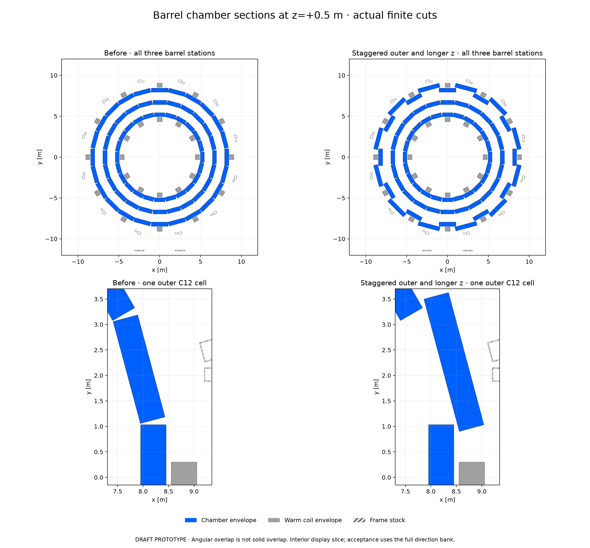
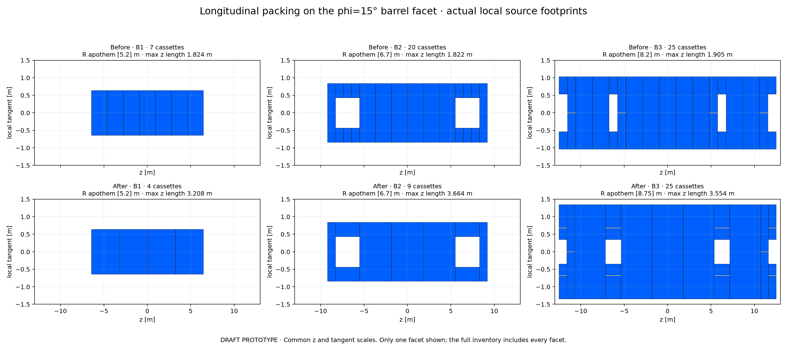

# DES-040 barrel overlap and longer cassettes — 2026-10-20

DRAFT / isolated PROTOTYPE responding to [PR90 barrel comment](https://github.com/asalzburger/nodd/pull/90#issuecomment-6287612852), under the preimplementation [DES040 contract](../../../design/DES-040-muon-chambers-frame.md). Input revision `e0fd6ad0e4cd8df96356c00ab35095446c3e9ce3`; executed geometry/export/validation source freeze `7d8c51f304dc79bd187279580b4e1cb5464f7974`. No human engineering sign-off or production integration.

Alternate outer-barrel facets move outward and widen to overlap their neighbours in azimuth. Longer z cassettes reduce the barrel count **1,056 → 696 (34.1%)**, while the **192 refined endcap outlines remain identical**. Total chamber count is **888**. The tradeoff is **13 barrel dimension families instead of 7**, including narrow fragments around fixed hardware.

## Updated outlines and downloads



[Vector cross-sections](views/barrel-cross-sections.svg) · [Actual source polygons](views/views.json)



[Vector longitudinal footprints](views/longitudinal-packing.svg) · [Barrel dimensions before](inventory/before-barrel.md) · [after](inventory/after-barrel.md)

- [Blue chambers and grey coils: OBJ + MTL ZIP](obj/chambers-and-coils.zip)
- [Separate barrel, positive-endcap, and toroids/frame: OBJ + MTL ZIP](obj/components.zip)
- [Combined preview](obj/chambers-and-coils.png) · [Barrel preview](obj/barrel-chambers.png)
- [Candidate geometry](candidate/geometry.json) · [fresh physical certificates and adverse controls](candidate/geometry-controls.json)
- [Native/OBJ/figure provenance](artifacts.json) · [native crossing checks and geometric bank](native-validation/validation.json)
- [Full precision dimensions and shape changes](inventory/comparison.json) · [source shape mapping](candidate/shape-change-mapping.json)

Coordinates are metres, right-handed xyz, beam along z. Each OBJ uses a sibling relative MTL. Chambers are blue RGB(0,96,255), coils/frame grey RGB(160,160,160), with ACTS's diffuse divisor256. Transparency is preview-only. Frame OBJ contains outer reservations with hollow cavities omitted and intersecting joints; it is not a material or mass union. Chamber internals remain undesigned.

## Geometry and rationale

All numerical choices below are **NODD DESIGN CHOICES**, selected provisionally from the reviewer's sketch; their consequences are **INFERENCES** from the explicit finite outlines. They are not measured engineering requirements. Existing source parameters retain their historical provenance; no new external scientific constant is introduced.

| Barrel station | Count before → after | Dimension families before → after | Actual after z length [m] |
|---|---:|---:|---:|
| B1 |168 → 96|1 → 1|3.2078|
| B2 |360 → 168|3 → 3|0.901–3.664|
| B3 |528 → 432|3 → 9|0.873571–3.554286|
| Total barrel |1,056 → 696|7 → 13|Maximum seed4m|

B1/B2 apothems5.2/6.7m are unchanged. B3 facets on BT planes0+30k degrees stay at8.2m; the twelve inter-BT facets15+30k degrees move to8.75m. Depth remains0.5m. Retained even half-width is1.036637355820m and widened odd half-width1.343992086290m. The full-width odd template is2.687984172581m wide.

For depth half-h, active border t and adjacent facet angle delta=15degrees, a straight IP ray traverses both depth faces within half-angle `beta=atan((halfwidth-t)/(R+h))`. Odd width is derived so adjacent even/odd half-angles sum to15.1degrees: **0.1degree projected overlap with the30mm border**. This applies to uncut templates. The finite z seams and coil/frame cuts remove local coverage; the direction bank below uses actual packed chambers.

Projected overlap does not create a solid intersection. The odd inner radial plane separates it from its even neighbour by

`(8.75-0.25) - [(8.2+0.25) cos(15deg) + 1.036637355820 sin(15deg)] = 0.069625277306m`.

This is also the true nearest distance of the full templates. It exceeds the new20mm neighbour clearance requirement. Simply widening at the original radius produces an interior collision, retained as an adverse control. All24 full outer templates and all393,828 pairs of final888 chambers are checked. The historical nominal20mm tangent subtraction corresponds to19.8289mm physical separation on same-radius facets; it is not relabelled as an exact20mm distance.

A provisional **4m maximum z seed**, replacing2m, retains the barrel half-z limits6.4456/9.2/12.5m and nominal20mm seams. Adaptive packing checks the complete volume against the fixed coils and all484 supports with50mm clearance. Identical tangent lanes can fill an adjacent20mm z seam only after a fresh whole-union clearance proof and within4m length:264 such merges are accepted. Rejected hardware corridors are never bridged. Hard coil/frame interruptions remain, visible in the longitudinal drawing: odd B3 full-width support intersections near abs(z)=6.1–6.5 and12.1–12.5m, odd B2 near6.1–7.1m, and even B3 BT return cuts near11.06–12.09m. Partial side strips can survive these intervals.

The inherited useful-size policy limits prospective z subdivisions to0.5m and all areas to0.25m²; it has no universal0.5m tangential-width floor. After packing,48B2 and96B3 fragments are narrower than0.5m; minimum B3 width is0.318498m. Such outlines require engineering evaluation. The seven endcap families and192endcap source objects are value-identical to the comparison baseline. Author-only [3m/6m seed diagnostics](seed-diagnostics.json) ([reproduction method](seed-diagnostics-method.md)) produce816/672barrels;4m was provisionally retained for better sampled geometric coverage with fewer families than6m. This is a bounded comparison, not an optimization or mechanical qualification.

The source boundaries `origin_m`, `basis`, `vertices_m`, `depth_m` are authoritative. Retained historical wheel metadata describes unchanged endcap input. The original `configuration.chambers.barrel_apothems_m` gives the base radii; the new `barrel_overlap_dimensions` supplies the odd-B3 override, explicitly identified in `barrel_apothem_scope`. Do not reconstruct the stagger from the base-radius array alone.

## Fixed interfaces and limits

Every magnetic source, all484 frame members, all192 endcaps and their certificates remain identical. The joint solenoid+toroid field is reused byte-exact; no magnetic solve is warranted by chamber-only relocation. A fresh binary conversion reproduces the retained [joint-field NPZ](../wheels-2026-10-20/magnetic/candidate-map.npz) exactly. Uniform middle-wheel eta3 remains **UNMET** because of the fixed ECT inner-leg obstruction described in the [refined-wheel report](../refined-wheels-2026-10-20/README.md#aperture-target-and-actual-limitation).

Maximum chamber corner radius grows8.513349341 → **9.099797510m**, within the fixed9.5m map. The retained ACTS chamber-navigation worldR9.1m leaves only0.20249mm numerical margin; all corners and native construction pass, but this is not an installation allowance. Map extent isR9.5m andabs(z)<=14.3125m. Frame/feet extend toR11.9084m and lie outside this world/map. The native world contains vacuum chamber boundaries, not the detector's passive material. Longer-tube sag, alignment, supports, handling, services and readout remain unqualified.

The [separate SysArch input assessment](review/interface-report.md), [portable checker](review/interface-check.py) and [actual results](review/interface-check.json) derive69.625mm clearance independently, check all276 template pairs and complete support-column intersections, and prove whole-z odd-B3 coil exclusion. It assessed the pinned input revision, not final artifacts.

## Actual checks and observables

Eight focused tests pass, including deterministic rebuild, occupied coil/support, duplicate volume, widened-same-radius collision, changed interfaces and cache-radius controls. Fresh cached C12 proofs include actual radius, complete footprint and source/config fingerprints; no historical barrel certificate is loaded. Separate uncached audits check all696 actual orientations with118,104 adaptive cells. Every accepted barrel has a fresh50mm coil and support proof, all484support members are considered, and no unresolved coil cell is accepted. These are mathematical outline checks, not independently surveyed hardware tolerances.

Native ACTS constructs888 finite chamber volumes and5,328unique faces. Native/exported corners agree with source within3.56e-15m. Four OBJ bundles pass finite closed-mesh, winding, volume and native-corner checks; ZIP members match siblings. Displayed72section polygons per layout match50,000source membership probes with no mismatch; common axes include actual coil/frame stock. The z=+0.5m view is a representative interior slice, avoiding a longitudinal seam. Longitudinal views use every actual footprint on phi15degrees; inventories contain every facet.

All1,024 zero-field native tracks complete and match the independent same-chamber front/back calculations, with and without the30mm border. A separate comparison uses **32,768iid directions uniform in cos(theta) over0<abs(eta)<1**, fullphi, mirrored to65,536rows, fixed seed906320. At each station both depth faces must lie in one finite chamber. The mirrored rows are not65,536independent directions.

| Geometric fraction in the declared barrel bank [%] | Before | After |
|---|---:|---:|
| B1 |77.7588|84.4971|
| B2 |75.0977|81.6040|
| B3 |78.3752|90.4510|
| All three barrel stations |56.6040|69.3878|
| All three,30mm border proxy |48.2971|61.8225|

The independent paired comparison also records local losses. Of the 32,768 independent directions, **6,198 gain and 2,009 lose** the three-station outline crossing: 18.9148% gained, 6.1310% lost, net +12.7838 percentage points. With the 30 mm border, 6,655 gain and 2,223 lose, net +13.5254 points. Conditional paired Monte Carlo standard errors on these net gains are 0.2673 and 0.2777 percentage points; they exclude design and response uncertainty. The mirrored rows duplicate those counts across both ends. This is a combined radial-stagger/z-packing tradeoff, not a pointwise improvement. Among outline losses, 508 miss only B1, 605 miss B1+B3, 896 miss only B3, and none lose B2.

Relocated axial seams can prevent both depth crossings from fitting in one cassette. Example zero-based row 13 in the 32,768-iid geometric bank (seed 906320; not the native-track bank), eta 0.579953 / phi 147.857819 degrees, passed old B1/F10/Z05; its new depth crossings span z 3.036546–3.343268 m, straddling seam 3.2178–3.2378 m. Row 163 (eta 0.204720, phi 316.731763 degrees) passed old B3/F21/Z07; new depth crossings 1.753103–1.856227 m straddle seam 1.777143–1.797143 m. Adjacent partial traversals therefore fail the strict same-cassette observable. These are physically explained packing/proxy effects, not geometry-overlap failures. A reconstruction study could use different crossing criteria but is outside this prototype.

These are straight geometry fractions in a declared band. They include actual cuts but no coil/material veto, multiple scattering, energy loss, hit response or reconstruction. They are not full-4pi acceptance or efficiency. Old endcap and large native studies remain historical, not recalculated performance for this candidate.

The unchanged-map curved smoke retains **all256tracks**,5/100GeV and both charges:197complete and59field-masked, with maximum finite plane residual9.70e-9m. Masked rows and IDs are retained; no extrapolation or zero replacement is used. This is a bounded event-consistency check, not an efficiency estimate. The [449-file prior source/evidence identity manifest](prior-evidence-identity.json) confirms historical files remain byte-exact.

The [separate final PhysVal assessment](review/physics-review.md), [portable checker](review/physics-check.py) and [actual results](review/physics-check.json) assess exact frozen artifact revision `0933e439a69e199fb17e250d792ba35d0feaf9ab`. All 39 focused checks pass across 495 pinned blobs. Its bounded assessment finds no new blocking implementation defect; it identifies the paired local-loss and sampling-precision tradeoffs, now clarified above without changing source, geometry or acquired artifacts. It independently checks finite pairs/supports/events/banks/meshes/views and historical identities; it inspects retained coil certificates but does not independently rerun their distance kernel or native transport. Uniform middle eta3 and engineering/response requirements remain unresolved. No automated check grants human engineering acceptance.

## Reproduction

Use Python with NumPy, plus Matplotlib for exports/views, and the verified local ACTS runtime for native commands. The source guards require executed files to match the current Git revision; run these modules at the recorded source freeze or an unchanged-source descendant. No shared dependency installation is performed.

```sh
python3 -B -m unittest tools.muon_layout.test_barrel_overlap
python3 -B -m tools.muon_layout.barrel_overlap
MPLCONFIGDIR=/tmp/pr90-barrel-matplotlib python3 -B -m tools.muon_layout.barrel_artifacts
python3 -B -m tools.muon_layout.barrel_validation
```

The node preflight warned that setup/Spack-lock fingerprints changed. Fresh same-shell Spack activation, native executable/library fingerprints, NumPy/Matplotlib imports and actual construction/transport passed. No ACTS installation or library was modified.

Independent actual-artifact check, without ACTS or scratch-path dependencies:

```sh
python3 -B docs/validation/DES-040/barrel-overlap-2026-10-20/review/physics-check.py \
 --repo . --revision 0933e439a69e199fb17e250d792ba35d0feaf9ab \
 --output /tmp/barrel-physics-check.json
```
