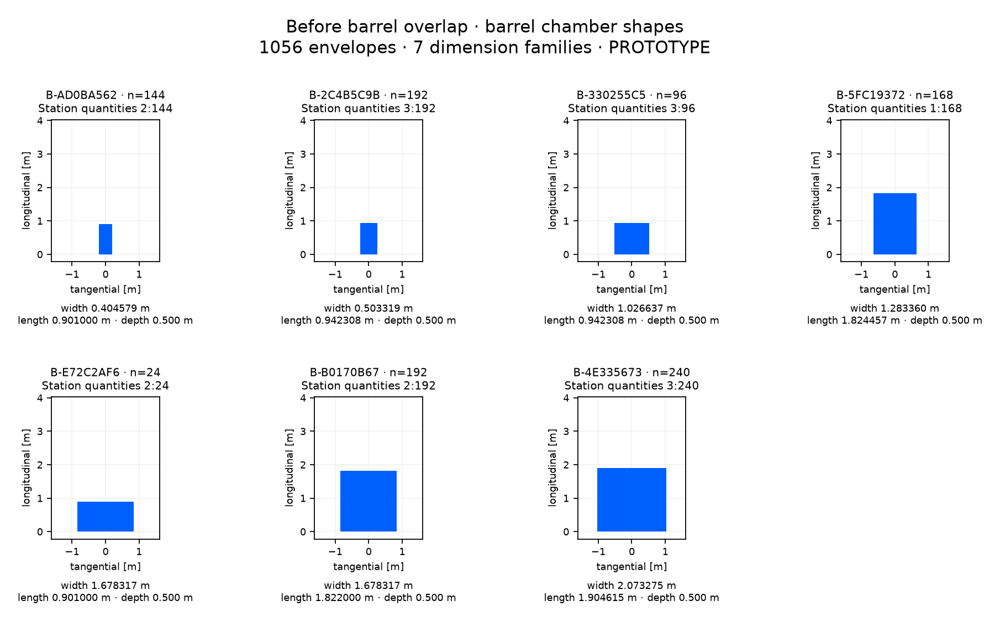

# Before barrel overlap: barrel chamber inventory

1056 chamber envelopes, 7 dimension families. Isolated PROTOTYPE; no chamber internals or manufacturing specification.

[CSV](before-barrel.csv) · [Full panel-to-shape mapping and source hash](before-barrel.json). Dimensions group on a 1 nm grid; the JSON retains every source panel’s unrounded dimensions. Endcap quantities include both hemispheres. Shape plots share a metric scale within this sheet.

| Shape | Quantity | Station: quantity | tangential width [m] | longitudinal length [m] | depth [m] |
| --- | --- | --- | --- | --- | --- |
| B-AD0BA562 | 144 | 2: 144 | 0.404579305 | 0.901000000 | 0.500000000 |
| B-2C4B5C9B | 192 | 3: 192 | 0.503318678 | 0.942307692 | 0.500000000 |
| B-330255C5 | 96 | 3: 96 | 1.026637356 | 0.942307692 | 0.500000000 |
| B-5FC19372 | 168 | 1: 168 | 1.283359726 | 1.824457143 | 0.500000000 |
| B-E72C2AF6 | 24 | 2: 24 | 1.678317219 | 0.901000000 | 0.500000000 |
| B-B0170B67 | 192 | 2: 192 | 1.678317219 | 1.822000000 | 0.500000000 |
| B-4E335673 | 240 | 3: 240 | 2.073274712 | 1.904615385 | 0.500000000 |
