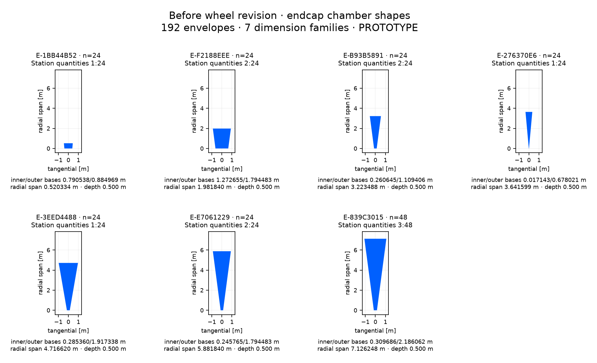

# Before wheel revision: endcap chamber inventory

192 chamber envelopes, 7 dimension families. Isolated PROTOTYPE; no chamber internals or manufacturing specification.

[CSV](before-endcap.csv) · [Full panel-to-shape mapping and source hash](before-endcap.json). Dimensions group on a 1 nm grid; the JSON retains every source panel’s unrounded dimensions. Endcap quantities include both hemispheres. Shape plots share a metric scale within this sheet.

| Shape | Quantity | Station: quantity | radial span [m] | inner base [m] | outer base [m] | outer base offset [m] | depth [m] |
| --- | --- | --- | --- | --- | --- | --- | --- |
| E-1BB44B52 | 24 | 1: 24 | 0.520334445 | 0.790538463 | 0.884968758 | 0.000000000 | 0.500000000 |
| E-F2188EEE | 24 | 2: 24 | 1.981839916 | 1.272654947 | 1.794483297 | 0.000000000 | 0.500000000 |
| E-B93B5891 | 24 | 2: 24 | 3.223487508 | 0.260645487 | 1.109405850 | 0.000000000 | 0.500000000 |
| E-276370E6 | 24 | 1: 24 | 3.641599012 | 0.017143473 | 0.678020863 | 0.000000000 | 0.500000000 |
| E-3EED4488 | 24 | 1: 24 | 4.716620330 | 0.285360471 | 1.917338002 | 0.000000000 | 0.500000000 |
| E-E7061229 | 24 | 2: 24 | 5.881839916 | 0.245765466 | 1.794483297 | 0.000000000 | 0.500000000 |
| E-839C3015 | 48 | 3: 48 | 7.126247775 | 0.309685571 | 2.186062207 | 0.000000000 | 0.500000000 |
