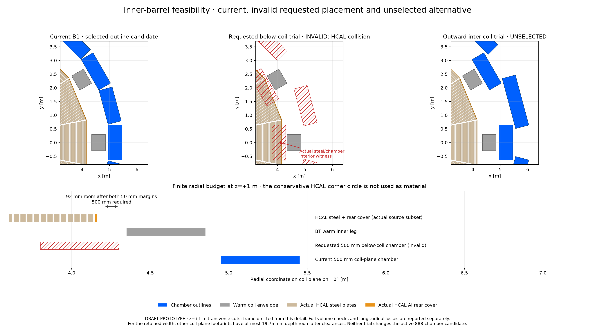
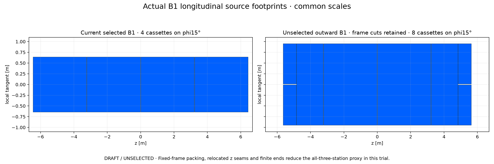

# Inner-barrel stagger: physical feasibility and conditional alternative

DRAFT / isolated PROTOTYPE responding to [PR90 comment6288294033](https://github.com/asalzburger/nodd/pull/90#issuecomment-6288294033), under the preconstruction [DES040 feasibility contract](../../../design/DES-040-muon-chambers-frame.md#inner-barrel-under-coil-feasibility-pr90-follow-up-2026-10-20). Input revision: `56f12ef5b2a9bd410cb77e95ac3140557d92f1b2`.

**The requested inward placement does not fit the current HCAL and BT geometry.** All 48 coil-plane B1 chambers moved below the BT inner legs intersect actual finite HCAL steel/cover. An outward inter-coil alternative clears the hardware, but adds chambers and reduces the sampled three-station geometric proxy. Neither trial is adopted. The current **888-chamber candidate**, OBJ downloads, magnets, field map, frame and endcaps remain unchanged. No human design sign-off or engineering acceptance is implied.



[Vector version](views/inner-barrel-feasibility.svg) · [Actual displayed source polygons and hashes](views/views.json)

The upper panels show a common cropped XY detail around one inner C12 cell at z=+1m. All24source facet cuts are retained in JSON. Steel/cover are actual occupied source subsets; the fixed frame is omitted only from this transverse detail. Plotting source freeze: `5d50357ce7c564ddab9fbd1b0eb7361b04b07ccd`.

## What prevents the proposed inward stagger

The coil-plane B1 chambers currently sit at apothem5.20m with radial depth0.50m, their inner face4.95m above the BT warm outer face4.85m. The proposal moves those twelve facet columns beneath the BT inner straight legs, retaining and widening the inter-coil columns. The second bullet is interpreted as tangential extent, consistent with the requested transverse stagger; the current4m maximum z seed is retained.

All quoted detector dimensions are existing or conditional **NODD DESIGN CHOICES**, not measured engineering requirements. The bounds, intersections and geometric fractions are **INFERENCES** from the pinned finite source shapes. The only new trial choice is the explicitly unselected inter-coil apothem5.75m and width derived for0.1degree full-depth overlap including the existing30mm border.

The inner BT straight-leg centre is `6.7−2.1=4.60m`. With the0.50m warm normal thickness its inner face is4.35m. For chamber half-depth h=0.25m and clearance c=0.05m,

`R + h + c <= 4.35m  =>  R <= 4.05m`.

At equality the expanded-obstacle touching convention rejects the limit, so an accepted layout would need a small strict guard below4.05m. The existing HCAL corner enclosure instead requires `R >= 4.23946+0.05+0.25 = 4.53946m`. That enclosure is conservative and is not treated as filled material.

The source-accurate check goes further. Expanded HCAL source [revision0e8530d](https://github.com/asalzburger/nodd/tree/0e8530d56d171f38c9d53d3c60c8b48803680bbd), already pinned by MUON001/DES039, has16sectors,36steel layers and a4.148–4.158m aluminium rear cover. Its config/design/summary hashes match the existing provenance records. Clipping the actual finite cover to each retained chamber's1.28336m tangential footprint gives:

| Coil planes | Necessary chamber apothem outside actual cover, with50mm margin | Maximum below-BT apothem | Missing radial room |
|---|---:|---:|---:|
|0°,90°,180°,270°|4.458m|4.05m|408mm|
|Other eight coil planes|4.5302525m|4.05m|480.2525mm|
|Conservative corner enclosure|4.53946m|4.05m|489.46mm|

There is no common radial interval. Independent whole-prism SAT checks cover all48 moved actual chambers against592 finite HCAL prisms (36steel plates plus rear cover in each of16sectors): **all48 have real source-model material intersections**. At z=1m, away from the actual z=0 cassette seam, `(4.120,0,1.000)m` lies strictly inside both a moved chamber and the last steel plate; `(4.153,0,1.000)m` lies inside the actual aluminium cover and that chamber. Raising the chamber to the HCAL-bound radius instead puts `(4.600,0,1.000)m` inside the chamber and the BT warm/current-pack allocation.

The independent [SysArch report](interface-report.md), [stdlib checker](interface-check.py) and [actual results](interface-check.json) retain exact finite coordinates and all12coil-plane constraints. Ten asserted controls pass. The HCAL set is an occupied subset, omitting modules, rails, end flanges and services: its detected intersections are sufficient to disprove this placement; a clear reduced-set result would not certify complete HCAL clearance.

Angular overlap alone would be misleading. At the limiting inward radius, unchanged widths overlap by1.038degrees at the mid-plane but still leave a0.500degree gap under the stricter full-depth30mm-border definition. Widening inter-coil chambers to1.399110m would close that angular proxy, but it does not remove the HCAL intersections. The red drawing is explicitly an invalid counterfactual, not a candidate or cleared geometry.

## Conditional outward inter-coil option: clear, but worse at three stations

The MuonTech [report](conditional-report.md), [portable calculation](conditional-check.py), [actual results](conditional-check.json) and [144 source outlines](conditional-B1-outlines.json) test a different, **unselected** option: keep coil-plane B1 at5.20m; move only inter-coil facets to5.75m and widen them to1.895447083m. The0.55m stagger gives0.1degree full-depth angular overlap with30mm borders,69.625mm neighbour separation and at least375.613mm radial clearance from B2. This differs from the requested inward move and is not silently substituted for it.



[Vector footprints](views/inner-barrel-longitudinal.svg). Actual phi15degree footprints show finite frame cuts, not an uninterrupted template.

| Quantity | Current | Conditional outward option |
|---|---:|---:|
|B1 outlines|96|144|
|B1 dimension families|1|4|
|Total chamber outlines|888|936|
|Maximum B1 corner radius|5.487645m|6.074387m|
|Other station/endcap outlines|792|792, value-identical|

Fresh physical checks pass: all437,580 pairs of the conditional936chambers,24full-z neighbouring template pairs,144uncached actual-orientation coil audits and all484support envelopes per B1 chamber. Coil/support clearance remains50mm, and no historical changed-radius certificate is reused. Fixed frame carriers/spokes/lugs require96rejected packing leaves near the barrel ends. The existing useful-size, z-seam and4m seed policies remain intact.

A new fixed bank uses **65,536 independent directions uniform in cos(theta) and phi over full4pi**, seed40087, with no mirroring. Each station ORs its barrel and endcap cassettes; all-three then requires three distinct station IDs. At each station both depth faces must fit in one cassette. This is a different domain from the earlier central barrel bank and must not be compared directly to its percentages.

| Geometric fraction in this full4pi bank [%] | Current | Conditional |
|---|---:|---:|
|B1 barrel alone, outline|64.2181|66.0156|
|B1 barrel alone,30mm border|60.0174|63.9252|
|All three station IDs, outline|65.6158|64.2670|
|All three station IDs,30mm border|57.4402|56.3980|

For the bordered three-station proxy,1,245directions gain and1,928lose: net **−1.0422percentage points**, conditional paired Monte Carlo SE0.0859points. The outline net is−1.3489points, SE0.0888. Border losses partition into565frame-packing losses,1,034relocated-z-seam/same-cassette losses and329finite-barrel-reach losses. Actual witness directions and panel IDs are retained. The effect has the same adverse sign in all four fixed quarter-bank diagnostics; no retuning or additional alternatives are selected from those diagnostics.

An increase in the standalone B1 fraction therefore does **not** establish improved three-station coverage. These are straight finite-geometry proxies, with no material veto, scattering, energy loss, measured MDT response, native transport, fit or reconstructed efficiency. No new magnetic or ACTS performance calculation is claimed.

## Physical choices needed before the inward proposal can proceed

No option below is selected:

- Open the HCAL/BT radial gap. Moving BT inner legs outward needs at least408–480.253mm locally for the unchanged chamber footprint, or489.46mm under the current corner enclosure. These are necessary local bounds, not a working coil design. Any coil-source change requires a fresh joint field/energy/sizing and chamber/frame study.
- Revisit chamber depth or technology. With the retained width and both50mm margins, actual cover bounds leave at most92mm depth on four coil planes and19.75mm on the other eight. Those are upper geometric bounds, not a viable MDT specification. The500mm envelope cannot be compressed silently.
- Reduce/notch HCAL. Even at the aligned plane it would need at least408mm less radial material/envelope, affecting calorimeter sampling/containment and services; this needs an explicit calorimeter design decision.
- Reconsider a different chamber/frame/z layout. The simple outward option above is not recommended as an overall geometric-coverage improvement and does not meet the requested inward arrangement.

The current source geometry/OBJ/maps remain the reviewable baseline while that physical choice is made. Uniform middle-wheel eta3 remains UNMET and unchanged. No change to internals, installed magnetic material, structural qualification or design lifecycle follows from this feasibility study.

## Reproduction and retained evidence

The checkers read exact Git blobs rather than current dirty source. The interface checker needs both main input56f12ef and HCAL0e8530d in the Git object database; missing sources fail explicitly. If needed, fetch the public HCAL commit from the same repository. [Exact input source archive](inputs/source-blobs.tar.gz) and [manifest](inputs/source-manifest.json) are also retained. No dependency installation is performed.

```sh
python3 -B docs/validation/DES-040/inner-barrel-2026-10-20/interface-check.py \
 --repo . --revision 56f12ef5b2a9bd410cb77e95ac3140557d92f1b2 \
 --output /tmp/inner-barrel-interface.json
python3 -B docs/validation/DES-040/inner-barrel-2026-10-20/conditional-check.py \
 --repo . --revision 56f12ef5b2a9bd410cb77e95ac3140557d92f1b2 \
 --output /tmp/inner-barrel-conditional.json \
 --outlines-output /tmp/inner-barrel-conditional-outlines.json
python3 -B -m tools.muon_layout.inner_barrel_views
```

The conditional checker automatically extracts its eight pinned Python/data inputs into a temporary tree before imports. Its [CLI portability replay](conditional-reproduction-check.json) reproduced all scientific results, IDs and byte-identical outlines. The plotting module records its own frozen source revision, all input hashes and actual displayed polygons in views.json. NumPy/Matplotlib run in the re-verified local runtime; no native simulation is required for unchanged active physics.

[All687 previous source/evidence files remain byte-exact](unchanged-evidence.json), including the active888geometry, OBJ, field maps and earlier native results. The [independent final PhysVal assessment](review/physics-review.md), [portable checker](review/physics-check.py) and [actual results](review/physics-check.json) review exact artifact revision `94d474906660619587b66e850019f0f0fb8e03bd`. The audit independently reproduces the occupied-HCAL obstruction, all conditional coverage counts and paired loss classes,437,580 chamber pairs,69,696 B1/support comparisons,700 unique displayed polygons,1,932 actual SVG polygons,12 source-archive blobs and all687 historical identities. No material correction to the report's conclusions was identified. Physical infeasibility of the inward proposal and the outward option's adverse tradeoff remain explicit; neither option is selected. No automated result is human approval.

The review notes that generating plotting-runtime metadata was absent at its target revision. A supplemental [runtime record](plotting-runtime.json), added after that review without changing source, figures or physics, records coordinator observations: Python3.14.5, NumPy2.5.4, Matplotlib3.11.2 in the activated local environment. NumPy/Matplotlib imports and environment were checked before plotting; the Python version was read back from the same executable afterward. This does not claim an independent byte-identical plot regeneration or that the supplemental file was part of the review target.

Independent artifact check (Python + NumPy, no ACTS):

```sh
python3 -B docs/validation/DES-040/inner-barrel-2026-10-20/review/physics-check.py \
 --repo . --revision 94d474906660619587b66e850019f0f0fb8e03bd \
 --output /tmp/inner-barrel-physics-check.json
```
