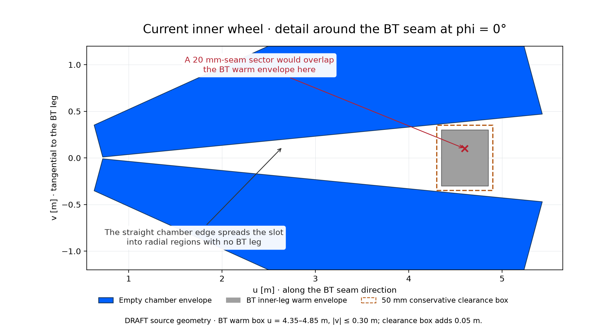
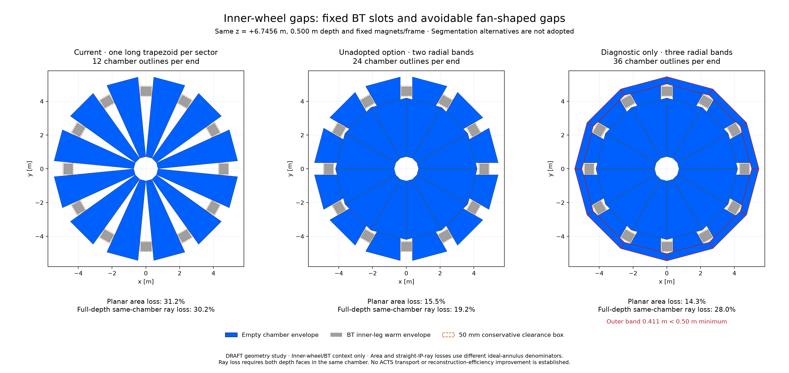

# Inner-wheel gaps: physical obstruction and segmentation study

DRAFT / unadopted geometry-only study for [PR90 comment6285814869](https://github.com/asalzburger/nodd/pull/90#issuecomment-6285814869).
Input revision15015d378b5b77b3bb11698809d1680d12b8a91c. This study answers
why the sectors do not close and tests alternatives; the current candidate,
OBJ, fields, inventories and native ACTS evidence remain unchanged.

## Answer to the reviewer

**We can recover much of the fan-shaped gap, but cannot close the slots occupied
by the fixed BT legs.** Keeping one full-length trapezoid per sector forces its
straight sides to leave empty wedges well away from those legs. Simply widening
those trapezoids to ordinary20 mm seams intersects the BT warm envelopes.



[Vector detail](bt-clearance-detail.svg) · [Exact adverse overlap witness](views-provenance.json)

A concrete **unadopted two-band option** closes the inner part to normal20 mm
seams and retains wide slots in the outer band. It has24 trapezoids and2 shapes
per end, versus12/1 now. If selected, total endcap dimension families would
increase from8 to9. A third band closes the outer rim further, but fails the
existing minimum useful span and has substantially worse full-depth same-module
acceptance than two bands. It is a diagnostic, not a compliant design option.



[Vector comparison](inner-closure-comparison.svg) · [Actual displayed polygons](display-polygons.json)

| Isolated inner-wheel geometric diagnostic | Current | Two bands, unadopted | Three bands, diagnostic |
|---|---:|---:|---:|
| Outlines per end |12|24|36|
| Dimension families for this wheel |1|2|3|
| Chamber face area per end [m²] |63.1668|77.5533|78.6884|
| Planar missing area [%] |31.1712|15.4952|14.2582|
| Full-depth same-chamber straight-IP-ray loss [%] |30.1538|19.1703|27.9720|
| Same ray loss with30 mm border proxy [%] |34.8916|25.3791|34.8082|

Planar loss uses the circular0.70–5.45 m annulus at the centre plane. Ray loss
uses its ideal **whole-depth** annulus and requires both front/back crossings
inside the same chamber. These are different denominators. The analytic ray
fractions were cross-checked with1,048,576 common iid directions, agreeing within
1.34 sampling standard errors. No ACTS, scattering/loss, response or fitting
study is implied. The former before/after ACTS results do not apply to these
unadopted module changes.

All optional full volumes pass the bounded coil,484-support and1,320-other-chamber
interface/overlap checks, and internal panel-pair tests; occupied and incorrectly
rotated-bound negative fixtures are rejected. These checks do not waive module
size rules or qualify construction. Current geometry and all prior scientific
results remain unchanged. The three-band outer base-distance is0.410664 m,
below0.50 m; the two-band3.350306 m inner cassette also needs an explicit
exemption from the ordinary1.50 m cap and amendment of the no-radial-tiling rule.

An almost continuous wheel outside localized coil slots could instead use
stepped/notched cassettes, but that changes the simple-trapezoid/native-volume
contract and requires separate geometry, chamber-internal and response design.
This study does not implement that topology or move any magnet.

## Evidence and reproduction

[MuonTech calculation/report](review/module-report.md) and
[SysArch fixed-interface assessment](review/interface-report.md) independently
separate required slots from the display/segmentation choice. Their recipes are
not identical: the interface report includes a more conservative thin outer band
with zero same-module full-depth ray cone, whereas the plotted projected-box
recipe has a small nonzero cone. Both violate the old minimum-span requirement.

- [Portable module calculation](review/module-check.py) / [actual results](review/module-check.json)
- [Portable interface checks](review/interface-check.py) / [actual results](review/interface-check.json)
- [Figure source, witness and artifact hashes](views-provenance.json)

From the repository root, with Python and NumPy (Matplotlib for views):

```sh
python3 -B docs/validation/DES-040/inner-closure-2026-10-20/review/module-check.py \
 --repo . --revision 15015d378b5b77b3bb11698809d1680d12b8a91c --output /tmp/inner-module-check.json
python3 -B docs/validation/DES-040/inner-closure-2026-10-20/review/interface-check.py \
 --repo . --revision 15015d378b5b77b3bb11698809d1680d12b8a91c --output /tmp/inner-interface-check.json
MPLCONFIGDIR=/tmp/muon-closure-matplotlib python3 -B -m tools.muon_layout.inner_closure_views
```

Inputs and executed code are fingerprinted. No external literature or changed
magnetic source enters this feasibility calculation. Plotting regenerates only
this separate study directory. Current candidate and dated manifests are preserved.

## Contract before generating comparison views

**FACT about pinned model:** each BT inner leg has a warm envelope0.50 m
in its meridional radial direction and0.60 m tangentially, centred at local
u=4.60 m. It intersects the whole inner-wheel slab z=6.4956–6.9956 m.
There are12 such legs. The50 mm componentwise clearance box is
u=4.30–4.90 m, abs(v)<=0.35 m. This is a local set of rectangles, not a
filled obstructing annulus. Current sectors use another10 mm tangent margin.

**INFERENCE:** replacing the current tapered gaps by20 mm seams in one
full-length trapezoid per sector collides with those BT warm envelopes.
The affine gap from the bore to the BT rectangle widens in radial regions
where the BT is absent; that extra open area is a consequence of the single
straight-sided module, rather than a physical demand for all those wedges.
Moving the wheel axially cannot solve it: the retained HCAL/ECT50 mm margins
allow its centre only at6.7412–6.7500 m and the BT leg crosses that entire slot.

**NODD DESIGN CHOICE for this unadopted study:** compare two radial bands of12 simple
trapezoids per end, preserving z/depth/bore/outer-vertex bound and all magnets,
frame and other chambers. Keep20 mm normal sector seams in the inner band;
use0.36 m seam half-corridors in the outer band to clear BT legs. Project the
actual clearance rectangle with extra10 mm tangent margin into the15-degree
sector-centre u-axis. Set the inner-band outer base at its minimum projection
minus10 mm; insert20 mm normal radial separation before the second band.
The outer base follows the existing exact5.45 m corner bound. This gives
24 modules and2 dimension families for the inner wheel, replacing12/1 only
if explicitly selected later. It requires amending the current no-radial-tiling
contract and confirming a cassette span exemption; it is not an adopted design.

**NODD DESIGN CHOICE for this diagnostic:** a third band can return to20 mm sector seams above
the maximum projected rectangle plus10 mm and another20 mm radial seam.
Its approximately0.411 m outer radial span is below the existing0.50 m useful
module bound. Retain it only to expose the tradeoff, not as a compliant proposed
layout. No exception to that minimum is granted here. An even more conservative
radial-bound example in the independent interface report is a distinct thinner
band and has no full-depth same-module straight-ray cone.

Compare planar area and full500 mm same-module straight-IP-ray acceptance
separately, with the same ideal annulus denominator and30 mm border proxy.
More radial seams can make front/back points lie in different modules. These
are geometrical quantities, not ACTS transport or reconstructed efficiency.
All optional volumes require coil, support and other-chamber separation checks;
no existing certificates are reused as proofs for changed modules. Magnetic
sources are fixed, so no new coil field/energy calculation is performed.

The figures/results and independent assessments follow below. This study
provides a concrete review choice; it does not relax any production criterion,
implement chamber internals, or grant engineering acceptance.
