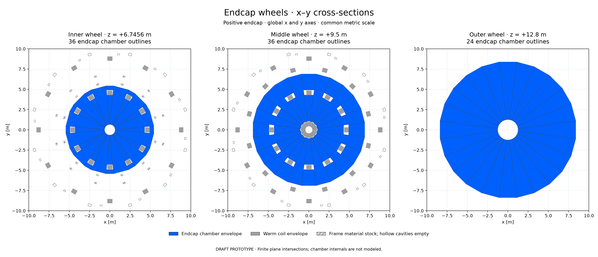

# Reviewer-refined muon wheel outlines

DRAFT isolated PROTOTYPE for PR #90 comments [6286566047](https://github.com/asalzburger/nodd/pull/90#issuecomment-6286566047) and [6286557527](https://github.com/asalzburger/nodd/pull/90#issuecomment-6286557527). Governing preimplementation contract: [DES-040](../../../design/DES-040-muon-chambers-frame.md). Baseline revision `5f42c4b9649619771e8d5ec70247c99b10d8e80f`; geometry/native source freeze `dcd49de80519a6d206599682f329f708b0e8465d`; export whitespace refinement `4cc2b08a824af5f8813e786a6845d7d1e42ee12f`.

The candidate adds inner-wheel gap fillers and replaces the middle packing with three chamber shapes. It has **seven endcap dimension families** and 192 endcap outlines, versus eight families and 288 outlines before. With the 1,056 unchanged barrel outlines, the total is **1,248 chambers**.

The three nominal apertures now derive from eta=3. **Uniform middle-wheel coverage to eta=3 remains obstructed by the fixed ECT inner legs.** The three-family packing also imposes additional aperture loss beyond their exact shadows. This part of the requested coverage cannot be claimed complete with these fixed coils and station position. The report distinguishes nominal target, actual boundaries and crossing results; changing an aperture label does not remove material.

## Updated geometry and review files



[Vector sections](xy-sections/endcap-wheels-xy.svg) · [Actual displayed polygons](xy-sections/sections.json) · [Seven shapes and dimensions](inventory/after-endcap.md)

- [Blue chambers and grey coils: OBJ + MTL ZIP](obj/chambers-and-coils.zip)
- [Separate barrel, positive endcap, and toroids/frame: OBJ + MTL ZIP](obj/components.zip)
- [Combined preview](obj/chambers-and-coils.png) · [positive-endcap preview](obj/positive-endcap-chambers.png)
- [Source geometry](candidate/geometry.json) · [fresh certificates and adverse controls](candidate/geometry-controls.json)
- [Before/after shape mapping](inventory/comparison.json) · [full-precision dimensions](inventory/after-panels-unrounded.csv)
- [Native/export/figure provenance](artifacts.json) · [native crossing validation](native-validation/validation.json)

OBJ coordinates are metres, right-handed xyz, with the beam along z. Each OBJ uses a sibling relative MTL. Chambers are blue RGB(0,96,255); coils/frame are grey RGB(160,160,160), with ACTS's diffuse divisor 256. Transparency is preview-only. The frame export contains outer reservations with hollow cavities omitted; separate members overlap at joints. It is not a material or mass union. Chamber internals are not designed.

| Station | Centre abs(z) [m] | Depth faces abs(z) [m] | Outlines/end, before → refined | Refined shapes |
|---|---:|---:|---:|---:|
| Inner |6.7456|6.4956–6.9956|12 → 36|3|
| Middle |9.5000|9.2500–9.7500|108 → 36|3|
| Outer |12.8000|12.5500–13.0500|24 → 24|1|

Each inner wheel has twelve core trapezoids, twelve pre-slot fillers and twelve post-slot fillers. These close the large fan-shaped openings on either side of the BT leg region. Actual filler-to-core normal seams are 20 mm. The BT warm footprints and 50 mm clearance remain empty; the localized slot band also retains **0.535997 m²/end** of extra affine guard wedges beyond those clearance boxes. That is a conservative reservation, not a claim that coils physically fill it. The post-slot filler span is 0.520334 m, above the old 0.50 m useful-span bound. Its pre-slot companion has a narrow bore base and remains only an outline reservation.

The middle wheel has twelve full 15-degree sectors centred at 15+30k degrees and twelve BT-centred sectors at 0+30k degrees split into lower/upper chambers around the BT slot: exactly three dimension families. The ordinary 1.50 m span limit is explicitly exempted for these cassette envelopes, as recorded before construction. Tube segmentation, sag, alignment, services and mechanical suitability remain unqualified.

The authoritative chamber boundaries are `vertices_m`, `basis` and `depth_m`.
`compartment.phi_deg` records a conservative parent/repetition-sector reservation,
not the exact angular extent of a filler or half-sector. Retained `wheel_revision`
and `wheel_dimensions` describe the historical input; `refined_wheel_revision`
and `refined_wheel_dimensions` govern this new candidate.

## Aperture target and actual limitation

**INFERENCE:** for the nearest face, `R3=(abs(zcentre)-0.25 m)/sinh(3)`. The chosen constant inner-base apothem is at least R3: a circumscribed polygonal hole avoids full-depth straight-ray coverage beyond eta=3, while polygon corners and seams reduce acceptance below it. This is a finite-prism approximation, not an exact conical sensitive boundary or response model.

| Station | Nominal R3 [m] | Implemented aperture |
|---|---:|---|
| Inner |0.648400988|Core and pre-slot filler bases use R3; coil slots and polygon edges remain.|
| Middle |0.923349519|Full-sector base 1.010000000 m; BT lower-sector base 1.066512492 m.|
| Outer |1.252760699|Full-sector base uses R3; polygon edges remain.|

Middle family sector-centre limits at the near face are eta≈2.91079 and 2.85668, rather than 3. At z=9.25 m the entire eta=3 circle lies inside the actual ECT warm inner-leg union: the closest leg is within 15 degrees; its local radial coordinate is 0.8919–0.92335 m, inside warm 0.45–0.95 m, and its tangent coordinate is at most 0.239 m, below the 0.30 m warm half-width. This obstruction exists before adding clearance.

The [independent interface assessment](review/interface-report.md) and [portable calculation](review/interface-check.py)/[actual results](review/interface-check.json) quantify both polygon conventions. Its illustrative 1.07 m BT base is distinct from the final generator's 1.066512492 m base. Uniform eta=3 requires a physical magnet/station/depth-layout change and new validation; no such change is silently selected here.

## Wheel placement and bending distance

The inner wheel is before ECT warm z=7.05–11.95 m, but within the BT leg length (warm axial bound abs(z)=12.05 m). The middle wheel is within both toroid axial ranges; the outer wheel is beyond both. No filled annular cryostat is assumed.

Moving the whole middle chamber beyond both toroids with 50 mm clearance needs centre z>=12.35 m. It conflicts with the rear carrier at z=12.15–12.45 m and overlaps the fixed outer wheel. Placing it just beyond the rear frame requires centre z>12.75 m; with 20 mm interwheel spacing the outer centre needs z>13.27 m and its far face z>13.52 m. This exceeds the current envelope.

Current centre gaps are 2.7544 and 3.3000 m, with total span 6.0544 m. The constant-curvature three-point chord product `(z2-z1)(z3-z2)` is 9.08952 m². Moving the middle to z=12.35 while retaining the outer centre reduces it to 2.52198 m², 27.75% of the current value. This is only a geometric bending proxy. Actual momentum measurement depends on the nonuniform field integral, material and fitted measurements; better planar coverage alone does not establish it.

## Actual checks and interpretation

All 192 changed prisms have fresh analytic whole-volume coil and 484-member support certificates, plus separate adaptive warm-sweep audits (343,392 cells, none unresolved/accepted). All 778,128 chamber-pair broad phases and candidate SAT checks pass. Six focused tests pass, including occupied coil/support, incorrect rotated bound, duplicate chamber, weakened clearance/seam and changed-station adverse fixtures. Barrels, supports and magnetic configuration are retained exactly; old barrel certificates remain identified as historical.

Native ACTS constructs 1,248 volumes with 7,488 finite faces and unique IDs. All 1,024 zero-field tracks complete; same-chamber front/back station results match the independent prism calculation with and without the 30 mm border. Native/source corners agree within 3.56e-15 m. Four OBJ exports are closed, outward-oriented and checked against actual native vertices; ZIP members match sibling OBJ/MTL files. XY coil cuts pass 150,000 random membership queries and opposite-end/off-plane controls.

A fixed bank of 32,768 iid directions is mirrored to both ends (65,536 rows), uniform in cos(theta) over **1.3<abs(eta)<3**. Both depth faces must lie inside the same chamber:

| Geometric observable in that cap bank [%] | Before | Refined |
|---|---:|---:|
| Inner station |73.1598|96.0876|
| Middle station |54.6051|84.8633|
| Outer station |98.1323|98.1110|
| All three endcap stations |44.5160|81.7932|
| All three, with 30 mm border proxy |36.1603|66.1194|

These are geometry-only fractions in the stated bank, not full-4pi coverage or efficiency. The slight outer decrease follows the eta aperture change. No material scattering, loss, measured MDT response or segment fit is included. The former large ACTS comparison applies to its historical geometry, not this refinement.

The unchanged-map curved smoke run retains **all 256 tracks** at 5/100 GeV and both charges: 93 complete and 163 stop at strict field masks. No mask is extrapolated or replaced by zero. Its finite events are checked; masks and the small bank prevent an overall efficiency or momentum-improvement claim. Original joint-field NPZ and native binary-map conversion agree exactly. No new magnetic solve is needed or claimed.

[369 prior scientific/source files remain byte-exact](unchanged-evidence.json). Previous candidate, OBJ, field, study and native results are preserved. The [independent PhysVal assessment](review/physics-review.md), [portable checker](review/physics-check.py) and [actual results](review/physics-check.json) examine exact artifact revision `81eba5c59e811fc61eb6179526db70e61c717be5`. It finds no new blocking implementation defect and retains the middle eta=3 requirement as unmet. Automated checks grant no engineering acceptance.

## Reproduction

Use Python with NumPy, and Matplotlib for artifacts. Activate the verified local ACTS Spack environment for native commands; no dependency installation runs.

```sh
python3 -B -m unittest tools.muon_layout.test_refined_wheels
python3 -B -m tools.muon_layout.refined_wheels
MPLCONFIGDIR=/tmp/pr90-refined-matplotlib python3 -B -m tools.muon_layout.refined_artifacts
python3 -B -m tools.muon_layout.refined_validation
```

Native binary/library fingerprints are checked. Executed sources must be frozen in Git before final acquisition. Portable SysArch checks use `--repo`, `--revision` and `--output`; no scratch path is needed to reproduce them.

Independent check reproduction (Python + NumPy only):

```sh
python3 -B docs/validation/DES-040/refined-wheels-2026-10-20/review/physics-check.py \
 --repo . --revision 81eba5c59e811fc61eb6179526db70e61c717be5 --output /tmp/refined-physics-check.json
```
