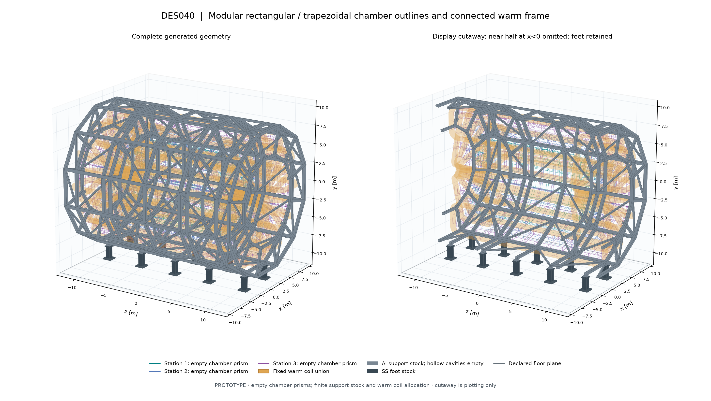
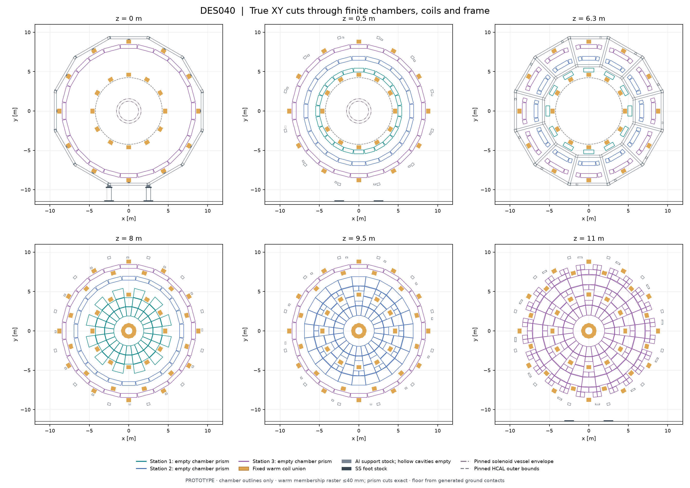
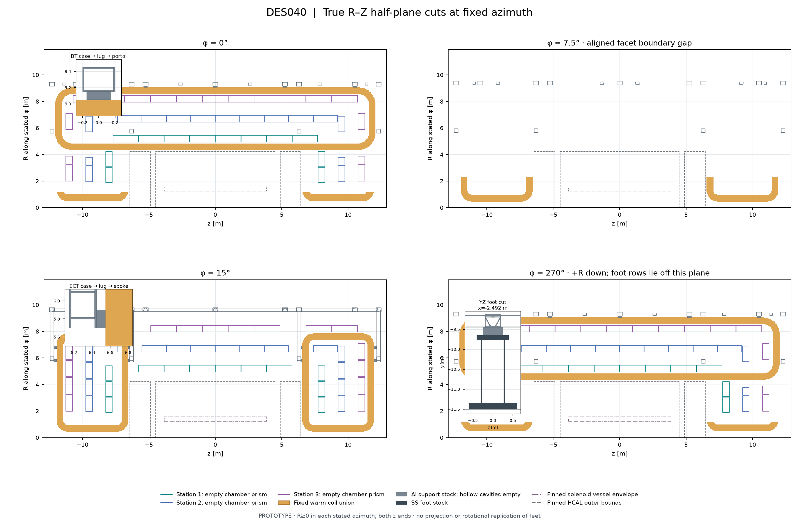
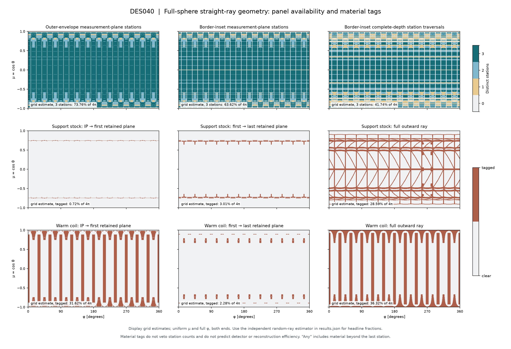

# DES040 validation — whole muon chambers, frame and feet

Status: **DRAFT / isolated PROTOTYPE**, 2026-10-19. This is a separate chamber-layout
follow-up to [PR87](https://github.com/asalzburger/nodd/pull/87), based on unchanged
magnetic source `fe372194038ed2af9617c27defffba09ae6d683f`. No human engineering
acceptance, production integration or measured detector performance.

## Result

The bounded proposal retains **1,560 whole chamber envelopes**: 816 rectangular
barrel modules and 744 trapezoidal endcap modules, arranged in three logical
stations. It adds a connected 12-sided warm frame, four endcap carrier planes,
156 finite coil-case attachment ports and ten feet. It does **not** achieve
uninterrupted three-station coverage over 4π. The finite chambers, border proxy,
fixed coil returns and support corridors leave substantial gaps. These are
reported rather than hidden by conditioning the denominator on a fiducial eta cut.

[Design and pre-generation choices](../../design/DES-040-muon-chambers-frame.md),
[exact inputs/source classifications](sources.json), [machine results](results.json),
[all transforms/IDs/contacts](geometry.json), [chamber edge-only OBJ](chamber-outlines.obj).

## Chamber layout and finite-space checks

| Station | Barrel rectangular modules | Endcap trapezoids, both ends | Barrel apothem / disk abs(z) [m] |
| --- | ---: | ---: | --- |
| 1 | 168 | 120 | 5.2 / 8.0 |
| 2 | 312 | 216 | 6.7 / 9.5 |
| 3 | 336 | 408 | 8.2 / 11.0 |

The 24 aligned facets/sectors retain 500 mm depth, 20 mm physical gaps and an
independent 30 mm inactive-border proxy. Compartments are adaptively subdivided
into whole rectangles/trapezoids, with longitudinal/radial span at least 500 mm
and face area at least 0.25 m². Smaller arbitrary slivers are rejected. Endcap
corners stay inside each actual cylindrical/angular compartment. The accepted
prisms have unique IDs and no panel-panel volume overlap.

Every accepted chamber has a conservative **full-volume** clearance certificate
against the exact warm coil masks plus 50 mm. Unresolved distance-bound cells
reject a candidate. Convex-prism SAT checks against conservative support envelopes
also require 50 mm. A control with all eight chamber corners clear but a coil leg
through the interior fails correctly. No coil-shaped chamber holes or internal
MDT tubes/electronics are generated. Module shape/size precedent comes from ATLAS
JINST chapter 6; all nODD dimensions/gaps/borders are unsigned choices.

## Full-solid-angle station availability

Headline estimates use **1,048,576 iid rays uniform in cos(theta) and phi**, both
hemispheres and all azimuths. Every direction belongs to the 4π denominator;
station identity prevents multiple panels in one station becoming multiple
measurements. Percentages are geometric availability, not efficiency.

| Definition | 0 stations | 1 station | 2 stations | 3 stations | 3-station MC standard error |
| --- | ---: | ---: | ---: | ---: | ---: |
| Outer envelope at measurement plane | 5.15% | 4.26% | 16.24% | 74.35% | 0.043 pp |
| Measurement plane, 30 mm inactive border | 8.53% | 6.55% | 21.72% | 63.20% | 0.047 pp |
| Both depth faces within the border | 14.31% | 17.15% | 27.16% | 41.38% | 0.048 pp |

Sampling standard errors exclude all geometry, response and material uncertainty.
The first-quarter sample gives three-station active coverage
63.20%, versus
63.20% in the full sample. Full-depth
traversal is deliberately separate: side entry can cross a measurement plane
without traversing the entire normal stack. Neither definition guarantees a
multilayer segment or the inherited chamber precision.

The image map is a 480×1440 midpoint grid, with a 240×720 sensitivity control.
The largest station-bin difference is 4.13 percentage points;
the fine grid's active three-station fraction is 63.62%.
Periodic gaps alias these grids; **they are not declared converged**. Figure
annotations explicitly say grid estimate. Use the independent integral above for
headline fractions, not binomial errors on the deterministic map. Numeric arrays
and signed-hemisphere/eta-band diagnostics are retained in [coverage NPZ](coverage.npz)
and [grid summary](coverage-summary.json).

A paired random-ray no-frame **repacking** control yields
65.99% three-station active availability.
Adding the specified frame reduces this by
2.787 ±
0.016 percentage points (MC standard error).
This includes changed module segmentation; it is not a veto on muons crossing
support material. The no-frame control has 1,464 larger whole modules.

The nominal first-disk 0.70 m beam bore at |z|=8 m alone excludes two polar cones
of half-angle 5.00064°, totalling
0.0478312 sr or
0.38063% of 4π. Additional
module/coil openings are much larger. An |eta|≤3 cut would remove 0.4945% of 4π
before any detector gap and is not substituted for the full-sphere study.

Actual three-active-station path spans have median
3.242 m, 5–95% interval
3.009–4.355 m,
and sampled range 3.000–5.271 m.
These are first-to-last plane distances, not sagitta response or a proof that
field integrals/material paths match the earlier ideal 3 m momentum model.

## Supports, contacts and mass scope

The frame has 484 finite member envelopes and 1378
actual material-wall prisms. Hollow cavities remain empty in contact and ray
checks. All 36 coil identities reach ground through 156 case-skin patches,
1310 material contacts and ten floor patches, in one 530-node graph
component. Positive-area material-face contact or actual material overlap is
required; a line/point touch or intersecting hollow void cannot create a graph
link. Every finite lug remains outside its own warm assembly by an analytic
supporting-plane bound, with full-volume checks against other assemblies and
all cold/winding reservations. Other members also have warm-volume certificates.
There are no unintended coil conflicts or Al/steel material penetrations.

Joint stock can intentionally overlap at same-material welds. Gross stock mass
is 131.193 t; the unique material union is approximately
**129.483 t**, with 0.009 t Monte Carlo
standard error at 1,048,576 samples/material. A separate 262,144-sample run gives
129.512 ± 0.018 t.
These are Al/SS density proxies (2700/8000 kg/m³) for this frame/feet only.
Uncertain section/material assumptions dominate interpretation; no case-wall,
cold-magnet or chamber mass is included. Inherited cold allocation is not a
magnet deadweight estimate. Strength, buckling, stiffness, gravity deflection,
magnetic inward/outward force closure, quench/seismic loads, joints, anchors and
assembly sequence remain unqualified.

Material-route tags separately identify actual hollow support walls and warm
coil reservations before the first and between the first/last available active
planes. They never remove hits. “Any” also includes structure beyond the last
station; external feet must not become an automatic reconstruction veto. Grid
shadow diagnostics are not claimed converged, and warm reservation lengths are
not material mass, X0 or scattering budgets.

## Review views

Chamber/support cuts are exact convex-prism plane sections. Coil display occupancy
uses a maximum 40 mm plotting step, independently of collision certification.
The phi=7.5° RZ section falls in an aligned facet crack. The phi=270° RZ plane
misses both foot rows; the inset is an explicitly different YZ cut at x=−2.492 m.
No azimuthal projection or symmetry replication hides these distinctions.

## Unchanged magnetic input and reproduction

All inherited DES039 and toroid/muon-study files are unchanged from PR87's
recorded commit; [invariance inventory](magnetic-invariance.json) records byte
hashes. The joint vacuum map remains SHA-256
`1219470d0246dd5d5facc81c34d84a572bd1509407a8d76c8273a03a1c48f493`.
No currents, source positions, fields, stored energies or MDT resolution changed.
The new support materials assume mu_r=1. Installed HCAL/steel nonlinear field,
chamber services/mounts/deadloads, forward technology, radiation conditions,
transport and reconstruction remain open. This proposal is an envelope/coverage
input for the next design decision.

[Reproduction commands](../../../tools/muon_layout/README.md) use pure
NumPy/Matplotlib; no ACTS/DD4hep/Geant4 runtime is relied on. The retained study
ran Python 3.14.6, NumPy 2.5.1. Input/artifact hashes,
seeds, counters, methods and limits are in results.json. Independent frozen-revision
review is retained separately; it does not grant human sign-off.
