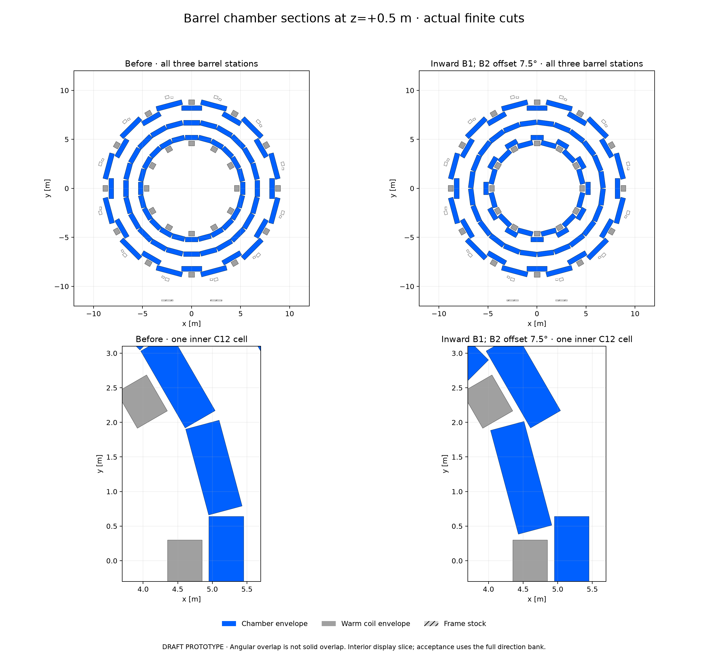

# Inward inter-coil B1 stagger and half-pitch B2 offset

DRAFT / isolated unsigned chamber-outline PROTOTYPE for [updated PR90 comment6290378667](https://github.com/asalzburger/nodd/pull/90#issuecomment-6290378667), edited2026-10-20T12:12:08Z. Governing [DES040 amendment](../../../design/DES-040-muon-chambers-frame.md#updated-inner-barrel-sketch-and-middle-layer-offset-2026-10-20). Baseline `a12efbb5f169e5e02cd1f36aee48c1e748b6ce6f`; construction/export/validation source freeze `65cf2741bd697ddb8c4022a751f275b41f63241e`.

**The updated sketch fits the fixed hardware:** coil-plane B1 stays at5.20m; inter-coil B1 moves inward to4.63m and widens for angular overlap. B2 rotates7.5degrees and is freshly cut around existing hardware. The candidate contains **936 outlines**,48 more than the preceding888 candidate, with a modest net three-station geometric gain and substantial local losses. This936 candidate differs from the earlier unselected936 outward-B1 trial. No engineering acceptance, material/response model or reconstruction improvement follows.



[Vector sections](views/barrel-cross-sections.svg) · [Displayed source polygons and hashes](views/views.json) · [Longitudinal source footprints](views/longitudinal-packing.png)

- [Blue chamber / grey coil OBJ+MTL ZIP](obj/chambers-and-coils.zip)
- [Separate barrel, positive-endcap and toroids/frame OBJ+MTL ZIP](obj/components.zip)
- [Native OBJ preview](obj/chambers-and-coils.png)
- [Barrel inventory and dimension families](inventory/after-barrel.md)
- [936 finite prisms](candidate/geometry.json), [fresh controls](candidate/geometry-controls.json), [shape mapping](candidate/shape-change-mapping.json)
- [Export and inventory checks](artifacts.json), [native and geometric results](native-validation/validation.json)

Coordinates are metres, beam axis z. Keep MTL beside OBJ for colours. Chamber faces come from actual native ACTS finite volumes through ObjVisualization3D; grey toroids are warm-envelope reservations. The component frame includes outer reservations, not a detailed installed passive-material model.

## Interpretation and physical choices

The sketch changes the **inter-coil** B1 facets, unlike the earlier infeasible coil-plane-below-BT proposal. The exact inward radius is a NODD DESIGN CHOICE inferred from available room, not a number supplied by the reviewer. B1 coil-plane even facets retain R5.20m and width1.283359726m. Odd inter-coil facets use R4.63m and width1.552830294m, retaining500mm depth. From the far depth faces and30mm lateral inset, angular half-widths6.403783462 and8.696216538degrees sum to15.1degrees, giving0.1degree template overlap. Finite z seams and cuts can still remove crossings.

The requested middle-station rotation is interpreted here as **barrel B2 only**, with the scope question left explicit. Half the15degree chamber pitch is7.5degrees; rotating15degrees would leave the24-facet edge set unchanged. All192 endcap outlines remain identical. Rotating the middle endcap wheels would require separate source-space repacking around fixed coil slots and is not claimed here.

The [independent SysArch assessment](interface-report.md), [pinned checker](interface-check.py) and [results with final-candidate audit](interface-check.json) derive the sufficient B1 interval **4.625<R<4.645246881422m** under current margins. R4.63 leaves35.33094mm between neighboring whole B1 prisms (20mm required),140.54mm above the conservative installed-HCAL corner bound, and55mm above the known4.325m service-jacket bound (50mm required). All24 full-z B1 templates clear actual rotated coils, all484 supports and592 finite HCAL steel/cover prisms at50mm. The bound is narrow and is not an installation tolerance allocation.

The source check distinguishes HCAL material from services: the4.325m bound is the **DES034 ECAL water-egress design reservation**, not installed HCAL material. Actual HCAL source is `0e8530d56d171f38c9d53d3c60c8b48803680bbd`, already pinned by MUON001/DES039. Complete external HCAL collectors, cabling and plant routes are absent and remain unqualified. Twenty exact source blobs, including the service route, are retained in the [archive](inputs/source-blobs.tar.gz) and [manifest](inputs/source-manifest.json).

All24 rotated full-z B2 templates encounter ECT coils and/or front-frame spoke/lug envelopes. The new finite packing retains those exclusions instead of rotating old certificates. All484 supports are tested in actual orientations:444 have C12 symmetry, while40 foot parts do not. Magnetic C12 symmetry cannot stand in for HCAL16-fold or asymmetric-foot checks.

| Outline inventory | Previous | New |
|---|---:|---:|
|B1|96|96|
|B2|168|216|
|B3|432|432, value-identical|
|Barrel total|696|744|
|Both endcaps|192|192, value-identical|
|All chambers|888|936|
|Barrel dimension families|13 (1/3/9)|15 (2/4/9)|

B1/B2 receive312 fresh whole-volume coil/support certificates and312 uncached actual-orientation coil audits. All437,580 chamber pairs and24 adjacent B1 template pairs pass. Occupied-coil/support, duplicate-solid, changed-radius/phase cache, insufficientR4.60 service margin and excessiveR4.65 neighbor controls reject as expected. Nine focused tests pass, including deterministic reconstruction. Existing4m maximum z seeds,20mm seams,0.50m longitudinal subdivision and0.25m² minimum area remain. The48 narrow B2 tangential fragments below0.50m retain the existing outline-policy exception; MDT construction/internal subdivision remains open.

B3, endcaps,484 support objects, magnetic sources and maps are fixed. Maximum chamber corner radius remains9.099797510m, within the9.1m numerical chamber world and9.5m map. The0.20249mm world margin is numerical, not an engineering gap. Frame/feet extend toR11.9084m, outside that vacuum chamber-navigation world. No magnetic solve is needed or claimed; the retained joint vacuum-map energy remains4.598715883GJ. Installed nonlinear iron/conductor/cryostat and structural qualification are unchanged open questions.

## Same-bank full-sphere geometric comparison

A fresh bank has **65,536 iid directions uniform in cos(theta) and phi over full4pi**, seed40088, without mirroring or hit selection. At each station, both depth faces must fit in the same finite cassette; barrel/endcap alternatives are ORed within each station. One/two/three means distinct station IDs. No material veto, scattering, energy loss, response, segment fit or reconstruction is included. Percentages from other seeds or the restricted central bank are different observables.

| Geometric fraction [%] | Previous outline | New outline | Previous30mm border | New30mm border |
|---|---:|---:|---:|---:|
|At least one station|97.5204|98.5184|96.8201|98.0927|
|At least two stations|85.8963|91.6687|80.6076|88.4827|
|All three stations|66.0767|67.4057|57.7698|59.0866|
|B1 barrel alone|64.8636|74.1501|60.6812|72.4716|
|B2 barrel alone|64.3143|63.3087|60.4874|59.1904|

For the border three-station observable, **5,608 directions gain and4,745 lose**, net+1.316833 percentage points with paired Monte Carlo SE0.155174points. Outline gains/losses are4,753/3,882, net+1.329041points, SE0.141698. The net sign is positive in each fixed quarter-bank diagnostic; this is not pointwise improvement. All distance arrays and exact loss masks/IDs remain in [the archive](native-validation/full-sphere-inputs-and-distances.npz).

Border losses partition into21 fixed-frame packing losses,798 longitudinal-seam/coil-packing losses and3,926 finite transverse/end-reach losses under the declared seamless-template diagnostic. The analogous outline partition is33/892/2,957. These are geometric counterfactual classes; seamless full-z templates do not constitute cleared physical chambers. Witness directions and IDs are in the result JSON.

The two requested changes are not independently beneficial under the strict three-station metric. Keeping oldB2 with newB1 gives59.1324% border three-station availability; rotatingB2 with oldB1 gives51.5656%; both together give59.0866%. Edge de-alignment shifts losses into other directions, and the inward B1 changes which directions can reach all three. These mixed-component controls are same-bank diagnostics, not additional adopted layouts. The final result remains the combined requested prototype.

The restricted central-barrel bank, retained for continuity, has32,768 iid directions uniform in cos(theta) over0<|eta|<1 mirrored to65,536rows. Its all-three-barrel fraction is69.3878%→71.2341%, or61.8225%→63.7787% with the border proxy. Do not compare these central fractions to full4pi values.

## Actual spacing and bounded native checks

Distances use the earliest full-depth same-cassette mid-plane hit for each station along a straight unit IP ray. For the33,115 directions with bordered three-station crossings in **both** layouts, median first-to-third chord changes3.677584→4.177411m; median middle fraction of that chord changes0.454942→0.498507. The new5th–95th percentile span remains3.017010–6.926174m across barrel/endcap alternatives. Barrel-only and all-accepted-cohort quantiles are retained separately. The new barrel middle-fraction5th–95th range is0.487690–0.514066, with a wider full range0.485549–0.565786. No station-order inversion occurs in the sampled three-station rows. These conditional chord distances do **not** establish a constant lever arm, bending integral or MDT momentum resolution.

The old numerical entranceR4.35m/H6.4684m plus10µm forward offset remains before every selected chamber: analytic reserves are29.99mm radial and27.19mm axial. All65,536 actual starts lie outside all chambers, and the minimum sampled start-to-first-prism ray-entry distance is27.32594mm. AnR4.60 diagnostic reproduces the adverse inside-start case; selectedR4.63 avoids it. The entrance is a numerical vacuum boundary, not a material transport model through the calorimeter.

Native ACTS builds936 finite volumes and5,616 unique faces. All1,024 zero-field tracks complete, and both outline and30mm-border same-cassette station masks match independent finite-prism ray predictions exactly. The unchanged-map256-track smoke at5/100GeV with both charges retains197 completed and59 field-masked rows, all in denominators. It is a bounded navigation check, not a refreshed wide momentum-performance scan. Maximum face-normal residual is9.905nm in that curved smoke. The native engine/writer/core fingerprints match the previously verified binaries; blue OBJ corners agree within3.56e-15m. Four exports and both ZIPs pass closed-volume/material checks.

The node preflight reported changed setup/Spack-lock fingerprints. Fresh activation verified the existing environment, ACTS import after its python/setup.sh, native binary loading and fingerprints, Python3.14.5/NumPy2.5.4/Matplotlib3.11.2. An initial import before ACTS PYTHONPATH setup failed and was corrected; no shared dependency installation, rebuild or mutation was needed.

## Reproduction and review scope

Freeze source before acquisition; wrappers reject dirty executed source. With the existing verified runtime, run these modules from the repository root, using the ACTS Spack skill before native work:

```sh
python3 -B -m unittest tools.muon_layout.test_sketched_stagger
python3 -B -m tools.muon_layout.sketched_stagger
python3 -B -m tools.muon_layout.sketched_artifacts
python3 -B -m tools.muon_layout.sketched_validation
python3 -B docs/validation/DES-040/sketched-stagger-2026-10-20/interface-check.py \
 --repo . --revision a12efbb5f169e5e02cd1f36aee48c1e748b6ce6f \
 --candidate docs/validation/DES-040/sketched-stagger-2026-10-20/candidate/geometry.json \
 --output /private/tmp/pr90-SS-A1-reproduction.json
```

The portable interface checker extracts pinned sources from Git objects; it requires both cited commits locally. Its scratch-output prefix restriction is intentional. Missing source objects fail explicitly; the retained source archive supports inspection without claiming those files are installed geometry.

[All709 prior scientific source/evidence files](unchanged-evidence.json) in DES040/DES039/MUON001 and the muon/toroid tool paths remain byte-exact. Earlier dated candidates, OBJ/maps and broad ACTS studies remain historical controls. Uniform middle-wheel eta3 remains **UNMET**, and chamber internals, backgrounds, response, sag, alignment, construction and complete service integration remain open. DES039/DES040 remain DRAFT; no automatic check grants human acceptance.

Separate exact-artifact PhysVal review is required before publication; its result will be linked here after the frozen artifact assessment.

## Scope-label correction after artifact freeze

SS-P1 identified one inherited global-limit sentence in the frozen validation JSON: it called all geometric fractions central-barrel quantities even though the full_sphere block correctly declares full4pi. The current JSON scopes that limit to geometric_bank; full_sphere retains its explicit full4pi definition. The future validation wrapper receives the same string-only correction. All scientific fields, raw data, masks, geometry, export and figure bytes remain unchanged, with the original report hash and a canonical scientific-field hash recorded in metadata_amendment. Execution source_revision/source_sha256 intentionally remain the actual65cf274 sources; this correction is not new acquisition. The independent assessment distinguishes the original11ec9bb target from this metadata amendment.
