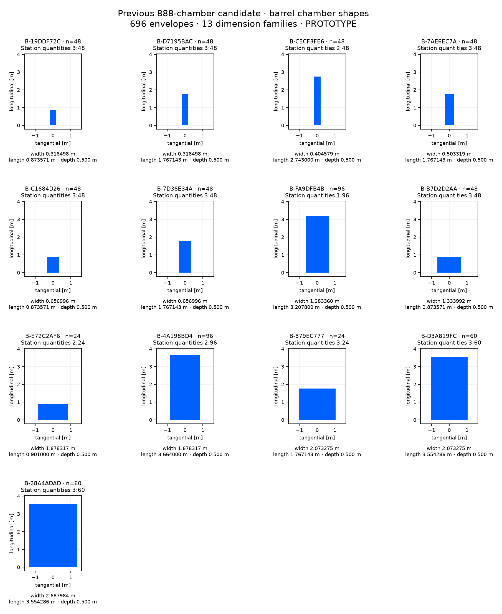

# Previous 888-chamber candidate: barrel chamber inventory

696 chamber envelopes, 13 dimension families. Isolated PROTOTYPE; no chamber internals or manufacturing specification.

[CSV](before-barrel.csv) · [Full panel-to-shape mapping and source hash](before-barrel.json). Dimensions group on a 1 nm grid; the JSON retains every source panel’s unrounded dimensions. Endcap quantities include both hemispheres. Shape plots share a metric scale within this sheet.

| Shape | Quantity | Station: quantity | tangential width [m] | longitudinal length [m] | depth [m] |
| --- | --- | --- | --- | --- | --- |
| B-19DDF72C | 48 | 3: 48 | 0.318498022 | 0.873571429 | 0.500000000 |
| B-D7195BAC | 48 | 3: 48 | 0.318498022 | 1.767142857 | 0.500000000 |
| B-CECF3FE6 | 48 | 2: 48 | 0.404579305 | 2.743000000 | 0.500000000 |
| B-7AE6EC7A | 48 | 3: 48 | 0.503318678 | 1.767142857 | 0.500000000 |
| B-C1684D26 | 48 | 3: 48 | 0.656996043 | 0.873571429 | 0.500000000 |
| B-7D36E34A | 48 | 3: 48 | 0.656996043 | 1.767142857 | 0.500000000 |
| B-FA9DFB4B | 96 | 1: 96 | 1.283359726 | 3.207800000 | 0.500000000 |
| B-B7D2D2AA | 48 | 3: 48 | 1.333992086 | 0.873571429 | 0.500000000 |
| B-E72C2AF6 | 24 | 2: 24 | 1.678317219 | 0.901000000 | 0.500000000 |
| B-4A198BD4 | 96 | 2: 96 | 1.678317219 | 3.664000000 | 0.500000000 |
| B-879EC777 | 24 | 3: 24 | 2.073274712 | 1.767142857 | 0.500000000 |
| B-D3A819FC | 60 | 3: 60 | 2.073274712 | 3.554285714 | 0.500000000 |
| B-28A4ADAD | 60 | 3: 60 | 2.687984173 | 3.554285714 | 0.500000000 |
