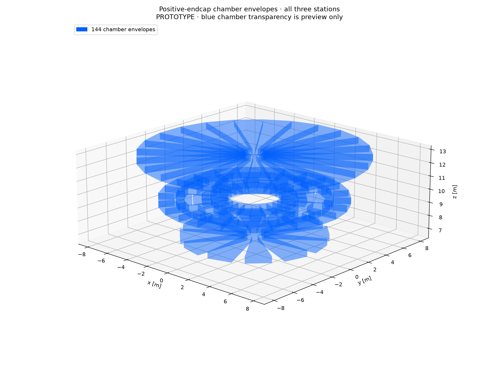

# PR90 shortened endcap toroids and whole chamber wheels

**DRAFT / isolated PROTOTYPE.** The [agreed reviewer decision](https://github.com/asalzburger/nodd/pull/90#issuecomment-6283618592)
and subsequent human choice to shorten the ECT are implemented. The selected
contract is in [DES040](../../../design/DES-040-muon-chambers-frame.md#selected-wheel-revision-contract-2026-10-20-before-implementation)
and [DES039](../../../design/DES-039-twelvefold-toroid.md#pr90-shortened-ect-candidate-2026-10-20).
No production detector integration or human engineering acceptance follows.

## Geometry and downloads

Move each ECT front return centre from abs(z)=6.80 to7.30 m; keep the rear
return at11.70 m. The centre becomes9.50 m and half-length2.20 m; the warm
front becomes7.05 m. Current packs, warm cross sections, 12-fold symmetry,
operating currents and the3 T solenoid source are retained.

| Quantity | Revised prototype |
|---|---|
| Inner wheel | abs(z)=6.7456 m;12 whole trapezoids per end; bore0.70 m; outer verticesR5.45 m |
| Middle wheel | Original216 modules over both ends, unchanged placements/shapes |
| Outer wheel | abs(z)=12.80 m;24 whole trapezoids per end; bore0.70 m; outer verticesR8.45 m |
| Chamber depth |0.500 m |
| Inner axial gaps |54.4 mm to HCAL and ECT warm front;50 mm HCAL allowance is provisional |
| Barrels B1/B2/B3 |168/360/528 panels; half-lengths6.4456/9.2/12.5 m |
| Total |1,344 panels =1,056 barrel +288 endcap |
| Frame |484 members;48 front lugs extended;36 coil cases connected to grounded feet |

The new inner/outer wheels have straight edges and explicit BT-leg/seam
corridors. They are whole chamber/cassette outlines; their large radial spans
do not imply monolithic precision MDT construction. The endcap centre span
is6.0544 m, superseding the historical3 m axial span. Neither span alone gives
a bending integral or momentum resolution.

- [Combined blue chambers / grey coils OBJ+MTL ZIP](obj-revised/chambers-and-coils.zip)
- [Separate barrel, positive endcap and toroid/frame OBJ+MTL ZIP](obj-revised/components.zip)
- [OBJ previews and exact export checks](obj-revised/README.md)
- [Before endcap:744 outlines /18 families](inventory-comparison/before-endcap.md)
- [After endcap:288 outlines /8 families](inventory-comparison/after-endcap.md)
- [Current barrel:1,056 outlines /7 families](inventory-comparison/current-barrel.md)
- [Inventory comparison and full-precision panel mapping](inventory-comparison/README.md)



The [geometry controls](candidate/geometry-controls.json) certify finite-prism
coil/support/panel separation, HCAL gaps and grounded frame connectivity.
The [independent gap calculation](candidate/README.md) separates geometric
sector/polygon losses from transport: full-depth ideal-annulus losses are
30.154% inner and2.737% outer (34.892%/8.917% with30 mm border). They must not
be multiplied into an assumed reconstruction efficiency. The coarse regular
grid aliases narrow seams; its adverse discrepancy is retained.

## Joint magnetic field

[Candidate map](magnetic/candidate-map.npz) and [extended before map](magnetic/baseline-extended-map.npz)
contain the complete solenoid plus BT plus both ECT vacuum field in cylindrical
components, on153×459×49 nodes: R0–9.5 m, z±14.3125 m and phi0–30 degrees.
Original401 baseline z planes, fields and masks are byte-identical. Both maps
retain strict masked stencils; invalid nodes are NaN, never filled with zero.

Fixed ampere-turns are BT2,985,343.814133761 and each ECT1,745,395.82445623.
[Complete self/mutual energy](magnetic/energy.json) is4.598716 GJ, including
the solenoid. The consistently iterated cold allocation is0.297387×0.433689 m,
fits the retained0.50×0.60 m warm reservation and gives30 MJ/m³ globally.
Origin field is3.000000 T; sampled complete tracker maximum is3.024372 T.
This is a sampled central check, not a continuum or conductor-field guarantee.

[Field controls](magnetic/controls.json) retain convergence, reciprocity,
source/map interpolation and symmetry checks. Maximum tested interpolation
residual is1.841 mT for the candidate; this is not a whole-domain error bound.
[Configuration](magnetic/configuration.json) explicitly labels the obsolete
station-normalization targets as historical, with no retuning to them.
HCAL ferromagnetic grade/BH, conductor operating margin, forces, quench,
thermal design and actual cryostat/support qualification remain open.

## Paired native ACTS coverage

[Full before/after tables](propagation/comparison/comparison.md),
[paired changes](propagation/comparison/paired-change.png),
[before native positions](propagation/before/figures/hit-positions.png),
[after native positions](propagation/after/figures/hit-positions.png) and
[after endcap eta/phi view](propagation/after/figures/entrance-endcap-pairs.png)
are available. All other six-face, paired-station, per-wheel, momentum and
charge-separated plots are in the sibling figure directories.

Both systems were rerun from the same common entrance R4.35 m/half-z6.4684 m,
10 µm forward offset and world R9.1 m/half-z13.3 m. Each has230,880 tracks:
five local momenta2.65/5/10/100/1000 GeV, both charges,10,800 eta-display
and4,096 iid full-sphere directions, plus separate4,096 iid cap directions
per end. Original14,896 directions are unchanged; cap directions never enter
the full-sphere denominator. The endcap region is fixed at initial
abs(eta)>=1.191571051278059. Both field and geometry change in this physical
comparison, so it does not isolate a chamber-only effect.

At100 GeV, q=+e, the proven–possible three-paired-station availability with
30 mm border is26.32–61.45% before and25.46–59.52% after over4pi. For
endcap-only stations in the separate cap bank it is5.20–63.28% before and
10.06–65.66% after. The corresponding paired changes are−35.99 to+33.20 and
−53.22 to+60.46 percentage points. **These wide unresolved-event bounds do
not establish an overall coverage or reconstruction-efficiency improvement.**
Endpoint sampling errors, conservative paired sampling errors and definitely
gained/lost counts are separate in CSV/JSON; they do not resolve masked tracks.

| Native outcome, all generated tracks | Before | After |
|---|---:|---:|
| Completed |99,292|103,861|
| Field masked |131,587|127,018|
| Step limit |1|1|
| Raw finite boundary events |662,154|805,628|
| Unique finite crossing events |656,276|805,628|

Masks are unavailable vacuum-field stencils, not physical absorption or an
installed-material veto. Every masked and unfinished event stays in its
denominator; observed passes remain lower bounds. No scattering, energy loss,
MDT response or track fitting is simulated. Unique faces and three paired
logical stations are distinct observables, with side entries, tangent touches,
reentries and30 mm border handled explicitly.

Both [before](propagation/before-controls.json) and [after](propagation/after-controls.json)
pass all12 unchanged numerical/control gates. Full scans also expose one native
correction cycle each: before ID88059 (5 GeV,+e), after ID28149 (2.65 GeV,+e).
The [supplemental root audit](propagation/failure-audit/README.md) reproduces
both failures with exhaustive search, half step and tighter surface tolerance.
Tighter RK resolves the cycles to field-masked/completed respectively; those
supplemental outcomes do not replace either frozen primary row. Each failure
is1/230,880 of the full scan. No numerical setting or gate was loosened.

## Provenance, controls and reproduction

Scientific acquisition uses committed source
`22a3f8c113a276b1321adeb9b994107594eb3c7d`. Native algorithm code is unchanged:
a SHA-guarded variant only parameterizes world/entrance dimensions. The
[default-domain regression](propagation/native-variant-controls.json) agrees
exactly for40 original tracks/138 events. [Runtime hashes](propagation/runtime.json)
identify the installed ACTS Core and preserve the15 existing external checkout
changes. The Oct19 dependency rebuild remains the runtime prerequisite.

The typed tracks/hits NPZ files retain native coordinates and64-bit IDs, all
failure states, source/input/raw CSV hashes and complete scan metadata in each
summary.json. ACTS root/finite-owner audits have0 orphan transitions,
parallel ambiguities and unqualified-navigation rows; maximum finite-face
residual is below10 nm. Before has5,878 repeated numerical reports, explicitly
deduplicated as crossing events. No synthetic trajectory point is used.

The separate [source/input assessment](review/source-review.md) and portable
controls assess frozen22a3f8c; final artifact assessment is recorded separately.
The geometry report retains its generation-time DES040 hash; the later frozen
document adds only the numerical corridor/base-dimension paragraph, already
implemented in the generation configuration. It is not an all-source hash match.
Later documentation cleanup does not change geometry/map/native bytes.

Main entry points, from the repository root with NumPy and Matplotlib:

```sh
python3 -B -m tools.muon_layout.wheels
python3 -B -m tools.muon_layout.wheels_field --help
python3 -B -m tools.muon_layout.wheels_artifacts
python3 -B tools/muon_layout/wheels_acts/prepare.py --help
python3 -B tools/muon_layout/wheels_acts/controls.py --help
python3 -B tools/muon_layout/wheels_acts/run.py --help
python3 -B tools/muon_layout/wheels_acts/analyze.py --help
python3 -B tools/muon_layout/wheels_acts/compare.py --help
python3 -B tools/muon_layout/wheels_acts/draw.py --help
```

Use the hashes/actual commands in the retained reports and normal ACTS CMake
configuration; no dependency installation is performed by these tools. OBJ
native-inspection/writer staging is regenerated locally and ignored; canonical
OBJ/MTL/ZIP, checks and source/native hashes are retained. Historical geometry,
field, OBJ, ACTS study, preparation manifest and before inventories are unchanged.

Historical preparation: [original gap alternatives](interface-audit.md),
[MuonTech concept](chamber-concepts.md), [coverage protocol](coverage-plan.md),
[preparation manifest](preparation-manifest.json) and [before inventory](before-inventory/endcap.md).
Earlier pending-choice statements in these pinned historical inputs are superseded
by the selected DES040 contract, not rewritten as completed evidence.
