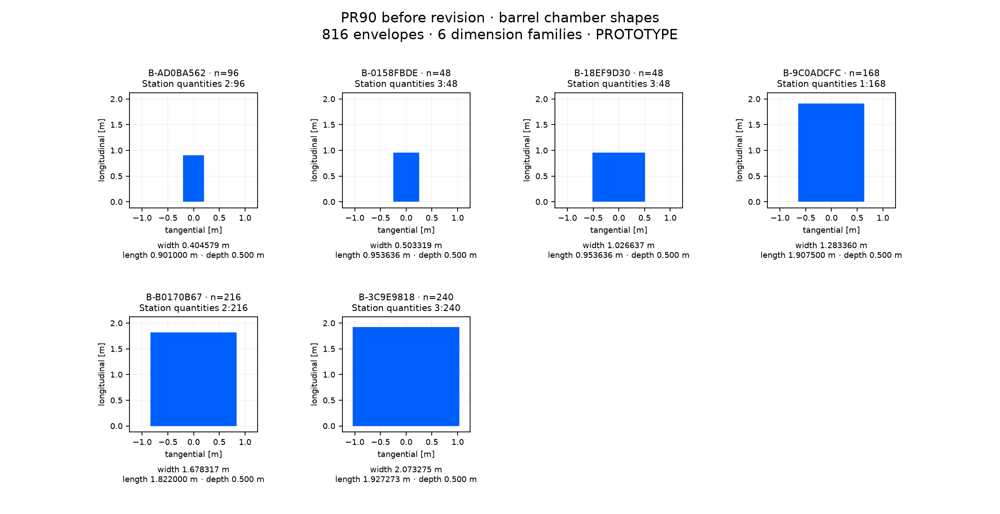

# PR90 before revision: barrel chamber inventory

816 chamber envelopes, 6 dimension families. Isolated PROTOTYPE; no chamber internals or manufacturing specification.

[CSV](barrel.csv) · [Full panel-to-shape mapping and source hash](barrel.json). Dimensions group on a 1 nm grid; the JSON retains every source panel’s unrounded dimensions. Endcap quantities include both hemispheres. Shape plots share a metric scale within this sheet.

| Shape | Quantity | Station: quantity | tangential width [m] | longitudinal length [m] | depth [m] |
| --- | --- | --- | --- | --- | --- |
| B-AD0BA562 | 96 | 2: 96 | 0.404579305 | 0.901000000 | 0.500000000 |
| B-0158FBDE | 48 | 3: 48 | 0.503318678 | 0.953636364 | 0.500000000 |
| B-18EF9D30 | 48 | 3: 48 | 1.026637356 | 0.953636364 | 0.500000000 |
| B-9C0ADCFC | 168 | 1: 168 | 1.283359726 | 1.907500000 | 0.500000000 |
| B-B0170B67 | 216 | 2: 216 | 1.678317219 | 1.822000000 | 0.500000000 |
| B-3C9E9818 | 240 | 3: 240 | 2.073274712 | 1.927272727 | 0.500000000 |
