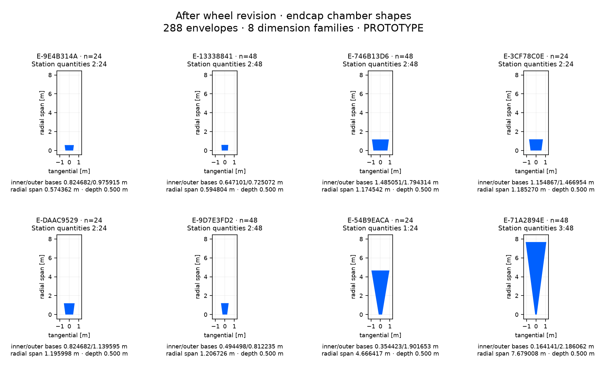

# After wheel revision: endcap chamber inventory

288 chamber envelopes, 8 dimension families. Isolated PROTOTYPE; no chamber internals or manufacturing specification.

[CSV](after-endcap.csv) · [Full panel-to-shape mapping and source hash](after-endcap.json). Dimensions group on a 1 nm grid; the JSON retains every source panel’s unrounded dimensions. Endcap quantities include both hemispheres. Shape plots share a metric scale within this sheet.

| Shape | Quantity | Station: quantity | radial span [m] | inner base [m] | outer base [m] | outer base offset [m] | depth [m] |
| --- | --- | --- | --- | --- | --- | --- | --- |
| E-9E4B314A | 24 | 2: 24 | 0.574362146 | 0.824682425 | 0.975914847 | 0.000000000 | 0.500000000 |
| E-13338841 | 48 | 2: 48 | 0.594804427 | 0.647101365 | 0.725072448 | 0.000000000 | 0.500000000 |
| E-746B13D6 | 48 | 2: 48 | 1.174541787 | 1.485051352 | 1.794314072 | 0.000000000 | 0.500000000 |
| E-3CF78C0E | 24 | 2: 24 | 1.185269930 | 1.154866888 | 1.466954382 | 0.000000000 | 0.500000000 |
| E-DAAC9529 | 24 | 2: 24 | 1.195998074 | 0.824682425 | 1.139594692 | 0.000000000 | 0.500000000 |
| E-9D7E3FD2 | 48 | 2: 48 | 1.206726218 | 0.494497961 | 0.812235002 | 0.000000000 | 0.500000000 |
| E-54B9EACA | 24 | 1: 24 | 4.666416782 | 0.354423346 | 1.901652879 | 0.000000000 | 0.500000000 |
| E-71A2894E | 48 | 3: 48 | 7.679008474 | 0.164140917 | 2.186062207 | 0.000000000 | 0.500000000 |
