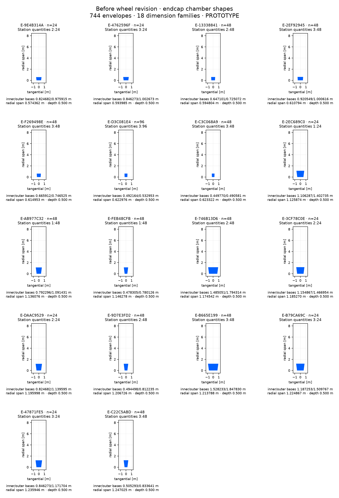

# Before wheel revision: endcap chamber inventory

744 chamber envelopes, 18 dimension families. Isolated PROTOTYPE; no chamber internals or manufacturing specification.

[CSV](before-endcap.csv) · [Full panel-to-shape mapping and source hash](before-endcap.json). Dimensions group on a 1 nm grid; the JSON retains every source panel’s unrounded dimensions. Endcap quantities include both hemispheres. Shape plots share a metric scale within this sheet.

| Shape | Quantity | Station: quantity | radial span [m] | inner base [m] | outer base [m] | outer base offset [m] | depth [m] |
| --- | --- | --- | --- | --- | --- | --- | --- |
| E-9E4B314A | 24 | 2: 24 | 0.574362146 | 0.824682425 | 0.975914847 | 0.000000000 | 0.500000000 |
| E-4762596F | 24 | 3: 24 | 0.593985244 | 0.846273434 | 1.002672716 | 0.000000000 | 0.500000000 |
| E-13338841 | 48 | 2: 48 | 0.594804427 | 0.647101365 | 0.725072448 | 0.000000000 | 0.500000000 |
| E-2EF92945 | 48 | 3: 48 | 0.610794249 | 0.920548691 | 1.000615832 | 0.000000000 | 0.500000000 |
| E-F269498E | 48 | 3: 48 | 0.614953290 | 0.665912338 | 0.746524675 | 0.000000000 | 0.500000000 |
| E-D3C081E4 | 96 | 3: 96 | 0.622975764 | 0.492164270 | 0.532952500 | 0.000000000 | 0.500000000 |
| E-C3C068A9 | 48 | 3: 48 | 0.623322444 | 0.449770359 | 0.490581287 | 0.000000000 | 0.500000000 |
| E-2EC689C0 | 24 | 1: 24 | 1.125874494 | 1.106287117 | 1.402735495 | 0.000000000 | 0.500000000 |
| E-AB977C32 | 48 | 1: 48 | 1.136076497 | 0.792295910 | 1.091430527 | 0.000000000 | 0.500000000 |
| E-FEB48CFB | 48 | 1: 48 | 1.146278500 | 0.478304703 | 0.780125558 | 0.000000000 | 0.500000000 |
| E-746B13D6 | 48 | 2: 48 | 1.174541787 | 1.485051352 | 1.794314072 | 0.000000000 | 0.500000000 |
| E-3CF78C0E | 24 | 2: 24 | 1.185269930 | 1.154866888 | 1.466954382 | 0.000000000 | 0.500000000 |
| E-DAAC9529 | 24 | 2: 24 | 1.195998074 | 0.824682425 | 1.139594692 | 0.000000000 | 0.500000000 |
| E-9D7E3FD2 | 48 | 2: 48 | 1.206726218 | 0.494497961 | 0.812235002 | 0.000000000 | 0.500000000 |
| E-B665E199 | 48 | 3: 48 | 1.213787983 | 1.528233372 | 1.847829811 | 0.000000000 | 0.500000000 |
| E-B79CA69C | 24 | 3: 24 | 1.224866888 | 1.187253403 | 1.509766973 | 0.000000000 | 0.500000000 |
| E-47871FE5 | 24 | 3: 24 | 1.235945792 | 0.846273434 | 1.171704135 | 0.000000000 | 0.500000000 |
| E-C22C5ABD | 48 | 3: 48 | 1.247024697 | 0.505293465 | 0.833641297 | 0.000000000 | 0.500000000 |
