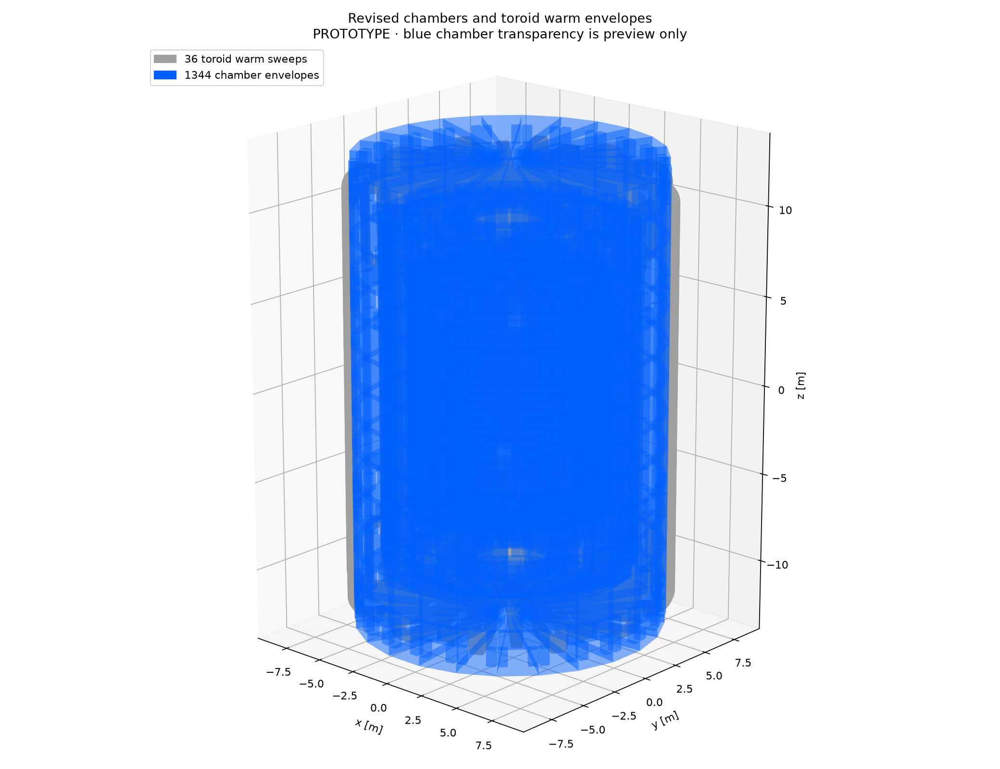

# Revised wheel geometry: native ACTS OBJ

Isolated PROTOTYPE. [Combined chambers and coils ZIP](chambers-and-coils.zip) contains a sibling OBJ/MTL pair. [Component ZIP](components.zip) contains barrel, positive endcap and toroids-plus-frame pairs. All paths in OBJ material references are relative; coordinates are metres, right-handed xyz, beam along z.

Chambers are blue RGB(0,96,255); coils/frame are grey RGB(160,160,160). ACTS stores diffuse values divided by 256. Blue transparency is preview only. Native finite chamber vertices are exported at17-digit precision. Every object is checked closed and outward-oriented after 1 nm position welding. Warm coils use 64 chords per quadrant.

Actual source support outer-prism reservations; hollow RHS cavities are omitted for review visibility. Separate members overlap at joints; these objects are neither material solids nor a mass union. Frame is outside the chamber-only ACTS world. No physical magnetic/material response, construction acceptance or mass follows.

[Barrel](barrel-chambers.obj) · [Positive endcap](positive-endcap-chambers.obj) · [Toroids and frame](toroids-and-frame.obj). Each has a sibling MTL/PNG. [Exact source/native checks and hashes](export.json).

Reproduce: `MPLCONFIGDIR=/private/tmp/pr90-wheels-matplotlib XDG_CACHE_HOME=/private/tmp/pr90-wheels-cache /Users/salzburg/Documents/work/installed/acts-nodd/pyvenv/bin/python -B -m tools.muon_layout.wheels_artifacts`. Existing native binary/library hashes are checked; no builds run.
