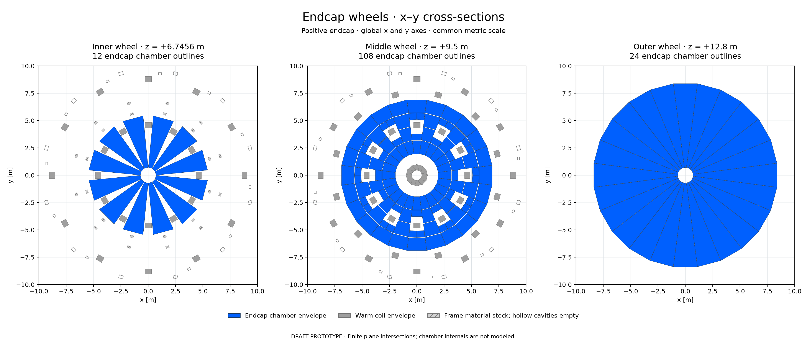

# Three endcap wheel x–y cross-sections

Requested by [PR90 comment6285630535](https://github.com/asalzburger/nodd/pull/90#issuecomment-6285630535).
DRAFT drawing-only addition to DES040. The saved geometry is unchanged.



[Full-resolution PNG](endcap-wheels-xy.png) · [Vector SVG](endcap-wheels-xy.svg)

| Wheel | Plane z [m] | Endcap chambers | Warm-coil sections | Frame stock sections | Individual view |
|---|---:|---:|---:|---:|---|
| Inner |+6.7456|12|24|120|[PNG](wheel-1-xy.png) / [SVG](wheel-1-xy.svg)|
| Middle |+9.5|108|48|96|[PNG](wheel-2-xy.png) / [SVG](wheel-2-xy.svg)|
| Outer |+12.8|24|0|0|[PNG](wheel-3-xy.png) / [SVG](wheel-3-xy.svg)|

All panels have global x-right/y-up coordinates, equal aspect and common
−10 to+10 m axes. Blue uses the retained native chamber material colour
RGB(0,96,255)/256. Grey is the warm-coil reservation; light grey hatching is
actual frame material stock with hollow cavities empty. Stock-part counts
include split walls and do not count unique structural members. Joints can
overlap and do not establish a mass union. Chamber internals remain undefined.

These are cuts through finite source volumes at each wheel's centre plane,
not projections of all three wheels into one view. The outer plane intersects
no coils/frame. Endcap chambers only are shown; barrel chamber context is not
included. Negative-end chambers have identical global XY footprints; a view
from the opposite camera direction would introduce a display reflection.

[Exact displayed polygons and source IDs](sections.json) and
[provenance/control results](provenance.json) are retained. Chamber/support
polygons use the existing finite prism/plane helper (coordinates rounded to
10⁻¹⁰ m). Coil sections are analytic horizontal slices of the exact rounded
rectangle distance and tangential slab definition; these planes give straight
rectangles. No raster, field-map sampling or 3D projection defines the cuts.

The generation controls compare150,000 random XY queries with exact source
coil membership, check144 off-plane chamber cases and compare opposite-end
footprints. Independent input/display checks also compare16,332 prism/plane
cases, adverse intersection fixtures and2,359,296 coil-membership queries.
These checks establish drawing fidelity, not a new clearance, physics response
or engineering qualification.

Reproduce from the repository root with Python, NumPy and Matplotlib:

```sh
MPLCONFIGDIR=/tmp/muon-xy-matplotlib python3 -B -m tools.muon_layout.wheels_xy
```

Source geometry is SHA-guarded at the input revision recorded in provenance.
No ACTS runtime or new propagation is needed. The original geometry, field,
OBJ, inventories, coverage and dated scientific evidence are preserved. The
parent evidence-index README gains a link; its earlier manifest fingerprint
remains reproducible at the baseline revision rather than being rewritten.
