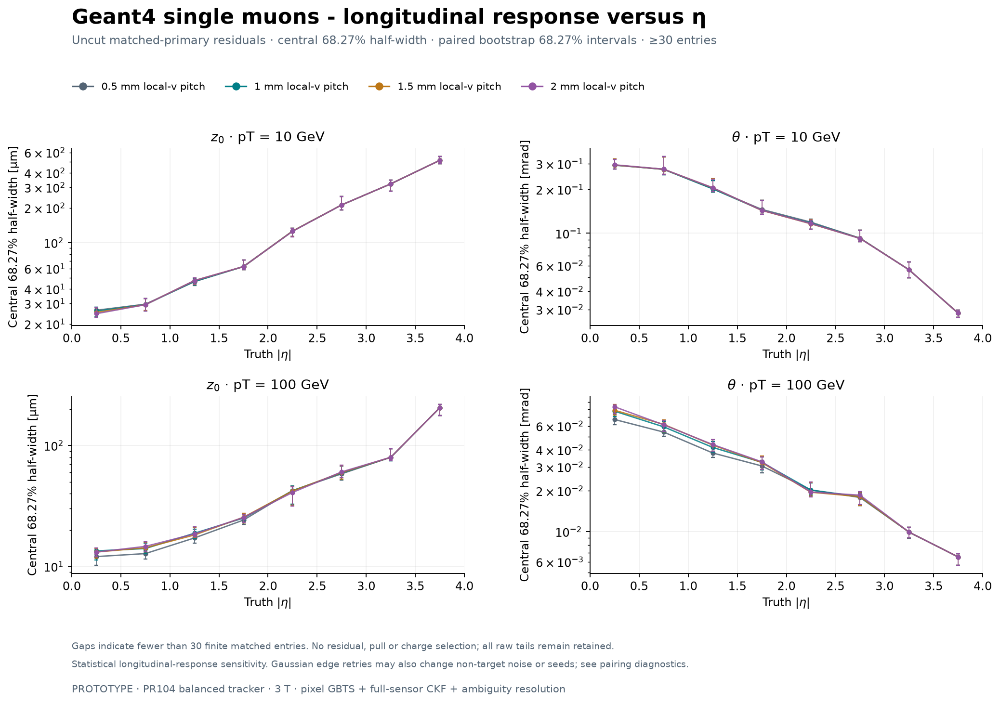

# GBTS reconstruction versus strixel length

**PROTOTYPE - DES041 and DES042 response sensitivity, 2026-10-31.**

At 2 mm, the observed central 100 GeV muon z₀ core width is **10.6% larger in Fatras** and **15.1% larger in Geant4** than at 0.5 mm in this frozen Gaussian-response study. The same central matched events supply all four lengths. Observed all-generated matching differences at 2 mm range from 0 to +3.6 percentage points across the 20 population/momentum comparisons. High-momentum electron fit failures remain substantial.

## Sample and response

The scan has 80 cases with 1,000 generated events each: Fatras muons and guarded Fatras electrons, plus Geant4 muons, electrons and charged pions; pT = 1, 5, 10 and 100 GeV; local-v pitches = 0.5, 1, 1.5 and 2 mm. The gun starts at the origin, randomizes charge and samples uniform η in [-4, 4] and full φ. These repeat established seeds and event IDs from the retained 5,000-event baseline samples.

The balanced tracker geometry, material, constant 3 T field, pixel-only GBTS seeding, full-sensor CKF, particle hypotheses and quality/matching cuts are fixed. The 0.5 mm case uses the frozen pooled Gaussian response. Only local-v Gaussian sigma for strixel systems 4 and 5 scales by pitch/0.5; measurement merging is disabled. This is an effective response prescription whose coarse cases require physical sensor calibration. Material reductions from a cable or power redesign are outside this fixed-material scan.

## Primary matching

Every generated primary remains in the denominator. Rates are percentages. The last column gives 2 mm minus 0.5 mm in percentage points with paired 95% intervals. The complete [80-case table](results.md) also gives individual Wilson intervals and fake, duplicate, covariance and quality counts.

| Transport and particle | pT [GeV] | 0.5 mm [%] | 1 mm [%] | 1.5 mm [%] | 2 mm [%] | Difference [95%, pp] |
|---|---:|---:|---:|---:|---:|---:|
| Fatras electron | 1 | 52.0 | 53.8 | 54.9 | 55.2 | +3.20 [+1.90, +4.50] |
| Fatras electron | 5 | 82.4 | 83.2 | 84.1 | 84.4 | +2.00 [+0.80, +3.30] |
| Fatras electron | 10 | 84.5 | 85.0 | 85.6 | 86.2 | +1.70 [+0.60, +2.90] |
| Fatras electron | 100 | 84.6 | 84.8 | 85.7 | 85.6 | +1.00 [-0.40, +2.30] |
| Fatras muon | 1 | 97.0 | 97.0 | 97.0 | 97.0 | +0.00 [-0.30, +0.30]† |
| Fatras muon | 5 | 99.4 | 99.4 | 99.4 | 99.4 | +0.00 [-0.30, +0.30]† |
| Fatras muon | 10 | 99.0 | 99.0 | 99.0 | 99.0 | +0.00 [-0.30, +0.30]† |
| Fatras muon | 100 | 99.6 | 99.7 | 99.7 | 99.7 | +0.10 [+0.00, +0.30] |
| Geant4 electron | 1 | 52.3 | 53.1 | 54.6 | 55.9 | +3.60 [+2.20, +5.10] |
| Geant4 electron | 5 | 79.1 | 79.7 | 80.5 | 80.4 | +1.30 [-0.10, +2.50] |
| Geant4 electron | 10 | 80.0 | 80.8 | 81.2 | 81.8 | +1.80 [+0.70, +3.00] |
| Geant4 electron | 100 | 77.1 | 77.8 | 79.1 | 78.6 | +1.50 [-0.20, +3.00] |
| Geant4 muon | 1 | 95.5 | 95.7 | 95.8 | 96.0 | +0.50 [+0.10, +1.00] |
| Geant4 muon | 5 | 98.8 | 99.1 | 99.1 | 99.1 | +0.30 [+0.00, +0.70] |
| Geant4 muon | 10 | 99.2 | 99.3 | 99.4 | 99.5 | +0.30 [+0.00, +0.70] |
| Geant4 muon | 100 | 98.7 | 98.9 | 98.9 | 98.9 | +0.20 [+0.00, +0.50] |
| Geant4 pion | 1 | 81.2 | 81.3 | 81.5 | 81.6 | +0.40 [-0.10, +0.90] |
| Geant4 pion | 5 | 85.6 | 85.8 | 85.9 | 86.0 | +0.40 [+0.00, +0.90] |
| Geant4 pion | 10 | 86.2 | 86.4 | 86.5 | 86.7 | +0.50 [+0.00, +0.90] |
| Geant4 pion | 100 | 90.0 | 90.1 | 90.1 | 90.4 | +0.40 [-0.10, +0.90] |

† Identical success flags yield a zero-spread empirical bootstrap. These rows instead use the conservative pointwise signed bound from the exact 95% upper limit on discordance: ±0.2991 percentage points for 1,000 events. Other intervals use 400 paired event bootstrap resamples. All intervals are pointwise; the scan establishes neither statistical equivalence nor simultaneous coverage over all comparisons.

## Central high momentum muon resolution

For pT = 100 GeV and 0 ≤ |η| < 1, the width is half the central 68.268949% residual interval, with no tail or charge cuts. Ratios have paired 68.27% bootstrap intervals. These are track perigee z₀ widths, not individual strixel hit resolutions.

| Local-v pitch [mm] | Fatras z₀ core [µm] | Ratio to 0.5 mm [68.27%] | Geant4 z₀ core [µm] | Ratio to 0.5 mm [68.27%] |
|---:|---:|---:|---:|---:|
| 0.5 | 13.03 | 1 (reference) | 12.32 | 1 (reference) |
| 1 | 14.29 | 1.097 [1.021, 1.111] | 13.50 | 1.096 [1.074, 1.157] |
| 1.5 | 14.44 | 1.108 [1.050, 1.148] | 13.74 | 1.115 [1.088, 1.184] |
| 2 | 14.41 | 1.106 [1.058, 1.164] | 14.18 | 1.151 [1.097, 1.203] |

All 254 central Fatras primaries match at every length; Geant4 matches the same 267 of 269 central primaries at every length. Common-success ratios therefore equal the individual-sample ratios here. At 2 mm, the θ core changes from 66.3 to 72.5 µrad in Fatras (+9.3%) and from 61.8 to 71.9 µrad in Geant4 (+16.4%). The slight non-monotonic Fatras z₀ values at 1.5 and 2 mm remain part of the finite-sample result.

## Momentum and charge tails

At 100 GeV over the full generated η range, electron samples retain roughly 13% wrong-charge representatives and about 55% with a relative-pT error above 50%. Longer strixels do not resolve those frozen-baseline fit limitations. Muon and pion momentum tails remain visible below. Matching efficiency alone is insufficient to assess momentum performance.

| Population at 100 GeV | Wrong charge at 0.5 mm | Wrong charge at 2 mm | Absolute relative pT error > 0.5 at 0.5 mm | Absolute relative pT error > 0.5 at 2 mm |
|---|---:|---:|---:|---:|
| Fatras electron | 110/846 (13.0%) | 112/856 (13.1%) | 460/846 (54.4%) | 467/856 (54.6%) |
| Fatras muon | 14/996 (1.4%) | 14/997 (1.4%) | 72/996 (7.2%) | 72/997 (7.2%) |
| Geant4 electron | 105/771 (13.6%) | 103/786 (13.1%) | 423/771 (54.9%) | 432/786 (55.0%) |
| Geant4 muon | 17/987 (1.7%) | 17/989 (1.7%) | 88/987 (8.9%) | 88/989 (8.9%) |
| Geant4 pion | 32/900 (3.6%) | 35/904 (3.9%) | 100/900 (11.1%) | 104/904 (11.5%) |

Wrong-charge fractions use matched primaries; momentum-tail fractions use finite momentum residuals. Every matched primary in these rows has a finite momentum residual. Residuals are truth minus reconstruction, with wrapped φ. Arrays and the local, ignored `profiles.json.gz` report retain uncut distributions, biases, RMS, extrema, nonfinite counts and all six bound pulls. Electron uncertainty calibration remains limited as in the [frozen species baseline](../../tracker-reconstruction-species/results.md).

## Pairing and interpretation

All 20 groups have identical generated/transported particle records and complete persisted simhit payloads across lengths. Hit floats are compared at ROOT writer float32 precision; this does not certify in-memory float64 identity. Measured pixel inputs, space points, ordered seed outputs, estimated seeds and primary measurement associations also agree in all 20 groups.

Configured non-target errors are fixed, but Gaussian boundary retries can shift later random draws. At 2 mm, index-free non-target measurement multisets change in 12 to 167 of 1,000 events depending on population/momentum. Each central 100 GeV muon comparison contains two such changed events. The differences therefore include native retry/noise coupling and cannot be attributed uniquely to longitudinal response. Per-system counts and the union of changed events remain separate from net measurement-count differences.

## Figures and reproduction

Each population has absolute matching efficiency, residual widths, width ratios with common-success controls, and longitudinal η profiles. Every figure is available as PNG and PDF.

| Population | Efficiency | Widths | Ratios | Longitudinal η |
|---|---|---|---|---|
| Fatras muon | [PNG](figures/fatras-muon-efficiency.png) / [PDF](figures/fatras-muon-efficiency.pdf) | [PNG](figures/fatras-muon-widths.png) / [PDF](figures/fatras-muon-widths.pdf) | [PNG](figures/fatras-muon-ratios.png) / [PDF](figures/fatras-muon-ratios.pdf) | [PNG](figures/fatras-muon-longitudinal-eta.png) / [PDF](figures/fatras-muon-longitudinal-eta.pdf) |
| Fatras electron | [PNG](figures/fatras-electron-efficiency.png) / [PDF](figures/fatras-electron-efficiency.pdf) | [PNG](figures/fatras-electron-widths.png) / [PDF](figures/fatras-electron-widths.pdf) | [PNG](figures/fatras-electron-ratios.png) / [PDF](figures/fatras-electron-ratios.pdf) | [PNG](figures/fatras-electron-longitudinal-eta.png) / [PDF](figures/fatras-electron-longitudinal-eta.pdf) |
| Geant4 muon | [PNG](figures/geant4-muon-efficiency.png) / [PDF](figures/geant4-muon-efficiency.pdf) | [PNG](figures/geant4-muon-widths.png) / [PDF](figures/geant4-muon-widths.pdf) | [PNG](figures/geant4-muon-ratios.png) / [PDF](figures/geant4-muon-ratios.pdf) | [PNG](figures/geant4-muon-longitudinal-eta.png) / [PDF](figures/geant4-muon-longitudinal-eta.pdf) |
| Geant4 electron | [PNG](figures/geant4-electron-efficiency.png) / [PDF](figures/geant4-electron-efficiency.pdf) | [PNG](figures/geant4-electron-widths.png) / [PDF](figures/geant4-electron-widths.pdf) | [PNG](figures/geant4-electron-ratios.png) / [PDF](figures/geant4-electron-ratios.pdf) | [PNG](figures/geant4-electron-longitudinal-eta.png) / [PDF](figures/geant4-electron-longitudinal-eta.pdf) |
| Geant4 pion | [PNG](figures/geant4-pion-efficiency.png) / [PDF](figures/geant4-pion-efficiency.pdf) | [PNG](figures/geant4-pion-widths.png) / [PDF](figures/geant4-pion-widths.pdf) | [PNG](figures/geant4-pion-ratios.png) / [PDF](figures/geant4-pion-ratios.pdf) | [PNG](figures/geant4-pion-longitudinal-eta.png) / [PDF](figures/geant4-pion-longitudinal-eta.pdf) |

The [repeat workflow](../../../../software/analysis/strixel_reconstruction/README.md) covers fresh native campaigns, portable retention, exact statistical replay, baseline comparison, ROOT audit and plotting. Native execution is pinned to `8c45136098d1e4d407c4d2f96e3590bb78eb6b75`; the retained-statistics analyzer SHA256 is `503bd05aa6fff1164dda466eba8a34dfa2852f3f6888db3e5c3b082cca7d4fd8`. The local, ignored `native-reports.json.gz` inventory, [environment](analysis-environment.json) and [figure manifest](figures/manifest.json) bind data, configuration, source and runtime identities.

The [baseline comparison](baseline-bridge.json) exactly reproduces 812 original observables and NaN masks across 20 fresh baseline subsets. The [ROOT audit](root-audit.json) and its exact replay cover all 80 cases and 5,406,814 persisted covariance marginals, every generated track event, raw candidates and matched parameter tuples. The focused suite passes 49 tests. The [verification record](verification.json) records the complete replay and export checks; the [session journal](../../../../logs/codex/SESSION-2026-10-31-strixel-gbts-crosscheck.md) retains independent assessments and exact revisions.

Per the 2026-10-31 publication instruction, portable event arrays, compressed case/configuration/report data and profile inputs remain local and ignored. Plots, compact reports/provenance and rerun code are retained in the PR. Their hashes and locations are recorded in [the local artifact inventory](../local-artifacts.json). Full replay requires the local files or a regenerated campaign; CI checks synthetic analysis tests and figure hashes/source bindings. Original unpublished source/review revisions are preserved at the inventory's local archive ref.
