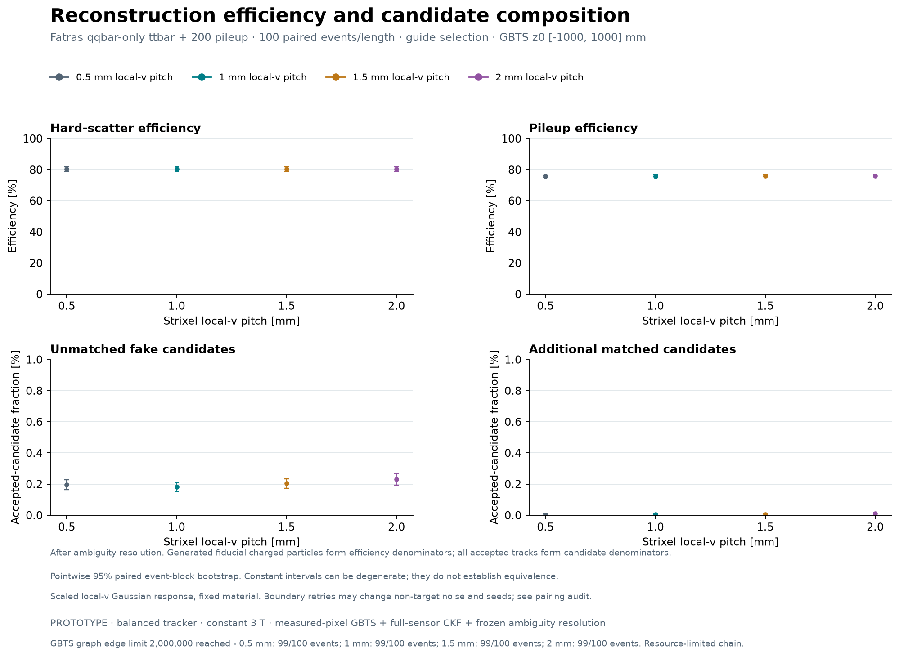

# Fatras ttbar + 200 pileup: strixel reconstruction

DES-042 **PROTOTYPE**, 2026-10-31. All four 100-event native cases, full 400-payload comparison, portable classification replay, 2,000 paired event-bootstrap calculations and figure replay passed. Independent final evidence review passed at `d93063a9e4827e9f9a66fc0f175c16c3cc1dbc64`.

The sample follows the matching ACTS `full_chain_odd.py`: 14 TeV pp, qqbar-only ttbar (`Top:qqbar2ttbar=on`) plus exactly 200 minimum-bias interactions. One validated Fatras sample is reconstructed at 0.5, 1, 1.5 and 2 mm strixel local-v length. These are **100 shared physical events and 400 reconstructed case-events**.

## Results after ambiguity resolution

Efficiency counts unique matched charged generated particles with pT ≥1 GeV, |eta| ≤3, rho ≤24 mm and |z| ≤1 m, before hit or track requirements. Every length has 89,342 eligible particles: 4,797 hard-scatter and 84,545 pileup particles. Values below are percentages with pointwise 95% event-bootstrap intervals.

Frozen quality requires ≥7 unique inlier measurements, a reference surface, finite fit parameters/chi2 with positive ndf, the native finite/symmetric/positive-definite covariance flag, and positive finite covariance diagonals. Portable replay retains this native flag rather than the full covariance matrix. The additional **guide-like analysis selection** requires reconstructed pT ≥1 GeV, |eta| ≤3, |loc0| ≤4 mm, ≤2 holes and ≤2 outliers. It is applied after the unchanged native chain.

| Length [mm] | Inclusive efficiency | Hard-scatter efficiency | Pileup efficiency |
|---:|---:|---:|---:|
| 0.5 | 76.05 [75.48, 76.69] | 80.36 [78.77, 81.87] | 75.81 [75.26, 76.44] |
| 1 | 76.10 [75.53, 76.73] | 80.40 [78.88, 81.85] | 75.86 [75.30, 76.47] |
| 1.5 | 76.14 [75.56, 76.78] | 80.40 [78.87, 81.87] | 75.90 [75.34, 76.53] |
| 2 | 76.15 [75.57, 76.79] | 80.36 [78.81, 81.84] | 75.91 [75.35, 76.54] |

A fake is an accepted candidate without a unique-inlier match meeting both purity ≥0.5 and completeness ≥0.5. Out-of-fiducial generated matches and simulation-secondary matches are separate. Duplicates are additional matches beyond the selected representative; they overlap matched categories.

| Length [mm] | Accepted tracks | Unmatched fakes | Fake fraction [%], 95% CI | Duplicates | Duplicate fraction [%], 95% CI |
|---:|---:|---:|---:|---:|---:|
| 0.5 | 69,076 | 135 | 0.195 [0.165, 0.227] | 2 | 0.0029 [0.0000, 0.0073] |
| 1 | 69,106 | 125 | 0.181 [0.151, 0.211] | 4 | 0.0058 [0.0014, 0.0117] |
| 1.5 | 69,166 | 141 | 0.204 [0.173, 0.234] | 3 | 0.0043 [0.0000, 0.0102] |
| 2 | 69,201 | 159 | 0.230 [0.194, 0.269] | 7 | 0.0101 [0.0043, 0.0177] |

| Length [mm] | Out-of-fiducial generated matches | Simulation-secondary matches | Events with ≥1 fake | Fake-event incidence [%], Wilson 95% |
|---:|---:|---:|---:|---:|
| 0.5 | 607 | 385 | 72/100 | 72.00 [62.51, 79.86] |
| 1 | 586 | 400 | 70/100 | 70.00 [60.42, 78.11] |
| 1.5 | 607 | 391 | 72/100 | 72.00 [62.51, 79.86] |
| 2 | 609 | 396 | 71/100 | 71.00 [61.46, 78.99] |

### Frozen quality alone

These results use the same ambiguity-resolved native candidates before the additional guide-like analysis cuts.

| Length [mm] | Inclusive efficiency [%], 95% CI | Hard-scatter efficiency [%], 95% CI | Pileup efficiency [%], 95% CI | Fake fraction [%], 95% CI | Fakes / accepted tracks |
|---:|---:|---:|---:|---:|---:|
| 0.5 | 77.36 [76.77, 78.02] | 81.11 [79.62, 82.58] | 77.14 [76.57, 77.78] | 3.460 [3.315, 3.606] | 3,459/99,968 |
| 1 | 77.38 [76.79, 78.04] | 81.09 [79.60, 82.53] | 77.17 [76.60, 77.81] | 3.646 [3.488, 3.793] | 3,655/100,237 |
| 1.5 | 77.39 [76.81, 78.04] | 81.13 [79.61, 82.61] | 77.18 [76.61, 77.82] | 3.944 [3.791, 4.097] | 3,967/100,591 |
| 2 | 77.41 [76.82, 78.06] | 81.11 [79.60, 82.60] | 77.20 [76.62, 77.84] | 4.236 [4.058, 4.400] | 4,275/100,929 |

### Paired changes relative to 0.5 mm

Values are percentage points, with jointly paired pointwise 95% event-bootstrap intervals.

| Length [mm] | Guide hard-scatter efficiency Δ | Guide inclusive efficiency Δ | Guide fake-fraction Δ | Frozen fake-fraction Δ |
|---:|---:|---:|---:|---:|
| 1 | +0.042 [-0.168, +0.247] | +0.049 [+0.003, +0.098] | -0.015 [-0.038, +0.008] | +0.186 [+0.119, +0.257] |
| 1.5 | +0.042 [-0.143, +0.207] | +0.086 [+0.028, +0.145] | +0.008 [-0.012, +0.029] | +0.484 [+0.401, +0.565] |
| 2 | +0.000 [-0.211, +0.202] | +0.093 [+0.041, +0.148] | +0.034 [+0.005, +0.064] | +0.776 [+0.677, +0.873] |

At 2 mm, the aggregate guide-selected hard-scatter efficiency equals the 0.5 mm value, with a paired interval of −0.211 to +0.202 percentage points. The guide fake fraction increases by 0.034 percentage points [0.005, 0.064]; with frozen quality alone it increases by 0.776 [0.677, 0.873]. These statistical intervals do not establish equivalence or physical sensor calibration.

All CKF-stage results, conditional efficiencies, seed coverage, wrong-charge diagnostics, raw quality-rejection counts, event rates, profile bins/overflow and paired changes are retained in [the full tables](results.md) and the local, ignored `profiles.json.gz`. Conditional denominator sizes are 89,282 for ≥9 associated measurements and 88,823 for ≥6 sensors/3 physical pixel groups. Pure-seed coverage is a diagnostic rather than an efficiency ceiling.

## Response, pairing and resource limits

Geometry, role-transported effective material, constant 3 T field, measured-pixel GBTS `pt4-nominal-triplet`, all-system CKF, inclusive muon hypothesis and strict ambiguity resolution remain fixed. A common ±1 m z0 window follows the guide-selected vertex region and was set before production. Only system 4/5 local-v Gaussian sigma scales with length; merging is disabled. Local-v is barrel z and endcap radial position.

| Length [mm] | Measurements retained | Pixels changed [events] | Space points changed | Seeds changed | Estimated seeds changed | Non-target response changed |
|---:|---:|---:|---:|---:|---:|---:|
| 0.5 | 7,907,248 | 0 | 0 | 0 | 0 | 0 |
| 1 | 7,907,247 | 0 | 0 | 0 | 0 | 100 |
| 1.5 | 7,907,246 | 0 | 0 | 0 | 0 | 100 |
| 2 | 7,907,246 | 0 | 0 | 0 | 0 | 100 |

Generated/simulated particles and hits are identical across lengths. Pixels, space points and both seed collections are bitwise invariant. Boundary retries couple the realized smearing stream: non-target response differs in every coarser event, and the coarser endcap response loses one or two measurements. Differences include this coupling as well as the scaled longitudinal response.

GBTS reaches its unchanged **2,000,000-edge cap in 99/100 events at every length**. Edge counts range from 1,921,530 to 2,000,000; edge links from 31,205 to 49,540. The 485,545 produced seeds are identical across lengths; the output-seed cap is disabled. Efficiency and eta structure describe this resource-limited reconstruction chain. Physical coarse-cell sharing/merging and service/material redesign are outside this Gaussian response scan.

All 55,903,986 variance marginals, 10,837,452 measured pixel-space-point transforms and 10,736,705 reconstruction hypotheses passed their native-response checks. The maximum space-point discrepancy is the expected float32 representation error, 9.802e-5 mm; each point equals the explicitly transformed coordinate after float32 conversion. All seven detector systems enter CKF. All ambiguity survivors have fewer than three shared measurements; the observed maximum is two. See [the response audit](response-audit.json).

The Fatras sample retains six default maximum-step failures: five generated pileup particles below pT=1 GeV and one simulation-secondary positron. All initial pT values are below 0.534 GeV. Independent input/output inventories in the affected events find no omitted headline-eligible generated particle. Missing background transport remains a qualification for occupancy and fake rates; all truth and events remain in the analysis. See [the complete failure audit](transport-failures.json).

## Figures

| Figure family | Guide-like selection | Frozen quality |
|---|---|---|
| Overview | [PDF](figures/guide-overview.pdf) · [PNG](figures/guide-overview.png) | [PDF](figures/frozen-overview.pdf) · [PNG](figures/frozen-overview.png) |
| Efficiency vs truth eta/pT | [PDF](figures/guide-efficiency-profiles.pdf) · [PNG](figures/guide-efficiency-profiles.png) | [PDF](figures/frozen-efficiency-profiles.pdf) · [PNG](figures/frozen-efficiency-profiles.png) |
| Fake/duplicate fraction vs reconstructed eta/pT | [PDF](figures/guide-candidate-profiles.pdf) · [PNG](figures/guide-candidate-profiles.png) | [PDF](figures/frozen-candidate-profiles.pdf) · [PNG](figures/frozen-candidate-profiles.png) |

Unrooted exports include pointwise 95% intervals and the graph-limit/model qualifications. Undefined bins remain gaps; counts and overflow stay in the retained report. All six PDFs were rendered and checked, and a fresh-directory rerender reproduces all 12 PNG/PDF files byte-for-byte. [Figure verification](figure-verification.json).

## Reproduction and provenance

The [execution guide](../../../../software/analysis/strixel_ttbar/README.md) covers task-owned native builds, immutable campaign launch/reuse, portable retention/replay, 2,000-resample inference and unrooted export. Raw validated sample outputs remain under `build/strixel-ttbar-production-v2/sample/`; fresh reconstruction outputs under `build/strixel-ttbar-production-v3/`. Each `pitch*/audit/event-*.npz` retains numeric matching inputs without pickle. The largest chunk is 4,687,538 bytes.

- Fatras generation source: `250a211ff71be2ce7339cc043766f0d839470411`.
- Reconstruction/analysis source: `46926ce90074d44b4a4ad42bbca0f318c6a68449`.
- Matching ACTS source: `355ea68493b326956756c9386d2fd9eaf9328568`.
- Production seed 153042; distinct-seed smoke 153043; bootstrap seed 153044.
- Pythia8 8.317, ROOT 6.40.04; exact native/compiler/ABI and analysis versions in [environment metadata](environment.json).

The task-owned numerical components preserve selected observables and random draws. The Fatras correction protects a zero-observable energy-loss region and copies failure diagnostics before queue erasure. The GBTS correction selects the denominator before division, preventing Clang O2 evaluation of an unselected endcap divide at a zero barrel slope. No cut, graph limit, propagation limit, event selection or FPE mask was relaxed. All failed attempts remain preserved with failed reports.

The corrected generation passes [all 100 particle/hit payload comparisons](numerical-replay.json). Fresh reconstruction passes [all 400 scientific-payload comparisons](gbts-reconstruction-replay.json), all 116 output hashes per case, complete numerical coverage and source/input/native immutability. [Native campaign](native-campaign.json), [compiler diagnosis](gbts-numerical-diagnosis.json), [numerical controls](gbts-numerical-repair.json).

Independent PhysVal-09 assessed the exact executing source, native numerical controls and committed full-chain pilot. [Final independent PhysVal-10 review](../../../../logs/codex/SESSION-2026-10-31-strixel-ttbar-pu200/PhysVal-10-result.md) assessed `d93063a9e4827e9f9a66fc0f175c16c3cc1dbc64` with no unresolved blocker: 1,500 file hashes, all 1,864 metrics/intervals independently resampled, 10,920 representative count checks and figure integrity/visual checks passed. The only subsequent report clarifications record this outcome and spell out the already enforced native covariance flag; scientific sources, data, statistics and figures are unchanged. The [session journal](../../../../logs/codex/SESSION-2026-10-31-strixel-ttbar-pu200.md) records assignments, failures, fixes, commands and actual checks. DES-042 remains an unsigned prototype; no detector baseline change, human sign-off or external publication is granted.

## Storage and PR contents

On 2026-10-31, the complete ttbar working set used 17.3 GiB (18.6 GB), excluding shared runtime/dependency builds and Git storage. The successful sample plus four reconstruction outputs used 9.25 GiB; portable audit evidence added 1.47 GiB. Failed attempts, smoke tests, task-owned builds and temporary diagnostics account for the remainder. The six PNG/PDF pairs occupy 1.65 MiB. This is measured retained storage, not a minimum or peak-memory estimate.

Per human direction, raw/portable data stay local and ignored; plots, compact reports/provenance and reproduction code are the PR deliverables. The [local artifact inventory](../local-artifacts.json) records excluded paths, sizes and hashes. The original unpublished source/evidence commits remain at the recorded local archive ref; the PR history preserves the unchanged published branch and pinned native-validator commits, while consolidating only the later unpublished data-bearing tail. Execution/review SHAs above identify the original local snapshots, with scientific source contents preserved.

A fresh clone contains the figures and reports. Regenerate a local dataset with the repeat workflow before attempting full event/statistical/plot replay. CI checks synthetic analysis tests and the published figure hashes/source bindings; it does not claim to replay the omitted dataset.
