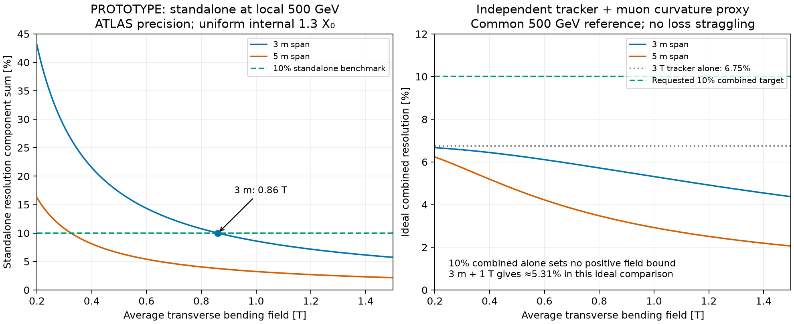

# MUON-001 — Compact span and 500 GeV follow-up

2026-10-16. **DRAFT / PROTOTYPE.** Response to the
[PR86 comment](https://github.com/asalzburger/nodd/pull/86#issuecomment-6210895219)
asking whether a 3 m chamber span can achieve 10% combined tracker–muon
resolution at 0.5 TeV. This extends the [parent study](../results.md); it does
not select a magnet or demonstrate a reconstructed-muon efficiency/resolution.

## Answer and design comparisons

**INFERENCE:** a 3 m station span is compatible with the requested target in
this central-barrel covariance estimate. The rerun 3 T tracker proxy already
gives **6.75% at 500 GeV**, so the 10% *combined* target alone places no positive
lower bound on the muon bending field. The tracker momentum could be retained
even if the muon system adds negligible curvature information. This statement
does not establish field-free muon identification or reliable chamber matching.

For a useful additional requirement, a **10% standalone muon measurement at
local 500 GeV requires about 0.86 T over 3 m**, with the existing precision and
internal-material assumptions. A **1 T / 3 m** candidate gives about **8.61%
standalone** and **5.31% in an ideal independent tracker–muon combination**.
If the goal is to preserve the intrinsic measurement contribution of the
earlier 0.5 T / 5 m comparison, use **about 1.4 T over 3 m** instead.
These are field benchmarks for subsequent design, not coil specifications.

The review comment's comparison at 100 GeV refers approximately to the
measurement contribution: at 0.5 T / 5 m it is 1.21%, while adding the assumed
internal scattering gives 2.70% for the muon system. The central tracker proxy
is 1.44% there. Its high-momentum resolution increases with momentum; it does
not remain at about 1% through 500 GeV.

## Tracker calculation

**INFERENCE:** direct pinned IdRes was rerun on the same nominal LAYOUT-001
layers, current hit resolutions, 3 T field and material proxy as the parent
study, using total momenta 100/200/500/1000 GeV. At eta=0, p=pT:

| Total p [GeV] | IdRes sigma(pT)/pT |
| --- | --- |
| 100 | 1.44% |
| 200 | 2.74% |
| 500 | 6.75% |
| 1000 | 13.5% |

The independent GLS value at 500 GeV is 6.74684%; the small difference is
IdRes output rounding. Half/nominal/double tracker material gives
6.73617/6.74684/6.76931% from GLS at this momentum. The high-momentum result is
primarily determined by hit precision and lever arm in the assumed uniform field.
The material proxy is not a complete validated tracker map.

[Retained IdRes inputs, outputs and hashes](idres/results.json) contain 48 cases
and the eta=1/2 comparisons; there pT=p/cosh(eta), so a fixed total-p table is
not a fixed-pT performance comparison. All 12 overlapping 100 GeV controls
reproduce the original results. A separate execution reproduced all 48 new
cases exactly, with IdRes/GLS differences below 0.5e-6 GeV^-1.

## Three-metre field and material arithmetic

Keep the parent study's ATLAS benchmarks: 81.7 micrometres per tube,
35 micrometres for the fitted chamber coordinate and a separate 30 micrometre
alignment term. Independent station alignment is assumed, giving
`sigma_station=sqrt(35^2+30^2)=46.10 micrometres`.

For three equally spaced stations spanning L in a uniform transverse field:

`r_measurement = 8 sqrt(3/2) sigma_station p / (0.299792 B L^2)`

`r_internal = 2 (0.0136 sqrt(t) [1+0.038 ln(t)]) / (sqrt(3) 0.299792 B L)`.

Here `t=1.3 X0` is held fixed and distributed uniformly within each tested span.
Compressing the span therefore increases its average material density; it does
not assert that an engineered 3 m spectrometer will contain exactly that amount.

At L=3 m and p=500 GeV:

`r_measurement = 0.0836993/B[T]`

`r_internal = 0.0201070/B[T]`

`r_mu = sqrt(r_measurement^2+r_internal^2) = 0.0860806/B[T]`.

Hence `r_mu <= 0.10` requires `B >= 0.860806 T`. With a 5 m span, the same
standalone target requires 0.324572 T. These are path-averaged transverse
fields in the measurement region; peak conductor field, energy and forces
require an actual magnetic solution.

The material budget used here is the **internal 1.3 X0 comparison assumption**,
not the roughly **106 X0 of calorimeters and solenoid upstream** of the muon
stations. Upstream scattering affects matching and constrained fits; it does
not become an internal sagitta error in a free standalone fit. A full combined
fit must propagate that material and its energy-loss fluctuations properly.

| Span | Average field | Measurement + alignment | Internal scattering | Standalone sum | Ideal combined with tracker |
| --- | --- | --- | --- | --- | --- |
| 5 m | 0.5 T | 6.03% | 2.41% | 6.49% | 4.68% |
| 3 m | 0.5 T | 16.74% | 4.02% | 17.22% | 6.28% |
| 3 m | 0.8 T | 10.46% | 2.51% | 10.76% | 5.72% |
| 3 m | 1.0 T | 8.37% | 2.01% | 8.61% | 5.31% |
| 3 m | 1.4 T | 5.98% | 1.44% | 6.15% | 4.55% |

The ideal combination uses independent Gaussian curvature information at a
common reference momentum:
`r_combined=(r_tracker^-2+r_mu^-2)^(-1/2)`.
It is a covariance sizing comparison, not a full combined track fit. The
tracker's direction and curvature are correlated and are not counted again as
independent measurements. Mean-loss correction, straggling and shared
alignment/field correlations are omitted. The existing PDG tables stop at
100 GeV kinetic energy: **no 500 GeV calorimeter transport is inferred from
extrapolating them**. The transport code now rejects energies above that domain.
The common 500 GeV reference must therefore not be read as a validated local
to interaction-point momentum conversion.

The field for a 10% *combined* requirement would be positive only if the tracker
alone were worse than 10%, or if an additional standalone precision or combined
improvement requirement were imposed. For example, matching the 6.75% tracker
precision with the 3 m standalone spectrometer requires about 1.28 T.

## Sensitivity and comparison to the earlier span

At fixed station precision, measurement errors scale as `1/(B L^2)` and the
uniform internal-scattering term as `1/(B L)`. Preserving the earlier
0.5 T / 5 m measurement term at 3 m requires
`0.5*(5/3)^2=1.389 T`. Preserving the complete standalone sum at 500 GeV needs
about 1.326 T under the fixed 1.3 X0 assumption; 1.4 T slightly overcompensates it.

The required 3 m field for 10% standalone at local 500 GeV changes with the
assumed internal material:

| Uniform internal material | Required average field |
| --- | --- |
| 0.5 X0 | 0.846 T |
| 1.3 X0 | 0.861 T |
| 5 X0 | 0.934 T |
| 10 X0 | 1.030 T |

An actual toroid, return structure, chamber support and service design must
replace this sensitivity study. In particular, field amplitude alone cannot
certify precision when material or alignment changes with the magnet topology.



## Reproduction and checks

```sh
python3 -B tools/muon_study/tracker_idres.py --idres ../nodd-software-submodules/build/idres/bin/idres --idres-source ../nodd-software-submodules/software/submodules/IdRes --output docs/validation/MUON-001/compact-span/idres --momenta 100 200 500 1000
python3 -B tools/muon_study/compact_span.py
MPLCONFIGDIR=/private/tmp/nodd-muon-mpl python tools/muon_study/compact_span.py --plot
```

[Machine-readable results](results.json) retain source hashes and assumptions.
Executed controls cover 3 m/5 m scaling, standalone field roots, combination
bounds, a positive-field combined-target case and rejection of unsupported
high-energy stopping-power extrapolation. CI runs the offline compact-span
calculation using retained IdRes evidence. No ACTS/DD4hep/Geant4 transport,
detector geometry adoption, topology selection or human sign-off is implied.
