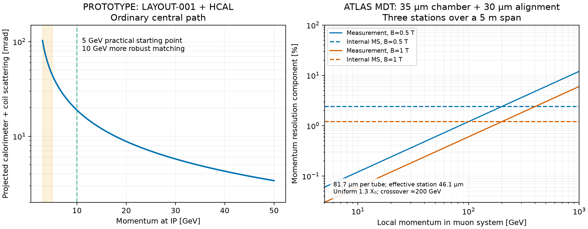

# MUON-001 — Muon reach and field estimate

2026-10-16. **DRAFT / PROTOTYPE.** Governing context: DES004 magnetic/muon
tradeoffs, DES025 tracker, DES026 solenoid and LAYOUT-001. These calculations
combine unsigned component inputs for a study; no production integration,
engineering approval or reconstruction efficiency is established.

## Working recommendation

For ordinary central barrel trajectories, use **5 GeV at the interaction point
as a candidate reconstruction working point**, and **10 GeV for more robust
tracker–muon matching**. At eta=0 these are also pT values. Neither is a
measured efficiency threshold or a momentum above which scattering disappears.
Below roughly 3–4 GeV the small remaining energy and large angular spread make
multi-station reconstruction increasingly difficult. The calculated mean-loss
exit limit of about 2.2 GeV is only a CSDA-like transport diagnostic.

An ATLAS-size **5 m station span with 0.5–1 T path-averaged transverse field** is
a useful starting benchmark for an independent muon momentum measurement.
Using the ATLAS 81.7 micrometre single-tube benchmark, a quoted 35 micrometre
fitted chamber precision and a separate 30 micrometre alignment term gives
46.1 micrometres per effective station. A 1% measurement-plus-alignment term at
local 100 GeV then needs about 0.60 T; including the illustrative internal
scattering term raises the field to 1.35 T.
An explicit target momentum and internal material distribution are necessary
to turn these benchmarks into a magnet requirement.

## Pinned component inputs and evidence

| Input | Revision / status |
| --- | --- |
| Current main / LAYOUT-001 | `5b4e5d9e563505aea17e9b792458708c3175ec4a` |
| Tracker configuration named by layout | `7c6d453fef12c3207b468c4fc99633fb393072a4` |
| 3 T solenoid, PR64 | `4e44d7c650ac0a2931f7fc1637b5b3f2dfbe4c95`, open |
| Si–W ECAL barrel, PR71 | `2776266570dda13386a16863e5b0e97432f27217`, open |
| Si–W ECAL endcaps, PR70 | `654b85a48abeb38735ad7fe0866c5d1082882df7`, open |
| Common HCAL module, PR81 | `abd95bdc64b9d7971561d659bf953e71de4e7e99`, open |
| HCAL barrel, PR84 | `0e8530d56d171f38c9d53d3c60c8b48803680bbd`, open |
| HCAL endcaps, PR85 | `c1f11013b03391a4f09d86b39dff57e6c3f58ab2`, open |

**FACT about prototype inputs:** both HCAL regions have 36 repeats of 30 mm
steel, a 12 mm common carrier and 1 mm installation clearance, followed by a
10 mm Al cover: total depth 1558 mm. This is 62.1 mm beyond the retained
LAYOUT-001 outline. Barrel apothems are 2.600–4.158 m, half-length 4.4832 m.
Endcap absolute z is 4.8832–6.4412 m, apothems 0.300–4.148 m. The study uses
these proposed depths rather than the older HCAL outline.

**FACT about recorded native ECAL rays:** at eta=0, phi=0.03, the barrel is
34.7771 X0 and 323.958 g/cm2. This includes 91.241 mm W alloy and 150.932 mm
copper; the copper cooling plates must be included. Pinned native excerpts and
hashes are in [ecal-native-rays.json](ecal-native-rays.json).

**INFERENCE:** finite intersections of the common HCAL primitives and barrel
placements give 973.541 g/cm2 on the same nominal ray, of which steel is
848.182 g/cm2. The independent analytical module implementation reproduces
four retained native module rays to less than 1e-7 mm and passes five primitive
controls. This is not a full-native regional HCAL material validation.
[hcal-material.json](hcal-material.json) retains finite intervals and hashes.

**INFERENCE:** calorimeters together give about 1297.5 g/cm2. HCAL is about
69.7 X0 using Fe/Cu/Al radiation lengths and minor-material proxies. Including
the solenoid's illustrative 1.402 X0 gives **about 106 X0**. Its energy loss
uses an explicit Al-equivalent 33.66 g/cm2 surrogate; this does not establish
the solenoid conductor/cryostat composition. Total surrogate column is
1331.16 g/cm2. The solenoid material scenario is described in
[DES026 material estimate](https://github.com/asalzburger/nodd/blob/4e44d7c650ac0a2931f7fc1637b5b3f2dfbe4c95/docs/validation/DES-026/material-estimate.md).

## Tracker momentum information

**INFERENCE, covariance-only:** pinned IdRes `d54d0e3c465cc0308becb737b04364ce5c68ce16`
was rerun with current nominal layers and binary hit resolutions. Pixel sigma
is 14.43 micrometres; short-strip tangential/second sigmas are 21.65/144.34;
the long stereo pair gives 16.33/816.55 micrometres. A complete current tracker
material map is unavailable: the explicit proxy uses 1/1.5/2% normal X0 per
pixel/short/long station, plus the Be pipe. This is a planning proxy, not a
validated baseline performance claim. Old DES006 results use different inputs.

| Total p [GeV] | sigma(pT)/pT, eta=0 | eta=1 | eta=2 |
| --- | --- | --- | --- |
| 5 | 0.511% | 0.635% | 0.736% |
| 10 | 0.530% | 0.647% | 0.756% |
| 20 | 0.584% | 0.671% | 0.792% |
| 100 | 1.440% | 1.095% | 1.010% |

pT=p/cosh(eta). At 10 GeV, halving/doubling the assumed station material changes
the central result to 0.379/0.753%. Effective straight-reference crossings,
uniform field, no inefficiencies, finite tiling or energy loss are assumed;
especially forward low-p crossings can overstate the actual lever arm.
All 72 covariance cases agree with an independent GLS calculation within half
the IdRes printed precision. The raw output column labelled B is the field-case
index (0 for the first configured 3 T case), as verified in IdRes src/main.cpp;
it is not a field strength in tesla. [IdRes evidence](idres/results.json).

## Energy loss, scattering and matching

**INFERENCE:** integrate PDG mean stopping powers at the decreasing kinetic
energy, using 400 steps in each of three slabs. Material columns are preserved;
material positions are homogenized within each system for the spread estimate.
W alloy is approximated by W for stopping, steel by Fe, minor glass/electronics
by Al and organics by polystyrene. The source rows and file hashes are retained
in [pdg-tables.json](pdg-tables.json). No energy-loss straggling, radiative tails,
field transport, pattern recognition, backgrounds or chamber inefficiency is
simulated. These mean values cannot certify reconstruction efficiency.

| IP p [GeV] | Mean loss [GeV] | Muon-system p [GeV] | Projected angle RMS [mrad] | Projected RMS at R=5 m [mm] |
| --- | --- | --- | --- | --- |
| 3 | 2.18 | 0.82 | 103 | 174 |
| 4 | 2.28 | 1.72 | 61 | 116 |
| 5 | 2.35 | 2.65 | 44 | 88 |
| 7 | 2.45 | 4.55 | 29 | 59 |
| 10 | 2.55 | 7.45 | 19 | 40 |
| 20 | 2.75 | 17.25 | 8.8 | 19 |

The projected Gaussian Highland scale is
`theta0 = 0.0136/(beta*p) sqrt(t) [1+0.038 ln(t)]`, with GeV momenta and
t in X0. For this budget, `p*theta0 ~= 0.165 GeV` at high momentum. The
calculation integrates `dt/(beta*p)^2` while applying the logarithmic correction
once to the total material. For constant stopping power and beta=1,
`theta0 ~= 0.165/sqrt(p_in*p_out)`, which explains why using only IP momentum
underestimates the low-p scattering. The tabulated values are one projection,
not a two-dimensional radial matching distance.

Calorimeter scattering dominates track extrapolation even at the proposed
working points; the independently computed central outgoing tracker angle is
about 0.40/0.22 mrad at 5/10 GeV in its bending projection. Scattering is a
covariance to fit and match through, not a universal reconstruction cut.
ATLAS also reports reduced reconstruction efficiency below 5 GeV pT because
soft muons often do not reach a second precision station
([ATLAS efficiency paper, section 7.2](https://arxiv.org/html/2012.00578v2)).
That is supporting context, not a transferable nODD efficiency curve.

The endcap ECAL native ray at eta=2 has 36.024 X0 and 335.216 g/cm2; a full
ordinary endcap HCAL steel path is approximately 1080*coth(eta) mm. A universal
pT threshold cannot follow from the central calculation. The incomplete
barrel/endcap handover near abs(eta)=0.94–1.22, fixed seams, high-eta HCAL bore,
empty FCal reservation and as-yet-absent muon stations require separate transport.

## Muon-system field

**FACT:** ATLAS measured **81.7 +/- 2.2 micrometres per MDT tube**, versus an
80 micrometre design target ([Run-2 MDT paper, abstract, sections 1 and 8](https://arxiv.org/html/1906.12226v2)).
The ATLAS benchmark also quotes **35 micrometres fitted chamber resolution** and
**30 micrometres alignment precision** ([ATLAS resolution paper, introduction](https://arxiv.org/html/1404.4562v1)).
The single-tube resolution describes each hit; the chamber coordinate already
combines tube information. It must not receive another 1/sqrt(N) improvement
or an extra single-hit error in quadrature.

**INFERENCE — adopted ATLAS-like sizing benchmark:** represent each station by
the quoted 35 micrometre chamber coordinate and an independent 30 micrometre
alignment uncertainty. This gives `sigma_station = sqrt(35^2+30^2) = 46.10`
micrometres. The independent alignment covariance is a study assumption,
not a reproduction of the full ATLAS alignment system. The measured Run-2
single-tube value and the earlier chamber/alignment benchmarks are distinct
public inputs; no newly fitted station performance is claimed.

**FACT:** original ATLAS barrel station radii are about 5/7.5/10 m
([ATLAS detector, section 6.1](https://jinst.sissa.it/LHC/ATLAS/2008_JINST_3_S08003.pdf)).
Its average barrel toroidal field is about 0.5 T
([ATLAS detector description, section 2](https://arxiv.org/pdf/1005.5254));
typical toroid integrals are 2–6 T m ([MDT paper, section 2](https://arxiv.org/html/1906.12226v2)).

**INFERENCE:** assume three equally spaced station coordinates, 5 m first-to-last
span, uniform transverse field, independent 46.10 micrometre effective station
errors including the stated alignment term, and perfect field knowledge. Then

`sigma_s = sqrt(3/2)*sigma_station = 56.46 micrometres`

`sigma_p/p|measurement = 8*sigma_s*p/(0.299792*B*L^2)`

`                       = 6.026e-5 * p[GeV]/B[T]`.

These momenta are **local after the calorimeters**, not the IP momentum.
The measurement-plus-alignment term at 10/100 GeV is 0.121/1.21% for B=0.5 T,
and 0.0603/0.603% at 1 T. To reach a 1% measurement-plus-alignment term requires
0.0603 T at 10 GeV, 0.603 T at 100 GeV or 6.03 T at 1 TeV. Increasing L
improves this term as L^-2. With the intrinsic 35 micrometre chamber term alone,
the field for 1% at local 100 GeV would be 0.458 T; this is a separate
perfect-alignment control.

**Essential distinction:** the calorimeters lie before all three muon stations.
Their random kick changes the entrance position/direction fitted by a free
standalone track; it does not directly become a standalone curvature error.
Material *within* the spectrometer does limit that fit. Upstream energy-loss
fluctuations still affect transporting its measured local momentum back to the IP.
ATLAS separates internal scattering, intrinsic resolution and energy-loss
fluctuations in its resolution model
([ATLAS resolution paper, section 10.1, equation 3](https://arxiv.org/pdf/1404.4562)).

For an illustrative uniform **1.3 X0 inside the 5 m spectrometer**, PDG's
uniform-scatter sagitta RMS `L*theta0/(4*sqrt(3))` gives
`sigma_p/p|MS = 0.01206/B[T]`, i.e. **2.41% at 0.5 T** or **1.21% at 1 T**.
The 1.3 X0 is an ATLAS-inspired benchmark
([ATLAS resolution paper, introduction](https://arxiv.org/pdf/1404.4562)), not an
nODD material inventory or a claim of uniformly distributed ATLAS material.
Combining both terms gives about 2.42% at local 10 GeV and 2.70% at local
100 GeV in 0.5 T. A 1% combined term at local 100 GeV requires about 1.35 T
under these assumptions. Concentrating the same scatterer near the middle gives a
larger sagitta variance; station supports and toroid structures need real positions.

**Both terms scale as 1/B. No field strength can change their dominance at
fixed momentum, geometry and material.** Their crossover in this illustrative
case is about **200 GeV local momentum**, independent of B. Better station
resolution moves this crossover upward; smaller internal material moves it down.

For the different observable of a bend compared directly with the upstream
calorimeter kink, `sigma_p/p|kink ~= 0.165/(0.299792*integral(B_perp dl))`
at high momentum. It would require about **5.5 T m for 10%** or **11 T m for
5%**, corresponding to 1.1/2.2 T over 5 m. This is an angular-difference sizing
yardstick, **not a requirement on a standalone three-station spectrometer**.

## Checks and reproduction



Run from the study checkout:

```sh
python3 -B tools/muon_study/study.py
MPLCONFIGDIR=/private/tmp/nodd-muon-mpl python -B tools/muon_study/study.py --plot
python3 -B tools/muon_study/hcal_material.py --repo ../nodd-hcal-barrel --output docs/validation/MUON-001/hcal-material.json
python3 -B tools/muon_study/tracker_idres.py --idres ../nodd-software-submodules/build/idres/bin/idres --idres-source ../nodd-software-submodules/software/submodules/IdRes --output docs/validation/MUON-001/idres
```

Executed: 72 IdRes covariance cases plus independent GLS agreement; five HCAL
primitive controls and four native module ray comparisons; mean-transport step
convergence, analytic high-p Highland limit and both 1/B scaling controls.
Plots were rendered using the existing Python environment (NumPy 2.5.3,
Matplotlib 3.11.2) and visually inspected. No ACTS/DD4hep/Geant4 runtime was used
for this study; changed Spack setup/lockfile fingerprints prevent relying on
previous environment qualification. Full material/field transport and fitted
reconstruction efficiency remain the next validation step.

The human-requested ATLAS MDT update regenerated the field results and both
plots with explicit hit/chamber/alignment provenance. A scaling check against
the earlier station benchmark and the unchanged calorimeter transport passed.
The superseded 180 micrometre calculation and its exact review targets are
retained in [historical-180um](historical-180um/README.md).

## Magnetic-system design handoff

**Human direction, 2026-10-16:** retain this study in a PR as the input to
subsequent magnetic-field-system design. The following are comparison inputs,
not selection or sign-off of a magnet topology.

- Keep the central tracker target at 3 T and use the proposed HCAL depth of
  1.558 m when assessing space outside the calorimeters. The 5 m first-to-last
  muon-station span is an ATLAS-size comparison; actual station positions,
  support/service clearances and forward lever arms still need a design.
- Start comparisons with 0.5–1 T path-averaged transverse bending fields and
  the 81.7 micrometre MDT hit / 35 micrometre chamber / 30 micrometre alignment
  benchmarks. The effective 46.1 micrometre station uncertainty and uniform
  internal 1.3 X0 remain explicit sizing assumptions. At local 100 GeV,
  0.60 T gives a 1% measurement-plus-alignment term; 1.35 T gives a 1% sum
  with that internal scattering model. These field values describe the
  measurement region, not peak conductor fields or a coil specification.
- Compare tracker-only, free standalone, explicitly vertex-constrained and
  combined fits separately. Resolve bending within the measured station span;
  calorimeter scattering is an upstream matching covariance. Demonstrate the
  effect of the actual vector field and material positions on the fitted q/p
  sensitivity, including barrel/endcap transition and sector dependence.
- Size coils, cold mass, vessels, returns, supports and services using the
  existing [DES004 sizing constraints](../../design/inputs/DES-004-magnet-sizing-review.md).
  Calculate the complete central field and stored energy with the appropriate
  coupled/nonlinear model; the existing 5 T complete-central-field cap and
  preferred 1–4 T central study range still apply. A path-average field alone
  cannot certify conductor margin, energy, forces or mechanical feasibility.
- Validate candidate geometry/fields and transport before drawing efficiency
  or IP-resolution conclusions. Include energy-loss fluctuations, chamber
  response/alignment, missing service material and the separate 5/10 GeV
  candidate reconstruction working points. No topology is selected here.
