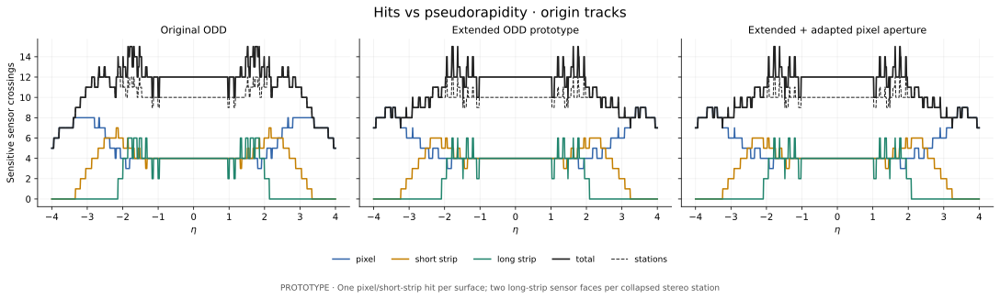
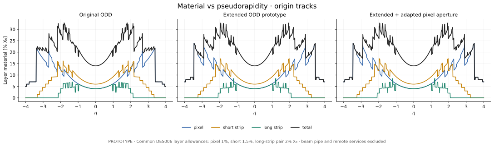
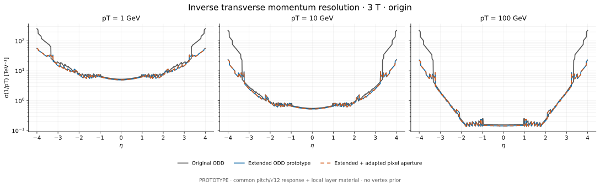

# ODD tracker comparison with IdRes

**2026-10-19 · executed PROTOTYPE · documentation evidence, no design sign-off.**

Three isolated ideal-layer layouts compare original ODD with the existing nODD
tracker prototype before/after its outer pixel disc aperture adaptation. The
user confirmed use of existing tracker prototype layouts. Full input JSON, SVGs,
raw IdRes tables and all plotted numerical values are retained here.

**These are parametric layer-model results.** The material curves use the common
DES006 local-layer allowances; they are **not a DD4hep material scan**. Original
ODD is reduced from layer envelopes, and current prototypes are reduced from
their existing JSON. Finite sensor tiling, stagger, phi tilts and stereo-face
separation are omitted. Neither hit efficiency nor reconstructed momentum
performance is established.

## Figures

- [Tracker layouts (SVG)](figures/layouts.svg)
- [Number of hits vs eta (SVG)](figures/hits-vs-eta.svg)
- [Material vs eta (SVG)](figures/material-vs-eta.svg)
- [Inverse transverse momentum resolution vs eta (SVG)](figures/momentum-resolution-vs-eta.svg)
- [Linearized relative pT uncertainty vs eta (SVG)](figures/relative-pt-vs-eta.svg)
- [Vertex stress controls (SVG)](figures/vertex-controls.svg)
- [Outer pixel disc apertures (SVG)](figures/pixel-apertures.svg)







The blue extended and orange dashed aperture curves coincide throughout the
sampled domain. Both remain drawn so that equality is visible.

## Geometry and source map

[geometries.json](geometries.json) is the complete runnable input: all signed
layers, stable IDs, dimensions in metres, normal-incidence material in percent
X0, response errors, scan settings and source hashes. Nothing needs to be
inferred from a rendered image. The two extended variants differ **only** in
the inner active-envelope radii of pixel discs 5–9 on each side.

| ID | Definition | Exact inputs and reduction |
| --- | --- | --- |
| `odd` | Original ODD, 48 ideal layers | [Extracted numerical source](odd-source.json), pinned `SRC-ODD-UPSTREAM` revision `c167363f3d4ad1540a577af99071283caf54f3a6`. Nominal barrel radii from `xml/detectors/TrackerPixels.xml`, `TrackerShortStrips.xml`, `TrackerLongStrips.xml`; continuous barrel z bounds derived from module placements and sensitive lengths using the corresponding factories. Disc `rmin/rmax` are **layer envelope bounds**, not finite sensor edges; `z_offset` is global. |
| `extended` | Existing extended tracker prototype, 52 ideal layers | Pixel reference radii and outer active z bounds from [DES013 packed layout](../DES-013-pixel-z/data/packed-200um/layout.json.gz); mixed pixel active-patch radial envelope from [DES017](../DES-017/four-single-two-quad-layout.json); selected whole-mm disc datums from [DES014 inputs](../../../tools/pixel_endcap_support/inputs.json). Short-strip barrel/endcaps from [DES020](../../../tools/short_strip_barrel/inputs-phi-tilted.json)/[DES021](../../../tools/short_strip_endcap/inputs.json); long strips from [DES022](../../../tools/long_strip_barrel/inputs.json)/[DES023](../../../tools/long_strip_endcap/inputs.json). |
| `aperture` | Same extended layout, DES018 adapted outer pixel aperture | [DES018 retained-ring schedule](../DES-018/screening.json), mixed variant. Enclose only retained active rectangles by their exact radial extrema. Keep disc positions, outer radii and every other layer unchanged. This reproduces an **ideal envelope reduction** of [DES019's selected configuration](../../../detector/config/pixel-detector-trimmed.json), not its detailed module geometry. |

The ODD study revision is intentionally frozen. It is distinct from the newer
ODD submodule pin on main. This comparison uses current prototype dimensions,
not the earlier DES006 A/B geometry: short-strip radii are 260/340/480/660 mm,
long-strip radii 840/1060 mm, and pixel disc datums
615/795/1046/1333/1645/1977/2328/2692/3070 mm. Actual packed pixel barrel
z extrema, including their small asymmetry, are retained in the JSON.

**FACT:** source dimensions and removal schedules are those in the cited files;
the source hashes and per-layer locators identify their exact bytes.
**INFERENCE:** replacing finite modules by continuous cylinders/annuli and
collapsing retained active patches to radial envelopes. This fills seams and
gaps and removes local z levels. It is an optimistic layer-coverage model, not
an exact acceptance comparison between detailed detectors. In particular,
ODD envelope annuli and prototype active radial envelopes have different source
semantics; the results do not rank finite-module coverage.
**NODD DESIGN CHOICE:** use these existing unsigned prototypes as the requested
study controls, with a common response/material scenario. All human design
approvals remain pending; no production configuration is edited.

| Positive pixel disc | z [mm] | Untrimmed inner radius [mm] | Adapted inner radius [mm] | Physical rings removed |
| --- | ---: | ---: | ---: | --- |
| 1–4 | 615, 795, 1046, 1333 | 31.141079 | 31.141079 | none |
| 5–6 | 1645, 1977 | 31.141079 | 49.094319 | 1 |
| 7 | 2328 | 31.141079 | 67.130168 | 1–2 |
| 8–9 | 2692, 3070 | 31.141079 | 85.226974 | 1–3 |

All outer envelope radii are 182.550748 mm; negative discs are mirrored.
These are mathematical active-envelope extrema, not engineering aperture
tolerances. Original DES018 proof datums and current whole-mm datums are both
preserved in `aperture_table`. Passive supports are retained in the detailed
prototype and are **not** represented as disappearing with the active aperture.

## Measurement, material and momentum conventions

The response is derived from the **current tracker prototypes**, then applied
identically to all three layouts to isolate geometry. This is not original ODD
digitization or a measured detector response.

| Technology | Prototype pitch | IdRes measurement sigma | Normal material allowance |
| --- | --- | --- | ---: |
| Pixel | 50 × 50 µm | 14.4338 µm in each coordinate | 1% X0 per surface |
| Short strip | 75 µm × 0.5 mm | 21.6506 µm fine, 144.3376 µm coarse | 1.5% X0 per surface |
| Long-strip pair | 80 µm per face; full stereo opening 0.04 rad | `s/(sqrt(2)*cos(.02))` fine and `s/(sqrt(2)*sin(.02))` coarse, with `s=80/sqrt(12)` µm: 16.3332 / 816.5510 µm | 2% X0 per collapsed pair |

**INFERENCE:** a uniform binary cell has sigma `pitch/sqrt(12)`. Two independent
scalar strip measurements at symmetric angles ±0.02 rad give the effective
diagonal two-coordinate covariance above, with no pair-separation credit.
Strip angle/pitch provenance is [DES022 model](../../../tools/long_strip_barrel/model.py)
and its input JSON. The values are response assumptions, not calibrated charge
sharing, alignment or hit pairing performance.

**NODD DESIGN CHOICE — inherited DES006 C05 fixtures:** 1/1.5/2% X0 are common
local-layer allowances. They do not use the newer component material inventories
and are not measured original ODD budgets. Composition, beam pipe, distributed
services and detailed passive supports are excluded. A future full-material
comparison must run the separate detailed DD4hep models. These curves alone
cannot quantify mass or service savings from ring removal.

For a straight ray, barrel incidence multiplies the normal allowance by
`cosh(eta)`; disc incidence multiplies it by `1/abs(tanh(eta))`. Only crossed
layers contribute. The independent Python sum agrees with IdRes `.X0` within
half its last printed decimal. IdRes reports material only for origin tracks;
the retained independent profiles also cover both shifted vertices.

The main hit plot counts one sensitive crossing for pixels and short strips,
and two sensor faces per long-strip stereo pair. The dashed total counts
measurement **stations**, grouping a long-strip pair once. Input technology
metadata supplies the split. IdRes classifies by its second-coordinate sigma:
the short-strip sigma here is below its 200 µm threshold, so raw `nPixHits`
combines pixels and short strips. For eta=0 the physical split is 4 pixel +
4 short-strip + 4 long-strip face hits = **12 sensor hits, 10 stations**;
IdRes reports `nPixHits=8`, `nStripHits=4`. Raw fields remain available unchanged.

IdRes fits a linearized five-parameter covariance with thin-layer multiple
scattering and no vertex prior, using uniform axial fields and straight
intersections. It does not transport a curved track through finite modules,
model energy loss, or perform pattern recognition. **One field per process**
avoids the previously recorded shared-field-table defect.

The principal momentum observable is **sigma(1/pT)**. Raw IdRes `Sig_invPt` is
TeV⁻¹; dividing by 1000 gives GeV⁻¹. The additional relative plot uses the
local linearization `sigma(pT)/pT ≈ pT*sigma(1/pT)`. Values ≥100% are retained
as explicit invalidity diagnostics, not called Gaussian relative momentum
resolutions. The scalar pT result does not include the covariance needed for
the full momentum magnitude `p=pT*cosh(eta)`. Raw d0/z0 errors are µm, angular
errors radians, and lever arms metres.

## Executed results

The scan covers **eta −4…+4 in 0.01 steps**, pT **1/10/100 GeV**, vertices
**−150/0/+150 mm**, and separate **2/3/4 T** runs. The closed eta endpoint is a
boundary diagnostic for the requested open |eta|<4 target. Vertex probes are
stress fixtures, not a luminous-region probability distribution.

- 9 nominal runs × 7,209 samples = **64,881 finite fit rows**, with no missing,
  duplicate or failed samples.
- **7,209 independent hit/material profiles** cover all geometries and vertices.
- 6 near-zero-material control runs (scales 1e−6 and 1e−8, 3 T, pT=100 GeV,
  eta=0/2/4, all three vertices) give **54 comparisons** with the independent
  SVD curvature covariance. All agree within half the printed
  `1e−6 GeV⁻¹` unit after matching IdRes's 0.3 field conversion.
- Independent hit counts agree with every nominal/control `.hits` row;
  origin material sums agree with every `.X0` row at printed precision.
- The extended/aperture hit-ID lists, local material and fit results coincide
  at every scanned sample. The removed inner envelope is outside these rays.
  This confirms the reduced model's sampled invariance; it does not replace
  DES018's finite-patch/finite-curvature validation.

Representative **origin, 3 T, pT=100 GeV** results:

| Layout | eta | Sensor hits / stations | Local material [% X0] | sigma(1/pT) [TeV⁻¹] |
| --- | ---: | ---: | ---: | ---: |
| Original ODD | 0 | 12 / 10 | 14.0000 | 0.157 |
| Extended / adapted aperture | 0 | 12 / 10 | 14.0000 | 0.144 |
| Original ODD | 2 | 12 / 11 | 27.8217 | 0.234 |
| Extended / adapted aperture | 2 | 11 / 10 | 26.2657 | 0.214 |
| Original ODD | 3 | 11 / 11 | 21.6248 | 1.993 |
| Extended / adapted aperture | 3 | 8 / 8 | 18.1074 | 1.888 |
| Original ODD | 4 | 5 / 5 | 5.0034 | 223.919 |
| Extended / adapted aperture | 4 | 7 / 7 | 7.0047 | 22.959 |

At eta=4 the extension reduces sigma(1/pT) by about 9.75× in this scenario.
However, at 100 GeV even the extended model has `pT*sigma(1/pT)=2.296`, so
its fractional-pT linearization is already outside the small-error regime.
More forward hits are not a claim of satisfactory momentum performance.

## Retained files and data dictionary

| File | Contents |
| --- | --- |
| [geometries.json](geometries.json) | Fully expanded 3-layout input, all dimensions/errors/material, scan and source SHA-256 map |
| [odd-source.json](odd-source.json) | Extracted original ODD numerical layer table, exact upstream revision, eight source-file hashes and per-layer XML locators; no upstream source vendored |
| [profiles.csv.gz](profiles.csv.gz), [profiles.json.gz](profiles.json.gz) | 7,209 matched rows: `geometry`, signed `eta`, `vertex_z_m`, technology hit counts, station/sensor totals, raw IdRes classification expectations, per-technology and total percent X0, independent lever arm [m], complete crossed `layer_ids` |
| [resolutions.csv.gz](resolutions.csv.gz), [resolutions.json.gz](resolutions.json.gz) | All 64,881 fit rows: geometry/field/vertex/pT/eta keys; sigma(1/pT) in both GeV⁻¹ and TeV⁻¹; linearized absolute sigma(pT) [GeV] and relative [%] with a `<1` validity flag; sigma(d0/z0) [µm], sigma(phi) [rad], sigma(cot theta), printed lever arm [m] |
| [raw/](raw/) | Every exact `.geom` input and execution `.log`; losslessly compressed original `.res`, `.hits`, `.X0` tables, including all controls |
| [controls.json](controls.json) | All 54 independent measurement-only covariance checks with predictions, observations, differences and print-precision decisions |
| [provenance.json](provenance.json) | Source/project/binary/producer hashes, actual versions/build and run commands, per-run expected/observed denominators, raw artifact hashes and limitations |
| [build.log](build.log) | Actual disposable IdRes compilation log; project path replaced by `<nodd-root>`; compiler warnings retained |
| [figures/manifest.json](figures/manifest.json) | Plot input/producer/SVG hashes and actual Matplotlib version |

`geometry` is the join key `odd`, `extended`, or `aperture`. Join resolutions
to profiles on `(geometry, eta, vertex_z_m)`; profiles are pT/field independent
because crossings are straight in this IdRes model. JSON has numeric/boolean
types; CSV uses header names with unit suffixes and a JSON-encoded `layer_ids`
array. CSV/JSON values are checked for exact agreement. Compression is gzip,
with zero timestamps for deterministic files.

Example: make new plots without running IdRes:

```python
import pandas as pd
hits = pd.read_csv("docs/validation/ODD-idres/profiles.csv.gz")
fits = pd.read_csv("docs/validation/ODD-idres/resolutions.csv.gz")
origin_100gev = fits.query("field_T == 3 and vertex_z_m == 0 and pt_GeV == 100")
ax = origin_100gev.pivot(index="eta", columns="geometry",
                         values="sigma_inverse_pt_TeV_inverse").plot(logy=True)
ax.set_ylabel("sigma(1/pT) [TeV^-1]")
```

## Reproduction

From the nODD root, create a Python environment with the existing pinned plotting
requirements. The retained data and SVG regeneration need **no IdRes checkout,
DD4hep, ACTS, detector assets or Spack environment**.

```sh
python3 -m venv build/odd-idres-venv
build/odd-idres-venv/bin/python -m pip install -r tools/tracker_layout/requirements-idres-plotting.txt
python3 -B tools/odd_idres/verify.py
MPLCONFIGDIR=build/odd-idres-mpl build/odd-idres-venv/bin/python -B tools/odd_idres/plot.py
```

`verify.py` checks source/producer/raw/SVG hashes, complete sample grids,
CSV/JSON equality and control outcomes. SVG byte identity assumes the recorded
Matplotlib/font environment; numeric data identity is the scientific comparison.

To rebuild the numerical study, use the externally supplied IdRes source at
`d54d0e3c465cc0308becb737b04364ce5c68ce16`. Its public access and redistribution
licence remain unresolved; see the [existing intake audit](../../../tools/tracker_layout/IDRES.md)
and `SRC-IDRES-LOCAL-2026` in the [source catalogue](../../../reference/manifest.yaml).
The build uses the installed GSL library; it copies source into a disposable
build directory and leaves the supplied checkout unchanged. No upstream source
or detector example is redistributed in this PR.

```sh
# Set this to the authorized, pinned local IdRes source checkout.
idres_source=/absolute/path/to/idres
python3 -B tools/odd_idres/prepare.py
python3 -B software/env/build_idres.py --source "$idres_source" --build build/odd-idres-engine
build/odd-idres-venv/bin/python -B tools/odd_idres/run.py \
  --source "$idres_source" --binary build/odd-idres-engine/bin/idres
MPLCONFIGDIR=build/odd-idres-mpl build/odd-idres-venv/bin/python -B tools/odd_idres/plot.py
python3 -B -m unittest discover -s tools/odd_idres -p 'test_*.py' -v
python3 -B tools/odd_idres/verify.py
```

The original ODD numerical extraction is already committed. To independently
refresh it, obtain the pinned public ODD study checkout and run:

```sh
python3 -B tools/odd_idres/prepare.py --extract-odd /absolute/path/to/pinned-OpenDataDetector
```

The extractor rejects a different revision or changed relevant source files.
`prepare.py` regenerates the same expanded JSON from retained source inputs.
The runner rejects changed IdRes source/build inputs, incomplete or duplicate
grids, nonfinite values, failed inversions, hit/material disagreements and failed
covariance controls. The 3 fields run in separate processes. The public CI
verifies committed results and unit controls without requiring IdRes access.

Fresh runtime/compiler versions and source execution SHA go into regenerated
provenance; compare numeric data separately from environment metadata. All
existing design states, accepted evidence and production configurations remain
unchanged. A physical material/reconstruction comparison requires further work.
