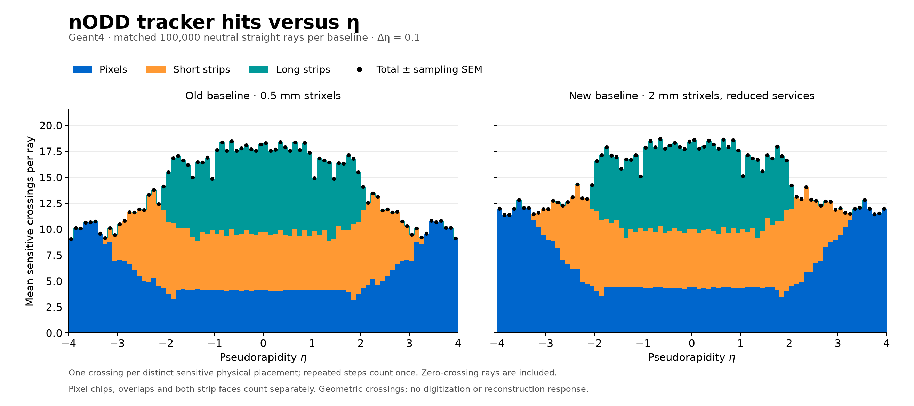
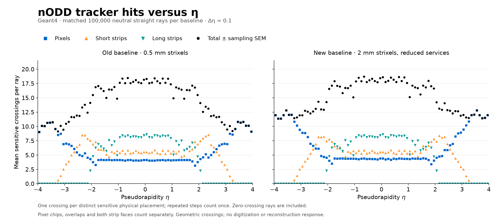

# Old/current tracker hits versus pseudorapidity

**PROTOTYPE characterization, 2026-11-03.** The two requested options use
unrooted and the fixed PR112 component colors. Each figure places the old and
new baselines side by side on common axes.

[Stacked PDF](figures/hits-stacked.pdf) · [Marker PDF](figures/hits-markers.pdf).
SVGs are retained beside the PNGs. Black markers are the sum of the three
components from the same rays. They are not a separate ACTS validation sample.

## Observable and samples

A plotted hit is one **distinct DD4hep-sensitive physical placement crossed
with positive path length per generated neutral straight Geant4 ray**. Pixel
chips, overlaps and both strip faces count separately. Multiple steps in the
same placement count once. Passive material, ASICs, guards, the beam pipe and
zero-length steps add no hits. These are geometric sensitive-volume crossings;
there is no energy-deposit, digitization, efficiency or reconstruction response.

Both baselines were freshly run with **1,000 events × 100 geantinos**, seed228,
uniform η in [−4,4], full phi, origin and one thread. Their event/track IDs,
vertices, η/phi and three direction components match exactly for all100,000
rays. All generated rays enter every component mean, including zeros. The
80 signed η bins have width0.1; neither baseline is reweighted. Markers show
population sampling SEM, M2/N². Total SEM is computed from per-ray totals and
includes component covariance; the complete binwise covariance matrices are
retained in [profiles.json](profiles.json).

| Mean crossings per ray | Old | Current | Paired current − old |
| --- | ---: | ---: | ---: |
| Pixels | 5.80622 | 6.64029 | +0.83407 |
| Short strips | 4.54608 | 4.57307 | +0.02699 |
| Long strips | 3.72043 | 3.72043 | 0 |
| Total | **14.07273** | **14.93379** | **+0.86106** |

The total paired finite-ray SEM is0.00424. Long-strip counts are identical for
every paired ray. This describes whole-baseline geometric coverage: pixel
layout and short-strip active coverage also change. It does not attribute an
increase to strixel pitch or reduced service material, or establish tracking
performance.

The old geometry is source `530080cfe16c7513228bf60238b99d4b9938538a`, with
compact SHA `a27b807c…`, exactly matching the previous0.5mm material reference's
explicit compact/factory hashes. Current geometry is
`62f6056395e0dfee0c7985cf24e88dc9919c4e2d` (PR110/DES043 and PR112), compact
`0d340945…`. These new hit runs have an explicit shared seed; they do not
recover the unknown original old material recording's seed or provenance.
The supplied old/PR109 material files and previous material evidence are unchanged.

## Native counting and checks

Material recordings do not store sensor identities, and rounded material
positions cannot always distinguish same-density sensitive/guard boundaries.
The live observer therefore uses the **actual Geant4 pre-step touchable** and
its complete physical path, including every parent/copy number. No rounded
position lookup or material-budget-to-hit conversion is used. A unique global
path index identifies every sensitive physical placement; sets deduplicate
placements separately for each ray, and event state is cleared each time.

DD4hep-sensitive logical names are unique and all match Geant4 logical volumes
with the same material name and density (unchanged5×10⁻⁶ relative tolerance).
Full native hierarchy counts agree: **45,646 old and46,682 current** sensitive
placements, with no duplicate paths or unmatched sensitive logical names.
The actual Geant4 placement supplies the hit identity, including near boundaries;
the prior material analysis's149 passive graphite/TGeo discrepancies require
no hit-identity inference and add no hits.

The observer is appended through the existing ACTS `SteppingActionList`, with
the original native `MaterialSteppingAction` forwarded first. It consumes no
random numbers and does not change track state or geometry. The
[300-ray noninterference control](observer-noninterference.json) matches all32
material-recording branches exactly against the previous current scan, including
every saved step and coordinate. Both full hit runs use the unchanged persistent
MaterialPhysicsList handle: one run/event-loop initialization,1,000 processed
events, one normal termination, no abort. The full runs omit the bulky ROOT writer.

All100,000 rays per baseline have unique expected event/track IDs, origin
vertices, finite coordinates and nonnegative integer counts. Components sum
exactly to total for every ray. Native totals are1,407,273 old and1,493,379
current hits. In these samples, every positive sensitive step was already in a
distinct placement: zero split steps or zero-length sensitive steps were observed.
The deduplication logic remains explicit; a split-step/touchable mock fixture
was not independently executed.

An independent vectorized ray–oriented-box calculation using native ACTS
sensor centers/axes/bounds/**thickness** agrees in every component for256 rays
from each baseline. [Old control](old-box-control.json) and
[current control](current-box-control.json) retain input/source hashes. This
checks a bounded sample, not every ray or every boundary configuration.
Zero-thickness sensor midplanes differ for12 old and13 current control rays:
finite-volume edge grazes need not reach the sensor midplane. Consequently these
results must not be relabeled as ACTS measurement-plane counts.

The pure tests cover zero-inclusive normalization, component covariance,
incomplete/noninteger inputs and finite-box placement/edge cases. Replotting
uses committed summaries; full per-ray accounting and native controls require
the local or regenerated CSV/ROOT/geometry payloads.

## Provenance, reproduction and scope

Governing records: [DES-025](../../design/DES-025-tracker-dd4hep-gen3.md),
[DES-043](../../design/DES-043-short-strip-service-redesign.md),
[ADR-003](../../decisions/ADR-003-validation-and-artifact-policy.md).
[Provenance](provenance.json) identifies exact source/configuration/input hashes,
runtime and native results. The [recipe](../../../software/analysis/hit_baseline_comparison/README.md)
records generation, observer control, reduction and rendering commands.

Full CSVs, smoke ROOT, native geometry and bulky logs remain ignored under
`build/hit-comparison`; no event-level reference payload is committed.
The ACTS Spack preflight reports changed setup/lock fingerprints and unverified
full-source registry records; actual DD4hep/Geant4 imports, source headers,
geometry construction and these complete native runs were verified separately.
No shared dependency install, geometry change or human acceptance occurred.
