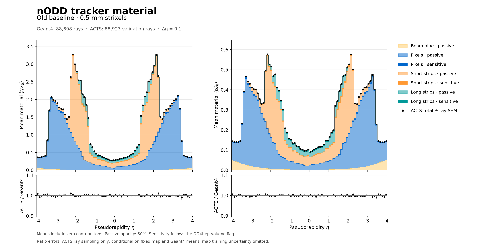
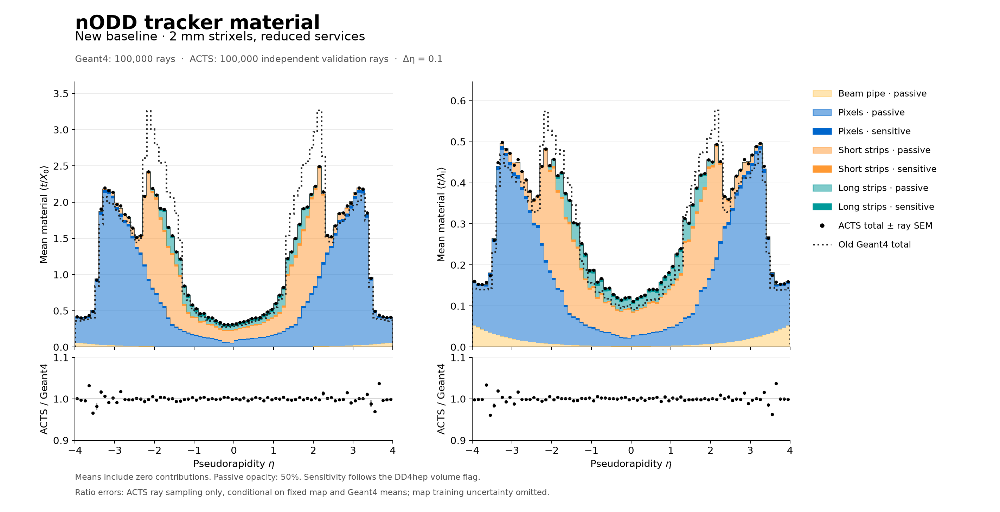

# Current tracker material map and baseline comparison

**PROTOTYPE / characterization, 2026-11-03.** Current geometry source:
`62f6056395e0dfee0c7985cf24e88dc9919c4e2d` (PR110 reduced-service DES043
implementation and PR112 palette). This characterizes the recorded Geant4
inventory and its ACTS portal representation; it grants no engineering or
tracking-performance acceptance. Governing records are
[DES-025](../../design/DES-025-tracker-dd4hep-gen3.md),
[DES-043](../../design/DES-043-short-strip-service-redesign.md) and
[ADR-003](../../decisions/ADR-003-validation-and-artifact-policy.md).

## Delivered comparison

Each figure shows radiation and interaction lengths. The Geant4 stack uses
the fixed beam-pipe, pixel, short-strip and long-strip colors; sensitive material
is opaque and passive material has alpha 0.5. Sensitivity follows the DD4hep
volume flag, so ASIC/guard silicon remains passive. The beam pipe has no
sensitive component. Black markers are the ACTS validation total,
with ACTS/total-Geant4 below. On the current figure, the dotted curve shows the
old Geant4 total. The user requested removal of the old short-strip reference
from the final figure.

The common support is **−4 < η < 4, signed bins of width 0.1**. The old scan and
old ACTS validation originally cover ±4.5; selecting whole aligned bins retains
88,698 Geant4 and 88,923 ACTS rays. The fresh current samples each have 100,000
rays over ±4. Each sample retains its own per-bin denominator, with every ray
contributing to every component, including zero contributions. No interpolation
or rescaling of the component means is applied. These η profiles integrate over
full phi; no old full-range phi profile is relabeled as a common-range result.

| Equal-weight average of 80 η-bin means | Old | Current | Current change |
| --- | ---: | ---: | ---: |
| Total t/X₀ | 1.301771 | 1.208087 | −7.20% |
| Short strips t/X₀ | 0.503422 | 0.364221 | −27.65% |
| Pixels t/X₀ | 0.710918 | 0.756355 | +6.39% |
| Total t/λI | 0.289075 | 0.297442 | +2.89% |
| Short strips t/λI | 0.096453 | 0.091965 | −4.65% |

These are descriptive whole-baseline differences. The old and current geometry
also differ in pixel layout. The total interaction-length budget increases;
the current baseline does not reduce every material observable. Beam-pipe and
long-strip differences include finite sampling fluctuations.

The supplied 2 mm file is a useful intermediate control, **not the reduced-service
baseline**: its producer metrics identify PR109 compact `8e59eedd…`, before
PR110. Its generated ray branches are exactly equal to all 100,000 fresh current
rays. The [paired control](pr109-control.json) gives a mean total t/X₀ change
1.349915→1.209445 (−10.41%) and t/λI 0.302216→0.297636 (−1.52%). Absolute
differences have paired finite-ray SEM 0.001112 and 0.0001452 respectively.
This isolates the **short-strip redesign package**—modules, cooling/services
and added endcap sensors. It does not isolate cable-only or segmentation-only
savings. Both supplied ROOT files were preserved.

## Mapping and independent validation

Fresh native Gen3 export contains 46,682 sensor planes, 120 volumes and 54 sensor
groups. The existing layer/extra-carrier policy selects 67 native portals and
8,650 material bins, with one phi bin and unchanged z/r bin counts. IDs come
from this export; no old-map IDs are transplanted. Before mapping, 46,683 native
surface slabs (sensors plus pipe) are cleared; there are no native volume slabs
to clear. This avoids double counting.

Training used 1,000 events × 100 neutral geantinos, seed 228, uniform η±4, full phi,
origin vertex and one thread. The persistent MaterialPhysicsList adapter reports
one run/event-loop initialization, 1,000 processed events, one normal termination,
finished=true and aborted=false. The 200.22 s recording reused the unchanged
verified adapter; its steering revision remains distinct from the geometry
revision. [Recording identity and lifecycle](recording-report.json) retain the
actual compact, materials, all five factories, native module and ROOT hashes.

All 100,000 training rays and 18,319,438 **nonzero** material slabs map with zero
unmapped slabs. Global and every-ray mapped-plus-unmapped X₀/λI residuals are
exactly zero at native reader precision. The raw recording contains an additional
185 exact zero-length slabs on 161 rays. The pinned ACTS ROOT reader explicitly
skips them; every count difference equals that ray's exact-zero count. No nonzero
slab is omitted. The historical raw-step audit was retained as a failed control;
the current workflow checks the actual reader boundary explicitly.

Serialization and native reload check all 67 material keys, resolved grid shapes
and 8,650 bins. There are 2,003 zero-thickness bins; a zero slab alone does not
distinguish unsampled from sampled-empty bins. Independent validation used
1,000 events × 100 ACTS straight rays, seed 43, uniform η±4, full phi, origin and
one thread. It recorded 1,553,386 portal interactions, with no empty rays and no
nonzero starting vertices. Mean totals are 1.209509 X₀ and 0.297688 λI versus
Geant4 training 1.209445 and 0.297636. Across 80 η bins, the largest absolute
relative mean differences are 3.70% X₀ and 3.87% λI; these are descriptive values,
without an accuracy acceptance threshold.

## Checks and limitations

The native profiles were independently reduced from all 100,000 categorized
rays. Counts, means, ROOT M2/N² variances, zero-inclusive normalization and
per-ray component-total closure pass. Total variance comes from per-ray totals,
preserving component covariance. Component variances are not added as if
independent. Maximum per-ray absolute closure residuals are 4.8422×10⁻⁶ X₀
and 1.0248×10⁻⁶ λI from the float recording. The
[current profiles](current-geant4.json) retain the checks.

The ordinary strict TGeo classifier initially found 149 density disagreements
at short-strip endcap graphite pickup/titanium CSG interfaces, with no unassigned
steps. An explicit native Geant4 audit queried seven strict interior points
per failed step: all 1,043 queries identify Graphite 2.21 g/cm³, matching the
recorded density/X₀/λI within the unchanged relative 5×10⁻⁶ tolerance. Each
Geant4 logical volume maps by a unique name to a matching passive DD4hep volume.
The hash-bound audit therefore resolves all 149 assignments; the final full
classification has zero unresolved density mismatches and zero unassigned steps.
The [audit summary](geant4-audit-summary.json) retains the failed control and
identities. The disputed recorded budget averages 1.4696×10⁻⁶ X₀ per ray;
this is a detected contribution, not an exhaustive geometry uncertainty bound.
**The Geant4/TGeo CSG disagreement remains unresolved as a geometry-conversion
issue.** No physical material, navigator tolerance or recording budget changed.

The float32 sensitivity-boundary rescue runs after a material mismatch, so
same-density active/guard ambiguities can escape it. Its reported ambiguity
budget is **detected-only**, not an exhaustive allocation bound. The original
old recording has no embedded source revision or seed; seed separation from the
old validation sample therefore cannot be established. Its exact SHA matches
the prior reference, whose explicit compact/factories and density checks are
retained. That association does not recover missing original run provenance.

The ratio is **ACTS bin-mean total / Geant4 bin-mean total**. Unsupported or
nonpositive denominators are masked. Error bars show ACTS finite-ray sampling
SEM divided by the fixed Geant4 mean, conditional on a fixed map. They omit
map-training uncertainty, Geant4 denominator uncertainty and map-induced
numerator/denominator covariance. Independent validation rays do not make the
trained map independent of its training data; the bars support no significance
or accuracy claim.

One phi bin averages away azimuthal structure. Integrated η-total agreement
does not validate material ordering/locality or tracking performance. The
[current locality diagnostic](locality.json) finds 48.16% of mapped X₀ and 31.99%
of λI assigned more than 50 mm along the ray from the original midpoint;
the maximum displacement is 413.23 mm. These diagnostic cuts have no acceptance
criteria. No magnetic transport, interaction response or tracking fit is tested.

## Artifacts and reproduction

- [Native map, lossless gzip](material_map.json.gz): 8,650 averaged material bins,
  not event data. Decompressed SHA-256
  `e61f5a99fcb062566793eeff2bf9c1807f19e4195a1634e36e5f1dc1e7ed9bd1`.
- [Selected carriers](selection.json), [preparation](preparation-report.json),
  [mapping checks](current-mapping-report.json) and
  [independent validation](current-validation-report.json).
- [Binwise comparison](comparison.json), [ACTS profiles](current-acts.json),
  [provenance](provenance.json), [classification inputs](classification-provenance.json)
  and [plot/library identities](figures/plot-report.json).
- [Old PDF](figures/material-old.pdf), [current PDF](figures/material-current.pdf)
  and editable vector SVGs beside the PNGs.
- [Exact build/record/audit/reduce/plot recipe](../../../software/analysis/material_baseline_comparison/README.md)
  and [mapping recipe](../../../software/analysis/material_baseline_comparison/README_mapping.md).

The uncompressed usable map and full recordings remain in local ignored storage;
ROOT samples, generated compact/native geometry and bulky logs are excluded from
Git. Replotting uses the retained binwise data and unrooted 0.1.0rc1. Native
conservation/reload checks require the local or regenerated payloads. Node
preflight flagged stale setup/lock/source-registry records; actual imports,
factory builds, required datasets, recording, mapping and validation were checked
directly without changing shared dependencies.
